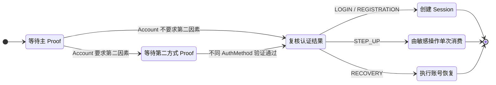
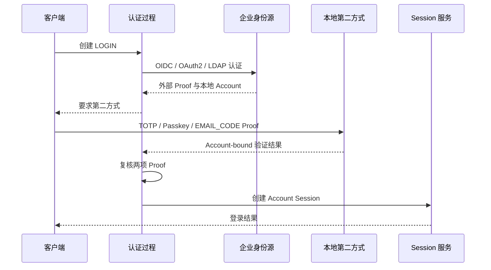
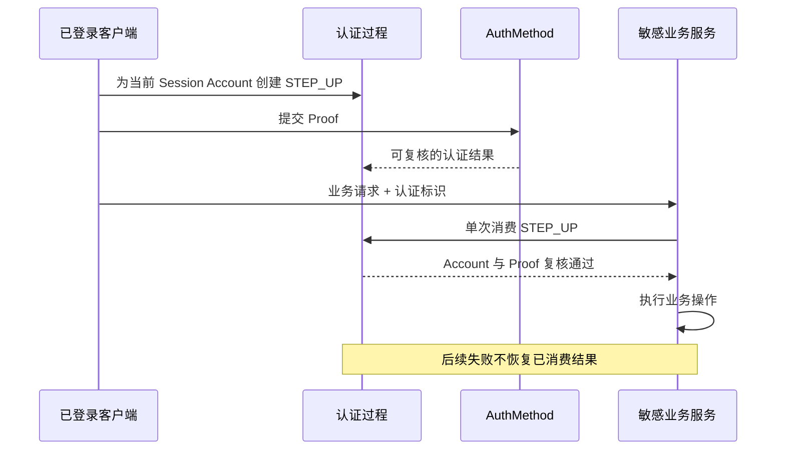

# 认证过程与 MFA

认证过程验证调用方是否控制某个 Account，并根据用途创建 Session、绑定认证方式、完成敏感操作验证或恢复账号。MFA 要求两个或更多相互独立的认证因素；当前认证过程使用不同 AuthMethod 表达验证步骤，但认证策略仍要判断这些方式是否依赖同一个控制来源。认证结果不会授予角色、租户成员资格或资源访问权限。

## 认证对象

| 对象 | 作用 |
| --- | --- |
| `AccountIdentifier` | 在 GLOBAL 或 TENANT 作用域中查找 Account |
| `Credential` | 保存 Account 的密码摘要、TOTP 密钥或 Passkey 公钥等长期认证材料 |
| `ExternalIdentity` | 把外部身份源中的 subject 关联到本地 Account |
| `AuthMethod
` | 声明认证方式、接受的 Proof 类型和支持的认证用途 |
| Proof | 当前请求提交的密码、验证码、WebAuthn 响应或外部身份验证结果 |
| Authentication Process | 保存用途、作用域、浏览器绑定、当前步骤和已经验证的 Proof 版本 |
| `Session` | 认证完成后固定 Subject 和 Account 的登录状态 |
| STEP_UP | 已登录账号执行敏感操作前使用的一次性补充认证 |

Credential 与 Proof 不相同。Credential 是可以变更、停用和版本化的长期记录；Proof 只在当前认证请求中出现。邮件验证码和恢复码不会为了复用公共表而伪装成 Credential。

这些对象对应当前 `AuthMethod`、`CredentialScheme`、认证过程服务和 IAM Credential 表。强制入口与失败处理由认证规则说明，当前路由和类型由参考手册说明。

## 因素与认证方式

| 因素来源 | 当前认证方式中的例子 | 判断限制 |
| --- | --- | --- |
| 用户知道的信息 | PASSWORD | 密码和恢复码都由用户保存，但恢复码只用于 RECOVERY，不作为第二因素 |
| 用户控制的设备或密钥 | TOTP、PASSKEY | TOTP 密钥、Passkey 私钥或安全密钥必须独立于主认证材料 |
| 用户控制的通信账号 | EMAIL_CODE | 证明当前可以读取已验证邮箱，不证明邮箱账号本身使用了 MFA |
| 认证器完成的本地用户验证 | PASSKEY | 服务端只验证 WebAuthn 的用户验证结果，不判断设备使用的是 PIN 还是生物识别 |
| 外部身份源返回的认证结果 | OIDC、OAUTH2、LDAP | 本地系统不能只根据协议名称推断上游使用了哪些因素 |

认证方式不等于因素分类。两个不同 `AuthMethodType` 可能依赖同一个邮箱、设备或上游账号，只能称为两步认证；确认控制来源相互独立后，才能作为 MFA 策略。

## 认证用途

`AuthMethod` 按实际实现声明可以参与的用途：

| 用途 | 完成结果 |
| --- | --- |
| `LOGIN` | 为已存在 Account 创建登录 Session |
| `REGISTRATION` | 创建或确定 Subject、Account 和初始认证关系 |
| `LINKING` | 把新的认证方式或外部身份关联到当前 Session Account |
| `STEP_UP` | 为当前 Account 的敏感操作提供单次认证结果 |
| `RECOVERY` | 使用恢复材料重新取得 Account 控制权 |

用途和协议分开后，同一种方式可以承担多个任务。例如 Passkey 可以用于 LOGIN 和 STEP_UP，OIDC 可以用于 LOGIN、REGISTRATION 和 LINKING，恢复码只用于 RECOVERY。

## 当前认证方式

| 方式 | 当前用途 | 保存位置 |
| --- | --- | --- |
| `PASSWORD` | LOGIN、STEP_UP | Account 的 PASSWORD Credential |
| `EMAIL_CODE` | STEP_UP、登录第二因素 | Redis 中的短期邮件 Challenge |
| `TOTP` | STEP_UP、登录第二因素 | Account 的 TOTP Credential |
| `PASSKEY` | LOGIN、STEP_UP、登录第二因素 | Account 的一个或多个 PASSKEY Credential |
| `RECOVERY_CODE` | RECOVERY | Account 当前恢复码集合的 Argon2id 摘要 |
| `OIDC` | LOGIN、REGISTRATION、LINKING | Provider 授权记录和 ExternalIdentity |
| `OAUTH2` | LOGIN、REGISTRATION、LINKING | Provider 授权记录和 ExternalIdentity |
| `LDAP` | LOGIN、REGISTRATION、LINKING | LDAP bind 结果和 ExternalIdentity |

应用只公布 Spring 容器中实际注册的方式。邮件、Passkey 或身份源被配置关闭时，对应方式不会出现在认证方式目录中。

`AuthMethodCatalog` 聚合这些实际注册的 `AuthMethod`。认证过程只保存用途、步骤、浏览器绑定和已经验证的 Proof 版本，不直接解释 Identifier、读取具体 Credential 或执行身份源协议。`PasswordAuthMethod`、`PasskeyAuthMethod` 和各身份源方式分别在自己的边界内完成账号定位和协议验证。

## 默认认证过程

当前默认过程要求一个主 Proof，并在 Account 要求第二因素时再要求一个不同认证方式的 Proof。这个结构可以承载 MFA，但默认实现只检查方式不同，不负责证明因素来源一定独立：

匿名 LOGIN、REGISTRATION 和 RECOVERY 使用 `scopeType` 选择 GLOBAL 或 TENANT。TENANT 请求提交业务可见的 `tenantCode`；服务端确认租户可用后取得 tenantId，客户端不查询、不保存也不提交内部 `scopeId`。

STEP_UP 和 LINKING 从当前 Session 固定 Subject、Account 和作用域。请求参数不能把验证目标切换到另一个 Account。完成认证前，服务端重新读取当前认证材料并比较 Proof 对应的主键和版本，避免已经替换或停用的 Credential 创建 Session。

当前第二因素可用性由已启用的认证方式分别判断：邮件验证码需要已验证 EMAIL Contact，TOTP 需要 ACTIVE TOTP Credential，Passkey 需要 ACTIVE PASSKEY Credential。启用 Account 第二因子要求时会签发恢复码，并结束该 Account 的全部旧 Session。

## 本地 Credential

`CredentialScheme<C, P>` 负责绑定、替换和验证具体 Credential。公共 Credential 表只保存类型、状态和版本，协议实现只读取自己的子表。

PASSWORD 保存 Argon2id 摘要。TOTP 密钥使用带 Credential 主键用途编码的 AES-256-GCM keyring 加密；验证码接受当前时间前后一个 30 秒时间步，数据库只允许 `iam_totp.last_accepted_step` 严格增加，因此同一时间步在多个节点并发提交时只有一个请求成功。

TOTP enrollment 在 Redis 中短期保存加密密钥、Account 归属和浏览器绑定。二维码只在当前用户读取 PNG 时解密生成；首次验证码通过后 enrollment 单次消费并创建或替换 ACTIVE Credential。TOTP Credential 变化后结束该 Account 的全部登录 Session。

Passkey 使用 Yubico WebAuthn Server 校验 RP ID、精确 Origin、challenge、用户验证、签名计数和认证器状态。浏览器使用 WebAuthn JSON 客户端转换 options 和认证器响应，不在页面手工转换二进制字段。

Passkey registration 和 assertion 使用不同的短期资源并分别单次消费。首次 registration 只读取已有 user handle 或生成 32 字节候选值；激活时在同一事务写入 `iam_passkey_user_handle`、公共 Credential 和 `iam_passkey`。并发 registration 已经为 Account 选定不同 handle 时，后到的 ceremony 返回冲突。

账号安全查询只返回 Passkey 展示名称、备份资格、备份状态、最近使用时间和公共 Credential 版本，不返回 WebAuthn credential ID、COSE 公钥、AAGUID 或 user handle。查询当前 Subject 的全部 Account 时批量读取 Passkey 展示资料，不按 Account 逐条查询。

## 外部身份源

IdentityProvider 主记录保存 GLOBAL/TENANT 作用域、不可变 code、协议类型、JIT 注册策略、邮箱自动关联开关和状态。OIDC、OAuth2、LDAP 配置分别写入协议子表。Provider 创建后默认停用，协议配置未完成时不能启用。

OIDC 和标准 OAuth2 使用 Authorization Code 与 PKCE。state、nonce、verifier、授权码和 Token 只保存在短期请求或 Redis 授权记录中。OAuth2 使用管理员配置的只读 JSONPath，从主 Profile 和可选辅助 Profile 读取 subject、displayName、email、emailVerified 和 avatar。

LDAP 使用服务账号搜索用户 DN，再使用用户提交的密码执行 bind；支持 StartTLS 和 LDAPS，本地不保存目录用户密码。

外部 Proof 可以推进 LOGIN、REGISTRATION 或 LINKING。已有 ExternalIdentity 时固定其 Account；未关联 subject 时按 Provider 注册策略创建同作用域 Subject、Account 和 DEFAULT Principal，TENANT Provider 同时创建 Membership 与 TENANT Principal。

邮箱自动关联默认关闭，开启后也只接受同作用域唯一 ACTIVE Account。解除关联前单次消费 STEP_UP，并拒绝删除 Account 的最后一个可登录方式。本项目只作为 OIDC、OAuth2 和 LDAP 上游的客户端，不向下游应用签发 OAuth2 或 OIDC Token。

## 第二因素与恢复

第二因子要求属于 Account。启用前使用当前 Session Account 完成 STEP_UP，目标 Account 必须属于同一 Subject。启用、重新签发恢复码和关闭都使用 Account 版本执行乐观写入，并结束目标 Account 的全部旧 Session。

每个 Account 最多有一个当前恢复码集合。系统一次返回 10 个恢复码，明文只在签发响应出现；数据库保存各恢复码的 Argon2id 摘要和使用时间。重新签发或关闭第二因子时删除旧摘要，历史集合只保留签发和替换时间。

RECOVERY 先在 Account 作用域内解析 Identifier，再固定执行十次 Argon2id 校验。数据库条件更新包含 `used_at IS NULL`、当前集合主键和集合版本，因此同一恢复码的并发请求只有一个能够创建 Proof。

认证过程完成复核和单次消费后，账号恢复服务替换 PASSWORD Credential 并结束该 Account 的全部登录 Session。任何失败都不会恢复已经消费的恢复码或认证过程。

## 组合场景

### 密码登录

PASSWORD 作为主认证方式，Account 没有要求第二因素时，主 Proof 复核后直接创建 Session。这是默认过程的最小组合，不影响以后为同一 Account 增加 Passkey 或第二因子要求。

### 密码与 TOTP

PASSWORD 确定 Account，TOTP 使用该 Account 的 ACTIVE Credential 作为不同认证方式。两个 Proof 都复核成功后创建 Session。TOTP Credential 被替换、停用或已经消费相同时间步时，认证不能完成。

### Passkey 无密码登录

PASSKEY 直接作为 LOGIN 主认证方式。服务端根据 WebAuthn credential ID 找到 Account，完成用户验证和签名检查后创建 Session，不需要先提交 USERNAME 或 PASSWORD。

Account 同时要求第二因素时，默认过程还需要另一种 STEP_UP 方式；不能再次使用同一个 PASSKEY 方法充当第二步。

### 企业身份源与本地第二因素

OIDC、OAuth2 或 LDAP 作为主认证方式确定本地 Account。Account 要求第二因素时，再使用已验证邮箱、TOTP 或 Passkey 完成本地验证。

这个组合允许企业身份源负责员工身份，本地系统继续决定高风险入口所需的额外认证。停用本地 Account、Membership 或 Principal 仍会阻止创建可用 Session 或进入相应工作空间。

### 敏感操作 STEP_UP

用户已有 Account Session，结束其他终端、修改第二因子、绑定或解除外部身份等操作创建 STEP_UP。认证结果绑定当前 Session Account，并由目标操作单次消费；请求失败后不会把同一个 Proof 恢复为可再次使用。

STEP_UP 不创建新的登录 Session，也不切换 Principal。业务操作仍使用当前请求选择的 Principal 和资源访问规则。

### 账号恢复

用户在 Account 作用域中提交 Identifier 和一次性恢复码。成功消费恢复码后替换 PASSWORD Credential，并结束该 Account 的全部旧 Session。其他 Account 即使属于同一个 Subject，也不会被自动修改。

## 默认过程之外的组合

`AuthMethod` 把协议验证与认证过程分开，因此新增认证协议不要求修改 Subject、Account 或 Principal。默认过程只表达“一项主认证，按 Account 配置增加一项第二认证”，更复杂的要求需要扩展认证过程和对应管理配置。

| 业务要求 | 可以复用的对象 | 需要增加的实现 |
| --- | --- | --- |
| 根据设备、网络或交易金额决定是否追加认证 | Account、AuthMethod、Proof | 风险输入和条件分支 |
| 不同租户采用不同登录方式 | Account 作用域、Provider、AuthMethod | 租户认证策略和方式筛选 |
| 要求三项 Proof 或任意两项通过 | AuthMethod、Proof 复核 | 多步骤或计数式认证过程 |
| 某类敏感操作要求指定方式 | STEP_UP、当前 Session Account | 操作级认证策略 |
| 增加硬件令牌或签名证书 | Credential、AuthMethod | 对应 CredentialScheme 和协议验证 |
| 对恢复操作增加人工核验 | RECOVERY、Subject、Account | 独立核验记录和恢复过程步骤 |

这些扩展仍然以 Account 为认证目标，以 Proof 证明当前控制权，完成后再创建或使用 Session。认证过程不直接写入角色、Membership 或资源 ACL。

强制入口、并发消费、Credential 管理和失败处理见[认证规则](/standards/facilities/authentication.md)，准确接口和类型见[请求与认证 API](/reference/api/request-auth.md)。
