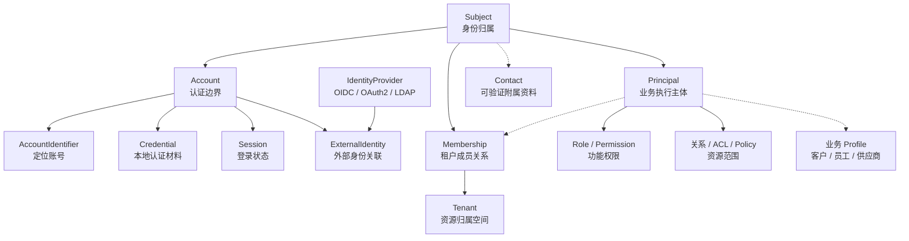
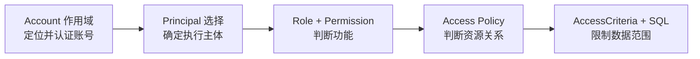
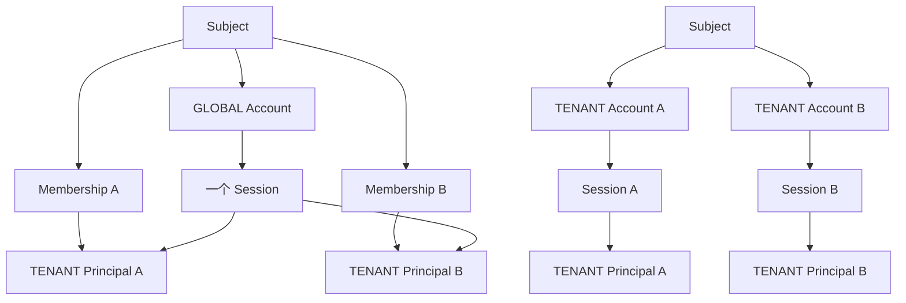
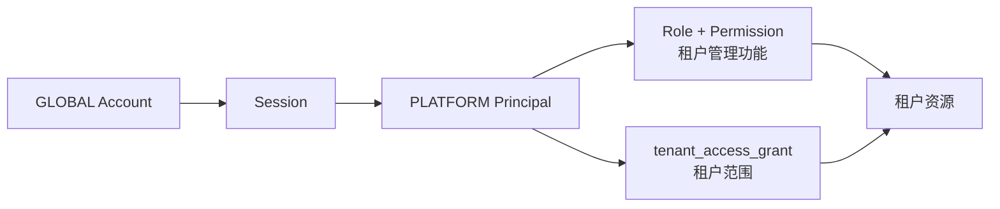

# IAM 身份与访问模型

IAM 把用户主档、登录账号、业务执行主体和访问关系分开保存。同一个人可以使用不同账号进入不同工作空间，也可以在一次登录后选择不同 Principal 执行业务操作；登录方式不会直接决定角色或数据范围。

## 对象关系

Subject、Account 和 Principal 构成主关系：Subject 统一身份归属，Account 隔离认证，Principal 表示业务执行主体。Identifier、Credential 和 Session 从属于 Account；Membership、Role 和资源关系限制 Principal 可以进入的空间和执行的操作。Contact 与业务 Profile 是附属资料，不参与这条主关系。

图中的对象对应当前 `iam_subject`、`iam_account`、`iam_principal` 等数据表和 `com.sca4d.iam`、`com.sca4d.common.auth` 中的同名类型。运行时选择和访问过程分别在后续 Session 与权限页面说明。

这组关系回答不同问题：

| 问题 | 对象 |
| --- | --- |
| 系统中记录的是谁 | `Subject` |
| 在哪个身份作用域中登录 | `Account` |
| 登录时根据什么标识值定位 Account | `AccountIdentifier` |
| Account 持有哪些本地认证材料 | `Credential` |
| 哪个外部身份关联到 Account | `ExternalIdentity` |
| 当前登录属于哪个账号 | `Session` |
| 这个人是否属于某个租户 | `Membership` |
| 本次请求代表哪个业务主体 | `Principal` |
| 可以使用哪些功能 | `Role`、`Permission` |
| 可以操作哪些具体数据 | 业务关系、ACL、Access Policy |

对象分开后，修改密码不会改变租户成员关系，移除角色不会删除登录账号，切换工作空间也不需要重新绑定认证材料。

## Subject

`Subject` 是一个自然人或系统主体的统一主档。它保存展示名、状态和版本，不保存登录标识、密码、邮箱或租户权限。

一个 Subject 可以拥有一个 GLOBAL Account，并在不同租户中分别拥有 TENANT Account。停用或删除 Subject 时，其全部 Account Session 都会结束。

## Account、Identifier 与 Credential

`Account` 是 Subject 在一个身份作用域中的登录账号。当前提供两种作用域：

- `GLOBAL`：标识在平台范围内解析；
- `TENANT(tenantId)`：标识只在指定租户内解析。

Account 作用域决定 Identifier 的唯一范围，以及认证后允许选择哪些 Principal。它不授予角色、权限或租户成员资格。

`AccountIdentifier` 保存登录时用于定位 Account 的标识值。当前标识类型为 USERNAME 和 EMAIL；服务端先按 Account 作用域和标识类型规范化用户输入，再查找对应 Account。因此不同租户可以使用相同用户名或邮箱。Identifier 只负责定位账号，是否允许登录仍由 Account 状态和后续认证结果决定。

`Credential` 是 Account 持有的长期认证材料。公共记录保存类型、状态、版本和时间，密码摘要、Passkey 公钥和 TOTP 密钥等协议字段保存在各自子表中。邮件验证码和恢复码属于短期 Proof，不作为通用 JSON Credential 保存。

一个 Subject 可以通过多个 Account 使用不同的登录策略。例如 GLOBAL Account 可以使用 Passkey，某个 TENANT Account 可以只接受企业身份源；两者仍然可以属于同一个 Subject。

## IdentityProvider 与 ExternalIdentity

`IdentityProvider` 表示 GLOBAL 或 TENANT 作用域中的 OIDC、OAuth2 或 LDAP 身份源。`ExternalIdentity` 使用 Provider 内唯一的 external subject 关联同作用域 Account。

Provider 只负责确认外部身份。外部身份成功登录后仍要落到本地 Account，再由 Account 找到 Subject 和可达 Principal。上游组织、群组或 Token 不直接成为本地角色、租户成员关系或资源授权。

GLOBAL Provider 只能关联 GLOBAL Account；TENANT Provider 只能关联相同租户的 TENANT Account。是否允许即时注册、是否根据可信邮箱关联已有账号，以及新账号获得哪些 Membership 和 Role，分别由身份源策略和本地业务服务决定。

具体认证协议、注册和关联过程见[认证过程与 MFA](./authentication-and-mfa.md)。

## Tenant、Membership 与 Principal

`Tenant` 表示资源归属和租户管理空间。`Membership` 表示 Subject 已加入 Tenant；它不取代 Account，也不保存登录材料。

`Principal` 是一次业务操作代表的执行主体。当前默认类型为：

| 类型 | 表示的执行主体 |
| --- | --- |
| `DEFAULT` | Subject 的个人或默认业务空间 |
| `PLATFORM` | 平台管理空间中的操作人员 |
| `TENANT` | 指定 Membership 对应的租户成员 |
| `SYSTEM` | 没有用户 Session 参与的系统任务 |

同一个 Subject 可以同时拥有 DEFAULT Principal、PLATFORM Principal 和多个 TENANT Principal。认证只固定 Account；请求进入哪个工作空间，由 `PrincipalSelection` 根据 Account 可达性在当前请求中选择。

业务中的客户、员工、供应商、创作者等资料通过 `principal_id` 关联自己的 Profile。多个业务身份共享相同执行身份和授权规则时，可以关联同一个 Principal；只有请求主体、选择方式、权限适用范围或审计身份确实不同，才需要增加 `PrincipalType`。

## Profile 与 Contact

Profile 保存客户、员工、供应商等业务资料，并通过 `principal_id` 关联执行主体。姓名、头像、岗位、等级等字段由对应业务模块解释，不参与账号解析或认证。

`Contact` 是 Subject 的附属资料，不是 Subject、Account、Principal 主关系中的核心对象。它与普通 Profile 属性的区别在于记录了规范值、验证状态和验证来源，可供登录标识、验证码投递和账号关联策略引用。

当前 Contact 支持 EMAIL 和 PHONE；同一类型可以保存多条已验证资料，但最多一条 primary Contact。个人资料和成员页面展示 primary Contact，修改后产生的新值默认未验证。

当前只有邮箱可以通过邮件验证码或可信上游的 `email_verified=true` 变为已验证状态。PHONE 只用于资料展示，不提供短信验证码、手机号登录或自动关联。

Contact 不等于登录标识。EMAIL Identifier 必须引用已经验证的 Contact，但相同邮箱不会自动合并两个 Subject，也不会自动建立跨租户访问关系。

## Role、Permission 与资源访问

Role 把一组 Permission 分配给 Principal。Permission 回答“能否执行这一类功能”，不回答“可以操作哪些记录”。

具体资源由 Owner、Membership、Grant、业务状态、时间条件或独立 ACL 表达。Access Policy 判断当前 Principal 与资源的关系，Repository 再使用 `AccessCriteria` 把范围写进 SQL。角色、功能权限和资源访问同时成立，操作才会执行。

完整判断过程见[权限与资源访问](./permission-and-access.md)。

## 三种作用域

Account、Principal 和资源访问分别限制不同对象，不能用其中一个替代另外两个。

| 作用域 | 决定内容 | 不决定内容 |
| --- | --- | --- |
| Account 作用域 | Identifier 唯一范围、认证入口、可达 Principal | 角色、权限、成员资格 |
| Principal 作用域 | 当前请求代表的平台、租户或默认主体 | 登录方式、密码、外部身份源 |
| 资源访问范围 | 当前 Principal 可以读取或修改的记录 | 当前 Session 属于哪个 Account |

GLOBAL Account 可以进入 DEFAULT、已有 PLATFORM Principal，以及已有 Membership 对应的 TENANT Principal。TENANT Account 只能进入 DEFAULT 自助空间和同租户 TENANT Principal。工作空间选择不会创建新 Session，也不会改变 Account。

## 默认实现与扩展位置

脚手架预置的是一组可以直接运行的类型，不是 IAM 可以表达的全部业务分类。

| 变化 | 保持不变的关系 | 扩展位置 |
| --- | --- | --- |
| 增加手机号、工号等登录标识 | Identifier 仍属于 Account | 增加标识类型、规范化和解析规则 |
| 增加新的本地认证协议 | Credential 仍属于 Account | `CredentialScheme` 与 `AuthMethod` |
| 接入新的企业身份源协议 | ExternalIdentity 仍关联 Account | Provider 协议实现和认证方式 |
| 增加客户、员工或供应商资料 | 业务资料仍引用 Principal | 新增业务 Profile |
| 增加新的执行主体 | Subject 与 Account 不变 | 仅在现有 PrincipalType 无法表达时增加类型和选择规则 |
| 增加项目、门店或设备授权 | Role 仍负责功能权限 | 业务关系、Access Policy、Criteria 或专用 ACL |
| 增加新的租户账号策略 | Account 仍属于 Subject | 账号创建、关联和身份源策略 |

扩展通常发生在 Identifier、Credential、Provider、业务 Profile 和资源关系处。为了增加会员等级、岗位或页面名称而修改 Subject、Account 或 Principal 核心关系，会把业务变化写入长期身份结构。

## 业务场景

GLOBAL Account 共享登录与 TENANT Account 隔离登录是两种不同组合。前者用一个 Session 选择多个租户 Principal，后者为每个租户分别认证并创建 Session。

### 单一应用账号

一个用户拥有 Subject、GLOBAL Account 和 DEFAULT Principal。USERNAME 或 EMAIL 找到 Account，密码或 Passkey 完成认证，业务 Profile 使用 DEFAULT Principal 主键。

这是当前默认结构的最小组合。没有租户时不需要创建 Membership 或 TENANT Principal；增加客户等级时修改业务 Profile 或业务规则，不增加 Account 类型。

### 一个账号进入多个租户

一个 Subject 使用 GLOBAL Account 登录，并在租户 A、租户 B 分别拥有 Membership 和 TENANT Principal。登录只创建一个 Account Session，进入租户工作空间时选择对应 TENANT Principal。

两个 Principal 可以绑定不同租户角色。用户离开租户 A 时只停用 A 的 Membership 和 Principal，不影响 GLOBAL Account、租户 B 或个人空间。

### 租户私有账号

租户 A 和租户 B 分别创建 TENANT Account。两个租户可以使用相同 USERNAME，因为 Identifier 唯一范围包含 tenantId。每个 Account 可以使用不同密码、Passkey 或租户身份源，并拥有独立 Session 和第二因子要求。

是否把两个租户账号关联到同一个 Subject 是明确的账号关联策略，不能根据相同邮箱自动推断。TENANT Account 认证后也不能选择其他租户的 Principal。

### 平台人员管理部分租户

运营人员使用 GLOBAL Account 和 PLATFORM Principal。平台角色提供租户管理功能，`tenant_access_grant` 再限定其可以查看或管理哪些租户。

增加“客服”“审计员”或“区域运营”等岗位时使用角色和租户 ACL。它们仍然代表 PLATFORM Principal，不需要为每个岗位增加 PrincipalType。

### 企业身份源即时注册

租户为自己的 TENANT 作用域配置 OIDC 或 LDAP Provider。员工首次通过上游认证后，JIT 策略可以创建本地 Subject、TENANT Account、DEFAULT Principal、Membership 和 TENANT Principal，并用 ExternalIdentity 固定后续登录使用的 Account。

上游只提供身份确认和资料。租户角色、菜单权限和业务数据范围继续由本地 Principal、Role 和 Access Policy 决定。

### 同一自然人的多个业务身份

同一个 Subject 可以同时具有客户资料、员工资料和供应商资料。若这些操作都以同一个 DEFAULT Principal 执行，业务表分别通过 `principal_id` 关联即可，角色和资源关系决定允许的动作。

如果某类操作必须显示独立工作空间、使用不同权限集合并在审计中作为不同执行主体出现，再评估新增 PrincipalType。登录账号和认证材料仍属于 Account，不迁移到业务 Profile。

### 系统任务执行

Quartz Job、清理任务和 Outbox 投递使用 SYSTEM Principal 建立 SYSTEM 请求，不伪造平台管理员或租户成员。Policy 明确接受或拒绝 SYSTEM，不能把没有用户 Session 解释为无限权限。

SYSTEM 与普通用户共享 Principal、Policy 和审计入口，但不经过交互式登录流程。
