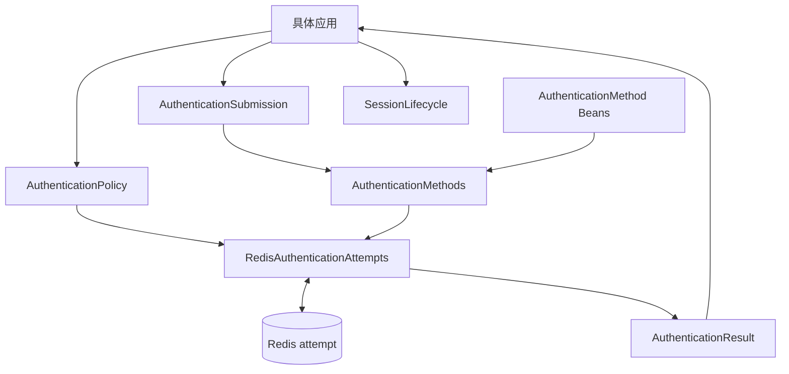
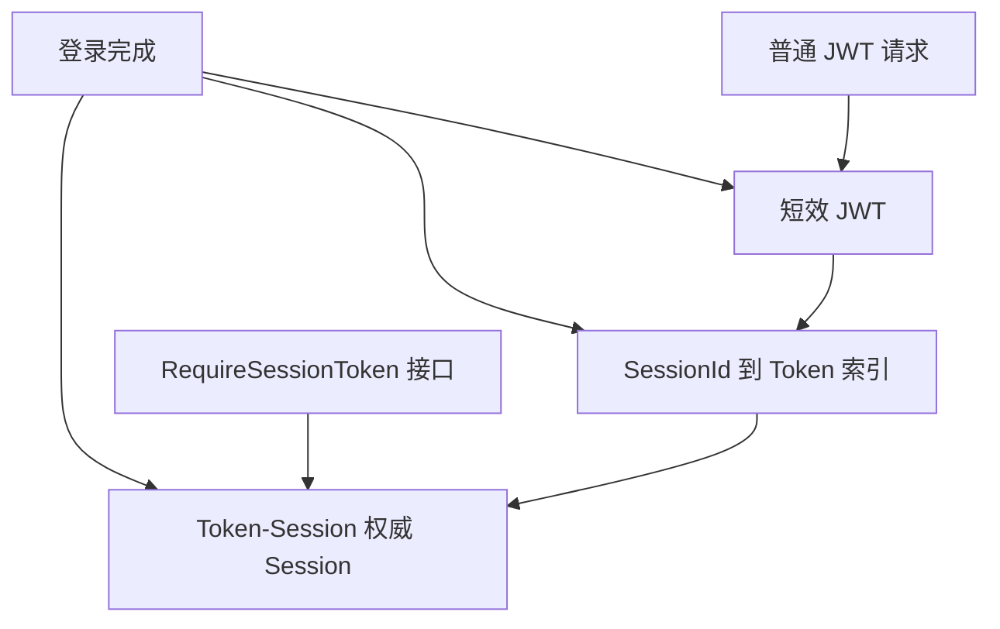

# 认证尝试与 Session 模块

`sca4dj-auth` 包含两部分长期独立的功能：按具体应用策略编排认证尝试，以及保存所有主体共用的权威 Session。

`sca4dj-auth` 不验证 Password、TOTP、Passkey、Email Code、Shared Secret、HMAC 或 X.509。它也不决定某个应用的登录和敏感操作规则。认证只回答当前 Account 是否完成动作要求的因素，不决定 Operation 或数据范围，动作要求由应用的 AuthenticationPolicy 声明。



具体应用提供 [AuthenticationPolicy](/javadoc/core/sca4dj-core-api/com/sca4d/core/api/authentication/AuthenticationPolicy.html)，并调用 [AuthenticationAttempts](/javadoc/core/sca4dj-core-api/com/sca4d/core/api/authentication/AuthenticationAttempts.html)。登录满足要求后，应用消费 AuthenticationResult，再调用 SessionLifecycle 建立通用 Session。普通动作认证只消费对应动作的结果，不建立新 Session。

## 包结构

| 包 | 职责 |
|---|---|
| `com.sca4d.auth.engine` | 索引认证方法，执行动作策略、因素去重和 attempt 消费 |
| `com.sca4d.auth.engine.attempt` | 编解码并原子读写 Redis attempt |
| `com.sca4d.auth.session` | 建立、读取、刷新和终止权威 Session |
| `com.sca4d.auth.session.codec` | 编解码 Session 及开放 Principal、Resource 类型 |
| `com.sca4d.auth.jwt` | 签发并验证短效 JWT，JWT 的内容来自权威 Session |
| `com.sca4d.auth.web` | 从 HTTP 请求恢复 Session 并绑定当前调用 |
| `com.sca4d.auth.config` | 绑定配置并装配认证尝试、方法目录与 Session 组件 |

## 认证尝试

[AuthenticationMethods](/javadoc/modules/auth/sca4dj-auth/com/sca4d/auth/engine/AuthenticationMethods.html) 索引应用注册的 AuthenticationMethod Bean。

- 调用方已知 Account 时，调用 `authenticate(account, submission)`。
- 需要方法从 Proof 识别 Account 时，调用 `authenticate(submission)`。

两条入口都检查以下内容：Proof 的精确类型、方法能否从 Proof 识别 Account、方法是否可用，以及返回的编码和因素是否符合声明。应用的组合根只在签发、轮换或撤销 Credential 时，按公开方法类型取得已注册实例。Proof 验证不绕过 AuthenticationMethods。

[RedisAuthenticationAttempts](/javadoc/modules/auth/sca4dj-auth/com/sca4d/auth/engine/RedisAuthenticationAttempts.html) 实现 AuthenticationAttempts。它按 AuthenticationFactorKind 去重，并执行零到三个因素的要求。每次开始、提交或消费认证尝试时，都重新读取当前策略和时间。

开始登录时，首个认证方法先验证材料并识别 Account，然后仍要通过应用策略检查。不能识别 Account 的方法只能用于已知 Account。

Redis attempt 只保存以下内容：

- Account；
- 动作编码；
- 可复用的 Authentication；
- VerifiedAuthentication 的非秘密引用；
- 版本；
- 可选的最晚有效时间；
- 过期时间；
- 满足状态。

完成结果只能消费一次。消费前，每个认证方法重新确认 Credential 或外部身份仍有效。任何 Proof 都不会写入 Redis attempt 或 Session。

## 登录与 Session

登录流程不在 `sca4dj-auth` 中硬编码。具体应用先用能够识别账号的方法开始认证，或为已知 Account 开始认证。随后，应用向同一 attempt 补充因素。

满足要求后，应用消费 AuthenticationResult，并把其中的 Account 与 Authentication 列表交给 SessionLifecycle。

建立 Session 时，系统重新装载以下内容：Subject、Account、完整 Principal、按类型分组的紧凑 Principal ID，以及完整或数字 ID 形式的静态 Resource。没有 Principal 的 Device 仍可以建立空 Principal、空 Resource 的 Session。业务调用在 Call 阶段因缺少 Principal 而失败。

身份装载或 Token 签发失败时，不能留下可用 Token 或半成品 Session。

PrincipalIdLoader 只返回建立 Session 时已经确认存在且有效的正数 ID。PrincipalIdLoaders 按具体 Principal Java 类型合并这些 ID。

请求期选择器可以解析紧凑集合中的当前 Principal 对象。`Call.selectPrincipal(...)` 仍校验精确类型和 ID。

ResourceIdLoader 只为完整 Principal 提供按 Resource 类型分组的数字 ID。动态角色、Permission 和数据范围不进入这些集合。

Session 保存登录时完成的 Authentication。动作策略可以按最大年龄复用这些记录。Session 本身和权限集合都不计为认证因素。

## Token 与 JWT

Sa-Token Redis Token-Session 始终保存唯一的权威 Session。[JwtSessionProjection](/javadoc/modules/auth/sca4dj-auth/com/sca4d/auth/jwt/JwtSessionProjection.html) 把同一份 Session 经 SessionCodec 编码后放入 JWT 的 payload，并用 HS256 密钥签名，生成短效 JWS。它不创建第二个 Session，也不加密载荷。



`sca4dj.auth.token.mode` 默认为 `SESSION`。JWT 模式需要具体应用提供 `issuer`、`audience` 和独立的 HS256 密钥。

普通 JWT 请求不在线检查注销、账号停用、权限变化或 Operation 目录变化。旧 JWT 最多继续有效到自身过期。

要求在线状态的接口使用 [RequireSessionToken](/javadoc/core/sca4dj-core-api/com/sca4d/core/api/authentication/RequireSessionToken.html)。

## Session 生命周期与账号控制

[SessionLifecycle](/javadoc/core/sca4dj-core-api/com/sca4d/core/api/authentication/SessionLifecycle.html) 建立、按 Session ID 或 Token 读取并终止单个 Session。登录、HTTP 认证恢复和 Web Realtime 票据校验依赖它。

[SessionControl](/javadoc/core/sca4dj-core-api/com/sca4d/core/api/authentication/SessionControl.html) 只控制指定 Account 的全部 Session，不读取身份、Principal 或 Resource。IAM、Credential 模块和具体应用在账号状态、权限或认证材料变化时调用它。因此，账号级控制不会反向依赖 SessionLifecycle 使用的 Loader。

Auth 为每个 Account 保存非负失效代次。Auth 还在 Token-Session 中保存建立或刷新 Session 时使用的 Operation 目录指纹。

指纹只包含排序后的具体 Operation 编码。显示名称、翻译键、排序值和模块登记顺序不影响它。

SESSION 模式在线读取时，若发现失效代次或目录指纹变化，系统重新装载一次身份、Principal 和 Resource。刷新成功后，保存新指纹。刷新失败的请求直接失败，并在下次请求时继续重试。只有身份不可用时，才终止 Session。

部署新增、删除或重命名 Operation 不需要清空整个 Redis。

`terminateAccount(...)`、`terminateOtherSessions(...)` 和 `invalidateAccount(...)` 的行为如下：

- `terminateAccount(...)` 终止指定 Account 的全部权威 Session。
- `terminateOtherSessions(...)` 保留指定的当前 Session，并终止同一 Account 的其他权威 Session。
- `invalidateAccount(...)` 保留登录，并要求已有 Session 在下次在线读取时刷新身份。

在事务中调用这些控制方法时，失效和终止动作在事务提交后执行。事务回滚不改变在线 Session。

批量权限或 Principal 变化时，使用 `invalidateAccounts(...)`。Auth 通过一次 Redis pipeline，增加全部目标 Account 的失效代次。

Session 变化后，Auth 调用 [SessionInvalidationListener](/javadoc/core/sca4dj-core-api/com/sca4d/core/api/authentication/SessionInvalidationListener.html)。Web Realtime 可以通知浏览器刷新。示例 App 的 IoT 组合可以终止绑定到变化的 Session 的协议连接。监听器不能反向修改 Auth 的内部状态。

## Session JSON

[SessionCodec](/javadoc/modules/auth/sca4dj-auth/com/sca4d/auth/session/codec/SessionCodec.html) 保存以下内容：格式版本、Session 标识、Subject、Account、Authentication、时间，以及每个完整 Principal 和 Resource 的 type 与 Base64 payload。

紧凑 Principal ID 按 Principal Codec type 保存。数字 Resource ID 按 Resource type 保存。两者都使用 Base64 包装的 Roaring64 portable payload。

开放类型字段由各模块的 Codec 或业务 Resource 类型负责。Auth 不依赖 IAM 或 IoT 实现类。

解码失败时不返回部分 Session。HTTP 返回结构、前端字段或本地化文本都不能直接改变 Session 的序列化内容。

## 示例

下面的示例为「工作区」应用提供登录策略，并在 Password 认证满足后建立 Session。
工作区登录要求一个因素，且只允许 Password。

```java
@Component
public class WorkspaceAuthenticationPolicy implements AuthenticationPolicy {

    public static final AuthenticationActionCode LOGIN =
            new AuthenticationActionCode("workspace.login");

    @Override
    public AuthenticationRequirement requirementFor(
            Account account, AuthenticationActionCode actionCode) {
        return new AuthenticationRequirement(1, null);
    }

    @Override
    public Set<TreeCode> allowedMethods(
            Account account,
            AuthenticationActionCode actionCode,
            List<Authentication> completedAuthentications) {
        return Set.of(PasswordAuthenticationMethod.CODE);
    }
}
```

登录服务先开始 attempt，满足后单次消费结果，再建立 Session。

```java
@Service
public class WorkspaceLoginService {

    private final AuthenticationAttempts attempts;
    private final SessionLifecycle sessions;

    public WorkspaceLoginService(AuthenticationAttempts attempts, SessionLifecycle sessions) {
        this.attempts = attempts;
        this.sessions = sessions;
    }

    public EstablishedSession login(String username, String password) {
        AuthenticationSubmission<PasswordProof> submission = new AuthenticationSubmission<>(
                PasswordAuthenticationMethod.CODE,
                PasswordProof.class,
                new PasswordProof(username, password));
        AuthenticationProgress progress =
                attempts.start(WorkspaceAuthenticationPolicy.LOGIN, submission);
        if (!progress.satisfied()) {
            throw new IllegalStateException("登录还需要 " + progress.remainingFactorCount() + " 个因素");
        }
        AuthenticationResult result = attempts.consume(progress.attemptId());
        return sessions.establish(result.account(), result.authentications());
    }
}
```

该示例中的 `workspace.login` 是应用自定义的动作编码。
`attempts.start(...)` 失败时不建立 Session。
`attempts.consume(...)` 只能成功一次。

## 扩展方式

具体应用通过下列方式向 Auth 提供实现。

| 扩展点 | 应用提供 | 框架发现方式 |
|---|---|---|
| AuthenticationPolicy | 一个 Bean | `AuthenticationAttempts` 的自动配置按类型注入；该 Bean 带 `@ConditionalOnMissingBean`，应用可以整体替换 AuthenticationAttempts |
| AuthenticationMethod | 每种认证方法一个 Bean | `AuthenticationMethods` 通过构造器注入 `List<AuthenticationMethod<?>>` 并建立索引 |
| PrincipalIdLoader | 每种 Principal 类型一个或多个 Bean | `PrincipalIdLoaders` 通过构造器注入 `List<PrincipalIdLoader<?>>`，按 Principal Java 类型合并 |
| ResourceIdLoader | 按 Resource 类型提供的 Bean | `ResourceIdLoaders` 通过构造器注入 `List<ResourceIdLoader>` |
| SessionInvalidationListener | 零个或多个 Bean | Auth 在 Session 变化后调用 |

AuthenticationMethod 的 `code()` 是方法编码。
`proofType()` 必须与 Submission 中的 Proof 类型精确一致。
