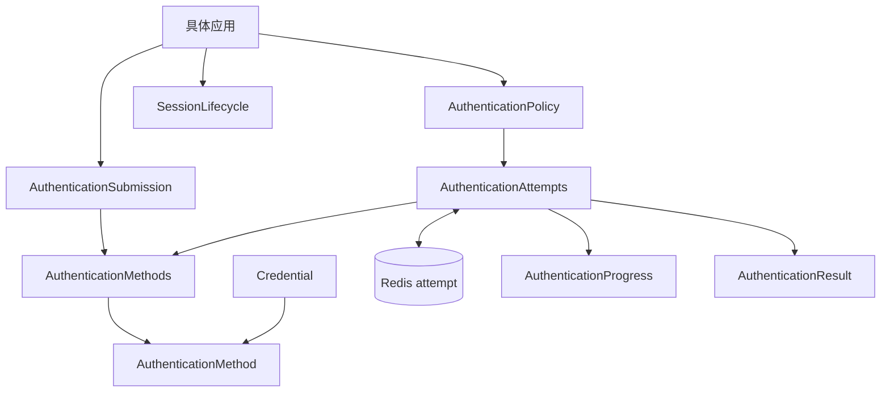

# 认证方法、凭据与认证因素

认证用于判断当前账号能否执行某个动作。登录是一个需要认证的动作。建立 Session 是登录认证成功后的结果，Session 本身不是认证因素。认证方法通过实现 `AuthenticationMethod` 接口接入引擎，新增方法不修改引擎或 Session；认证因素按 `AuthenticationFactorKind` 去重，而不是按方法计数。

具体应用通过 [AuthenticationPolicy](/javadoc/core/sca4dj-core-api/com/sca4d/core/api/authentication/AuthenticationPolicy.html) 决定以下内容：

- 登录、敏感操作或其他动作需要多少个不同因素；
- 当前允许使用哪些认证方法。



示例 App 的平台账号使用 Password 和 Email Code。

`modules/` 中保留 Passkey 源码。Passkey 不纳入示例 App 的 Gradle 工程，也不进入 Server 运行时依赖。模块源码存在，不表示应用已注册该认证方法。

调用方把动作编码和首个认证材料交给 [AuthenticationAttempts](/javadoc/core/sca4dj-core-api/com/sca4d/core/api/authentication/AuthenticationAttempts.html)。首个材料可以识别账号，也可以由调用方先给出已知账号。

认证尝试满足策略后，调用方单次消费 [AuthenticationResult](/javadoc/core/sca4dj-core-api/com/sca4d/core/api/authentication/AuthenticationResult.html)。只有登录流程才继续调用 [SessionLifecycle](/javadoc/core/sca4dj-core-api/com/sca4d/core/api/authentication/SessionLifecycle.html) 建立 Session。

## 四个独立概念

**登录**：识别账号、执行具体应用的登录认证规则，并在满足后建立 Session。示例 App 的登录规则至少要求一个因素。

**认证**：验证当前账号为某个动作提交的证明。通用认证模型允许动作要求零到三个不同因素。

**Session**：保存登录完成后的账号、Principal、权限资源和近期 Authentication。具体应用可以按最大年龄复用其中的 Authentication。「已有 Session」不增加因素数量。

**权限**：判断已经识别的 Principal 是否允许访问资源。权限检查不能替代认证，认证也不决定角色或资源权限。

## 方法、凭据和证明

认证方法（[AuthenticationMethod](/javadoc/core/sca4dj-core-api/com/sca4d/core/api/authentication/AuthenticationMethod.html)）连接长期 Credential 与单次 Proof。

- Credential 由具体认证方法模块保存，并统一关联 Account。
- Proof 只在当前调用中使用，不进入 Redis attempt、日志或 Session。

| 方法 | Credential 数量 | Proof | 因素类别 | 可识别账号 |
|---|---:|---|---|---|
| Password | 每个账号一个 | 用户名和原始密码，或已知账号下的原始密码 | `KNOWLEDGE` | 是 |
| TOTP | 每个账号一个 | 六位动态验证码 | `POSSESSION` | 否 |
| Passkey | 每个账号多个，默认最多五个 | WebAuthn assertion JSON | `POSSESSION` | 是 |
| Email Code | 无长期 Credential；每次签发一个短期 Challenge | Challenge ID 和六位验证码 | `POSSESSION` | 是 |
| Shared Secret | 每个账号一个当前 Credential | 原始共享密钥 | `POSSESSION` | 否 |
| HMAC | 每个账号一个当前 Credential | 时间、nonce、规范请求和签名 | `POSSESSION` | 否 |
| X.509 | 每个账号可登记多个证书 | 已由传输层验证的客户端证书 | `POSSESSION` | 是 |

Shared Secret、HMAC 和 X.509 不是 IoT 私有的认证表。它们分别由 `sca4dj-auth-shared-secret`、`sca4dj-auth-hmac` 和 `sca4dj-auth-x509` 实现同一个 AuthenticationMethod 接口。业务应用、Device 或服务账号都可以选择使用这些方法。

示例 App 把 MQTT 连接的协议字段转换成 AuthenticationSubmission 后，仍交给 AuthenticationMethods 验证。

Passkey registration 和 assertion 使用一次性 ceremony。Passkey Credential 保存公钥、签名计数器、备份状态和乐观版本，不保存私钥。

Shared Secret 与 HMAC 只在签发时返回一次原始值，数据库保存摘要。X.509 只保存公开证书字段和指纹，不保存私钥。

## 因素计数

认证进度按 [AuthenticationFactorKind](/javadoc/core/sca4dj-core-api/com/sca4d/core/api/authentication/AuthenticationFactorKind.html) 去重，不按方法数量计数。

Password 与 TOTP 可以贡献两个因素。TOTP、Passkey、Email Code、HMAC 和 X.509 都属于 `POSSESSION`。其中任意多个同时成功，仍只贡献一个因素。

AuthenticationMethod 声明可能贡献的因素类别。实际返回的 [Authentication](/javadoc/core/sca4dj-core-api/com/sca4d/core/api/authentication/Authentication.html) 只能使用其中的类别。

设备支持生物识别，不代表当前协议已经验证 `INHERENCE`。方法不能据此增加因素。

## 动作策略与方法用途

Auth 不保存具体应用的登录或敏感操作要求。AuthenticationPolicy 根据 Account、动作编码和本次已经接受的认证记录，返回因素数量、可复用认证的最大年龄和当前允许的方法编码。

随后，Auth 从应用实际注册的 AuthenticationMethod 中筛选出当前 Account 可用的方法。

示例 App 为平台账号（Platform Account）的每个认证方法保存三个用途开关：

- 是否允许识别账号并开始登录；
- 是否允许补充登录后续因素；
- 是否允许认证登录后的敏感动作。

这些开关是示例 App 的业务数据，不属于认证模块公共 API。修改设置时，示例 App 执行以下检查：

- 至少保留一种可识别账号的登录方法；
- 已登记 Credential 能够提供足够多的不同因素。

登录的因素数量只能为一到三。其他动作可以要求零到三个因素。

Device 的接入方式也由 App 选择。这些方式不会进入 DeviceService 的认证类型分支。

匿名和 Session 是连接生命周期的输入。`account:<method>` 使用同一 AuthenticationSubmission 和 AuthenticationMethods。

App 只在签发、轮换或撤销 Credential 时，按公开方法类型取得已注册的方法。App 不直接调用具体方法验证 Proof。

## 跨请求认证

AuthenticationAttempts 的 Redis 实现保存短期 attempt。每次提交 [AuthenticationSubmission](/javadoc/core/sca4dj-core-api/com/sca4d/core/api/authentication/AuthenticationSubmission.html) 时，Redis 实现先按编码选择已注册方法，再检查 Proof 的精确类型、应用策略和 Account 当前可用性。

认证方法成功后返回 [VerifiedAuthentication](/javadoc/core/sca4dj-core-api/com/sca4d/core/api/authentication/VerifiedAuthentication.html)。VerifiedAuthentication 只包含以下内容：Account、Authentication、用于重新定位 Credential 或外部身份的非秘密引用、版本，以及可选的最晚有效时间。

Redis 不保存原始密码、验证码、共享密钥、HMAC、证书字节、WebAuthn 响应或外部 Token。

满足要求后，调用方必须单次消费 AuthenticationResult。消费前，Auth 调用对应的 AuthenticationMethod 复核引用和版本是否仍然有效。Credential 已撤销、已替换，或方法不再可用时，消费失败，且不会建立 Session。

## 并发与删除

认证模块优先使用无锁读取。

- Credential 并发修改使用数据库约束和乐观版本。
- Passkey 数量上限和删除时的最小保留数量，通过账号锚点版本的 CAS（比较并交换，compare-and-swap）判定。
- 跨请求 attempt 使用 Redis 短租约，防止同一个 attempt 被同时提交或消费。

Account 删除流程调用 AuthenticationMethods，让每个已注册方法幂等删除自己负责的 Credential 和临时状态。认证方法不能删除 IAM 身份、其他方法的 Credential 或具体应用业务数据。

各方法的数据和失败结果见[认证尝试与 Session 模块](/capabilities/authentication-session/auth)、[Password 模块](/capabilities/authentication-session/password)、[TOTP 模块](/capabilities/authentication-session/totp)、[Passkey 模块](/capabilities/authentication-session/passkey)和 [Email Code 模块](/capabilities/authentication-session/email-code)。

## 示例

下面的示例为「工作区」应用声明两种认证要求：成员登录要求一个因素，修改成员角色要求两个不同因素，且可以复用十分钟内的 Authentication。

```java
@Component
public class WorkspaceAuthenticationPolicy implements AuthenticationPolicy {

    public static final AuthenticationActionCode LOGIN =
            new AuthenticationActionCode("workspace.login");
    public static final AuthenticationActionCode CHANGE_ROLE =
            new AuthenticationActionCode("workspace.member.change-role");

    @Override
    public AuthenticationRequirement requirementFor(
            Account account, AuthenticationActionCode actionCode) {
        if (CHANGE_ROLE.equals(actionCode)) {
            return new AuthenticationRequirement(2, Duration.ofMinutes(10));
        }
        return new AuthenticationRequirement(1, null);
    }

    @Override
    public Set<TreeCode> allowedMethods(
            Account account,
            AuthenticationActionCode actionCode,
            List<Authentication> completedAuthentications) {
        return Set.of(PasswordAuthenticationMethod.CODE, TotpAuthenticationMethod.CODE);
    }
}
```

Password 属于 `KNOWLEDGE`，TOTP 属于 `POSSESSION`，两者各贡献一个因素。
同一 Account 同时提交 TOTP 与 Email Code 时，只计一个 `POSSESSION` 因素，两个因素的要求不会满足。

## 扩展方式

新增认证方法时，应用或模块实现 `AuthenticationMethod<P>`，并注册为 Spring Bean。
`AuthenticationMethods` 通过构造器注入 `List<AuthenticationMethod<?>>` 建立索引，不需要额外登记。
方法需要实现 `code()`、`proofType()`、`factorKinds()`、`canIdentifyAccount()`、`available(Account)`、`authenticate(...)`、`verifyCurrent(...)` 和 `eraseAccount(long)`。

```java
@Component
public class WorkspaceInviteAuthenticationMethod
        implements AuthenticationMethod<WorkspaceInviteProof> {

    public static final TreeCode CODE = TreeCode.ofSlash("AUTHENTICATION/WORKSPACE_INVITE");

    @Override
    public TreeCode code() {
        return CODE;
    }

    @Override
    public Class<WorkspaceInviteProof> proofType() {
        return WorkspaceInviteProof.class;
    }

    @Override
    public Set<AuthenticationFactorKind> factorKinds() {
        return Set.of(AuthenticationFactorKind.POSSESSION);
    }

    @Override
    public boolean canIdentifyAccount() {
        return false;
    }

    // available、authenticate、verifyCurrent 和 eraseAccount 由应用按自己的 Credential 实现。
}
```

`WorkspaceInviteProof` 是应用自定义的 Proof 类。
Proof 类必须与 Submission 声明的类型精确一致，子类不被接受。
应用策略通过 `allowedMethods(...)` 返回该方法编码后，方法才会参与认证。
