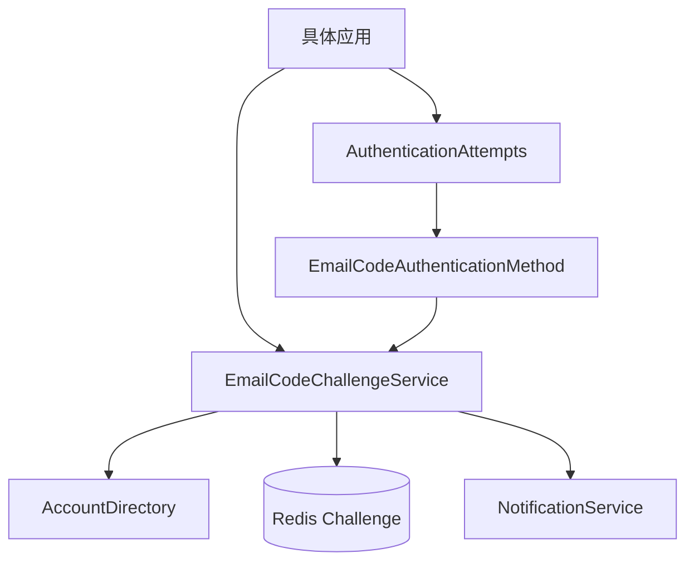

# Email Code 认证模块

`modules/auth/sca4dj-auth-email` 定义 `email-code` AuthenticationMethod、六位验证码 Challenge 和 Redis 原子消费。

模块定义 `EMAIL` AccountIdentifierType，但不保存邮箱资料。AccountDirectory 按具体应用注册的 EMAIL 规范化器解析 Account。Email Code 贡献 `POSSESSION` 因素，只证明持有该邮箱，不建立 Session，也不决定动作需要几个因素，这些由应用的 AuthenticationPolicy 决定。



匿名签发时，先按认证域、`EMAIL` 类型和原始输入调用 AccountDirectory。

- 真实且可投递的 Account，使用稳定的 accountId 计算重发冷却目标，并把验证码通知写入 Messaging Outbox。
- 未知邮箱仍创建不绑定 Account 的 dummy Challenge，但不发送通知。

两类响应都只包含 Challenge ID、脱敏提示、过期时间和可重发时间。

验证码原文只进入通知变量和当前的摘要调用。

Redis 保存以下内容：Account ID、Core [SecretHasher](/javadoc/core/sca4dj-core-api/com/sca4d/core/api/security/SecretHasher.html) 生成的摘要、时间、错误次数、状态和版本。Redis 不保存验证码原文。

验证时，Lua 脚本原子累计错误次数，或把 Challenge 改为 `CONSUMED`。AuthenticationMethod 在认证完成前，再次核对 Account、消费状态和版本。

模块不建立 Session，也不决定登录或敏感动作需要几个因素。具体应用调用 [AuthenticationAttempts](/javadoc/core/sca4dj-core-api/com/sca4d/core/api/authentication/AuthenticationAttempts.html) 开始或继续 attempt，并检查 Session Account 与动作认证 attempt 的 Account 是否相同。

## 示例

下面的示例为「工作区」成员提供邮箱验证码登录。
应用先签发 Challenge，再把 Challenge ID 与用户输入的验证码交给 `AuthenticationAttempts`。

```java
@Service
public class WorkspaceEmailLoginService {

    private final AuthenticationAttempts attempts;
    private final SessionLifecycle sessions;

    public WorkspaceEmailLoginService(AuthenticationAttempts attempts, SessionLifecycle sessions) {
        this.attempts = attempts;
        this.sessions = sessions;
    }

    public EstablishedSession login(EmailCodeProof proof) {
        AuthenticationSubmission<EmailCodeProof> submission = new AuthenticationSubmission<>(
                EmailCodeAuthenticationMethod.CODE,
                EmailCodeProof.class,
                proof);
        AuthenticationProgress progress =
                attempts.start(WorkspaceAuthenticationPolicy.LOGIN, submission);
        AuthenticationResult result = attempts.consume(progress.attemptId());
        return sessions.establish(result.account(), result.authentications());
    }
}
```

`EmailCodeProof` 携带 Challenge ID 和六位验证码。
`WorkspaceAuthenticationPolicy` 的 `allowedMethods(...)` 必须返回 `EmailCodeAuthenticationMethod.CODE`，否则 attempt 不接受该方法。
`progress.satisfied()` 为 `false` 时，应用不能调用 `consume`，需要继续补充因素。

## 扩展方式

应用必须为 `EMAIL` AccountIdentifierType 注册规范化器，AccountDirectory 才能解析 Account。
`EmailCodeChallengeService` 通过构造器接收 AccountDirectory、认证域 `RealmKey`、`Notifications`、Redis Challenge 存储、`SecretHasher`、`EmailCodeSettings` 和 `Clock`，由模块自动配置装配。
验证码通知经 Messaging Outbox 发送，应用通过 Messaging 提供邮件投递实现。
