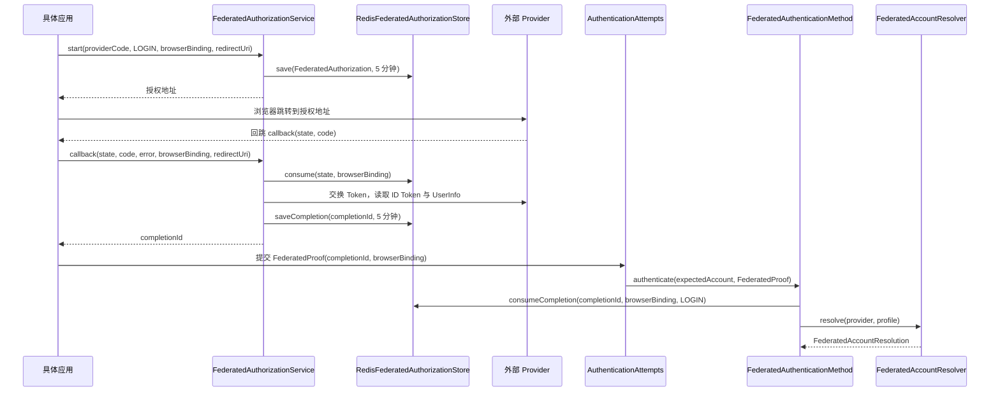

# 联邦登录

联邦登录让用户通过外部身份提供方（Provider）完成认证。`sca4dj-auth-federation` 模块支持 OpenID Connect（OIDC）和 OAuth 2.0 两种协议。模块负责 Provider 配置、授权码与 PKCE 流程、外部身份绑定，以及 `FederatedAuthenticationMethod` 认证方法。

本页适用于需要接入外部登录提供方的具体应用的开发者。读完后，开发者可以确定授权流程的调用顺序，了解 Provider 配置的保存与启用规则，并处理各类失败结果。

## 概念

外部 Provider 证明用户的身份。具体应用需要把外部身份对应到本地 Account。模块不负责这项对应。

具体应用实现 `FederatedAccountResolver`，由它决定以下结果之一：找到已绑定的 Account、按 Provider 策略创建 Account，或拒绝登录。外部 Provider 只证明外部身份，本地 Account 由应用的解析器决定；联邦登录得到的结果与其他认证方法一样，是一条 `POSSESSION` 类别的 Authentication。

模块保证以下约束：

- 授权状态和完成结果在 Redis 中只能消费一次。
- Provider 的 Client Secret 加密保存。
- 传给认证引擎的外部资料不包含 Token。

例如，应用配置一个编码为 `corp-sso` 的 OIDC Provider（示例编码，由具体应用命名）。用户在登录页选择 `corp-sso`。应用调用 `FederatedAuthorizationService.start`，获得授权地址。浏览器跳转到 Provider 完成登录。

Provider 回跳到应用的 callback 后，应用调用 `FederatedAuthorizationService.callback`，获得完成标识。应用再把该完成标识放入 `FederatedProof`，提交给认证尝试。

`redirectUri` 由具体应用传入。`start` 和 `callback` 使用的值必须完全相同。源码不校验 `redirectUri` 的协议，但 `start` 的 Javadoc 要求它为 HTTPS callback。

## 核心对象

| 对象 | 负责 | 不负责 |
|---|---|---|
| `FederatedProviderService` | 创建、替换、启用、停用和删除 Provider；启用前校验协议配置 | 发起 HTTP 请求，解析授权回调 |
| `FederatedProvider` | 保存不可变的编码 `code`、协议、状态、登录页展示、未绑定身份策略和多语言文案 | 保存协议端点和 Client Secret |
| `FederatedProviderConfiguration` | 保存 issuer、clientId、端点、scope、资料映射和附加授权参数 | 对外展示 Client Secret 明文 |
| `FederatedSecretCryptography` | 使用 SecretKeyring 加密和解密 Client Secret | 保存密钥本身 |
| `FederatedAuthorizationService` | 生成 state、nonce 和 PKCE verifier；交换 Token；校验 ID Token 与用户资料 | 建立 Session，决定 Account |
| `FederatedAuthorizationStore` | 保存授权状态和完成结果，读取时删除原记录 | 保存 Token |
| `RedisFederatedAuthorizationStore` | `FederatedAuthorizationStore` 的 Redis 实现 | 保存业务数据 |
| `FederatedAccountResolver` | 由具体应用实现，解析外部身份对应的 Account | 由模块提供默认实现 |
| `FederatedIdentityService` | 查询、绑定、刷新和解绑外部身份 | 决定绑定由哪个 Account 发起 |
| `FederatedAuthenticationMethod` | 消费 `LOGIN` 用途的完成结果，返回 `POSSESSION` 认证因素 | 建立 Session，消费 `LINK` 用途的完成结果 |
| `FederatedUnlinkedIdentityAction` | 表示未绑定身份的处理策略，取值为 `REJECT` 或 `JIT_CREATE` | 执行账号创建，账号创建由具体应用的解析器完成 |

`FederatedAuthenticationMethod` 只在应用提供 `FederatedAccountResolver` Bean 时注册。

## 调用顺序



调用顺序说明如下。

1. `start` 要求 Provider 状态为 `ACTIVE`，且协议配置存在。OIDC 从 Discovery 文档读取端点，OAuth 2.0 使用配置中保存的端点。`start` 保存授权状态后，返回授权地址。
2. `callback` 首先删除并读取授权状态。授权状态不存在、已过期或 `browserBinding` 不一致时，返回 `AUTHORIZATION_UNAVAILABLE`。
3. `callback` 在交换 Token 前比较 `redirectUri`。不一致时返回 `AUTHORIZATION_REJECTED`，此时授权状态已经被删除。
4. OIDC 协议的 ID Token 使用 `RS256` 校验签名、Issuer、受众和 nonce。UserInfo 存在时，UserInfo 的 `sub` 必须与 ID Token 的 subject 一致。
5. OAuth 2.0 协议使用配置的 `profileMapping` 读取 UserInfo，并把 `subject` 映射为外部资料的 subject。
6. `callback` 保存不含 Token 的完成结果，并返回完成标识。
7. `FederatedAuthenticationMethod.authenticate` 按 `LOGIN` 用途消费完成结果，然后调用 `FederatedAccountResolver.resolve`。传入的 `expectedAccount` 非空时，解析结果必须是同一 Account。
8. 认证引擎完成前调用 `verifyCurrent`。模块调用 `FederatedAccountResolver.verifyCurrentBinding`，由具体应用的解析器复核绑定记录仍属于同一 Account，且版本未变化。

`browserBinding` 由调用方传入。源码未定义它的生成方式。`start` 与 `callback` 必须使用同一个值。

## 配置

联邦登录没有 `@ConfigurationProperties` 配置类。Provider 与协议配置保存在数据库中，由管理流程通过 `FederatedProviderService` 写入。

### Provider 字段

| 字段 | 取值 | 默认值 | 作用 |
|---|---|---|---|
| `code` | 文本 | 创建时指定 | Provider 的稳定编码，未删除的 Provider 中唯一 |
| `protocol` | `OIDC`、`OAUTH2` | 创建时指定 | 协议类型，创建后不变 |
| `status` | `DISABLED`、`ACTIVE` | `DISABLED` | 新建 Provider 默认停用。只有 `ACTIVE` 的 Provider 能参与登录 |
| `loginPageVisible` | 布尔值 | 创建时指定 | 是否在登录页展示 |
| `displayOrder` | 非负整数 | 创建时指定 | 登录页排序值 |
| `unlinkedIdentityAction` | `REJECT`、`JIT_CREATE` | 创建时指定 | 外部身份未绑定 Account 时的处理策略，由具体应用的解析器执行 |
| `autoLinkVerifiedEmail` | 布尔值 | 创建时指定 | 是否尝试使用已验证邮箱自动关联 Account。模块源码不读取该字段，其效果由具体应用的 `FederatedAccountResolver` 实现决定 |
| `i18n` | `name` 与 `buttonText` 的多语言文本 | 创建时指定 | 登录页文案。`name` 上限 128，`buttonText` 上限 256。应用默认 Locale 必须有对应文案 |

### 协议配置

| 字段 | OIDC | OAuth 2.0 |
|---|---|---|
| `issuer` | 必填，必须是 HTTPS URL | 可省略；填写时必须是 HTTPS URL |
| `clientId` | 必填 | 必填 |
| `clientSecret` | 启用前必须已配置，除非 `clientAuthentication` 为 `ONE` | 同左 |
| `authorizationEndpoint`、`tokenEndpoint`、`userInfoEndpoint` | 不读取，端点来自 Discovery 文档 | 必填，必须是 HTTPS URL |
| `jwksEndpoint` | 不读取，`jwks_uri` 来自 Discovery 文档 | 不使用 |
| `clientAuthentication` | `CLIENT_SECRET_BASIC`、`CLIENT_SECRET_POST`、`ONE` | 同左 |
| `scopes` | 必须包含 `openid` | 无模块级校验 |
| `profileMapping` | 不使用 | 必须包含 `subject`，允许的键为 `subject`、`displayName`、`email`、`emailVerified`、`avatar`，值必须以 `$` 开头 |
| `authorizationParameters` | 允许 `prompt`、`login_hint`、`ui_locales`、`max_age`、`acr_values`、`hd`、`access_type`、`audience`、`resource` | 同左 |

`clientAuthentication` 的含义如下。

- `CLIENT_SECRET_BASIC`：在 `Authorization` 请求头中以 HTTP Basic 发送 `clientId` 与 `clientSecret`。
- `CLIENT_SECRET_POST`：在表单正文中发送 `client_secret`。
- `ONE`：不发送 Client Secret，供带 PKCE 的公开客户端使用。

`authorizationParameters` 中以下键不允许出现。出现时返回 `CONFIGURATION_INVALID`：`client_id`、`redirect_uri`、`response_type`、`scope`、`state`、`nonce`、`code_challenge`、`code_challenge_method`。取值为空白的参数同样不允许。

`profileMapping` 的值只支持点分路径读取。源码中不执行表达式，也不支持数组访问。

### 状态规则

- 替换展示字段（`replace`）和替换协议配置（`replaceConfiguration`）要求 Provider 为 `DISABLED`。Provider 为 `ACTIVE` 时，返回 `CONFIGURATION_INVALID`。
- 替换协议配置时，`protocol` 必须与 Provider 当前协议相同。
- 启用（`changeStatus` 设为 `ACTIVE`）时，协议配置必须存在，必须通过 `validate` 校验，并且除 `ONE` 外必须已配置 Client Secret。
- 停用不执行上述校验。
- 替换协议配置时若未提供新的 Client Secret，原有 Secret 保留，并使用当前密钥重新加密。
- Client Secret 加密后保存在 `auth_federated_provider_configuration` 表的 `client_secret_key_id` 与 `client_secret_ciphertext` 字段中。管理读取只返回 `clientSecretConfigured`，不返回明文。

### 模块常量

以下数值是源码中的常量，没有对应的配置键。

- 授权状态和完成结果的有效期为 5 分钟。
- Redis 授权存储的 TTL 必须大于 0，且不超过 15 分钟。超出时抛出 `IllegalArgumentException`。
- Discovery、JWKS、Token 和 UserInfo 响应的字符串长度上限为 1048576。超出时按上游失败处理，返回 `UPSTREAM_FAILED`。
- 授权标识必须匹配 `[A-Za-z0-9_-]{20,128}`。格式不符时抛出 `IllegalArgumentException`。

HTTP 客户端 Bean `federatedRestClient` 带有 `@ConditionalOnMissingBean`。应用提供自己的 `RestClient` Bean 时，模块使用该 Bean 发起上游请求。

### 数据约束

- 同一 Provider 下，未删除的外部身份满足 `(issuer, subject)` 唯一（索引 `uk_auth_federated_identity_subject`）。
- 同一 Account 在同一 Provider 下最多有一条未删除的外部身份绑定（索引 `uk_auth_federated_identity_account_provider`）。
- 未删除的 Provider 编码唯一（索引 `uk_auth_federated_provider_code`）。

## 限制与失败结果

失败结果分为 `BusinessException` 错误码、`IllegalArgumentException` 和 `AuthFederationException`。

| 错误码 | 类别 | 触发位置 | 调用方处理 |
|---|---|---|---|
| `AUTHORIZATION_UNAVAILABLE`（2600） | 认证 | 授权状态不存在、已消费、已过期或 `browserBinding` 不一致；完成结果不存在或用途不是 `LOGIN` | 重新调用 `start`，不复用同一 state |
| `AUTHORIZATION_REJECTED`（2601） | 认证 | Provider 返回 `error` 或未返回 `code`；`redirectUri` 不一致；Token 响应含 `error` 或缺少 `access_token`；完成结果的 Account 与 `expectedAccount` 不一致；绑定记录已不存在 | 重新开始登录 |
| `PROVIDER_UNAVAILABLE`（2602） | 资源不存在 | Provider 不存在、未启用，或没有协议配置 | 不向用户展示该 Provider |
| `PROFILE_INVALID`（2603） | 认证 | ID Token 解析或校验失败；UserInfo 的 `sub` 与 ID Token 不一致；OAuth 2.0 资料缺少 `subject` | 重新开始登录，并检查 Provider 配置 |
| `UPSTREAM_FAILED`（2604） | 不可用 | 上游网络失败；Discovery 缺少必填字段；响应超过长度上限 | 稍后重试，并检查 Provider 地址 |
| `UNLINKED_IDENTITY`（2605） | 认证 | 错误码已定义，但模块内没有抛出位置。外部身份未绑定时，是否使用该错误码由具体应用的解析器决定 | 按具体应用的解析器说明处理 |
| `CONFIGURATION_INVALID`（2606） | 校验 | 配置不满足 `validate` 规则；状态不允许替换；`protocol` 不一致；未配置 Client Secret 时启用 | 修正配置后重试 |
| `PROVIDER_CONFLICT`（2607） | 冲突 | 写入 Provider 时违反唯一约束 | 更换编码 |
| `IDENTITY_CONFLICT`（2608） | 冲突 | 外部身份已绑定其他 Account；写入绑定时违反唯一约束 | 确认外部身份归属，不自动覆盖绑定 |

其他异常如下。

- `AuthFederationException` 是运行时异常。它表示 Redis 中的授权数据或完成结果损坏，授权用途无效，或 `FederatedAuthenticationMethod.verifyCurrent` 收到的引用不是数字。该异常不带错误码，表示基础设施或数据故障。
- `IllegalArgumentException` 表示授权标识格式错误，或 Redis TTL 超出范围。这些情况通常来自调用方输入或配置错误。

授权状态在第一次 `callback` 时即被删除。之后，无论成功或失败都不能重复使用。调用方在任何错误后都应重新调用 `start`。

## 示例

下面的示例为「工作区」应用提供联邦登录。
解析器只接受已经绑定的外部身份。
`WorkspaceIdentityBindings` 是应用自己的服务，保存外部身份与成员 Account 的绑定。

```java
@Component
public class WorkspaceFederatedAccountResolver implements FederatedAccountResolver {

    private final WorkspaceIdentityBindings bindings;

    public WorkspaceFederatedAccountResolver(WorkspaceIdentityBindings bindings) {
        this.bindings = bindings;
    }

    @Override
    public FederatedAccountResolution resolve(FederatedProvider provider, FederatedProfile profile) {
        // 外部身份未绑定时拒绝登录，不创建成员。
        return bindings.find(provider, profile)
                .orElseThrow(() -> new BusinessException(FederatedErrorCode.UNLINKED_IDENTITY));
    }

    @Override
    public FederatedAccountResolution link(
            Account account, FederatedProvider provider, FederatedProfile profile) {
        return bindings.bind(account, provider, profile);
    }

    @Override
    public void verifyCurrentBinding(Account account, FederatedAccountResolution resolution) {
        bindings.requireCurrent(account, resolution.identityId(), resolution.identityVersion());
    }
}
```

登录入口按文档的调用顺序使用授权服务和认证尝试。

```java
URI redirectUri = URI.create("https://workspace.example.com/login/callback");

String authorizationUrl = authorizations.start(
        "corp-sso", FederatedAuthorizationPurpose.LOGIN, browserBinding, redirectUri);

// 浏览器回跳后，使用同一个 browserBinding 和 redirectUri。
String completionId = authorizations.callback(state, code, error, browserBinding, redirectUri);

AuthenticationSubmission<FederatedProof> submission = new AuthenticationSubmission<>(
        FederatedAuthenticationMethod.CODE,
        FederatedProof.class,
        new FederatedProof(completionId, browserBinding));
AuthenticationProgress progress =
        attempts.start(WorkspaceAuthenticationPolicy.LOGIN, submission);
```

`corp-sso` 是示例 Provider 编码，`workspace.example.com` 是示例域名。
`authorizations` 是 `FederatedAuthorizationService`，`attempts` 是 `AuthenticationAttempts`。
`BusinessException` 与 `FederatedErrorCode` 的使用方式与模块内部一致，`UNLINKED_IDENTITY` 是否使用由解析器决定。

## 扩展方式

具体应用必须提供一个 `FederatedAccountResolver` Bean。
`FederatedAutoConfiguration` 对 `FederatedAuthenticationMethod` 使用 `@ConditionalOnBean(FederatedAccountResolver.class)`，没有解析器时该认证方法不注册。
`FederatedAuthenticationMethod` 注册后，`AuthenticationMethods` 通过 `List<AuthenticationMethod<?>>` 收集它。

HTTP 客户端 `federatedRestClient` 带有 `@ConditionalOnMissingBean`。
应用提供自己的 `RestClient` Bean 时，模块使用该 Bean，可以在其中配置超时或代理。

## 相关页面

- [认证方法、凭据与认证因素](/capabilities/authentication-session/authentication-methods)
- [认证开发规则](/capabilities/authentication-session/development)
- [认证尝试与 Session 模块](/capabilities/authentication-session/auth)
- [认证配置](/capabilities/authentication-session/configuration)
- [身份与访问管理](/capabilities/identity-access/iam)
