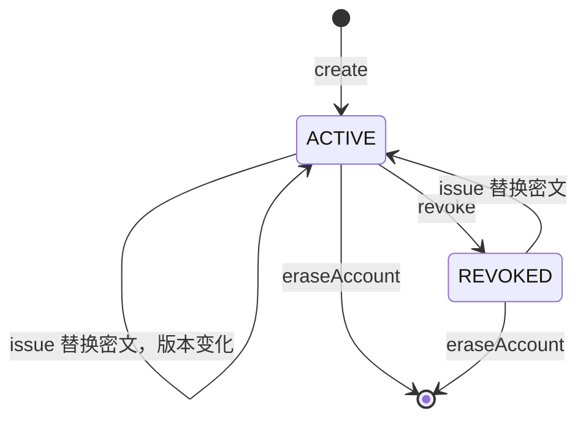

# HMAC 认证

HMAC 认证使用 Account 持有的 32 字节 MAC Key 计算 HMAC-SHA256 签名。服务端解密当前 Key 验证签名，并检查时间窗口、nonce 和失败次数。

`sca4dj-auth-hmac` 模块包含签发、轮换、撤销、签名验证、防重放和失败限制。对应的认证方法是 `HmacAuthenticationMethod`。

本页适用于需要以请求签名识别 Account 的具体应用的开发者。读完后，开发者可以理解 MAC Key 的加密存储、签名证明的字段、防重放与失败限制的规则，以及对应的配置项。规范串（canonical request）的字段顺序和格式见 [HMAC 请求签名](/capabilities/iot/hmac-request-signing)，本页不重复说明。

## 概念

HMAC 认证解决的问题是：证明调用方持有某个 Account 的 MAC Key，并且请求在有效时间窗口内没有被重放。

模块只验证签名，不解析 HTTP 请求。调用方或具体应用负责生成规范串字节。Session 的建立与权限判断由认证引擎和 IAM 负责，模块只返回 `VerifiedAuthentication`，因此同一实现可用于 HTTP、消息或设备接入。

HMAC 认证不能识别 Account。`canIdentifyAccount` 返回 `false`，认证时必须已经确定 Account。

例如，具体应用为 Device 的 HTTP 接口生成规范串字节。调用方使用签发的 Key 计算 HMAC-SHA256 签名，连同时间戳、nonce 和签名一起提交。应用构造 `HmacProof`，调用 `HmacAuthenticationMethod.authenticate(account, proof)`。模块依次检查时间窗口、失败次数、nonce 和签名，全部通过后返回认证结果。

## 核心对象

| 对象 | 负责 | 不负责 |
|---|---|---|
| `HmacAuthenticationMethod` | 声明 `AUTHENTICATION/HMAC` 编码，签发、轮换、撤销、验证签名，执行时间窗口、nonce 与失败次数规则 | 生成规范串，识别 Account |
| `HmacCredential` | 表示 Account 当前的 Credential，包含加密 Key、状态和版本 | 保存明文 Key |
| `HmacKeyCryptography` | 使用 `SecretKeyring` 加密和解密 MAC Key，按 Account 和版本绑定加密上下文 | 保存密钥环本身 |
| `HmacCredentialRepository` | 查询、创建、替换、更新状态和删除 `auth_hmac_credential` 表中的记录 | 验证签名 |
| `HmacAuthenticationAttemptStore` | 使用 Redis 保存 nonce 占用记录和失败次数 | 保存 MAC Key |
| `HmacProof` | 包装时间戳、nonce、规范串字节和签名，并校验格式 | 计算签名 |
| `IssuedHmacKey` | 同时包含新 Credential 和本次签发的明文 Key，由 `issue` 返回 | 在之后的调用中再次提供明文 Key |
| `HmacProperties` | 保存时间窗口、nonce 保留时间和失败限制的配置 | 决定 Account 的认证策略 |

## 签发与加密

`issue` 生成 32 字节随机数，并以无填充的 Base64URL 编码为 MAC Key 字符串。MAC Key 字符串的 UTF-8 字节，即为 HMAC-SHA256 的密钥字节。

Key 使用 `HmacKeyCryptography.encrypt` 加密。加密上下文为 `auth.hmac.account.<accountId>.version.<version>`，因此密文只能用于同一 Account 和版本。加密结果中的 `key_id` 与 `ciphertext` 保存在 `auth_hmac_credential` 表中。解密时，模块根据 `key_id` 查找 `SecretKeyring` 中的密钥。

签发时：

1. 若 Account 没有 Credential，`create` 插入新记录。
2. 若 Account 已有 Credential，`replace` 替换密文，并把状态设为 `ACTIVE`。
3. 已有 Credential 被替换时，`SessionControl.terminateAccount` 终止该 Account 的全部 Session，原因为 `AUTHENTICATION_CHANGED`。
4. 返回 `IssuedHmacKey`。

模块没有读取明文 Key 的方法。明文 Key 丢失后，只能通过再次签发替换。

## 签名证明

`HmacProof` 包含以下字段。

| 字段 | 校验规则 |
|---|---|
| `timestamp` | 不能为空。验证时与服务端当前时间的差值不能超过 `clock-skew` |
| `nonce` | 不能为空白，长度不超过 128 个字符 |
| `canonicalBytes` | 长度在 1 到 65536 字节之间，内容由调用方按规范串生成 |
| `signature` | 必须是 43 个字符的无填充 Base64URL 文本，解码后为 32 字节 |

签名为 `canonicalBytes` 经 HMAC-SHA256 计算后的 32 字节原始输出，再进行无填充 Base64URL 编码。`toString` 不输出 nonce、规范串字节和签名。

## 验证顺序

`authenticate` 按以下顺序执行检查。

1. `account` 为 `null` 时返回 `REJECTED`。
2. `timestamp` 与当前时间的差值超过 `clock-skew` 时返回 `REJECTED`。此时不计入失败次数。
3. 同一 Account 的失败次数达到 `failure-limit` 时返回 `REJECTED`。此时不计入失败次数。
4. 以 Account 和 nonce 调用 `setIfAbsent` 占用 nonce。占用失败时返回 `REJECTED`，此时不计入失败次数。nonce 占用发生在签名验证之前，因此错误签名的请求也会消耗其 nonce。
5. 读取 Credential，解密 Key，验证签名。Credential 不存在、状态不是 `ACTIVE`、签名不匹配，或签名不是合法的 Base64URL 时，计入一次失败并返回 `REJECTED`。
6. 验证成功后，清除该 Account 的失败次数，返回 `VerifiedAuthentication`。其引用为 Account 标识的十进制文本，版本为 Credential 的版本，过期时间为空。

签名比较使用 `MessageDigest.isEqual`，即固定时间比较。

失败次数的规则如下。

- 第一次失败时，Redis 计数键的 TTL 设为 `failure-window`。之后的失败不刷新 TTL，因此窗口是固定窗口，从第一次失败开始计算。
- 计数达到 `failure-limit` 后，在窗口结束前，该 Account 的所有请求都在第 3 步被拒绝。
- 验证成功会清除计数。

认证引擎完成前调用 `verifyCurrent`。Credential 必须仍存在、处于 `ACTIVE`、引用与 Account 一致，且版本一致。

Credential 的状态变化如下。



撤销时，`revoke` 把状态从 `ACTIVE` 改为 `REVOKED`，并记录撤销时间，然后终止该 Account 的全部 Session。Credential 已处于 `REVOKED` 时，`revoke` 返回 `false`。

`eraseAccount` 删除 Account 的 Credential 并清除失败次数。源码中的 erase 不删除已写入的 nonce 记录，nonce 记录按 `nonce-ttl` 自动过期。

## 配置

以下配置项由 `HmacProperties` 绑定，前缀为 `sca4dj.auth.hmac`。配置项在启动时校验：时长必须为正数，`failure-limit` 必须在 1 到 1000 之间。不满足时，启动失败并抛出 `IllegalStateException`。

| 配置键 | 类型 | 默认值 | 作用 |
|---|---|---|---|
| `sca4dj.auth.hmac.clock-skew` | 时长 | 5 分钟 | 允许的时间戳偏差。`timestamp` 与服务端时间的差值超过该值时拒绝 |
| `sca4dj.auth.hmac.nonce-ttl` | 时长 | 10 分钟 | nonce 占用记录的保留时间 |
| `sca4dj.auth.hmac.failure-window` | 时长 | 1 分钟 | 失败次数的固定统计窗口 |
| `sca4dj.auth.hmac.failure-limit` | 整数 | 10 | 窗口内允许的失败次数上限，取值范围为 1 到 1000 |

`nonce-ttl` 应不小于 `clock-skew` 的两倍。

设请求时间戳为 T。服务端当前时间在 `[T − clock-skew, T + clock-skew]` 内时，请求有效。因此，同一 nonce 的首次占用可能发生在 `T − clock-skew` 时刻。

若 `nonce-ttl` 小于 `clock-skew` 的两倍，nonce 记录可能先于时间窗口结束而过期。已过期的 nonce 可能被再次使用。

源码没有校验这两个配置项之间的关系。调整时应由配置方自行保证。默认值满足该关系。

Redis 键以 `AUTH:HMAC` 为前缀，分别包含 `NONCE` 与 `FAILURE` 段。

## 限制与失败结果

| 错误码 | 类别 | 触发位置 | 调用方处理 |
|---|---|---|---|
| `REJECTED`（1200） | 认证 | `authenticate` 中 Account 为空、时间戳超出窗口、失败次数已达上限、nonce 重复、Credential 不可用，或签名不匹配 | 以认证失败处理。所有拒绝原因使用同一错误码。同一 nonce 不能再次提交 |
| `CREDENTIAL_NOT_FOUND`（1201） | 资源不存在 | `revoke` 时 Account 从未签发过 Credential | 检查 Account 标识 |

以下情况不使用上表的错误码。

- `AuthHmacException` 是运行时异常，表示失败次数不是整数、Redis 返回的失败次数无效、无法设置失败计数的 TTL，或 JVM 不支持 `HmacSHA256`。这些情况是基础设施或数据故障。
- `IllegalStateException` 表示 Redis 未返回 nonce 写入结果，Credential 使用的 `key_id` 在 `SecretKeyring` 中不存在，或 `verifyCurrent` 发现 Credential 已变化（消息为 `HMAC Credential 已变化`）。
- `HmacProof` 的构造方法对格式不符的 nonce、规范串或签名抛出 `IllegalArgumentException`。这类错误通常来自调用方的请求解析。

调用方应注意以下规则。

- 重复提交同一请求会被 nonce 检查拒绝，即使第一次提交的签名有效。
- 错误签名会计入失败次数。达到上限后，即使提交正确签名，窗口结束前仍被拒绝。
- 轮换 Key 会使旧 Key 立即失效，并终止该 Account 的全部 Session。
- 规范串的字段、顺序和编码由调用方与服务端约定，见 [HMAC 请求签名](/capabilities/iot/hmac-request-signing)。模块只验证规范串字节与签名。

## 示例

以下示例为工作区的服务成员签发 MAC Key，并校验一次带签名的请求。`workspaceService` 表示具体应用自己的类型，其余类型均来自 `sca4dj-auth-hmac` 与 Core API。

```java
import java.time.Instant;

import com.sca4d.auth.hmac.HmacAuthenticationMethod;
import com.sca4d.auth.hmac.HmacProof;
import com.sca4d.auth.hmac.IssuedHmacKey;
import com.sca4d.core.api.authentication.VerifiedAuthentication;
import com.sca4d.core.api.identity.Account;

public class WorkspaceServiceKeys {

    private final HmacAuthenticationMethod hmac;

    public WorkspaceServiceKeys(HmacAuthenticationMethod hmac) {
        this.hmac = hmac;
    }

    /** 为工作区服务成员签发 Key。返回的 Key 只能在此刻交付一次。 */
    public String issueKey(Account serviceMember) {
        IssuedHmacKey issued = hmac.issue(serviceMember);
        return issued.key();
    }

    /** 校验请求。canonicalBytes 由应用按约定的规范串规则生成。 */
    public VerifiedAuthentication verify(
            Account serviceMember,
            Instant timestamp,
            String nonce,
            byte[] canonicalBytes,
            String signature) {
        HmacProof proof = new HmacProof(timestamp, nonce, canonicalBytes, signature);
        return hmac.authenticate(serviceMember, proof);
    }
}
```

`issue` 在 Account 已有 Credential 时替换旧 Key，并终止该 Account 的全部 Session。
`authenticate` 在拒绝时抛出 `REJECTED`（1200）。
调用方需要在 Account 已确定后再调用，因为本方法不能识别 Account。

调整时间窗口与失败限制的配置示例如下。`nonce-ttl` 保持不小于 `clock-skew` 的两倍。

```yaml
sca4dj:
  auth:
    hmac:
      clock-skew: 5m
      nonce-ttl: 10m
      failure-window: 1m
      failure-limit: 10
```

## 扩展方式

应用不替换 HMAC 实现，而是提供它依赖的对象。

- `SecretKeyring` 由 Core 提供。配置键 `sca4dj.secret-keyring.active-key-id` 存在且应用没有自己的 `SecretKeyring` Bean 时，Core 创建默认密钥环（`@ConditionalOnMissingBean`）；应用也可以提供自己的实现。密文使用的 `key_id` 必须仍能在密钥环中找到，否则解密抛出 `IllegalStateException`。
- `HmacAutoConfiguration` 把 `HmacCredentialRepository`、`HmacKeyCryptography`、`HmacAuthenticationAttemptStore` 和 `HmacAuthenticationMethod` 注册为 Bean。
- 认证引擎的 `AuthenticationMethods` 通过 `List<AuthenticationMethod<?>>` 收集全部方法。方法编码重复或没有声明因素类别时启动失败。
- 需要另一种签名算法时，应用实现自己的 `AuthenticationMethod` 并使用不同的编码，不修改本模块。

## 相关页面

- [认证方法、凭据与认证因素](/capabilities/authentication-session/authentication-methods)
- [认证开发规则](/capabilities/authentication-session/development)
- [认证尝试与 Session 模块](/capabilities/authentication-session/auth)
- [Shared Secret 认证](/capabilities/authentication-session/shared-secret)
- [HMAC 请求签名](/capabilities/iot/hmac-request-signing)
