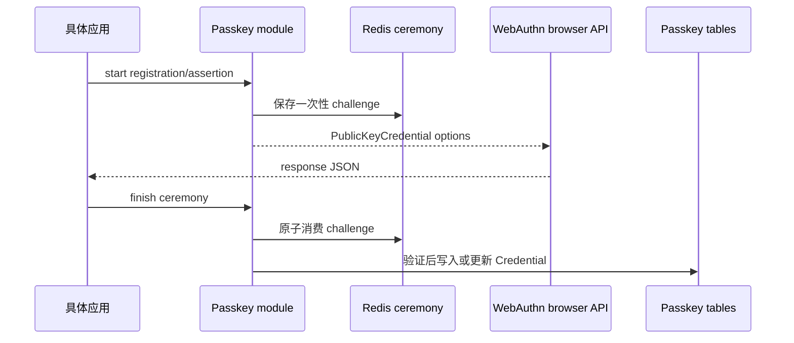

# Passkey 认证模块

当具体应用没有在 `settings.gradle.kts` 中纳入该模块，且服务端也不依赖它时，模块源码不参与应用构建、打包或 Spring 自动装配。以下内容说明模块本身的行为。

sca4dj-auth-passkey 实现 discoverable WebAuthn Passkey。每个 Account 可以保存多个 Credential，默认最多五个。每个 Credential 贡献 `POSSESSION`，并可以在登录起点识别 Account。Passkey 贡献 `POSSESSION` 因素，并能在登录起点识别 Account，因此 Account 是认证的结果，而不是 Passkey 登录的前置输入。



模块保存随机 user handle、公钥、签名计数器、transport、备份状态、名称和乐观版本，不保存私钥。

- registration 强制要求 resident key 和用户验证。
- assertion 验证 challenge、RP、origin、用户验证和签名计数器。

账号锚点为同一账号的多个 Credential 提供乐观版本。新增 Credential 先通过版本 CAS（比较并交换，compare-and-swap）抢占名额。删除时，同一个 CAS 同时检查删除后的最小保留数量。并发失败时返回版本冲突，不使用显式数据库行锁。

## 示例

以下示例为工作区成员注册 Passkey，并在登录起点完成 assertion。

```java
import com.sca4d.auth.passkey.PasskeyAuthenticationMethod;
import com.sca4d.auth.passkey.PasskeyCeremonyId;
import com.sca4d.auth.passkey.PasskeyProof;
import com.sca4d.auth.passkey.ceremony.PasskeyAssertionOptions;
import com.sca4d.auth.passkey.ceremony.PasskeyAssertionService;
import com.sca4d.auth.passkey.registration.PasskeyRegistrationOptions;
import com.sca4d.auth.passkey.registration.PasskeyRegistrationService;
import com.sca4d.core.api.authentication.AuthenticationSubmission;
import com.sca4d.core.api.identity.Account;

public class WorkspaceMemberPasskeys {

    private final PasskeyRegistrationService registration;
    private final PasskeyAssertionService assertion;

    public WorkspaceMemberPasskeys(
            PasskeyRegistrationService registration,
            PasskeyAssertionService assertion) {
        this.registration = registration;
        this.assertion = assertion;
    }

    /** 开始注册。返回的 options 交给浏览器的 WebAuthn API。 */
    public PasskeyRegistrationOptions startRegistration(Account member, String displayName) {
        return registration.start(member, displayName);
    }

    /** 完成注册。浏览器返回的 JSON 原样传入。 */
    public void finishRegistration(
            Account member,
            PasskeyCeremonyId ceremonyId,
            String responseJson,
            String credentialName) {
        registration.finish(member, ceremonyId, responseJson, credentialName);
    }

    /** 登录起点：不需要先指定 Account。 */
    public PasskeyAssertionOptions startAssertion() {
        return assertion.start();
    }

    /** 提交 assertion 给认证引擎。 */
    public AuthenticationSubmission<PasskeyProof> submission(
            PasskeyCeremonyId ceremonyId,
            String responseJson) {
        return new AuthenticationSubmission<>(
                PasskeyAuthenticationMethod.CODE,
                PasskeyProof.class,
                new PasskeyProof(ceremonyId, responseJson));
    }
}
```

每个 Account 默认最多五个 Credential。达到上限后继续注册，失败码为 `CREDENTIAL_LIMIT_REACHED`（2712）。

## 扩展方式

- 应用先在 `settings.gradle.kts` 纳入模块，并让服务端依赖它，`PasskeyAutoConfiguration` 才会生效。
- 配置前缀为 `sca4dj.auth.passkey`，`PasskeyProperties` 提供 `relyingPartyId`（默认 `localhost`）、`relyingPartyName`（默认 `Sca4d-J`）和 `origins`（默认 `http://localhost:5173`）对应的配置。部署时按实际域名覆盖。
- `RelyingParty` Bean 带有 `@ConditionalOnMissingBean`。应用提供自己的 `RelyingParty` Bean 时，默认实现不再创建。
- 认证引擎通过 `List<AuthenticationMethod<?>>` 发现 `PasskeyAuthenticationMethod`。
