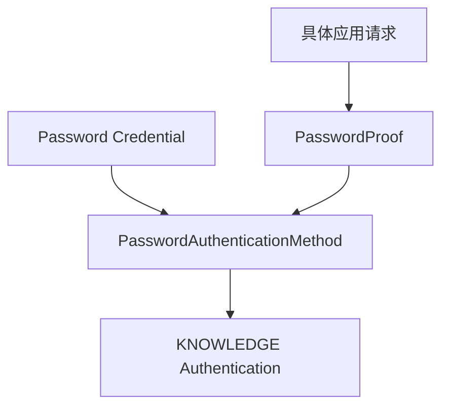

# Password 认证模块

sca4dj-auth-password 为每个 Account 保存一个 Password Credential，并实现 `password` AuthenticationMethod。模块不提供登录路由、不建立 Session，也不决定 Password 可以用于哪些动作。



具体应用创建账号或修改密码时，调用 Password Credential 服务。

Credential 保存 Argon2 摘要，并使用乐观版本。原始密码只在当前调用中使用。

登录起点可以携带用户名识别 Account。已知账号的动作认证只提交密码。

替换 Password 时，模块终止对应 Account 的全部旧 Session。终态删除 Account 时，具体应用负责终止 Session，并调用模块擦除密码摘要。Password 只贡献 `KNOWLEDGE` 因素，不建立 Session，也不决定密码能用于哪些动作；替换后终止旧 Session，使 Session 始终对应当前的认证状态。

## 示例

以下示例在工作区创建成员账号时保存初始密码，并在成员修改密码时替换。

```java
import com.sca4d.auth.password.PasswordAuthenticationMethod;

public class WorkspaceMemberPasswords {

    private final PasswordAuthenticationMethod password;

    public WorkspaceMemberPasswords(PasswordAuthenticationMethod password) {
        this.password = password;
    }

    /** 创建成员账号后保存初始密码。 */
    public void initialize(long accountId, String rawPassword) {
        password.create(accountId, rawPassword);
    }

    /** 替换密码。模块会终止该 Account 的全部旧 Session。 */
    public void change(long accountId, String newRawPassword) {
        password.replace(accountId, newRawPassword);
    }

    /** 终态删除成员账号时，应用先终止 Session，再擦除密码摘要。 */
    public void erase(long accountId) {
        password.eraseAccount(accountId);
    }
}
```

登录时，应用把 `PasswordProof(identifier, password)` 提交给认证引擎。
登录起点的 `identifier` 用于识别 Account。已知账号的动作认证没有标识，可以传入 `null`。
配置键见 [PasswordProperties](/capabilities/authentication-session/password-configuration)。

## 扩展方式

- `PasswordAutoConfiguration` 把 `PasswordAuthenticationMethod` 注册为 Bean，认证引擎通过 `List<AuthenticationMethod<?>>` 发现它。
- 登录标识类型通过 `sca4dj.auth.password.login-identifier-types` 配置，由 `AccountDirectory` 解析。应用提供 `AccountDirectory` 实现，并登记对应类型的标识。
- bootstrap 初始密码由 `sca4dj.auth.password.bootstrap.enabled` 控制，可以关闭。
