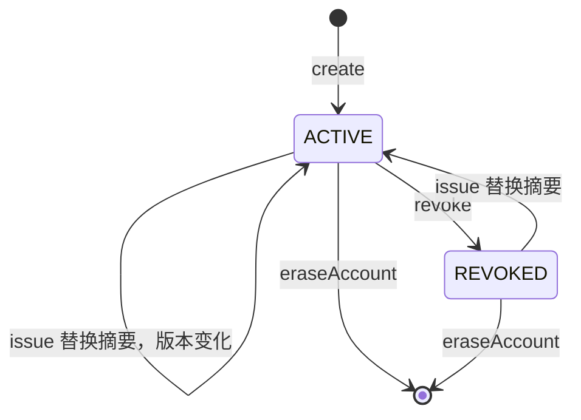

# Shared Secret 认证

Shared Secret 认证使用 Account 持有的一个原始共享密钥作为认证材料。服务端只保存密钥的不可逆摘要，原始值只在签发时返回一次。`sca4dj-auth-shared-secret` 模块包含签发、轮换、撤销和验证的实现，对应认证方法 `SharedSecretAuthenticationMethod`。

本页适用于需要为服务账号或设备接入签发长期共享密钥的具体应用的开发者。读完后，开发者可以理解原始密钥只展示一次的规则、轮换产生的新 Credential 版本，以及认证失败的结果。

## 概念

Shared Secret 认证解决的问题是：在调用方无法使用证书或签名时，用一个由服务端签发的随机密钥证明调用方的身份。

模块每个 Account 只保存一个当前 Credential。签发新密钥会替换旧密钥的摘要。

Shared Secret 认证不能识别 Account。`canIdentifyAccount` 返回 `false`，因此认证时必须先由具体应用或连接上下文确定 Account，再提交 `SharedSecretProof`。

例如，具体应用为服务账号签发密钥。签发调用返回 `IssuedSharedSecret`，其中包含 Credential 和原始密钥。应用把原始密钥交给服务账号的运维人员保存。之后，服务账号在请求中提交原始密钥。应用构造 `SharedSecretProof`，调用 `SharedSecretAuthenticationMethod.authenticate(account, proof)`。

## 核心对象

| 对象 | 负责 | 不负责 |
|---|---|---|
| `SharedSecretAuthenticationMethod` | 声明 `AUTHENTICATION/SHARED_SECRET` 编码，签发、轮换、撤销、验证原始密钥，撤销和轮换时终止 Account 的 Session | 识别 Account，保存原始密钥 |
| `SharedSecretCredential` | 表示 Account 当前的 Credential，包含摘要、状态和版本 | 保存原始密钥 |
| `SharedSecretCredentialRepository` | 查询、创建、替换、更新状态和删除 `auth_shared_secret_credential` 表中的记录 | 生成或比较密钥 |
| `IssuedSharedSecret` | 同时包含新 Credential 和本次签发的原始密钥，由 `issue` 返回 | 在之后的调用中再次提供原始密钥 |
| `SharedSecretProof` | 包装调用方提交的原始密钥，`toString` 不输出密钥 | 查询 Account |

密钥由 `SecureRandom` 生成 32 字节随机数，再以无填充的 Base64URL 编码。编码结果为 43 个字符。摘要由 Core 的 `SecretHasher` 计算。数据库列注释说明摘要为 Argon2id 不可逆摘要，并包含算法参数和盐值。

模块没有读取原始密钥的方法。原始密钥丢失后，只能通过再次签发替换为新密钥。原始密钥只在签发结果中出现一次，Credential 变化时终止该 Account 的全部 Session，与其他认证方法的做法一致。

## 调用与状态顺序

签发顺序如下。

1. `issue` 生成新的原始密钥，并计算摘要。
2. 若 Account 没有 Credential，`create` 插入新记录，状态为 `ACTIVE`。
3. 若 Account 已有 Credential，`replace` 更新摘要，并把状态设为 `ACTIVE`。无论原状态是 `ACTIVE` 还是 `REVOKED`，都会执行替换。
4. 已有 Credential 被替换时，`SessionControl.terminateAccount` 终止该 Account 的全部 Session，原因为 `AUTHENTICATION_CHANGED`。
5. 返回 `IssuedSharedSecret`。

认证顺序如下。

1. `account` 为 `null` 时返回 `REJECTED`。
2. 读取 Account 的 Credential。Credential 不存在、状态不是 `ACTIVE`，或摘要不匹配时返回 `REJECTED`。
3. 认证成功后，返回 `VerifiedAuthentication`。其引用为 Account 标识的十进制文本，版本为 Credential 的版本，过期时间为空。
4. 认证引擎完成前调用 `verifyCurrent`。Credential 必须仍存在、处于 `ACTIVE`、引用与 Account 一致，且版本一致。

Credential 的状态变化如下。



撤销时，`revoke` 检查 Credential 存在，然后把状态从 `ACTIVE` 改为 `REVOKED`，并记录撤销时间。撤销成功后，`SessionControl.terminateAccount` 终止该 Account 的全部 Session。Credential 已处于 `REVOKED` 时，`revoke` 返回 `false`。

## 配置

Shared Secret 认证没有 `@ConfigurationProperties` 配置类，也没有系统设置。密钥长度、编码和摘要算法由源码固定。

数据库表 `auth_shared_secret_credential` 的 `account_id` 唯一，因此每个 Account 只能有一条 Credential 记录。`version` 字段用于乐观并发控制。列注释说明它在创建、轮换、撤销或重新签发时递增。

## 限制与失败结果

| 错误码 | 类别 | 触发位置 | 调用方处理 |
|---|---|---|---|
| `REJECTED`（2800） | 认证 | `authenticate` 中 Account 为空、Credential 不存在、Credential 已撤销，或摘要不匹配 | 以认证失败处理。所有拒绝原因使用同一错误码 |
| `CREDENTIAL_NOT_FOUND`（2801） | 资源不存在 | `revoke` 时 Account 从未签发过 Credential | 检查 Account 标识 |

以下情况不使用上表的错误码。

- `verifyCurrent` 发现 Credential 缺失、已撤销、引用不一致或版本已变化时，抛出 `IllegalStateException`，消息为 `Shared Secret 凭据已变化`。源码中未为该情况定义错误码。
- `revoke` 对已撤销的 Credential 返回 `false`，不抛出异常。

调用方应注意以下规则。

- 原始密钥只出现在 `IssuedSharedSecret.secret()` 中。调用方应在签发后立即交付给使用方并妥善保存，模块之后不再提供该值。
- 轮换会使旧密钥立即失效，并终止该 Account 的全部 Session。
- 认证失败时，错误码不区分密钥错误、Credential 已撤销和 Account 为空。调用方不应从错误码推断密钥的具体状态。
- Shared Secret 认证的认证材料是请求中提交的原始密钥。传输安全由调用方的协议层保证，本模块不负责加密传输。模块源码中没有 HMAC 签名或时间窗口。需要签名和防重放时，应使用 [HMAC 认证](/capabilities/authentication-session/hmac)。

## 示例

以下示例为工作区的服务成员签发共享密钥，并在请求到达时校验。

```java
import com.sca4d.auth.sharedsecret.IssuedSharedSecret;
import com.sca4d.auth.sharedsecret.SharedSecretAuthenticationMethod;
import com.sca4d.auth.sharedsecret.SharedSecretProof;
import com.sca4d.core.api.authentication.VerifiedAuthentication;
import com.sca4d.core.api.identity.Account;

public class WorkspaceServiceSecrets {

    private final SharedSecretAuthenticationMethod sharedSecret;

    public WorkspaceServiceSecrets(SharedSecretAuthenticationMethod sharedSecret) {
        this.sharedSecret = sharedSecret;
    }

    /** 签发或轮换密钥。原始密钥只出现在返回值中。 */
    public String issue(Account serviceMember) {
        IssuedSharedSecret issued = sharedSecret.issue(serviceMember);
        return issued.secret();
    }

    /** 校验调用方提交的原始密钥。认证失败时抛出 REJECTED（2800）。 */
    public VerifiedAuthentication verify(Account serviceMember, String submittedSecret) {
        return sharedSecret.authenticate(serviceMember, new SharedSecretProof(submittedSecret));
    }
}
```

`issue` 在 Account 已有 Credential 时替换摘要，并终止该 Account 的全部 Session。
本模块没有配置键，因此示例中没有配置片段。

## 扩展方式

模块没有 `@ConfigurationProperties` 配置类，也没有应用需要实现的扩展接口。

- `SharedSecretAuthenticationMethod` 作为 Bean 注册后，认证引擎的 `AuthenticationMethods` 通过 `List<AuthenticationMethod<?>>` 发现它。
- 应用需要不同的密钥长度、编码或摘要算法时，实现自己的 `AuthenticationMethod`，使用不同的编码，不修改本模块。源码固定了 32 字节随机数和 Base64URL 编码。

## 相关页面

- [认证方法、凭据与认证因素](/capabilities/authentication-session/authentication-methods)
- [认证开发规则](/capabilities/authentication-session/development)
- [认证尝试与 Session 模块](/capabilities/authentication-session/auth)
- [HMAC 认证](/capabilities/authentication-session/hmac)
- [X.509 证书认证](/capabilities/authentication-session/x509)
