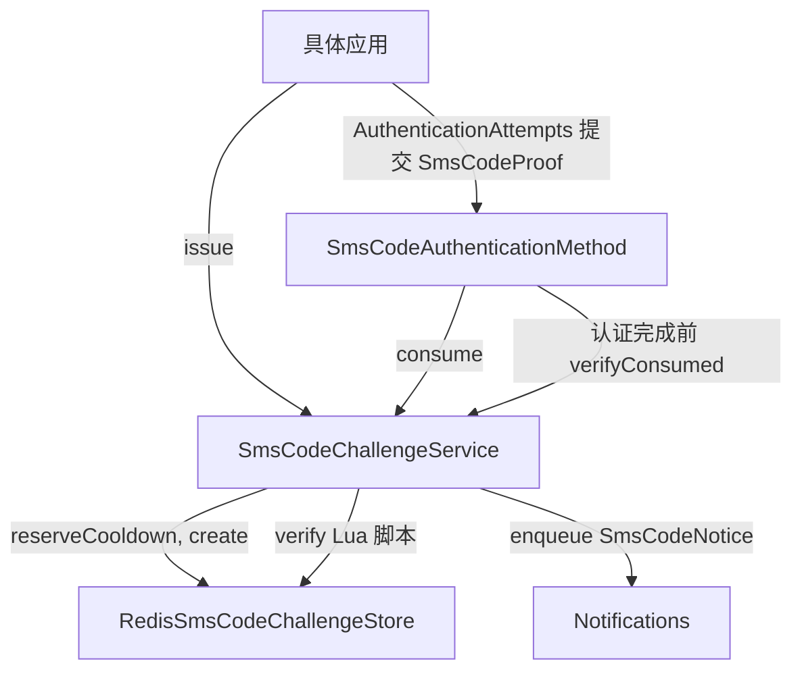
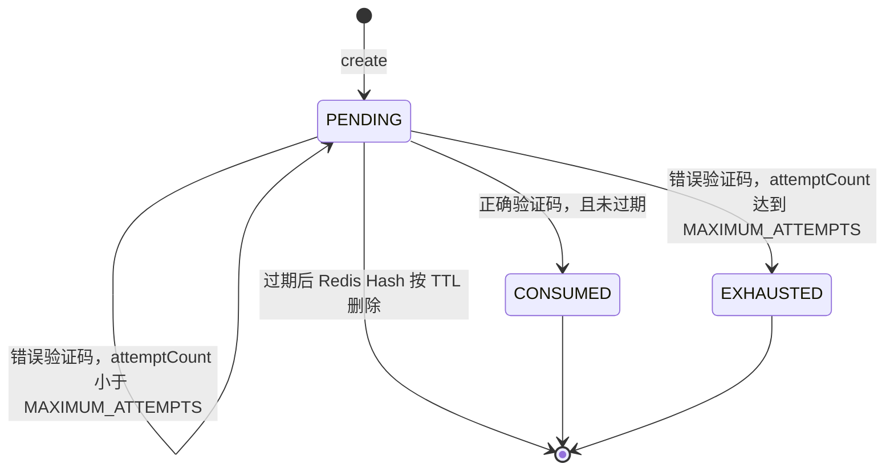

# 短信验证码登录

短信验证码登录（SMS Code）向账号绑定的手机号发送六位数字验证码，由用户提交验证码完成认证。`sca4dj-auth-sms` 模块包含 `sms-code` 认证方法、Challenge 的签发与消费、Redis 状态存储和配置项。

本页适用于需要手机号登录的具体应用的开发者。读完后，开发者可以理解验证码的签发、消费和重发限制，并能根据错误码处理签发与提交失败。

## 概念

短信验证码登录解决的问题是：在不保存密码的情况下，证明用户持有某个已确认的手机号。模块把每次验证码签发记录为一个 Challenge，并且每个 Challenge 的验证码只能被消费一次。

模块与以下对象协作：

- `AccountDirectory`：按 `PHONE` 类型标识符解析 Account。
- `Notifications`：把验证码通知入队。短信发送由 `sca4dj-notification-sms` 模块的 SMS 渠道完成。
- `RedisSmsCodeChallengeStore`：保存 Challenge 状态和重发冷却记录。
- `SecretHasher`：计算验证码摘要。Redis 中不保存验证码原文。
- `AuthenticationAttempts`：由具体应用调用，负责把 `SmsCodeProof` 交给认证方法。

例如，用户在登录页输入手机号 `13800138000`。具体应用调用 `SmsCodeChallengeService.issue(String)`。SmsCodeChallengeService 按 `PHONE` 类型解析 Account，生成六位验证码，并把验证码通知入队。返回值只包含 Challenge 标识、脱敏手机号 `1380***8000`、有效期截止时间和可重发时间。用户收到短信后，应用构造 `SmsCodeProof`，由 `SmsCodeAuthenticationMethod` 消费对应的 Challenge。

手机号无法解析为可发送验证码的 Account 时，`issue` 仍返回结构相同的 Challenge，但不发送通知。调用方无法通过响应判断手机号是否存在。

## 核心对象

| 对象 | 负责 | 不负责 |
|---|---|---|
| `SmsCodeAuthenticationMethod` | 声明 `AUTHENTICATION/SMS_CODE` 编码，消费 `SmsCodeProof`，返回 `POSSESSION` 认证因素 | 签发 Challenge，建立 Session，决定登录需要的因素数量 |
| `SmsCodeChallengeService` | 签发 Challenge，检查重发冷却，消费验证码，复核已消费的 Challenge | 发送短信，保存手机号资料 |
| `SmsCodeChallenge` | 返回给调用方的 Challenge 字段，包含标识、脱敏手机号、有效期和可重发时间 | 包含验证码或完整手机号 |
| `SmsCodeChallengeState` | 表示 Redis 中 Challenge 的内部状态，包括摘要、尝试次数、状态和版本 | 对外返回 |
| `RedisSmsCodeChallengeStore` | 使用 Redis Hash 保存 Challenge，使用 Lua 脚本原子更新状态，使用 `SETNX` 登记冷却 | 判断验证码是否正确 |
| `ConsumedSmsCodeChallenge` | 保存消费成功后的 Challenge 标识、Account 和消费后版本 | 保存验证码 |
| `SmsCodeNotice` | 定义 `AUTHENTICATION/SMS_CODE` 通知类型，要求 SMS 渠道，并在入队时携带验证码 | 保存通知的发送结果 |
| `SmsCodeProof` | 保存 Challenge 标识和用户提交的验证码，`toString` 不输出验证码 | 查询 Challenge 状态 |

`SmsCodeNotice` 的通知类型要求 `SmsChannels.SMS` 渠道。源码注释说明该渠道不可关闭。通知的变量只包含验证码和有效分钟数。手机号由 `AccountDirectory` 解析，模块不保存手机号，也不发送短信，发送交给 `Notifications` 与 SMS 渠道。

## 调用与状态顺序



Challenge 的状态变化如下。



签发顺序如下。

1. `issue` 解析 Account。按手机号签发时，解析失败或 Account 不可发送时，Challenge 不绑定 Account。
2. `reserveCooldown` 使用 `SETNX` 登记冷却记录。冷却键对应真实 Account 时使用 Account 标识的摘要，对应未知手机号时使用手机号的摘要。已有冷却记录时返回 `RESEND_TOO_SOON`。
3. 生成六位验证码，并用 `SecretHasher` 计算摘要。
4. `create` 把 Challenge 写入 Redis Hash，并把 TTL 设为有效期截止时间。
5. 只有绑定真实 Account 时，`Notifications.enqueue` 才入队 `SmsCodeNotice`。Javadoc 说明该入队在当前事务中写入 Outbox。

消费顺序如下。

1. `consume` 读取 Challenge。Challenge 不存在时，仍执行一次摘要比较，然后返回 `CODE_REJECTED`。
2. 只有状态为 `PENDING`、未过期、绑定真实 Account、验证码为六位数字且摘要匹配时，才视为有效。
3. `verify` 通过 Lua 脚本原子处理结果。有效时，状态变为 `CONSUMED` 并递增版本。无效时，尝试次数加 1；达到上限时，状态变为 `EXHAUSTED`。
4. 消费成功后，`consume` 读取当前 Account。Account 不可用时抛出 `CODE_REJECTED`，但 Challenge 保持 `CONSUMED`。
5. `SmsCodeAuthenticationMethod.authenticate` 检查 `expectedAccount` 与消费 Account 相同，然后返回 `VerifiedAuthentication`。其引用为 Challenge 标识，版本为消费后版本。
6. 认证引擎完成前，`verifyCurrent` 调用 `verifyConsumed`。Challenge 必须仍为 `CONSUMED`、未过期、版本一致，且绑定同一 Account。

## 配置

### 属性

| 配置键 | 类型 | 默认值 | 作用 |
|---|---|---|---|
| `sca4dj.auth.sms-code.account-realm` | 文本 | `platform` | 解析 `PHONE` 标识符所使用的 Account 认证域。设置为空白时，setter 抛出 `IllegalArgumentException` |

### 系统设置

以下设置由 `SmsCodeSettings` 声明。环境变量后缀不含产品前缀。

| 设置键 | 环境变量后缀 | 默认值 | 作用 |
|---|---|---|---|
| `AUTH:SMS_CODE:CHALLENGE_TTL` | `AUTH_SMS_CODE_CHALLENGE_TTL` | 5 分钟 | Challenge 有效期。同时用于 Redis Hash 的 TTL，并写入通知的有效分钟数。分钟数向上取整，且最小为 1 |
| `AUTH:SMS_CODE:RESEND_INTERVAL` | `AUTH_SMS_CODE_RESEND_INTERVAL` | 60 秒 | 同一目标两次签发之间的最短间隔。同时作为冷却记录的 TTL |
| `AUTH:SMS_CODE:MAXIMUM_ATTEMPTS` | `AUTH_SMS_CODE_MAXIMUM_ATTEMPTS` | 5 | 错误验证码的次数上限，达到后 Challenge 变为 `EXHAUSTED` |

三个设置都必须为正数。`CHALLENGE_TTL` 与 `RESEND_INTERVAL` 使用正数时长，`MAXIMUM_ATTEMPTS` 使用正整数。

### 依赖

`sca4dj-auth-sms` 依赖 `sca4dj-notification-sms`。验证码通知通过该模块的 SMS 渠道投递。

模块本身不保存手机号。`available` 通过 `Notifications.isAvailable` 判断 Account 是否具备可用的 SMS 渠道和已验证手机号。

## 限制与失败结果

| 错误码 | 类别 | 触发位置 | 调用方处理 |
|---|---|---|---|
| `CHALLENGE_UNAVAILABLE`（1300） | 资源不存在 | `issue(Account)` 时 Account 没有可用的 SMS 渠道或已验证手机号 | 不向该 Account 签发验证码 |
| `CODE_REJECTED`（1301） | 认证 | `consume` 中验证码错误、格式不是六位数字、Challenge 不存在、已消费、已耗尽或已过期；消费成功后 Account 不可用；`authenticate` 中 `expectedAccount` 不一致。`authenticate` 会把其他 `BusinessException` 统一包装为该错误码 | 提示用户重新输入或重新获取验证码。视次数情况决定是否重新签发 |
| `RESEND_TOO_SOON`（1302） | 冲突 | 同一目标在 `RESEND_INTERVAL` 内再次签发 | 等待 `resendAt` 后重新签发 |
| `CHALLENGE_ID_CONFLICT`（1303） | 冲突 | `create` 发现标识已存在。标识由 UUID 生成 | 重新签发 |
| `CHALLENGE_EXPIRED`（1304） | 冲突 | `create` 时有效期截止时间不晚于当前时间 | 重新签发 |
| `CHALLENGE_CHANGED`（1305） | 冲突 | `verifyConsumed` 发现 Challenge 缺失、已过期、状态不是 `CONSUMED`、版本不一致或 Account 不一致 | 重新获取验证码并重新认证 |

以下情况不使用上表的错误码。

- `AuthSmsException` 是运行时异常，表示 Redis Hash 缺少字段、字段为空或无法解析。它表示 Redis 中的 Challenge 数据损坏。
- 冷却记录在 Redis 中直接写入，不随外层事务回滚撤销。外层事务回滚后，冷却期内仍不能再次签发。
- `issue(Account)` 的 Javadoc 说明，Account 不存在或已停用时抛出 IAM 实现的 `ACCOUNT_UNAVAILABLE`。该错误码由 IAM 模块定义。

调用方应注意以下规则。

- 验证码只能成功消费一次。消费成功后，同一 Challenge 再次提交返回 `CODE_REJECTED`。
- 错误验证码会计入尝试次数。达到 `MAXIMUM_ATTEMPTS` 后，同一 Challenge 不能继续使用，应重新签发。
- 通知入队发生在 `create` 之后。通知投递结果不影响 Challenge 的状态。源码中未定义通知失败时的回滚行为。

## 示例

以下示例展示工作区成员使用手机号登录的两个调用点。
`authenticationMethods` 是认证引擎的 `AuthenticationMethods`，其用法见[认证尝试与 Session 模块](/capabilities/authentication-session/auth)。

```java
import com.sca4d.auth.sms.SmsCodeAuthenticationMethod;
import com.sca4d.auth.sms.SmsCodeChallenge;
import com.sca4d.auth.sms.SmsCodeChallengeId;
import com.sca4d.auth.sms.SmsCodeProof;
import com.sca4d.auth.sms.challenge.SmsCodeChallengeService;
import com.sca4d.core.api.authentication.AuthenticationSubmission;

public class WorkspaceMemberSmsLogin {

    private final SmsCodeChallengeService challenges;

    public WorkspaceMemberSmsLogin(SmsCodeChallengeService challenges) {
        this.challenges = challenges;
    }

    /** 第一步：为手机号签发 Challenge。手机号不存在时仍返回结构相同的结果。 */
    public SmsCodeChallenge sendCode(String phoneNumber) {
        return challenges.issue(phoneNumber);
    }

    /** 第二步：把用户提交的验证码包装为 Proof，交给认证引擎。 */
    public AuthenticationSubmission<SmsCodeProof> submission(
            SmsCodeChallengeId challengeId,
            String code) {
        return new AuthenticationSubmission<>(
                SmsCodeAuthenticationMethod.CODE,
                SmsCodeProof.class,
                new SmsCodeProof(challengeId, code));
    }
}
```

`issue` 在重发冷却期内抛出 `RESEND_TOO_SOON`（1302）。
验证码错误会计入尝试次数，达到上限后 Challenge 变为 `EXHAUSTED`。

调整有效期、重发间隔与尝试次数时，使用系统设置对应的环境变量。变量名前需要加产品前缀。

```properties
AUTH_SMS_CODE_CHALLENGE_TTL=5m
AUTH_SMS_CODE_RESEND_INTERVAL=60s
AUTH_SMS_CODE_MAXIMUM_ATTEMPTS=5
```

上述取值与默认值相同。
环境变量的产品前缀与取值格式见[字典与系统设置](/capabilities/data-configuration/dictionaries-and-settings)。

## 扩展方式

- 应用需要提供 `AccountDirectory` 的实现，使 `PHONE` 类型标识符能解析为 Account，并保证 `Notifications` 可用于该 Account 的 SMS 渠道。
- `SmsCodeAutoConfiguration` 把 Challenge 服务、Redis 存储和 `SmsCodeAuthenticationMethod` 注册为 Bean。认证引擎通过 `List<AuthenticationMethod<?>>` 发现该方法。
- 需要不同通知渠道时，应用在 `Notifications` 一侧提供渠道。`SmsCodeNotice` 要求 `SmsChannels.SMS`，该渠道不可关闭。
- 验证码长度和 Challenge 状态机由源码固定。需要不同规则时，应用实现自己的 `AuthenticationMethod`，使用不同的编码。

## 相关页面

- [认证方法、凭据与认证因素](/capabilities/authentication-session/authentication-methods)
- [认证开发规则](/capabilities/authentication-session/development)
- [认证尝试与 Session 模块](/capabilities/authentication-session/auth)
- [认证配置](/capabilities/authentication-session/configuration)
- [通知](/capabilities/messaging-notification/notification)
