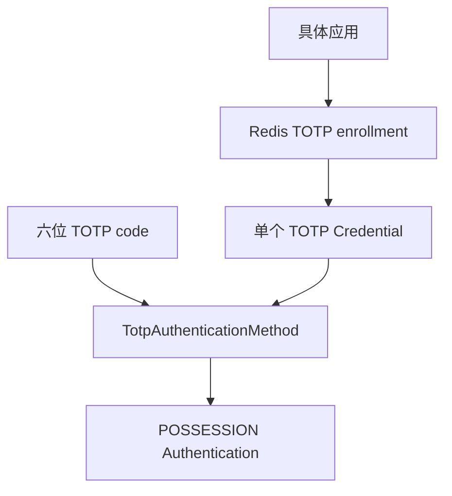

# TOTP 认证模块

sca4dj-auth-totp 为每个 Account 保存一个 TOTP Credential，并实现 `totp` AuthenticationMethod。TOTP 贡献 `POSSESSION`，不能识别 Account。



配置流程先在 Redis 中创建短期 enrollment。只有首个有效验证码通过后，才保存加密的 secret。

enrollment 单次消费，并有明确的有效期。Credential secret 使用应用配置的密钥加密。响应和日志都不返回 secret。未确认的 enrollment 只保存在 Redis，首个有效验证码通过后才写入数据库，避免留下无法使用的 Credential。

替换使用乐观版本。替换或删除 Credential 时，模块终止对应 Account 的全部旧 Session。删除最后一个 Credential 前，具体应用检查剩余认证方法是否仍能满足登录和敏感动作要求。

## 示例

以下示例为工作区成员绑定身份验证器，并在登录时校验验证码。

```java
import com.sca4d.auth.totp.TotpProof;
import com.sca4d.auth.totp.enrollment.TotpEnrollmentService;
import com.sca4d.auth.totp.credential.TotpCredential;
import com.sca4d.auth.totp.enrollment.TotpEnrollment;

public class WorkspaceMemberTotp {

    private final TotpEnrollmentService enrollments;

    public WorkspaceMemberTotp(TotpEnrollmentService enrollments) {
        this.enrollments = enrollments;
    }

    /** 第一步：创建短期 enrollment，展示给成员扫描。 */
    public TotpEnrollment begin(long accountId) {
        return enrollments.create(accountId);
    }

    /** 第二步：成员输入身份验证器显示的验证码，通过后才保存加密 secret。 */
    public TotpCredential confirm(long accountId, String enrollmentId, String code) {
        return enrollments.activate(accountId, enrollmentId, code);
    }

    /** 登录时把验证码交给认证引擎。 */
    public TotpProof proof(String code) {
        return new TotpProof(code);
    }
}
```

`replace` 与 `delete` 同样由 `TotpEnrollmentService` 提供，二者都会终止该 Account 的全部旧 Session。
删除最后一个 Credential 前，应用先检查剩余认证方法。

## 扩展方式

- `TotpAutoConfiguration` 把 enrollment 服务、Credential Repository 和 `TotpAuthenticationMethod` 注册为 Bean，认证引擎通过 `List<AuthenticationMethod<?>>` 发现该方法。
- secret 的加密使用应用配置的密钥。应用提供密钥的方式见 Core 的 `SecretKeyring`。
- 应用负责决定哪些动作需要 `POSSESSION` 因素，以及删除最后一个 Credential 前的检查。
