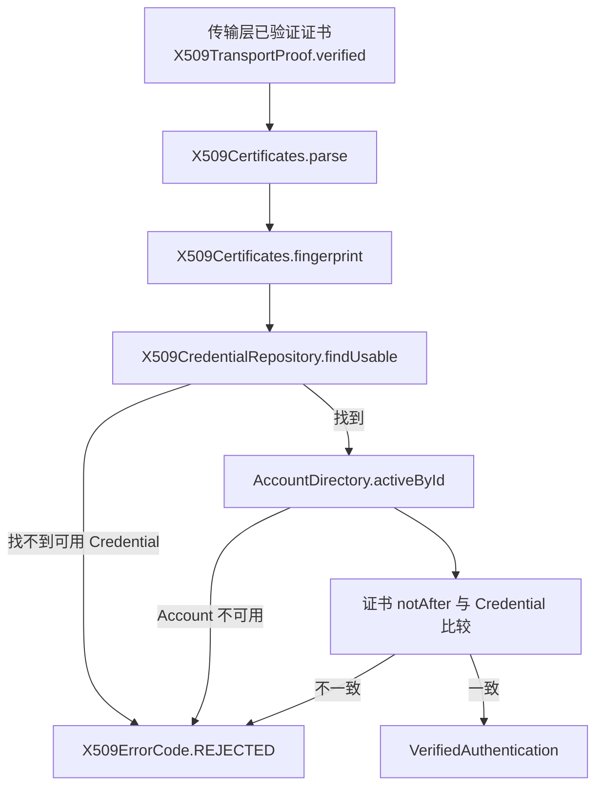
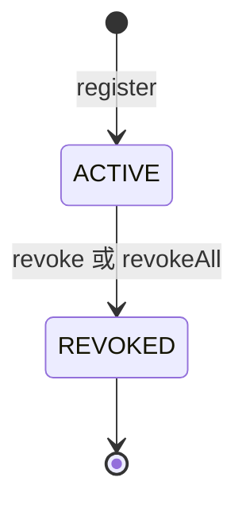

# X.509 证书认证

X.509 认证使用 Account 登记过的公钥证书。传输层完成证书验证后，具体应用把对端证书交给认证方法。认证方法按 SHA-256 指纹找到有效的 Credential。`sca4dj-auth-x509` 模块包含证书登记、撤销和 `X509AuthenticationMethod` 认证方法。

本页适用于需要以客户端证书识别 Account 的具体应用的开发者，包括业务应用、服务账号和设备接入。读完后，开发者可以理解证书登记的校验规则、传输层证明的前置条件，以及各失败结果的含义。

## 概念

X.509 认证解决的问题是：证明连接方持有某张已登记的客户端证书的私钥。模块只保存证书的公钥部分（DER 编码）和元数据，不保存私钥。

证书由外部 CA 签发。模块不建立证书链信任，也不执行 TLS 握手。这些工作由具体应用在传输层完成。证书链是否可信由传输层完成，模块只按指纹查找 Credential 确认 Account；Credential 只保存证书元数据，不保存私钥。

例如，服务账号 svc-gateway 的客户端证书由外部 CA 签发。管理流程把该证书的 DER 内容交给 `X509AuthenticationMethod.register`，模块保存指纹、序列号、Subject DN 和有效期。之后，服务端在 TLS 握手完成后取得对端证书的 DER，调用 `X509TransportProof.verified(der)` 生成 Proof，再由认证引擎交给 `X509AuthenticationMethod.authenticate`。

## 核心对象

| 对象 | 负责 | 不负责 |
|---|---|---|
| `X509AuthenticationMethod` | 声明 `AUTHENTICATION/X509` 编码，登记、查询和撤销 Credential，验证 Proof，撤销时终止 Account 的 Session | 执行 TLS 握手，验证证书链 |
| `X509CredentialRegistration` | 包装单张 X.509 公钥证书的 DER，供登记使用 | 接收或保存私钥 |
| `X509TransportProof` | 包装已由传输层验证的证书 DER，`toString` 不输出 DER | 验证证书是否可信 |
| `X509Certificates` | 模块内部的 DER 解析、长度校验和 SHA-256 指纹计算 | 对外提供 API |
| `X509Credential` | 表示一张已登记证书的元数据和状态，状态为 `ACTIVE` 或 `REVOKED` | 保存证书 DER 字节 |
| `X509CredentialRepository` | 保存、查询和更新 `auth_x509_credential` 表 | 判断证书是否有效 |

`X509Credential` 的 `usableAt` 判断两个条件：状态为 `ACTIVE`，并且当前时间位于 `notBefore`（含）与 `notAfter`（不含）之间。

## 调用与状态顺序

登记证书的顺序如下。

1. `register` 解析 DER。解析失败时返回 `INVALID_CERTIFICATE`。
2. 证书的 `notAfter` 不晚于当前时间，或 `notAfter` 不晚于 `notBefore` 时，返回 `INVALID_CERTIFICATE`。
3. 计算 DER 的 SHA-256 小写十六进制指纹，并生成新的 Credential 标识。
4. 保存 Credential 与 DER。指纹唯一约束冲突时返回 `CREDENTIAL_CONFLICT`。

Javadoc 说明 Account 停用时仍允许预置证书。

认证的顺序如下。



认证成功后，`VerifiedAuthentication` 的引用为 Credential 标识的十进制文本，版本为 Credential 的版本，过期时间为证书的 `notAfter`。认证引擎完成前调用 `verifyCurrent`。模块要求 Credential 仍存在、属于同一 Account、版本一致，且在有效期内。

Credential 的状态变化如下。



撤销时，`revoke` 把状态改为 `REVOKED` 并记录撤销时间，然后调用 `SessionControl.terminateAccount`，原因为 `AUTHENTICATION_CHANGED`。`revokeAll` 对 Account 的全部 `ACTIVE` Credential 执行相同操作。已撤销的 Credential 再次调用 `revoke` 时返回 `false`，且不终止 Session。

## 传输层证明

`X509TransportProof.verified(certificateDer)` 只能用于传输层已经完成以下验证的证书。

- 受信任根证书链验证。
- 证书有效期验证。
- 客户端认证用途验证。
- 握手签名验证。

Javadoc 说明，原始 PEM、只完成格式解析的证书，以及只计算过指纹的证书，都不能调用该方法。模块本身不执行这些验证，只按指纹查找已登记的 Credential。

证书 DER 的长度必须在 1 到 65536 字节之间。长度不符时，构造方法抛出 `IllegalArgumentException`。该上限是 `X509Certificates` 中的常量，没有配置键。

## 配置

`sca4dj-auth-x509` 模块没有 `@ConfigurationProperties` 配置类，也没有系统设置。证书登记数据保存在 `auth_x509_credential` 表中，包括指纹（唯一）、证书 DER、序列号、Subject DN、`not_before`、`not_after`、状态、版本和撤销时间。表中不包含私钥。

## 限制与失败结果

| 错误码 | 类别 | 触发位置 | 调用方处理 |
|---|---|---|---|
| `REJECTED`（3300） | 认证 | `authenticate` 中 DER 无法解析，指纹没有对应的可用 Credential，Account 不可用，`expectedAccount` 不一致，或 `notAfter` 与 Credential 不一致。方法内任何 `BusinessException` 都统一包装为该错误码 | 以认证失败处理。错误码不区分具体原因 |
| `CREDENTIAL_NOT_FOUND`（3301） | 资源不存在 | `revoke` 时 Credential 不存在或不属于目标 Account | 检查 Account 标识和 Credential 标识 |
| `INVALID_CERTIFICATE`（3302） | 校验 | `register` 时 DER 无法解析、证书已过期，或有效期不正确 | 提供有效的单张 X.509 公钥证书 |
| `CREDENTIAL_CONFLICT`（3303） | 冲突 | `register` 时同一证书指纹已登记 | 确认证书是否已经登记，不重复登记 |

以下情况不使用上表的错误码。

- `verifyCurrent` 发现 Credential 缺失、不属于同一 Account、版本已变化或已不在有效期内时，抛出 `IllegalStateException`，消息为 `X.509 Credential 已变化`。源码中未为该情况定义错误码，调用方不应依赖错误码识别它。
- `verifyCurrent` 中的引用不是数字时，抛出 `AuthX509Exception`。该情况表示认证证据数据损坏。
- DER 为空或超过 65536 字节时，抛出 `IllegalArgumentException`。

调用方应注意以下规则。

- 证书撤销会立即终止 Account 的全部 Session。
- 同一证书只能登记一次。同一证书的指纹相同，因此无法以同一 DER 登记给两个 Account。
- 证书轮换由具体应用完成：登记新证书，撤销旧证书。模块的登记操作不会自动撤销已有证书。

## 与 IoT 设备凭据的分工

IoT 主库不保存证书表。证书由本模块的 Credential 按 Account 保存。Device 声明的接入方式由 IoT 模块保存。

连接时，IoT 的连接认证按 Device 声明的接入方式执行 X.509 认证。相关说明见[设备生命周期](/capabilities/iot/device-lifecycle)。

## 示例

以下示例为工作区的服务成员登记客户端证书，并在传输层验证后认证连接。

```java
import com.sca4d.auth.x509.X509AuthenticationMethod;
import com.sca4d.auth.x509.X509Credential;
import com.sca4d.auth.x509.X509CredentialRegistration;
import com.sca4d.auth.x509.X509TransportProof;
import com.sca4d.core.api.authentication.VerifiedAuthentication;
import com.sca4d.core.api.identity.Account;

public class WorkspaceServiceCertificates {

    private final X509AuthenticationMethod x509;

    public WorkspaceServiceCertificates(X509AuthenticationMethod x509) {
        this.x509 = x509;
    }

    /** 登记由外部 CA 签发的单张证书。重复登记同一证书抛出 CREDENTIAL_CONFLICT（3303）。 */
    public X509Credential register(Account serviceMember, byte[] certificateDer) {
        return x509.register(serviceMember, new X509CredentialRegistration(certificateDer));
    }

    /** 只能在 TLS 握手已经验证证书链、有效期、用途和签名之后调用。 */
    public VerifiedAuthentication authenticate(Account serviceMember, byte[] peerCertificateDer) {
        return x509.authenticate(serviceMember, X509TransportProof.verified(peerCertificateDer));
    }

    /** 轮换证书：先登记新证书，再撤销旧证书。 */
    public void rotate(Account serviceMember, long oldCredentialId, byte[] newCertificateDer) {
        x509.register(serviceMember, new X509CredentialRegistration(newCertificateDer));
        x509.revoke(serviceMember.accountId(), oldCredentialId);
    }
}
```

`authenticate` 的 `expectedAccount` 可以为 `null`，此时由证书指纹解析 Account，因此 X.509 可以在登录起点识别 Account。
本模块没有配置键，因此示例中没有配置片段。

## 扩展方式

- 模块没有应用需要实现的扩展接口。应用提供的是传输层：配置 TLS 信任根并要求客户端证书，在握手完成后取得对端证书 DER。
- `X509AuthenticationMethod` 作为 Bean 注册后，认证引擎的 `AuthenticationMethods` 通过 `List<AuthenticationMethod<?>>` 发现它。
- 需要证书之外的绑定规则，例如按 Subject DN 限制，由应用在调用 `register` 之前检查。模块只保存 Subject DN，不据此判断。

## 相关页面

- [认证方法、凭据与认证因素](/capabilities/authentication-session/authentication-methods)
- [认证开发规则](/capabilities/authentication-session/development)
- [认证尝试与 Session 模块](/capabilities/authentication-session/auth)
- [IoT 基础模块](/capabilities/iot/iot)
- [设备生命周期](/capabilities/iot/device-lifecycle)
