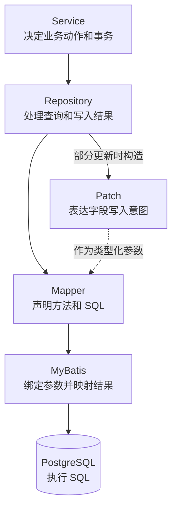

# 数据访问与持久化设计

本页说明 Sca4d-J 选择原生 MyBatis 访问关系数据库的理由，以及 Service、Repository、Mapper 和 Patch 各自负责的事项。本页适用于设计 Repository、Mapper 和数据库查询的开发者。读完后，开发者能判断一项数据库操作应保留手写 SQL 的哪些条件，以及哪些工作仍需由开发者完成。

Sca4d-J 使用 PostgreSQL 保存关系数据，并使用原生 MyBatis 访问数据库。这里的「原生 MyBatis」包括 MyBatis 及其 Spring 集成。它不包括 MyBatis-Plus、MyBatis-Flex 或 ORM 框架。

Sca4d-J 选择 MyBatis，是因为查询和更新条件需要直接写在 SQL 中。参数绑定、结果映射和 JDBC 资源管理，没有必要在每个 Repository 中重复实现。SQL 由应用维护，MyBatis 完成 Java 与 SQL 之间的转换。

本页只说明关系数据库访问的技术选择。Mapper 和 SQL 的编码要求见 [MyBatis 与持久化规范](/engineering/stack/persistence)。Service、Repository 和 Mapper 的职责见 [SQL 与持久化分层](/engineering/stack/persistence-boundary)。

## 为什么保留手写 SQL

Sca4d-J 的数据库操作不只是单表增删改查。例如：

- 状态更新要在同一条语句中检查目标 ID、数据范围、当前状态和预期版本；
- 任务抢占要明确排序、批量上限、锁和租约条件；
- 分页查询要明确返回字段、联表方式、筛选条件和稳定排序；
- 聚合、批量写入和 PostgreSQL 专用操作，需要按数据库实际支持的语法实现。

这些条件决定查询结果、并发行为和写入是否成功。直接阅读 SQL，可以确认数据库会读取哪些数据、以什么顺序加锁，以及哪些条件不满足时不会更新。

出现结果错误或性能问题时，也可以从 Mapper 中找到实际语句，再检查绑定参数、执行计划和索引。

直接使用 JDBC 同样可以保留 SQL。但每个查询都要重复创建语句、绑定参数、读取结果集、转换类型和释放资源。因此，Sca4d-J 保留手写 SQL，由 MyBatis 处理重复的 JDBC 工作。

并发条件和失败结果都在 SQL 中体现：零行结果经 `AffectedRowCounts.requireSingle` 转换为冲突或前置条件失败，见[并发规则](/capabilities/data-configuration/concurrency-development)。

## MyBatis 在这里做什么

MyBatis 负责以下工作：

- 将 Mapper 方法调用关联到对应的 SQL；
- 绑定 SQL 参数，并按 Mapper XML 中的条件拼装动态语句；
- 将查询结果转换成普通 Java 对象；
- 通过 TypeHandler 读写框架中的专用值类型；
- 通过 MyBatis-Spring 使用 Spring 管理的 Mapper 和数据库事务。

MyBatis 不维护 Java 对象之间的关系，不跟踪对象字段的变化，也不判断权限、业务状态和事务范围。表之间怎样关联、更新必须满足哪些条件，仍然明确写在 SQL 中。业务动作和事务，仍然由 Service 决定。

短小、固定的 SQL 可以写在 Mapper 注解中。包含动态条件、复杂联表、聚合或批量处理的 SQL，写在 Mapper XML 中。两种形式都直接保存 SQL，只是文件位置不同。

PostgreSQL 的 `RETURNING`、CTE、窗口函数和 JSON 操作，也可以按需直接使用。Mapper 保存具体语句，Repository 解释返回行和影响行数，Service 不依赖 PostgreSQL 的列名或语法。



业务流程由 Service 调用 Repository。Repository 根据本次数据操作，调用一个或多个 Mapper。它将空查询、零行更新和分页查询返回的数据库行，转换为调用方能够直接处理的结果。

Mapper 声明数据库实际执行的 SQL 及其参数和返回类型。MyBatis 负责执行语句并完成转换。Service 不处理 Mapper 的行类型、影响行数或其他持久化细节。

## 部分更新怎样表达字段意图

一次 SQL 更新可能只修改部分列。可空 Java 值无法同时表达「不修改该列」和「把该列写为数据库 `NULL`」。也不能把数值零、`false` 或空字符串推断为没有修改。

[Patch](/capabilities/data-configuration/patch-updates) 让 Repository 为每个可选更新列明确选择 IGNORE、SET 或 CLEAR。再由 Mapper XML 按状态生成对应的列赋值。

Patch 位于 Core API，但不把持久化改成通用 DAO。各模块仍然声明自己的更新参数对象和 Mapper 方法。SQL 仍然逐列写出允许更新的数据库字段、原子条件和 `WHERE` 条件。

Patch 也不进入 HTTP Request 或 Service 校验流程。Controller、实体和值对象、Service 继续在各自范围内完成协议、字段和业务校验。Repository 只把已经确定的结果，转换成数据库写入所需的变更内容。

## 列表查询怎样保持类型安全

动态列表由 Controller 使用 ListDefinition 声明允许字段、默认排序和可选页大小上限。再把 ListParameters 转为 ListRequest。

Sort 只保存大写协议字段名，不保存数据库列或 SQL。创建时间、修改时间、ASCII 名称和稳定序号可以使用内置字段。业务字段使用 `Sort.of(...)`。

业务筛选继续由具体参数和业务 Query 表达。Repository 在同一个数据范围内执行 count 和当前页查询，并返回公共 `Page<T>`。没有记录时，跳过 rows 查询。

Mapper 对每个允许的 Sort 显式映射数据库列，使用公共方向片段。它还追加稳定的 ID 排序，消除相同字段值的顺序歧义。

这套类型只统一分页和安全排序。它不生成筛选字段，不生成查询 Wrapper，也不把请求字符串作为 SQL 片段。完整 HTTP 参数和失败结果见 [HTTP API 通用约定](/reference/http/common#列表查询)。

## 为什么不混用其他持久化框架

ORM 以对象映射和对象状态为主要入口，再由框架生成 SQL。采用 ORM 后，对象关系、查询方式和写入方式，都要按照同一套模型组织。Sca4d-J 的数据库操作需要直接控制查询字段、联表条件、锁和原子更新条件，因此没有采用 ORM。

MyBatis-Plus、MyBatis-Flex 等增强框架，可以用通用 Mapper、Wrapper 或查询 DSL 减少简单查询的代码。但它们也会在原生 SQL 之外，增加新的查询写法。

混用后，同一类查询可以写成 Wrapper、DSL、注解 SQL 或 Mapper XML。相似代码容易在不同模块使用不同写法。遇到锁、数据库专用语法或复杂批量操作时，仍然需要找到并检查最终 SQL。

Sca4d-J 因此只保留原生 MyBatis。简单查询和复杂查询都遵守同一套 Mapper 规则。

更换持久化框架时，需要同时调整对象关系、查询、写入、迁移和测试。不能在现有 MyBatis Mapper 旁增加一套并行实现。

## 仍需完成的数据库工作

Java 编译器不会检查表名、列名和完整 SQL。MyBatis 也不会自动同步数据库结构与 Java 类型。因此，开发者需要完成以下工作：

- 表或列发生变化时，同步修改 Mapper、结果类型、Repository 和相关测试；
- 查询必须明确选择字段，并检查动态条件、排序、数据范围、锁和批量上限；
- Mapper 需要通过数据库集成测试与迁移一起验证；
- 重要查询和慢查询需要检查执行计划及索引；
- Repository 必须处理查询行、影响行数和 MyBatis 类型，不能把这些细节交给 Service。

MyBatis 减少的是重复的 JDBC 代码，不是数据库设计、SQL 检查、迁移和集成测试。查询条件、并发规则和数据库行为，仍然需要在 Mapper 中清楚写出，并在 PostgreSQL 集成测试中验证。

## 内部批处理

Repository 使用 SqlBatches 分批执行已经确定的集合查询和写入。它根据 `sca4dj.persistence.batch.max-items` 与 `sca4dj.persistence.batch.max-bind-parameters` 计算每批大小，默认分别为 1000 和 30000。调用方还要声明每个元素与每条 SQL 的绑定参数数量。

配置只控制单次数据库操作的规模，不限制公开方法可以接收的总集合数量。

SqlBatches 不去重输入、不创建事务、不重试，也不解释缺失记录、重复结果和影响行数。Repository 继续负责这些持久化判断。单对象读取应复用同一个批量装载入口，避免维护另一套对象组装逻辑。

Redis pipeline 使用独立的 RedisBatches，按 `sca4dj.redis.pipeline.max-commands` 和每个元素产生的命令数切批，默认命令上限为 1000。SQL 与 Redis 的成本和失败方式不同，不能共用一个批次配置。

## 示例

以下示例用「文档」说明 Service、Repository 与 Mapper 的分工。`DocumentService`、`DocumentRepository`、`DocumentMapper`、`DocumentEntry` 和 `DocumentErrorCode` 由应用定义。

Mapper 声明 SQL 的参数和返回类型，不处理业务判断：

```java
public interface DocumentMapper {

    @CheckReturnValue
    @NotNull
    List<@NotNull DocumentEntry> selectDocuments(
            @Param("workspaceId") long workspaceId,
            @Param("offset") long offset,
            @Param("size") int size);

    @CheckReturnValue
    long countDocuments(@Param("workspaceId") long workspaceId);

    int updateTitle(
            @Param("id") long id,
            @Param("title") @NotNull Patch<String> title,
            @Param("expectedVersion") @NotNull Version expectedVersion);
}
```

Repository 解释影响行数，并把零行转换为明确的失败：

```java
public void renameDocument(long id, String title) {
    Document current = find(id).orElseThrow(() -> new BusinessException(DocumentErrorCode.NOT_FOUND));
    VersionCondition condition = versionConditions.resolve(current.version());
    int rows = mapper.updateTitle(id, Patch.set(title), condition.expected());
    AffectedRowCounts.requireSingle(rows, condition.whenZero(), "文档");
}
```

Service 只调用 Repository 的公开方法，不接触 Mapper 的行类型和影响行数。

Mapper 中的 SQL 直接写出 `WHERE id = #{id} AND version = #{expectedVersion}`，并按 Patch 状态生成列赋值。Patch 的状态见[Patch](/capabilities/data-configuration/patch-updates)。

批量读取同一工作区的多个文档时，Repository 使用 `SqlBatches.query`。每个元素产生一个绑定参数，每条 SQL 另有一个固定参数：

```java
List<DocumentEntry> entries = sqlBatches.query(
        documentIds, 1, 1, batch -> mapper.selectByIds(workspaceId, batch));
```

`SqlBatches.query` 返回按批次合并的不可修改结果。输入为空时返回空列表，不调用 `query`。`selectByIds` 是应用在 `DocumentMapper` 中声明的方法。
