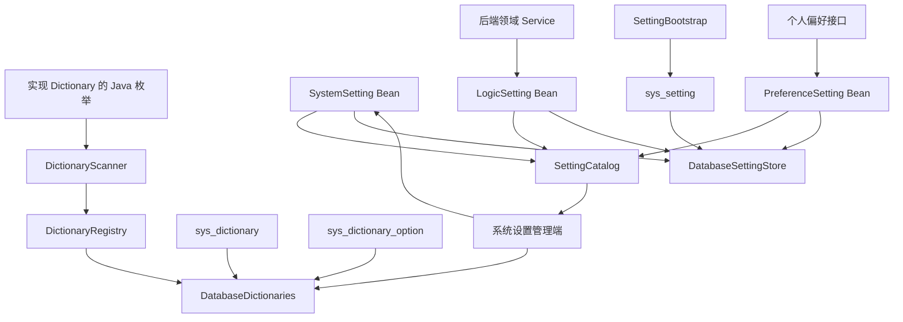

# 字典与设置

本页说明字典与 Setting 的数据归属、保存规则、初始化节点以及管理端负责的范围。本页适用于维护枚举选项、系统设置和个人偏好的开发者。

代码中的枚举和数据库中需要长期维护的选项，都有展示、排序和禁用要求。只让各页面保存本地映射，会使同一值在不同界面出现不同标签。

没有独立生命周期、需要动态管理的类型化值，也不能混入业务表，或散落在 Spring Properties 中。Sca4d-J 将这两类数据分成[字典](/javadoc/core/sca4dj-core-api/com/sca4d/core/api/dictionary/package-summary.html)和 [Setting](/javadoc/core/sca4dj-core-api/com/sca4d/core/api/setting/package-summary.html)。

## 数据归属



实现 Dictionary 的枚举，只由 DictionaryScanner 扫描到 DictionaryRegistry，不写入 `sys_dictionary`。

DatabaseDictionaries 在读取时，将代码项与 `sys_dictionary_option` 中允许的数据库扩展项合并。动态字典和动态字典的选项，分别保存在 `sys_dictionary` 与 `sys_dictionary_option`。

字典管理服务在写入前检查代码键、选项扩展规则和乐观锁版本。失败时不产生部分更新。

应用在构造 Setting 时注入 SettingReader 和 SettingWriter，再把定义注册为 Spring Bean。SettingCatalog 拒绝重复编码。管理接口按定义类型限制访问范围。

业务通过 `setting.get()`、`setting.inspect(owner)`、`setting.replace(owner, value)` 和 `setting.reset(owner)` 读取或维护值。

DatabaseSettingStore 负责读写 `sys_setting`。缺失的值由 Setting 选择继承来源或默认值。

SettingBootstrap 只处理 SystemSetting。它在指定初始化节点写入或同步系统 owner。失败时，节点不会就绪。

Gateway Header 等启动后不得变化的协议名称，由 ConfiguredConstants 从部署配置读取，不保存到 `sys_setting`。

## 字典保存哪些数据

Dictionary 的 `dictionaryKey()` 必须由同一枚举的所有常量一致返回。

代码字典默认封闭。只有 `allowsDatabaseOptions()` 返回 `true` 时，才允许 `sys_dictionary_option` 增加枚举之外的值。

动态字典不需要 Java 枚举，但必须先存在且处于启用状态的 `sys_dictionary` 行，才能读取或写入选项。

代码选项使用国际化消息键。数据库选项的 `label` 保存所有目标 Locale 都没有翻译时使用的必填回退文本。`i18n` 按 BCP 47 Locale 保存可选的 `label` 翻译。

查询结果先按 `sortOrder` 排序，再按值排序。禁用项仍保留在读取结果中，调用方不能把它用于新的业务输入。

字典不保存业务对象、业务流程、语言包或每个选项的复杂生命周期。这些数据仍由相应模块的表和 Service 负责。

## 哪些值适合做 Setting

Setting 保存一个 owner 的完整类型化值，例如系统范围的文件传输有效期、Account 的认证策略或 Account 的管理端偏好。

短信模板、邮件模板，以及可独立创建、删除、审计、授权或排序的业务对象，拥有自己的 Repository 和表。不能改写为 Setting 键值。

数据库地址、连接凭据、模块启用条件和启动装配参数仍是运行配置。除非另有动态生效设计，不能仅因它们可配置，就写入 `sys_setting`。

Setting 使用 TreeCode 表达稳定编码。数据库和 HTTP 设置键使用大写冒号形式，例如 `BRAND:PRODUCT_NAME` 和 `ADMIN:UI_PREFERENCES`。

VersionedCodec 声明 Java 值类型、外部表示和内容版本。SettingCodec 另外定义管理接口的 JSON 表示与输入控件类型。

Setting 在构造时固定来源顺序、写入目标、默认值和 Pipeline。读取完成后，校验完整结果。SystemSetting 还声明分组、国际化消息键、ENV 后缀和展示顺序。

| 定义 | owner | 调用入口 | 主要限制 |
| --- | --- | --- | --- |
| SystemSetting | `Subject.SYSTEM`，ID 由 `sca4dj.iam.system-subject-id` 配置 | 定义本身、系统设置管理接口、SettingBootstrap | 可以声明敏感值和 ENV 同步 |
| LogicSetting | 调用方提供 Account、Principal 或 Resource | 后端通过定义读写 | 前端不能按编码任意访问 |
| PreferenceSetting | 调用方提供 Account、Principal 或其他个人 owner | 定义本身、应用偏好接口 | 只能保存可完整传输的非敏感 JSON |

`sys_setting` 使用 `owner_type + owner_id + setting_key` 作为主键。`sys_` 是公共基础表前缀，不限制 owner 类型。Account、Principal 和 Resource 仍使用各自稳定的类型和标识，不增加每种 owner 的专用设置表。

`has_value=false` 的行是恢复默认值后的 tombstone。它保留递增的行版本，避免旧客户端用过期 ETag 覆盖新状态。

owner 已删除时，负责该 owner 生命周期的 Service 使用 `erase` 物理清理对应设置。

数据库 `schema_version` 保存内容 Codec 版本。定义可以明确登记历史读取 Codec。遇到未支持的版本或损坏内容时，直接失败。

SettingValue 的 `codecVersion()` 返回内容版本，`origins()` 返回实际来源元数据。每行 `version` 是乐观并发版本。数据库行不存在时为零。写入覆盖值或清除已有覆盖值后，版本递增。

具体应用的管理接口从写入目标的 `revision()` 生成强 ETag。写入使用 `If-Match`，版本不一致时返回 412。

跨多次 `get()` 调用，不承诺相同的数据库时刻。需要一致快照时，由应用在适当的数据库事务内组织读取。

同一数据库的多个 JVM 使用同一个系统 owner，不按实例复制设置。SYSTEM Subject ID 由 `sca4dj.iam.system-subject-id` 配置。已有数据库身份映射不允许在部署时改变。

启动装配参数仍使用类型化 Properties，见[配置规则](/capabilities/data-configuration/configuration-development)。

## 初始化节点

环境变量名由 `sca4dj.environment.prefix` 和 SystemSetting 的 `environmentVariableSuffix()` 组成。前缀由具体应用的运行配置说明给出。初始化节点只在 `sca4dj.bootstrap.enabled=true` 时注册：

| 环境声明 | 数据库结果 | 管理端结果 |
|---|---|---|
| `<ENV>_INIT=true` 和 `<ENV>` | 仅在不存在时写入值 | 可以随后修改或恢复默认值 |
| `<ENV>_SYNC=true` 和 `<ENV>` | 每次初始化覆盖值并标记同步来源 | 只读 |
| `<ENV>_SYNC=false` | 保留最后一个值并解除同步标记 | 可以修改或恢复默认值 |
| 只有 `<ENV>` | 初始化失败 | 节点不就绪 |

`_INIT` 只接受 `true`，不能和 `_SYNC` 同时出现。两个标记和对应值都在同一事务中校验。

敏感 SystemSetting 还要求 SecretKeyring。新密文的加密用途，同时绑定 owner 类型、owner 标识和设置 key。旧用途版本只在数据迁移后的读取路径中保留。

完整输入与失败结果见 [SettingBootstrap](/javadoc/core/sca4dj-core-spring/com/sca4d/core/spring/setting/SettingBootstrap.html)。

## 应用与管理端

具体应用的 SystemSettingController 在 `system:settings:*` Operation 下开放 SystemSetting 管理路由。字典选项查询继续为业务表单提供服务。

示例应用的 `PreferenceController` 只读取 SettingCatalog 中已注册的 PreferenceSetting，并把当前 Session Account 固定为 owner。客户端不能切换 owner，也不能访问 LogicSetting。

账号认证策略是 Account owner 的 LogicSetting。它仍由认证 Service 检查 Credential、已注册方法和因素数量。

个人偏好读取优先使用五分钟 Redis 快照。缓存失败时，查询 `sys_setting`。数据库始终是权威来源。

管理端只呈现服务端返回的标签、只读状态和值版本。权限、枚举封闭性、值格式、加密、环境同步和并发冲突，始终由后端判断。

路由、请求和响应见[系统管理 HTTP 规格](/capabilities/operations-observability/system-administration)。具体应用的 HTTP 接口说明由具体应用维护。

具体 Java 类型见 [Setting](/javadoc/core/sca4dj-core-api/com/sca4d/core/api/setting/Setting.html)、[WritableSetting](/javadoc/core/sca4dj-core-api/com/sca4d/core/api/setting/WritableSetting.html)、[SettingReader](/javadoc/core/sca4dj-core-api/com/sca4d/core/api/setting/access/SettingReader.html) 与 [SettingValue](/javadoc/core/sca4dj-core-api/com/sca4d/core/api/setting/value/SettingValue.html)。

## 示例

### 声明代码字典

以下枚举声明「成员状态」字典。写法参照 `RoleStatus`。

```java
public enum MemberStatus implements Dictionary {
    ACTIVE("ACTIVE", "启用"),
    SUSPENDED("SUSPENDED", "停用");

    private final @NotNull String value;
    private final @NotNull String description;

    MemberStatus(@NotNull String value, @NotNull String description) {
        this.value = value;
        this.description = description;
    }

    @Override
    public @NotNull String value() {
        return value;
    }

    @Override
    public @NotNull String description() {
        return description;
    }

    @Override
    public @NotNull String dictionaryKey() {
        return "workspace.member-status";
    }
}
```

所有常量返回同一个 `dictionaryKey()`。选项的消息键默认为 `dictionary.workspace.member-status.active`。需要让数据库增加枚举之外的选项时，覆盖 `allowsDatabaseOptions()` 并返回 `true`。

### 声明系统设置

以下类声明一个「成员邀请有效期」的 SystemSetting。构造参数的顺序与 `AuthSettings` 一致。

```java
public class WorkspaceSettings {

    public static final @NotNull SettingGroup SECTION = new SettingGroup(
            TreeCode.of("WORKSPACE"),
            "setting.group.workspace",
            200);

    public final @NotNull SystemSetting<Duration> INVITATION_TTL;

    public WorkspaceSettings(@NotNull SettingReader<String> reader, SettingWriter<String> writer) {
        this.INVITATION_TTL = new SystemSetting<>(
                reader,
                writer,
                TreeCode.of("WORKSPACE:INVITATION_TTL"),
                SECTION,
                "setting.workspace.invitation-ttl",
                "setting.workspace.invitation-ttl.description",
                "WORKSPACE_INVITATION_TTL",
                Duration.ofDays(7),
                SettingCodec.positiveDuration(),
                Pipeline.identity(Duration.class),
                false,
                100);
    }
}
```

业务代码注入 `WorkspaceSettings` 后，通过 `settings.INVITATION_TTL.get()` 读取成员邀请的有效期。未写入覆盖值时，返回默认值 7 天。

按环境变量初始化时，`WORKSPACE_INVITATION_TTL` 加后缀 `_INIT` 或 `_SYNC` 的规则见上文「初始化节点」。

## 扩展方式

应用提供字典时，声明实现 `Dictionary` 的枚举。DictionaryScanner 扫描并登记到 DictionaryRegistry，应用不需要手写注册代码。

应用提供设置时，把 SystemSetting、LogicSetting 或 PreferenceSetting 定义注册为 Spring Bean。SettingCatalog 收集这些 Bean，并拒绝重复编码。
