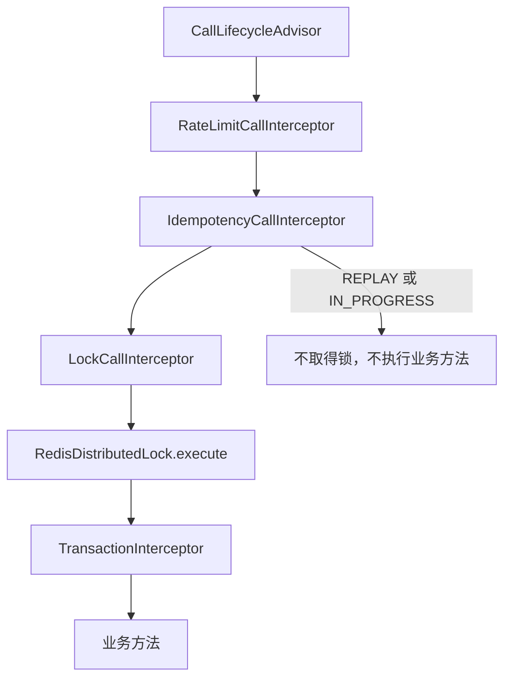

# 分布式锁

本页涵盖 `@Locked` 与 `LockKey` 声明的分布式锁，包括 `DistributedLock` 接口、`LockCallInterceptor` 的执行顺序、Redis 实现的等待与租期，以及锁失败时的结果。本页适用于需要让同一业务对象的修改串行执行的服务方法的开发者。读完后，开发者能写出锁键解析器，判断等待超时和释放失败的结果，并确定锁与幂等、事务的组合顺序。

分布式锁只让同一锁键的任务，在参与协调的应用实例之间互斥执行。它不替代数据库唯一约束、乐观版本或外部系统的幂等键。

## 概念

同一业务对象的读取、判断和写入需要串行执行时，服务方法可以声明 `@Locked`。拦截器在进入业务方法前取得锁，在业务方法结束后释放锁。

锁键由 `LockKey` 表示。`LockKey` 的前缀为 `LOCK`，后续段由构造参数决定。`@Locked.key` 表达式的返回值必须是 `LockKey`。因此，需要按业务对象构造锁键时，应使用 `keyResolver`。

以下解析器按资源 ID 生成锁键。`ResourceLockKeyResolver`、`RenameRequest` 与 `ResultView` 由具体应用定义：

```java
@Locked(keyResolver = ResourceLockKeyResolver.class, waitMillis = 3000)
public ResultView rename(long resourceId, RenameRequest request) {
    return resourceService.rename(resourceId, request);
}

public final class ResourceLockKeyResolver implements CallValueResolver<LockKey> {

    @Override
    public LockKey resolve(CallExecution execution) {
        long resourceId = (Long) execution.arguments()[0];
        return new LockKey(TreeCode.of("RESOURCE"), resourceId);
    }
}
```

同一资源的两次 `rename` 调用会排队执行。等待时间超过 `waitMillis` 时，第二次调用不执行业务方法。

## 核心对象

| 对象 | 负责 | 不负责 |
| --- | --- | --- |
| `Locked` | 声明方法需要锁，保存 `keyResolver`、`key` 与 `waitMillis`。 | 计算锁键。 |
| `LockKey` | 保存 `LOCK` 前缀下的锁键段。 | 取得或释放锁。 |
| `DistributedLock` | 定义 `execute(LockKey, Duration, Supplier)`，并可选实现 `executeAsync`。 | 解析注解。 |
| `LockCallInterceptor` | 读取 `@Locked`，解析并校验锁键，调用 `DistributedLock`，并在锁内执行后续调用。 | 决定锁的 Redis 名称。 |
| `RedisDistributedLock` | 使用 Redisson 的 `RLock` 取得和释放锁，并维护同一线程内的重入记录。 | 处理业务结果。 |

`LockCallInterceptor` 只处理 `@Locked` 声明的方法。`supports` 方法通过 `execution.declaration(Locked.class)` 判断是否执行。

## 调用顺序



`CallLifecycleConfiguration` 固定 `LockCallInterceptor` 排在 `IdempotencyCallInterceptor` 之后。幂等重放不取得锁。幂等记录处于处理中时，请求在取得锁之前返回。

`CallLifecycleAdvisor` 的顺序为 `Ordered.HIGHEST_PRECEDENCE + 200`。主代码没有为 Spring 事务拦截器设置顺序。因此，调用生命周期（包括 `@Locked`）先于 Spring 事务拦截器执行。

业务方法的事务在锁内开始，并在业务方法返回后、锁释放前结束。

`@Locked` 与 `@Idempotent` 同时声明时，幂等状态先于锁。锁只在幂等处理权取得后串行化执行。锁本身不替代幂等记录的并发判断。

## 锁键和声明

`@Locked` 的 `keyResolver` 与 `key` 必须二选一。二者都为空，或都不为空时，`LockCallInterceptor` 抛出 `IllegalStateException`。

`key` 是读取方法参数的表达式，返回值必须是 `LockKey`。`keyResolver` 是实现 `CallValueResolver<LockKey>` 的类。解析结果为 `null` 或其他类型时，抛出 `IllegalStateException`。

`waitMillis` 没有默认值，必须显式指定。它表示最大等待毫秒数。负数会在取得锁时抛出 `IllegalArgumentException`。

`RedisDistributedLock` 使用 `LockKey.format(NameFormat.COLON)` 生成 Redis 锁名称。`Key.format` 输出带 App 前缀的完整键，因此 Redis 中的锁名称包含应用隔离前缀。

`RedisDistributedLock.execute` 的实现注释写明，锁名称与 `LockKey` 的格式一致，不额外加入 App 前缀。App 前缀由 `Key.format` 通过 `AppName` 添加。

## 同步与异步持锁

`DistributedLock.execute` 在当前线程等待锁，取得锁后执行任务，任务结束后释放锁。`RedisDistributedLock` 在同一线程内记录已经持有的锁键。同一线程对同一锁键嵌套调用时，内层任务直接执行，不再次取得 Redis 锁。最外层调用负责释放。

`DistributedLock.executeAsync` 在调用线程等待锁，然后在调用线程同步创建任务的 `CompletionStage`。任务完成后才释放锁。

`RedisDistributedLock` 的异步路径不做线程内重入。同一线程在异步任务中再次获取同一锁键时，内层调用会等待。超时后返回 `CONFLICT`。

`LockCallInterceptor.aroundAsync` 使用 `executeAsync`。异步业务方法完成并释放锁之后，调用才继续外层生命周期。

## 租期

`RedisDistributedLock` 调用 `RLock.tryLock(waitMillis, MILLISECONDS)`，没有传入租期。因此，锁由 Redisson watchdog 续租，直到任务结束或锁被释放。

`RedissonConfigFactory` 与 `RedisDistributedLock` 没有设置 `lockWatchdogTimeout`。续租间隔与超时时间使用 Redisson 默认配置。

进程异常退出时，锁何时在 Redis 中失效，由 Redis 中的锁状态决定。源码中没有定义锁的固定租期，也没有锁专用配置键。

锁不能约束已过期的持有者，关键写入仍需版本条件，见[并发规则](/capabilities/data-configuration/concurrency-development)。

## 配置

源码中没有锁专用的 `sca4dj` 配置键。Redis 连接由 Spring Boot 的 `RedisConnectionDetails` 提供。

`CoreRedisAutoConfiguration` 只在类路径存在 `Redisson`，且容器中存在 `RedisConnectionDetails` 时，创建 `RedisDistributedLock` 与 `RedissonClient`。

`DistributedLock` Bean 只在容器中没有 `DistributedLock` 时创建。因此，应用可以提供自己的实现。

## 失败结果

| 情况 | 异常 | 错误码 | HTTP 状态 | 业务方法 | 调用方处理 |
| --- | --- | --- | ---: | --- | --- |
| 等待超过 `waitMillis`。 | `BusinessException`，错误码为 `CoreErrorCode.CONFLICT`。 | `1004` | 409 | 不执行。 | 稍后重试，或向用户报告资源正在被处理。 |
| 等待时线程被中断。 | `BusinessException`，错误码为 `CoreErrorCode.UNAVAILABLE`。线程中断标记被恢复。 | `1098` | 503 | 不执行。 | 按服务暂不可用处理。 |
| `waitMillis` 为负数。 | `IllegalArgumentException`，由 `GlobalExceptionHandler` 转换。 | `1100` | 400 | 不执行。 | 视为代码配置错误。 |
| `key` 与 `keyResolver` 同时声明，或都未声明。 | `IllegalStateException`。 | `1099` | 500 | 不执行。 | 视为代码配置错误。 |
| 键解析结果为 `null` 或不是 `LockKey`。 | `IllegalStateException`。 | `1099` | 500 | 不执行。 | 视为代码配置错误。 |
| Redis 连接或 Redisson 调用异常。 | 异常原样传播。源码中未定义 Redis 不可用时的专用错误码。 | `1099` | 500 | 不执行。 | 视为服务端错误。 |
| 业务方法抛出异常。 | 业务异常原样传播。锁释放失败时，释放异常作为 suppressed 附加。 | 由业务异常决定 | 由业务异常决定 | 已执行。 | 按业务异常处理。 |
| 业务方法正常返回，但释放锁时锁已不属于当前线程。 | `IllegalStateException`，消息为「任务结束时已失去分布式锁所有权」。 | `1099` | 500 | 已执行。 | 业务结果已经得到，但调用方收到完成故障。不能据此判断业务动作未发生。 |

等待超时和中断都发生在取得锁之前，因此业务方法不会执行。

业务方法正常返回后出现的锁释放故障，不会丢弃已经得到的业务结果。`LockCallInterceptor` 通过 `CallOutcome.withCompletionFailure` 登记完成故障，业务结果仍然保留。调用方收到该完成故障时，业务动作可能已经提交。

## 与幂等和事务的组合

- 幂等重放不取得锁。
- 幂等记录处于处理中时，请求在取得锁之前返回 `IDEMPOTENCY_IN_PROGRESS`。
- 锁内的业务方法和事务在锁内开始。事务在业务方法返回后提交，之后才释放锁。
- 锁释放故障发生在事务结束之后，不会撤销已经提交的事务。

锁只在单个 Redis 锁键上串行化。因此，跨多个资源的一致性仍需要应用自行设计事务范围和业务约束。

[幂等](/capabilities/data-configuration/idempotency) 说明了幂等记录与锁之间的组合规则。

## 直接调用示例

不经过注解时，注入 `DistributedLock` 并调用 `execute`。以下示例按文档 ID 串行执行附件整理：

```java
public int compact(long documentId) {
    LockKey key = new LockKey(TreeCode.of("DOCUMENT:COMPACT"), documentId);
    return distributedLock.execute(key, Duration.ofSeconds(3), () -> attachmentService.compact(documentId));
}
```

等待超过 3 秒时，抛出错误码为 `CoreErrorCode.CONFLICT` 的 BusinessException，任务不执行。直接调用需要业务自行保证锁释放失败后的重试安全。

## 扩展方式

应用声明自己的 `DistributedLock` Bean 时，Core Spring 不再创建 `RedisDistributedLock`。自定义实现须在超时时抛出异常，并只在任务结束后释放锁。异步持锁需要覆盖 `executeAsync`，否则默认实现返回 `UnsupportedOperationException`。

应用通过实现 `CallValueResolver<LockKey>` 提供锁键，并在 `@Locked.keyResolver` 中引用。`LockCallInterceptor` 读取注解后调用该解析器。

## 相关页面

- [幂等](/capabilities/data-configuration/idempotency)：`IdempotencyCallInterceptor` 在锁之前执行，并处理重放与处理中状态。
- [限流](/capabilities/data-configuration/rate-limit)：`RateLimitCallInterceptor` 在幂等之前执行。
- [并发规则](/capabilities/data-configuration/concurrency-development)：并发控制的开发约定。
- [数据访问与持久化设计](/capabilities/data-configuration/data-access-and-persistence)：事务与持久化的职责划分。
