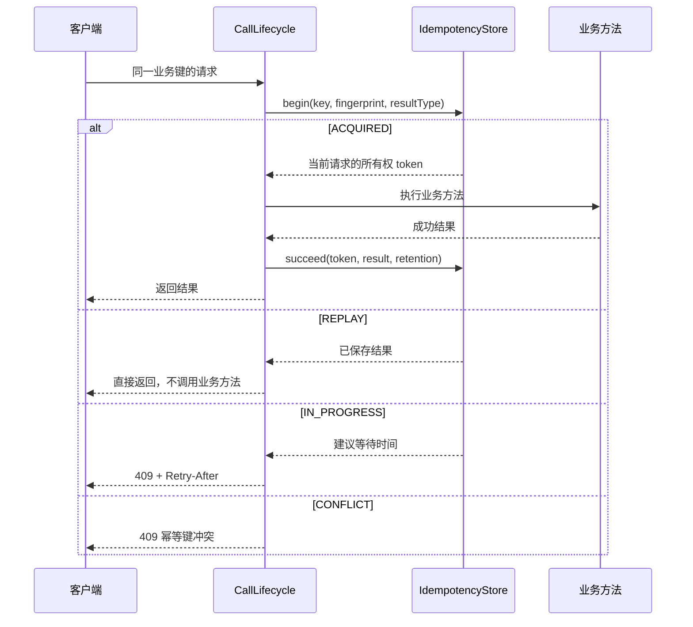

# Idempotent

源码：`core/sca4dj-core-api/src/main/java/com/sca4d/core/api/annotation/Idempotent.java`

## 它解决什么问题

创建文档、提交附件或调用外部服务后，客户端可能因超时、断线或重试，再次发送同一个业务动作。服务端若把第二次请求当作新动作，会重复创建数据，或重复调用外部系统。

Idempotent 让一次业务动作拥有稳定的 IdempotencyKey。IdempotencyStore 在业务方法执行前原子登记处理中记录。已经完成的调用，把返回值存入同一记录。保留期内携带相同键和相同请求指纹的重试，直接取得第一次的返回值，业务方法不再执行。

它不把任意两个内容相同的请求自动视为同一动作，也不替调用方选择键。键必须由客户端重试标识、业务单据号或其他能唯一代表「这一次提交」的数据构成。

## 与 HTTP 幂等含义的关系

[RFC 9110 的幂等方法](https://www.rfc-editor.org/rfc/rfc9110.html#section-9.2.2) 要求：多次发送相同请求，服务器应得到与发送一次相同的预期结果。`PUT` 和 `DELETE` 按协议定义就是幂等方法。`POST` 通常不是。这里的「结果相同」指资源最终状态，不表示每次响应内容、日志或审计记录必须完全一样。

Idempotent 处理的是更具体的业务重试。调用方用 IdempotencyKey 标明两次调用属于同一次提交。执行器保存第一次成功的 Java 返回值。它可以用于创建资源的 `POST`。

HttpCallFilter 把 `Idempotency-Key` 放入 Call 的 `IdempotencyKey.INPUT`。未声明 `key` 和 `keyResolver` 时，拦截器读取该输入。

内部方法可以使用 MethodArgumentsIdempotencyKeyResolver，从规范化参数 JSON 的 SHA-256 摘要生成键。

## 调用如何执行



执行器先完成认证、权限和限流检查，再计算方法和参数的请求指纹，并调用 `begin(...)`。IdempotencyStore 返回四种互斥结果：

- `ACQUIRED`：当前请求取得所有权 token，可以执行一次业务方法；
- `REPLAY`：同一请求已有成功结果，直接返回，包括明确保存的 `null`；
- `IN_PROGRESS`：同一请求仍在执行，返回 Core 错误码 `1006`、HTTP 409 和正整数 `Retry-After`；
- `CONFLICT`：同一键已经绑定不同请求指纹，返回 Core 错误码 `1007` 和 HTTP 409。

命中 `REPLAY` 时，即使业务方法同时声明 Audit，仍会记录一次成功审计。不会再次执行方法、获取锁或保存结果。

方法同时声明 `@Locked` 时，CallLifecycleAdvisor 在 Spring 事务拦截器之前执行。LockCallInterceptor 在取得幂等处理权之后、业务方法及其事务开始之前，取得分布式锁。幂等状态机不依赖该锁阻止相同请求并发执行。

业务方法抛出异常时，执行器只用当前 token 释放处理中记录，后续请求可以重试。释放失败时，记录会在处理租约到期后自动消失。

业务方法正常返回后，才尝试保存结果。

锁释放失败等完成阶段故障，不会抹掉已经得到的业务结果。拦截器仍保存成功结果供同键重放，并把故障报告给原调用方。

只有当前 token 成功保存结果且没有完成故障时，执行器才向调用方确认成功。保存失败时，当前调用返回失败，并保留处理中租约直到过期。

此时业务动作可能已经提交。调用方不能据此判断动作未发生，因此业务唯一约束和外部幂等键仍然不可省略。

## 怎样使用

把注解标在会产生新数据或外部副作用的方法上。HTTP 请求使用 `Idempotency-Key` 时，可以只声明 `@Idempotent`。参数已经包含 IdempotencyKey 时，可以用 `key = "#key"` 直接取值。

表达式返回非空文本时，`IdempotencyKey.fromValue(CharSequence)` 会校验长度和控制字符。

需要业务查询或组合标识时，由 `keyResolver` 实现 [CallValueResolver](/javadoc/core/sca4dj-core-api/com/sca4d/core/api/call/CallValueResolver.html)。`key` 与 `keyResolver` 互斥。二者都缺失时，必须由 Call 输入提供键。

```java
@Idempotent(key = "#key", retentionSeconds = 86_400)
public DocumentView createDocument(IdempotencyKey key, CreateDocumentRequest request) {
    return documentService.createDocument(request);
}
```

DocumentView、CreateDocumentRequest 和 documentService 由具体应用定义。表达式在业务方法执行前求值，不能读取 `#result`。参数别名与默认解析 SPI 见调用生命周期的「注解表达式」。

```java
@Idempotent(
        keyResolver = CreateDocumentKeyResolver.class,
        retentionSeconds = 86_400)
public DocumentView createDocument(CreateDocumentRequest request) {
    return documentService.createDocument(request);
}

public final class CreateDocumentKeyResolver
        implements CallValueResolver<IdempotencyKey> {

    @Override
    public IdempotencyKey resolve(CallExecution execution) {
        CreateDocumentRequest request = (CreateDocumentRequest) execution.arguments()[0];
        return new IdempotencyKey(
                execution.call().account().orElseThrow().accountId() + ":" + request.requestId());
    }
}
```

示例把账号标识与请求 `requestId` 合入键，避免两个账号使用同一个客户端标识时互相复用结果。实际键应包含能区分操作类型、调用者和一次提交的数据。不要使用随机 UUID、当前时间，或每次重试都会变化的值。

`retentionSeconds` 大于零时，覆盖方法保留期。零表示使用 `sca4dj.redis.idempotency.result-retention`，默认一天。执行器把最终保留期转换成 Duration，原样交给存储实现。

选择保留期时，要覆盖客户端可能重试的最长时间，同时避免让已完成结果占用不必要的存储空间。

Redis 幂等处理中记录默认租约为五分钟。同一请求仍在执行时，默认建议三秒后重试。二者分别由 `sca4dj.redis.idempotency.processing-ttl` 和 `sca4dj.redis.idempotency.retry-after` 配置。

方法返回值及其嵌套数据，必须能由内部 JSON 映射器按声明的泛型还原。不可变响应使用明确的 JSON 构造方法保存对外字段。不能仅提供读取业务对象的 getter，也不能在重放时重新查询当前资源，来代替第一次返回值。应用应验证序列化往返后的标识、空值、状态和数量保持一致。

返回 ApiResponse 时，Redis 同时保存显式 HTTP 状态和响应头。重放保留 `201`、`202`、`204`、`ETag` 和 `Location`。这些元数据不进入对外响应体。

普通响应体保持第一次成功时的请求编号和时间。带强 ETag 的稳定响应，把调用编号写入 `X-Call-Id`，并省略动态时间字段。重放仍使用第一次执行保存的内部元数据。

没有保存过 HTTP 元数据的历史记录，无法补回原响应头。但不能因此重新执行业务动作。

## 不能解决的情况

Redis IdempotencyStore 能阻止相同键和相同请求指纹同时进入业务方法。但它不串行化不同幂等键对同一业务对象的修改。

创建记录、扣减库存或外部扣款，还需要数据库唯一约束、乐观版本、业务对象分布式锁或外部系统幂等键。具体选择由业务竞争对象决定。

业务动作完成，但进程退出或结果保存失败时，Redis 仍只有处理中记录。当前调用失败或没有响应。租约到期后，请求会重新执行。

对应业务、数据库或外部协议必须能够识别这种重复。不能把幂等结果缓存当作仅一次执行的保证。

同一业务对象的并发修改仍由版本号或租约处理，见[并发规则](/capabilities/data-configuration/concurrency-development)。

## 当前接入情况

IdempotencyCallInterceptor 已经实现四状态处理、请求指纹、所有权 token、失败释放和成功重放。

返回 `CompletionStage<T>` 的方法，在实际结果完成前定时延长处理租约。所有权丢失或保存失败，会使调用失败。

续期使用受管理调度器和同步 Redis 调用。外部负载必须覆盖最大并发量及 Redis 延迟，不能把单个调度线程当作无限容量。

Core Spring 默认注册 RedisIdempotencyStore。RateLimiter、IdempotencyStore 和 DistributedLock 任一实现缺失时，应用启动失败。

每个使用 `@Idempotent` 的入口仍须选择稳定键和结果保留期，并在重放前重新检查当前权限。

## 示例

以下示例在工作区内创建文档。HTTP 客户端在请求头中携带 `Idempotency-Key`，Controller 只需声明 `@Idempotent`。`DocumentView`、`CreateDocumentRequest` 和 `documentService` 由具体应用定义。

```java
@RestController
@RequestMapping("/workspaces/{workspaceId}/documents")
class DocumentController {

    private final DocumentService documentService;

    DocumentController(DocumentService documentService) {
        this.documentService = documentService;
    }

    @PostMapping
    @Idempotent(retentionSeconds = 86_400)
    DocumentView create(@PathVariable long workspaceId, @RequestBody CreateDocumentRequest request) {
        return documentService.create(workspaceId, request);
    }
}
```

客户端使用同一个 `Idempotency-Key` 重试时，Redis 中已有成功结果，Controller 方法不再执行，响应复用第一次的返回值。同一个键携带不同参数时，返回 HTTP 409 和 Core 错误码 `1007`。

对应的 Redis 配置如下，键名和默认值见上文：

```yaml
sca4dj:
  redis:
    idempotency:
      result-retention: 1d
      processing-ttl: 5m
      retry-after: 3s
```

## 相关页面

- [IdempotencyKey](/javadoc/core/sca4dj-core-api/com/sca4d/core/api/concurrent/IdempotencyKey.html)：一次提交的稳定键。
- [IdempotencyStore](/javadoc/core/sca4dj-core-api/com/sca4d/core/api/concurrent/IdempotencyStore.html)：保存与读取成功结果的接口。
- [Locked](/javadoc/core/sca4dj-core-api/com/sca4d/core/api/annotation/Locked.html)：串行执行竞争同一业务对象的业务方法。
- [CallLifecycle](/javadoc/core/sca4dj-core-api/com/sca4d/core/api/call/CallLifecycle.html)：读取注解并按固定顺序执行调用。
