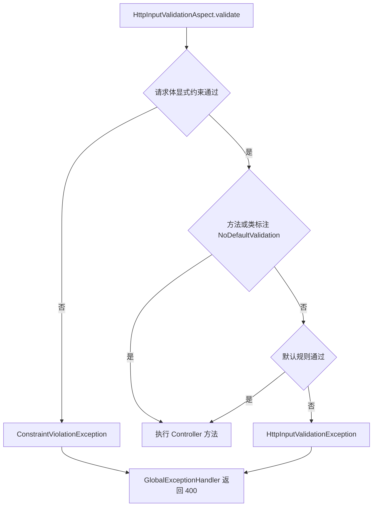

# 输入校验

本页涵盖 Core Spring 的输入校验，包括 `Req` 注解族、通用格式约束（`SafeText`、`DisplayName`、`MacAddress`、`BizId`、`TimeRange`）、HTTP 输入的默认规则、`@NoDefaultValidation`，以及校验失败时返回的响应。本页适用于开发 Controller、请求体对象和需要校验业务输入的服务端开发者。读完后，开发者能够为字段选择约束，判断默认规则何时拒绝请求，并处理 400 响应中的字段列表。

校验分为两层。第一层是显式约束，由应用在请求体字段或方法参数上标注。第二层是默认规则，由 `HttpInputValidationAspect` 按 Java 数据类型执行。两层都在 Controller 方法执行前运行。

## 概念

Core Spring 提供的约束注解基于 Jakarta Bean Validation。`Req` 中的注解以 `jakarta.validation.constraints` 中的 `NotNull`、`NotBlank` 与 `NotEmpty` 为元注解，用于声明运行时必填。它们不替代 JetBrains 的空值注解。`ReqTest` 对此有验证。

以下请求对象使用通用字段名。`name` 必填，且不能包含控制字符。`description` 可以省略，省略时只受默认长度规则约束：

```java
public class CreateItemRequest {

    @Req.NotBlank
    @SafeText(max = 64)
    private String name;

    @SafeText(max = 512)
    private String description;
}
```

`Req.NotBlank` 拒绝 `null`、空字符串和只包含空白的文本。`SafeText` 对 `null` 与空白文本不做检查，因此 `description` 为 `null` 或空白时仍然通过。

非 HTTP 场景使用 `com.sca4d.core.api.validation.Validation`。该入口依次执行 `Validator<T>`，合并每个 `ValidationResult` 中的 `Violation`，返回一个 `ValidationResult`。`Violation` 保存输入位置 `path` 和应用消息目录使用的 `messageKey`。`Validation` 的 `value` 不能为 `null`。

## 核心对象

| 对象 | 负责 | 不负责 |
| --- | --- | --- |
| `Req` | 提供 `Req.NotNull`、`Req.NotBlank` 与 `Req.NotEmpty` 三个必填约束。 | 检查文本格式或长度。 |
| `SafeText` | 限制文本长度，并拒绝控制字符。 | 检查文本是否为有效的业务编码。 |
| `DisplayName` | 限制展示名称长度，并拒绝控制字符。 | 检查展示名称是否重复。 |
| `MacAddress` | 检查 `XX:XX:XX:XX:XX:XX` 格式，大小写均可。 | 检查地址是否属于某个设备。 |
| `BizId` | 检查数字 ID、固定格式编码、命名空间编码或自定义正则。 | 表达字段必填。需要必填时同时标注 `Req.NotNull` 或 `Req.NotBlank`。 |
| `TimeRange` | 检查两个 `Instant` 属性的先后关系。 | 检查时间是否位于某个业务允许范围内。 |
| `PhoneNumber` | 检查手机号，并按注解中的规则筛选地区与号码类型。规则见[手机号校验](/capabilities/data-configuration/phone-number-validation)。 | 维护地区数据。 |
| `HttpInputValidationAspect` | 检查 Controller 的外部输入参数，执行请求体上的显式约束和默认规则。 | 检查没有上述输入注解的参数。 |
| `Validation` | 合并 `Validator<T>` 的结果。 | 把结果转换为 HTTP 响应。 |
| `NoDefaultValidation` | 关闭对应类型、方法、参数或字段的默认规则。 | 关闭请求体上的显式约束。 |

## 通用约束

| 注解 | `null` 是否通过 | 默认值 | 规则 |
| --- | --- | --- | --- |
| `Req.NotNull` | 否 | 无 | 值必须存在。空字符串和空集合通过。 |
| `Req.NotBlank` | 否 | 无 | 文本不能为空，也不能只包含空白。 |
| `Req.NotEmpty` | 否 | 无 | 文本、集合、Map 或数组的长度必须大于 0。 |
| `SafeText` | 是 | `max = 255` | 空白文本通过。其他文本的长度不能超过 `max`，并且不能包含控制字符。`max` 小于 0 时初始化失败。 |
| `DisplayName` | 是 | `max = 128` | 空白文本通过。其他文本的长度不能超过 `max`，并且不能包含控制字符。`max` 小于 1 时初始化失败。 |
| `MacAddress` | 是 | 无 | 空白文本通过。其他文本必须匹配 `(?i)^([0-9A-F]{2}:){5}[0-9A-F]{2}$`。 |
| `BizId` | 是 | `mode = CODE`，`min = 1`，`max = 64` | 字符串首尾不能有空白，长度必须在 `min` 与 `max` 之间，并且匹配 `mode` 对应的格式。 |
| `TimeRange` | 是 | `message` 使用 `validation.time-range.invalid` | 必须声明 `start` 与 `end` 两个可读取的 `Instant` 属性，且 `start` 必须早于 `end`。任一属性为 `null` 时通过。失败时错误位置为 `end`。 |

`BizIdMode` 的取值与格式如下：

| 取值 | 格式 |
| --- | --- |
| `NUM` | 正整数。`Byte`、`Short`、`Integer`、`Long` 与 `BigInteger` 必须大于 0；其他数字类型不通过。字符串必须匹配 `^\d+$`，并且数值大于 0。 |
| `CODE` | 字母或数字开头，之后可以包含字母、数字、`_` 与 `-`，即 `^[A-Za-z0-9][A-Za-z0-9_-]*$`。 |
| `NAMESPACED_CODE` | 小写字母开头，段之间使用 `.`、`_` 或 `-` 分隔，即 `^[a-z][a-z0-9]*(?:[._-][a-z0-9]+)*$`。 |
| `CUSTOM` | 使用 `regexp` 属性提供的正则表达式。`regexp` 为空白时初始化失败。 |

`BizId` 的 `min` 小于 0，或 `max` 小于 `min` 时，初始化失败。`BizId` 只检查格式。字段必填需要另外标注 `Req.NotNull` 或 `Req.NotBlank`。

## 默认规则

`HttpInputValidationAspect` 只作用于带有 `@RestController` 或 `@Controller` 的类。它检查带有下列注解的参数：`PathVariable`、`RequestParam`、`RequestHeader`、`CookieValue`、`MatrixVariable`、`RequestPart`、`RequestBody` 与 `ModelAttribute`。

默认规则只检查 Java 类型，不读取应用的业务含义。它们的配置前缀为 `sca4dj.core.http.input.validation`。

| 规则 | 配置键 | 默认值 | 适用对象 | 失败消息键 |
| --- | --- | ---: | --- | --- |
| 整数必须大于 0 | `positive-integer-enabled` | `true` | `Byte`、`Short`、`Integer`、`Long` 与 `BigInteger`。声明了 `Min`、`Max`、`Positive`、`PositiveOrZero`、`Negative`、`NegativeOrZero`、`DecimalMin` 或 `DecimalMax` 时不执行该规则。 | `validation.positive` |
| 请求体显式约束 | `request-body-validation-enabled` | `true` | 带有 `@RequestBody` 且值不为 `null` 的参数。 | 由 Bean Validation 生成 |
| 字符串最大长度 | `string-size-enabled`，`max-string-length` | `true`，`4096` | `CharSequence` 值。声明了 `@Size` 时不执行该规则。 | `validation.string-size` |
| 容器最大元素数 | `container-size-enabled`，`max-container-size` | `true`，`1000` | `Collection`、`Map` 与非 `byte[]`、`char[]` 的数组。声明了 `@Size` 时不执行该规则。 | `validation.container-size` |

默认规则会递归读取请求对象的字段、集合元素和数组元素。字段路径使用 `.` 连接，容器元素路径使用 `[下标]`。例如，`items[0].quantity` 表示第一个元素的 `quantity` 字段。

整数默认规则适用于请求对象中的所有整数字段，因此 `0` 默认不通过。需要允许 `0` 时，应在字段上声明 `@PositiveOrZero`、`@Min(0)` 或其他数值范围注解，使默认规则不再执行。



请求体显式约束先于默认规则执行。`NoDefaultValidation` 只跳过默认规则，不跳过请求体上的显式约束。

## NoDefaultValidation

`@NoDefaultValidation` 可以标注在类型、方法、参数、字段或类型使用位置上。作用范围如下：

- 标注在方法或声明方法的类上时，该方法的默认规则全部不执行。
- 标注在参数、字段或类型使用位置上时，只跳过该值及其子值的默认规则。
- 标注在值的运行时类型上时，跳过该类型实例的默认规则。

该注解不关闭请求体上的显式约束。需要关闭请求体约束时，应使用 `sca4dj.core.http.input.validation.request-body-validation-enabled`，并且该配置影响整个应用。

## 失败结果

以下失败结果都通过 `GlobalExceptionHandler` 转换为 HTTP 400。错误码为 `1100`，即 `HttpErrorCode.BAD_REQUEST`。

| 失败来源 | 异常 | `data` |
| --- | --- | --- |
| 请求体显式约束失败，由 `HttpInputValidationAspect` 抛出。 | `ConstraintViolationException` | `FieldViolation` 列表，`field` 为约束属性路径。 |
| 请求体使用 `@Valid` 且绑定校验失败。 | `MethodArgumentNotValidException` | `FieldViolation` 列表。 |
| 参数绑定失败。 | `BindException` | `FieldViolation` 列表。 |
| 默认规则失败。 | `HttpInputValidationException` | `FieldViolation` 列表。 |
| Spring 方法校验失败。 | `HandlerMethodValidationException` | `null`。 |

`FieldViolation` 包含 `field` 与 `message` 两个字段。`message` 由当前请求的 Locale 生成，不应作为程序判断条件。客户端应根据 HTTP 状态 `400` 与错误码 `1100` 判断输入错误，并根据 `field` 定位字段。

HTTP 响应的完整字段见 [HTTP 通用约定](/reference/http/common)。

`Validation` 与 `ValidationResult` 不会由 Core Spring 自动转换为 HTTP 响应。源码中未定义 `ValidationResult` 或 `Violation` 到 `FieldViolation` 的自动转换。需要返回 HTTP 响应时，应用应自行读取 `violations()` 并转换结果。

注解参数不合法时，`initialize` 方法抛出 `IllegalArgumentException`。`TimeRange` 引用的属性不存在、不可读取或不是 `Instant` 时，校验执行时抛出 `IllegalArgumentException`。这些情况属于代码配置错误，不应作为客户端输入错误处理。

## 示例

以下示例为创建文档的接口声明请求对象和 Controller。`DocumentView` 和 `documentService` 由具体应用定义。`TimeRange` 标注在类型上，并要求 `start` 与 `end` 对应的可读属性类型为 `Instant`。

```java
@TimeRange(start = "visibleFrom", end = "visibleUntil")
public class CreateDocumentRequest {

    @Req.NotBlank
    @DisplayName(max = 100)
    private String title;

    @SafeText(max = 2000)
    private String summary;

    @Req.NotNull
    @BizId(mode = BizIdMode.NUM)
    private Long folderId;

    @BizId(mode = BizIdMode.NAMESPACED_CODE, max = 32)
    private String category;

    private Instant visibleFrom;

    private Instant visibleUntil;

    @PositiveOrZero
    private int pageCount;

    // getter 与 setter 省略
}
```

```java
@RestController
@RequestMapping("/workspaces/{workspaceId}/documents")
class DocumentController {

    private final DocumentService documentService;

    DocumentController(DocumentService documentService) {
        this.documentService = documentService;
    }

    @PostMapping
    DocumentView create(@PathVariable long workspaceId, @RequestBody CreateDocumentRequest request) {
        return documentService.create(workspaceId, request);
    }

    @PostMapping("/import")
    @NoDefaultValidation
    DocumentView importRaw(@PathVariable long workspaceId, @RequestBody String rawContent) {
        return documentService.importRaw(workspaceId, rawContent);
    }
}
```

`pageCount` 声明了 `@PositiveOrZero`，因此默认的整数大于 0 规则不再检查它。`workspaceId` 为 `0` 时，默认规则拒绝请求。`importRaw` 方法关闭默认规则，需要自行限制 `rawContent` 的长度。

`title` 缺失时，客户端收到 HTTP 400 和错误码 `1100`，`data` 为 `FieldViolation` 列表：

```json
{
  "code": "1100",
  "data": [{ "field": "title", "message": "..." }]
}
```

字段 `message` 的文案取决于请求 Locale，字段 `field` 可用于定位输入位置。完整响应字段见 [HTTP 通用约定](/reference/http/common)。

## 扩展方式

自定义约束按 Jakarta Bean Validation 的方式编写：声明 `@Constraint` 注解并提供 `ConstraintValidator` 实现，在请求对象字段上标注即可。`HttpInputValidationAspect` 对请求体执行 Bean Validation，因此自定义约束与 `SafeText` 的执行路径相同。

## 配置

`sca4dj.core.http.input.validation` 的配置键见上文默认规则表。字符串最大长度必须大于 0，容器最大元素数也必须大于 0。设置小于 1 的值时，配置属性的 setter 抛出 `IllegalArgumentException`。

上限经 `sca4dj.core.http.input.validation` 绑定，与[配置规则](/capabilities/data-configuration/configuration-development)中的 Spring 配置键写法一致。

## 相关页面

- [查询与分页](/capabilities/data-configuration/query-and-pagination)：分页与排序参数的解析规则和失败结果。
- [手机号校验](/capabilities/data-configuration/phone-number-validation)：`PhoneNumber` 注解的规则与地区筛选。
- [并发规则](/capabilities/data-configuration/concurrency-development)：并发控制与限流的开发约定。
- [HTTP 通用约定](/reference/http/common)：错误响应字段、HTTP 状态与 `FieldViolation` 的完整说明。
