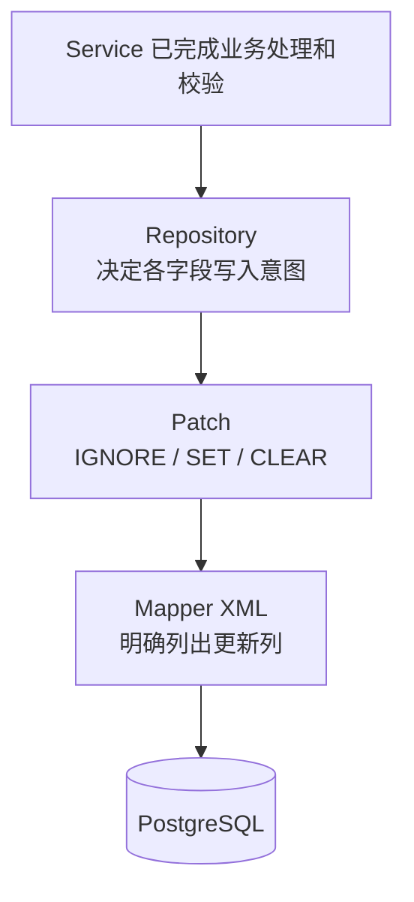

# Patch

源码：`core/sca4dj-core-api/src/main/java/com/sca4d/core/api/persistence/Patch.java`

本页说明 Patch 的三种写入状态、构造方式和 Mapper 的使用限制。本页适用于编写部分更新 Repository 和 Mapper 的开发者。读完后，开发者能为每个可选更新列选择正确的 Patch 状态。

数据库字段的部分更新必须区分三种结果：保留原值、写入一个值、写入数据库 `NULL`。只传递可空 Java 值，无法区分前两种结果。把数值零、`false` 或空字符串统一当作「空」，又会丢失调用方明确给出的数据。

Patch 使用三个互斥状态，保存 Repository 已经确定的字段写入意图。

| 状态 | 构造方式 | Mapper 行为 |
|---|---|---|
| IGNORE | `Patch.ignore()` | 不在 `SET` 子句中写该列，数据库保留原值 |
| SET | `Patch.set(value)` | 把非空 value 绑定到该列 |
| CLEAR | `Patch.clear()` | 把该列写为数据库 `NULL` |

`Patch.set(null)` 抛出 NullPointerException。数值零、`false`、空字符串和空集合不是特殊状态，均由 SET 原样保存。

只有 `value()` 或供映射框架读取的 `getValue()` 可以取得 SET 值。在 IGNORE 或 CLEAR 状态读取值，会抛出 IllegalStateException。



Service 把已经校验的业务结果交给 Repository。Repository 根据稳定的持久化规则构造 Patch。

Mapper XML 逐列读取状态：SET 绑定值，CLEAR 写 `NULL`，IGNORE 不生成列赋值。

Repository 在调用 Mapper 前，拒绝所有字段均为 IGNORE 的更新，避免生成没有列的 `UPDATE`。

Patch 不依赖 HTTP Request、Jackson、Jakarta Validation、Spring 或 MyBatis。Controller 仍负责 HTTP 绑定和统一请求校验。实体和值对象仍在自己的构造入口检查字段限制。Service 仍负责跨字段和业务规则。

Patch 只在这些处理完成后，表达数据库字段怎样写入。它不能代替任何一层校验。

## 构造写入意图

固定结果直接使用三个静态方法：

```java
Patch<String> name = Patch.set(displayName);
Patch<String> remark = remarkValue == null ? Patch.clear() : Patch.set(remarkValue);
Patch<String> unchanged = Patch.ignore();
```

`resolve(source, resolver)` 让 Repository 使用回调，集中解释一个业务处理结果。source 可以为 `null`。resolver 必须返回非空 Patch。回调返回 `null` 时，立即失败。

```java
Patch<String> remark = Patch.resolve(
        change,
        value -> {
            if (value.clearRemark()) {
                return Patch.clear();
            }
            if (value.updateRemark()) {
                return Patch.set(value.remark());
            }
            return Patch.ignore();
        });
```

条件较少时，可以使用 `choose()` 连续声明候选结果。并以 `otherwiseIgnore()`、`otherwiseSet(...)` 或 `otherwiseClear()` 明确没有条件命中时的结果。

```java
Patch<String> remark = Patch.<String>choose()
        .setIf(copyDefault, defaultRemark)
        .setIf(useGenerated, () -> generateRemark())
        .clearIf(removeRemark)
        .otherwiseIgnore();
```

零个条件命中时，返回结束方法声明的结果。一个以上条件命中时，抛出 IllegalStateException，不按声明先后静默覆盖。

Supplier 只在对应分支唯一命中，并且结束构造时执行。未命中的分支和未使用的兜底 Supplier 不执行。

Patch 只表达列的写入意图，乐观版本条件仍由 Mapper 的 `WHERE` 子句提供，见[并发规则](/capabilities/data-configuration/concurrency-development)。

## 示例

以下示例更新工作区成员的备注和角色。请求中的 `remark` 有三种处理方式：未提交时保留，命令要求清除时写入 `NULL`，提交了值时写入。`MemberMapper` 与 `MemberUpdateCommand` 由具体应用定义，Mapper XML 按上文方式逐列判断 Patch 状态。

```java
@Repository
class MemberRepository {

    private final MemberMapper mapper;

    MemberRepository(MemberMapper mapper) {
        this.mapper = mapper;
    }

    void update(long memberId, long version, MemberUpdateCommand command) {
        Patch<String> remark = Patch.resolve(
                command,
                value -> {
                    if (value.clearRemark()) {
                        return Patch.clear();
                    }
                    if (value.remark() != null) {
                        return Patch.set(value.remark());
                    }
                    return Patch.ignore();
                });
        Patch<String> role = command.role() == null ? Patch.ignore() : Patch.set(command.role());
        if (remark.isIgnore() && role.isIgnore()) {
            return;
        }
        mapper.update(memberId, version, remark, role);
    }
}
```

Mapper 的 `WHERE` 条件包含 `version = #{version}`，影响行数为 0 时由 Repository 报告版本冲突。

## Mapper 限制

Patch 不生成 SQL，也不通过反射推断列名。

Mapper 方法可以直接接收具名 Patch 参数，也可以接收包含 Patch 字段的模块持久化参数对象。字段数量、共同使用方式和实际复用，决定是否需要更新对象。不为每个 update 机械建立 Update 类。

Mapper XML 明确写出每个允许修改的列、状态条件、版本条件和 `WHERE` 条件。例如，直接传入名为 `remark` 的 Patch：

```xml
<choose>
    <when test="remark.set">
        remark = #{remark.value},
    </when>
    <when test="remark.clear">
        remark = NULL,
    </when>
</choose>
```

没有注解、通用 DAO、字段 Map、Query Wrapper 或自动 SQL 生成器参与字段更新。完整的分层和 SQL 规则见[数据访问与持久化设计](/capabilities/data-configuration/data-access-and-persistence)和 [SQL 与持久化分层](/engineering/stack/persistence-boundary)。
