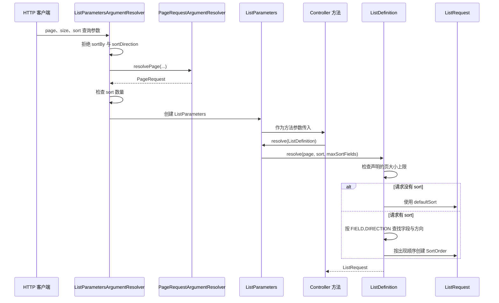

# 查询与分页

本页涵盖 Core 查询对象的分工。`PageRequest` 表示页码与每页数量，`Page` 表示一页结果，`Sort` 与 `SortOrder` 表示排序字段与方向，`ListRequest` 汇总分页与排序，`ListDefinition` 声明某个列表接口允许的排序字段。本页适用于开发列表接口、Service 与 Repository 查询的开发者。读完后，开发者能够声明允许的排序字段，理解页码和每页数量的限制，并判断非法参数会得到什么失败结果。

HTTP 参数 `page`、`size` 与 `sort` 的协议约定见 [HTTP 通用约定](/reference/http/common)。本页只说明服务端对象和解析规则，不重复该参考页的响应字段。

## 概念

列表查询需要同时确定页码、每页数量和排序条件。Core 把这三项转换为类型化对象，使排序字段只能来自列表声明，而不是直接来自客户端字符串。

`ListDefinition` 只生成 `Sort` 与 `SortDir`，不生成 SQL、数据库列名或筛选条件。具体列表仍需在 `ListDefinition` 和 Mapper 中，分别声明允许的字段与列映射。

以下代码构造一个请求，表示第 1 页、每页 20 条，并按 `UPDATED_AT` 降序排列：

```java
ListRequest list = new ListRequest(new PageRequest(1, 20), List.of(Sort.UPDATED_AT.desc()));
```

Service 或 Repository 接收 `ListRequest`。查询结果以 `Page<T>` 返回。其中保存当前页记录，以及满足完整查询条件的 `total`。

## 核心对象

| 对象 | 负责 | 不负责 |
| --- | --- | --- |
| `PageRequest` | 保存从 1 开始的 `page` 与 `size`，并通过 `offset()` 计算数据库偏移量。 | 解析 HTTP 字符串，不知道接口声明的上限。 |
| `Page<T>` | 保存当前页记录、请求的页码与每页数量，以及 `total`。构造时检查记录数量不超过 `size`，`total` 不为负数。 | 计算 `total`，也不执行查询。 |
| `Sort` | 保存协议字段名。`Sort.of(String)` 只接受以大写字母开头、只包含大写字母、数字和下划线的名称。常量包括 `CREATED_AT`、`UPDATED_AT`、`NAME` 与 `SERIAL`。 | 保存数据库列或 SQL。 |
| `SortOrder` | 保存一个 `Sort` 与一个 `SortDir`，方向只有 `ASC` 与 `DESC`。 | 检查字段是否属于某个列表。 |
| `ListRequest` | 保存一个 `PageRequest` 和按优先级排列的 `SortOrder` 列表。同一字段重复出现时抛出 `IllegalArgumentException`。 | 决定哪些字段允许排序。 |
| `ListDefinition` | 声明允许的排序字段、默认排序和可选的页大小上限，并把原始参数解析为 `ListRequest`。 | 生成 SQL 或筛选条件。 |
| `ListParameters` | 暂存已解析的 `page` 与原始 `sort` 值，并由 `resolve(ListDefinition)` 交给列表声明完成转换。 | 保存列表声明。 |

`ListDefinition` 的构造器要求至少声明一个字段和一个默认排序条件。默认排序引用的字段必须已经声明，并且不能重复。`Builder.fields(...)` 遇到同名字段时抛出 `IllegalArgumentException`。

## 解析顺序

Controller 参数类型为 `ListParameters` 时，Spring MVC 调用 `ListParametersArgumentResolver`。Controller 方法再调用 `ListParameters.resolve(ListDefinition)`。



分页参数和 `sortBy`、`sortDirection`、`sort` 数量的检查，发生在 Controller 方法执行前。字段与方向的检查，发生在 Controller 调用 `ListParameters.resolve` 时。

`sort` 的每个值必须是 `FIELD,DIRECTION` 格式。字段名必须与 `ListDefinition` 中声明的 `Sort.name()` 完全一致。方向必须是 `ASC` 或 `DESC`。两者都区分大小写。

多个 `sort` 参数按出现顺序排列，并且各字段只能出现一次。

排序字段只能取自 `ListDefinition` 中声明的 `Sort`，客户端字符串不直接进入 SQL。

## 示例

以下示例为工作区内的文档列表声明可排序字段，并在 Controller 中解析参数。`DocumentView` 和 `documentService` 由具体应用定义。

```java
@RestController
@RequestMapping("/workspaces/{workspaceId}/documents")
class DocumentListController {

    private static final ListDefinition DOCUMENT_LIST = ListDefinition.builder()
            .fields(Sort.CREATED_AT, Sort.UPDATED_AT, Sort.NAME)
            .defaultSort(Sort.UPDATED_AT.desc())
            .maxSize(100)
            .build();

    private final DocumentService documentService;

    DocumentListController(DocumentService documentService) {
        this.documentService = documentService;
    }

    @GetMapping
    Page<DocumentView> list(@PathVariable long workspaceId, ListParameters parameters) {
        ListRequest request = parameters.resolve(DOCUMENT_LIST);
        return documentService.list(workspaceId, request);
    }
}
```

客户端请求 `GET /workspaces/1/documents?page=1&size=20&sort=NAME,ASC&sort=CREATED_AT,DESC` 时，`ListRequest` 包含两个按出现顺序排列的 `SortOrder`。`size` 超过 `100` 时返回 HTTP 400 和错误码 `1000`。

Service 返回 `Page<T>` 时，`total` 为满足完整查询条件的记录数：

```java
Page<DocumentView> list(long workspaceId, ListRequest request) {
    PageRequest page = request.getPage();
    List<DocumentView> items = documentMapper.selectPage(workspaceId, page.offset(), page.size(), request.getSort());
    long total = documentMapper.count(workspaceId);
    return new Page<>(items, page, total);
}
```

`documentMapper` 由应用定义，并负责把 `Sort` 映射为列。

页大小上限也可以标注在参数上：

```java
@GetMapping("/recent")
Page<DocumentView> recent(@PageOptions(maxSize = 50) PageRequest page) {
    return documentService.recent(page);
}
```

## 扩展方式

应用不实现框架接口，只声明 `ListDefinition` 常量，并在 Controller 参数中使用 `ListParameters`、`PageRequest` 或带 `@PageOptions` 的参数。`ListParametersArgumentResolver` 和 `PageRequestArgumentResolver` 由 Core Spring 的 Web 配置注册，应用不需要重复注册。

新增排序字段时，调用 `Sort.of(String)` 创建协议名称，并在 `ListDefinition.Builder.fields(...)` 中声明，再在 Mapper 中提供列映射。

## 配置

| 配置键 | 默认值 | 约束 | 作用 |
| --- | ---: | --- | --- |
| `sca4dj.core.pagination.default-size` | `20` | 不小于 1，且不大于最大值。 | 请求没有 `size` 时使用的每页数量。 |
| `sca4dj.core.pagination.max-size` | `200` | 不小于默认值。 | 全局允许的最大 `size`。 |
| `sca4dj.core.sort-max-fields` | `5` | 1 到 20。 | 单个请求允许的 `sort` 参数数量上限，也用于检查默认排序的字段数量。 |

`CoreSpringProperties` 通过 `@ConfigurationProperties("sca4dj.core")` 绑定配置。它同时提供 `page-default-size` 与 `page-max-size` 形式的 JavaBean 属性。二者指向与 `pagination.default-size`、`pagination.max-size` 相同的字段。

具体接口可以声明更小的页大小上限，有两种方式：

- 在 `ListDefinition.Builder` 上调用 `maxSize(int)`。`ListDefinition.resolve` 检查 `size` 是否超过该值。
- 在方法参数上标注 `@PageOptions(maxSize = ...)`。`PageRequestArgumentResolver` 使用全局上限与该参数上限中较小的一个。

`@PageOptions` 标注在 `ListParameters` 参数上时，`ListParametersArgumentResolver` 同样读取该标注。`maxSize` 必须为正数，否则抛出 `IllegalStateException`。

## 限制与失败结果

下表列出源码中可以观察到的失败情况。错误码和 HTTP 状态由 `GlobalExceptionHandler` 转换得到。

| 情况 | 源码中的异常 | 错误码 | HTTP 状态 | 调用方处理 |
| --- | --- | --- | ---: | --- |
| `page` 或 `size` 不是整数，`page` 小于 1，`size` 小于 1，或 `size` 超过全局上限或 `@PageOptions` 上限。 | `BusinessException`，错误码为 `CoreErrorCode.VALIDATION_FAILED`。 | `1000` | 400 | 修正分页参数后再请求。 |
| `size` 超过 `ListDefinition.Builder.maxSize(int)` 声明的上限。 | `BusinessException`，错误码为 `VALIDATION_FAILED`。 | `1000` | 400 | 使用不超过接口上限的 `size`。 |
| 同时提交 `sortBy` 或 `sortDirection`。 | `BusinessException`，错误码为 `VALIDATION_FAILED`。 | `1000` | 400 | 改用 `sort=FIELD,DIRECTION`。 |
| `sort` 数量超过 `sca4dj.core.sort-max-fields`。 | `BusinessException`，错误码为 `VALIDATION_FAILED`。 | `1000` | 400 | 减少排序条件。 |
| `sort` 格式错误、字段未声明、同一字段重复，或方向不是 `ASC` 与 `DESC`。 | `ListDefinition.resolve` 内部的 `IllegalArgumentException` 被转换为 `BusinessException`，错误码为 `VALIDATION_FAILED`。 | `1000` | 400 | 使用声明的字段名与大写方向。 |
| 默认排序的字段数量超过 `sca4dj.core.sort-max-fields`。 | `IllegalStateException`，消息指出接口声明与配置不一致。 | `CoreErrorCode.INTERNAL` | 500 | 这是接口声明与配置不一致，不能通过修改客户端请求解决。应修改接口声明或配置。 |

`BusinessException` 响应的 `data` 为 `null`。客户端应根据 HTTP 状态和 `code` 判断分页或排序参数无效，不应依赖 `message` 文案判断具体字段。

Java 调用方直接使用对象时，构造失败会抛出 `IllegalArgumentException`。例如，`PageRequest` 的页码或每页数量不是正数，`Page` 的记录数量超过 `size`，`Sort.of` 收到不符合格式的名称，`ListRequest` 中出现重复字段。

如果这些异常逃逸到 Controller，`GlobalExceptionHandler` 会返回 HTTP 400 和错误码 `1100`，并且 `data` 为 `null`。这属于调用代码的参数错误，不应作为列表查询的正常分支处理。

`PageRequest.verifyMaxSize(int)` 检查调用方给出的每页数量上限，超过时抛出 `IllegalArgumentException`。HTTP 参数解析不调用该方法。应用的 Repository 可以在查询前调用它，再次限制每页数量。

## 相关页面

- [HTTP 通用约定](/reference/http/common)：`page`、`size`、`sort` 的请求参数，列表响应结构，以及错误响应字段。
- [输入校验](/capabilities/data-configuration/input-validation)：请求体与参数的 Bean Validation 约束，以及默认输入规则。
- [数据访问与持久化设计](/capabilities/data-configuration/data-access-and-persistence)：Repository、Mapper 与查询结果的职责划分。
- [持久化分层](/engineering/stack/persistence-boundary)：持久化层的依赖方向与 SQL 位置。
