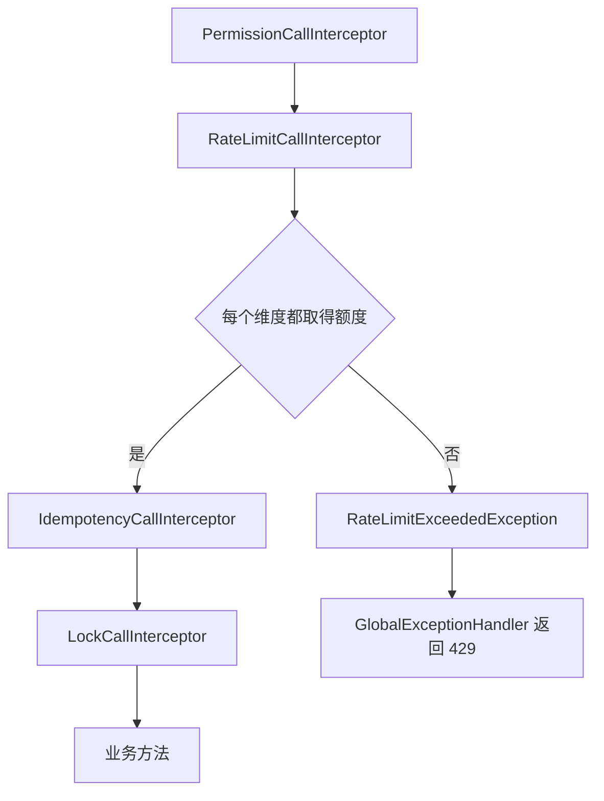

# 限流

本页涵盖 `@RateLimited` 声明的方法限流，包括限流维度、限流键、调用生命周期中的位置、Redis 实现与配置，以及超限和存储失败时的结果。本页适用于开发需要限制调用频率的接口和服务方法的开发者。读完后，开发者能够选择限流维度，写出 `@RateLimited` 声明，并处理 `429` 响应中的 `Retry-After`。

限流由 `RateLimitCallInterceptor` 在方法调用前执行。多个应用实例共享同一组令牌桶时，默认实现 `RedisRateLimiter` 把令牌桶状态保存在 Redis 中。

## 概念

`@RateLimited` 限制一个限流键在时间窗口内可以取得的调用次数。窗口内允许的次数由 `permits` 指定，窗口长度由 `windowSeconds` 指定。

以下声明限制同一 IP 在 60 秒内最多调用 10 次。`ResultView` 与 `VerifyRequest` 由具体应用定义：

```java
@RateLimited(dimensions = {RateLimit.Dim.IP}, permits = 10, windowSeconds = 60)
public ResultView verify(VerifyRequest request) {
    return verifier.verify(request);
}
```

限流只判断调用是否可以继续，不改变方法的返回值。取得额度后，调用继续进入后续拦截器和业务方法。额度不足时，调用不进入业务方法。

限流只限制调用频率，不保证互斥，互斥由版本号或[分布式锁](/capabilities/data-configuration/distributed-lock)负责。

## 核心对象

| 对象 | 负责 | 不负责 |
| --- | --- | --- |
| `RateLimited` | 声明维度、自定义键、`permits` 与 `windowSeconds`。 | 保存令牌桶状态。 |
| `RateLimit` | 保存允许次数 `permits` 与时间窗口 `window`，并定义内置维度枚举 `RateLimit.Dim`。 | 访问 Redis。 |
| `RateLimitCallInterceptor` | 读取 `@RateLimited`，计算每个维度的限流键，逐个调用 `RateLimiter.tryAcquire`，并在任一维度无额度时抛出 `RateLimitExceededException`。 | 实现令牌桶算法。 |
| `RateLimitKey` | 保存 `RATE_LIMIT` 前缀下的限流键段。 | 决定维度的业务含义。 |
| `RateLimiter` | 定义 `tryAcquire(RateLimitKey, RateLimit)`，返回 `RateLimitDecision`。 | 解析注解。 |
| `RateLimitDecision` | 表示允许或拒绝，并在拒绝时保存等待时间 `retryAfter`。 | 向 HTTP 客户端写响应。 |
| `RedisRateLimiter` | 使用 Bucket4j 的 Redis CAS 代理消耗一个令牌。 | 合并多个维度的结果。 |
| `RateLimitExceededException` | 携带向上取整后的 `retryAfterSeconds`，错误码为 `RATE_LIMITED`。 | 决定 HTTP 响应体。HTTP 响应由 `GlobalExceptionHandler` 生成。 |

`RateLimitDecision.allow()` 与 `RateLimitDecision.deny(Duration)` 是仅有的两种结果。拒绝时，等待时间必须为正数。

## 限流维度与限流键

`dimensions` 的默认值是 `{RateLimit.Dim.GLOBAL}`，表示同一方法的全部调用共享一个令牌桶。`dimensions` 中声明多个维度时，每个维度使用独立的令牌桶。

| 维度 | 限流键中的动态值 | 前置条件 |
|---|---|---|
| `GLOBAL` | 无动态值，只使用方法签名的 SHA-256 摘要。 | 无。 |
| `IP` | 当前 HTTP 调用的客户端 IP 的 SHA-256 摘要。 | 当前调用必须是 HTTP 调用，否则抛出 `IllegalStateException`。 |
| `UA` | 对 `present:` 加 `User-Agent` 文本计算 SHA-256 摘要；请求没有 `User-Agent` 时，对 `absent` 计算摘要。 | 当前调用必须是 HTTP 调用，否则抛出 `IllegalStateException`。 |
| `SUBJECT` | 当前调用的 Subject ID。 | 当前调用必须存在 Subject，否则抛出 `IllegalStateException`。 |
| `ACCOUNT` | 当前调用的 Account ID。 | 当前调用必须存在 Account，否则抛出 `IllegalStateException`。 |

自定义维度由 `key` 或 `keyResolver` 提供。`key` 是读取方法参数的表达式，`keyResolver` 是实现 `CallValueResolver<String>` 的类。两者只能二选一。解析结果必须是非空白字符串，否则抛出 `IllegalStateException`。

`dimensions` 为空数组时，只使用自定义维度。同一内置维度重复出现时，抛出 `IllegalStateException`。

以下声明只按邮箱限流。`email` 是方法参数名，表达式返回值必须是 `String`：

```java
@RateLimited(dimensions = {}, key = "#email", permits = 5, windowSeconds = 300)
public void sendCode(String email) {
    codeSender.send(email);
}
```

限流键由 `RATE_LIMIT`、`CALL`、维度名称、方法签名摘要和动态值摘要组成。`RedisRateLimiter` 再把 `permits` 与窗口纳秒数加入键中。因此，修改允许次数或窗口后，会使用新的令牌桶，不继续使用旧状态。

Redis 键由 `RateLimitKey.format(NameFormat.COLON)` 生成。`Key.format` 输出带 App 前缀的完整键，因此 Redis 中的键包含应用隔离前缀。`RedisRateLimiter` 的构造方法注释写明，本类不加入 App 名称前缀。实际前缀由 `Key.format` 决定。

## 调用顺序



`CallLifecycleConfiguration` 固定 `RateLimitCallInterceptor` 排在 `PermissionCallInterceptor` 之后，并排在 `IdempotencyCallInterceptor` 之前。因此，权限不通过的调用不消耗限流额度。限流拒绝的调用也不进入幂等记录或分布式锁。

对每个维度，`RateLimitCallInterceptor` 依次调用 `RateLimiter.tryAcquire`。全部维度都检查后，如果存在拒绝结果，取最长的 `retryAfter` 抛出异常。

实现中没有回滚已经成功取得的额度。某个维度已经消耗的令牌，不会因为其他维度拒绝而返还。

`RateLimited.keyResolver()` 的注释写明，自定义维度与内置维度一起原子取得额度。实际实现只保证每个维度自己的令牌桶 CAS 更新是原子的。

异步返回值的方法在进入业务方法前同样判断额度。超限时，同步抛出 `RateLimitExceededException`。

## 配置

| 配置键 | 默认值 | 约束 | 作用 |
| --- | ---: | --- | --- |
| `sca4dj.redis.rate-limit.keep-after-refill` | `1` 小时（`Duration.ofHours(1)`） | 必须为正数。 | 令牌桶补满后，Redis 中的状态额外保留的时间。`ExpirationAfterWriteStrategy.basedOnTimeForRefillingBucketUpToMax` 使用该值。 |

`RedisRateLimitProperties` 绑定前缀为 `sca4dj.redis.rate-limit`。设置 `null`、零或负数时，setter 抛出 `IllegalArgumentException`。

`CoreRedisAutoConfiguration` 只在类路径中存在 `Redisson`，并且容器中存在 `RedisConnectionDetails` 时，注册 Redis 限流实现。该配置创建独立的 `RedissonClient`，不替换 Spring Data Redis 的连接工厂。

该配置创建的 Bucket4j 代理使用 `Mapper.STRING` 作为键映射器，并使用 CAS 方式更新令牌桶。`RateLimiter` Bean 只在容器中没有 `RateLimiter` 时创建，因此应用可以提供自己的实现。

`RateLimitCallInterceptor` 的 Bean 方法要求容器中存在 `RateLimiter`。源码中 `RateLimiter` 的默认实现只在 Redis 配置满足条件时提供。

### 注解属性

| 属性 | 默认值 | 说明 |
| --- | --- | --- |
| `dimensions` | `{RateLimit.Dim.GLOBAL}` | 内置维度。 |
| `keyResolver` | `NoRateLimitKeyResolver.class` | 自定义键解析器。默认值表示不使用。 |
| `key` | `""` | 自定义键表达式。默认值表示不使用。 |
| `permits` | 无 | 窗口内允许的次数。必须为正数。 |
| `windowSeconds` | 无 | 时间窗口秒数。必须为正数。 |

`permits` 与 `windowSeconds` 在调用时由 `RateLimit` 构造器检查。注解本身不在应用启动时检查这两个值。`permits` 小于 1，或 `windowSeconds` 不为正数时，每次调用抛出 `IllegalArgumentException`。

## 失败结果

| 情况 | 异常或响应 | HTTP 状态 | 错误码 | 调用方处理 |
| --- | --- | ---: | --- | --- |
| 任一维度没有剩余额度。 | `RateLimitExceededException`，由 `GlobalExceptionHandler` 转换。 | 429 | `1005`（`RATE_LIMITED`） | 等待 `Retry-After` 指定的秒数后再发起新的尝试。`data` 为 `null`。 |
| 自定义键表达式返回 `null`、非 `String` 或空白文本，或键解析器抛出异常。 | `IllegalStateException` 或解析器抛出的异常。 | 500 | `1099`（`INTERNAL`） | 视为服务端错误。修正表达式或解析器。 |
| `permits` 小于 1，或 `windowSeconds` 不为正数。 | `IllegalArgumentException`，由 `GlobalExceptionHandler` 转换。 | 400 | `1100`（`BAD_REQUEST`） | 视为代码配置错误。修正注解。 |
| Redis 或 Bucket4j 代理抛出异常。 | 异常原样传播。 | 500 | `1099`（`INTERNAL`） | 源码中未定义降级行为。异常不会被当作允许或拒绝处理。 |

`RateLimitExceededException` 的 `Retry-After` 是剩余等待时间向上取整后的正整数秒数。剩余时间不足 1 秒时，返回 `1`。

`IllegalArgumentException` 在 `GlobalExceptionHandler` 中转换为 HTTP 400。因此，注解配置错误在客户端看来是请求错误。服务端日志中才能看到具体异常。调用方应以服务端配置为准，不应重试同一配置。

HTTP 响应字段和 `Retry-After` 的通用约定见 [HTTP 通用约定](/reference/http/common)。

## 示例

以下示例限制邀请成员接口。同一账号每分钟最多调用 5 次，同一 IP 每分钟最多调用 20 次。`MemberService`、`InviteRequest` 和 `InviteView` 由具体应用定义。

```java
@Service
class MemberInviteService {

    private final MemberService memberService;

    MemberInviteService(MemberService memberService) {
        this.memberService = memberService;
    }

    @RateLimited(
            dimensions = {RateLimit.Dim.ACCOUNT},
            permits = 5,
            windowSeconds = 60)
    public InviteView invite(long workspaceId, InviteRequest request) {
        return memberService.invite(workspaceId, request);
    }
}
```

同一个方法需要同时限制多个维度时，在 `dimensions` 中列出：

```java
@RateLimited(
        dimensions = {RateLimit.Dim.ACCOUNT, RateLimit.Dim.IP},
        permits = 20,
        windowSeconds = 60)
public InviteView inviteFromPortal(long workspaceId, InviteRequest request) {
    return memberService.invite(workspaceId, request);
}
```

任一维度没有额度时，调用方收到 HTTP 429、错误码 `1005` 和 `Retry-After` 响应头。令牌桶补满后的保留时间可调整：

```yaml
sca4dj:
  redis:
    rate-limit:
      keep-after-refill: 2h
```

## 扩展方式

应用提供自己的 `RateLimiter` Bean 后，默认的 `RedisRateLimiter` 不再创建（`@ConditionalOnMissingBean`）。`RateLimitCallInterceptor` 通过容器中的 `RateLimiter` 取得实现，不需要额外注册。

```java
@Configuration
class CustomRateLimitConfiguration {

    @Bean
    RateLimiter rateLimiter() {
        return (key, limit) -> RateLimitDecision.allow();
    }
}
```

自定义维度的键由实现 `CallValueResolver<String>` 的类提供，通过 `keyResolver` 引用。

## 相关页面

- [幂等](/capabilities/data-configuration/idempotency)：幂等拦截器在限流之后执行，相同键的重放不经过业务方法。
- [分布式锁](/capabilities/data-configuration/distributed-lock)：锁拦截器在幂等之后执行。
- [并发规则](/capabilities/data-configuration/concurrency-development)：并发控制与限流的开发约定。
- [HTTP 通用约定](/reference/http/common)：`429` 响应、`Retry-After` 与固定响应字段。
