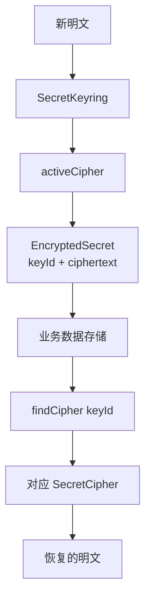
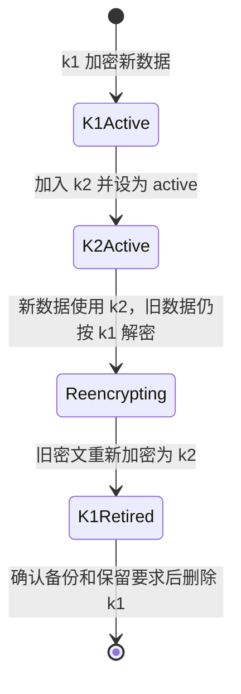

# 敏感数据加密与密钥轮换

本页说明敏感数据加密、密钥选择和轮换的范围。本页适用于需要保存第三方密钥、Client Secret 或设备私钥等、且之后仍需取得原文的数据的开发者。读完后，开发者能判断哪些数据应加密，以及轮换时仍需具体应用完成哪些工作。

有些敏感数据必须保存，业务以后还要取得原文。例如，第三方 API 密钥、OAuth Client Secret 或设备私钥。这些数据不应以明文写入业务表，需要先加密，使用时再解密。

Sca4d-J Core 用 [EncryptedSecret](/javadoc/core/sca4dj-core-api/com/sca4d/core/api/security/EncryptedSecret.html)、[SecretCipher](/javadoc/core/sca4dj-core-api/com/sca4d/core/api/security/SecretCipher.html) 和 [SecretKeyring](/javadoc/core/sca4dj-core-api/com/sca4d/core/api/security/SecretKeyring.html)，定义加密结果、单把密钥的加解密操作和多把密钥的选择方式。

用户密码不属于这类数据。密码验证只需要判断输入是否匹配，不需要取得原密码。因此，系统保存密码哈希，而不是保存加密后的密码。

Core Spring 提供配置驱动的 ConfiguredSecretKeyring 和 AES-256-GCM AesGcmSecretCipher。每份密文使用随机的 12-byte nonce。GCM tag 防止密文被篡改。调用方提供的 purpose 作为 AAD，绑定用途。

当前密文字节固定为 `nonce || ciphertext || tag`，不含格式版本。TOTP 模块已经使用它加密 enrollment 和 Credential Secret。

密钥仍由部署配置提供，不写入业务数据库。示例 App 的 `local-dev` 默认值只供本地启动。生产环境必须注入独立的 32-byte 密钥，并限制读取权限。

## 为什么密文要记录 keyId

密钥不能永远不变。NIST [SP 800-57 Part 1 Rev. 5](https://csrc.nist.gov/pubs/sp/800/57/pt1/r5/final) 讨论密钥从生成、使用到停用和销毁的生命周期。OWASP 的[加密存储指南](https://cheatsheetseries.owasp.org/cheatsheets/Cryptographic_Storage_Cheat_Sheet.html#key-lifetimes-and-rotation) 也说明，轮换后可以给每份数据记录加密密钥 ID，并保留旧密钥用于解密。

如果数据库只保存密文字节，轮换后应用无法知道应该用旧密钥还是新密钥解密。因此，EncryptedSecret 把 `keyId` 和 `ciphertext` 放在一起：



写入新数据时，调用方从 SecretKeyring 取得 `activeCipher()`。读取旧数据时，根据 EncryptedSecret 的 `keyId()` 调用 `findCipher(keyId)`。这样，切换 active 密钥不会立即让旧密文失效。

轮换期间新旧密文并存，靠 `keyId` 区分，不依赖全表同时切换。

## 一次轮换需要完成什么

以密钥 `k1` 轮换到 `k2` 为例：



SecretKeyring 只表达图中的两次选择：哪把密钥加密新数据，以及怎样按 keyId 找到旧密钥。具体应用仍要完成以下工作：

- 生成并安全保存 `k2`；
- 把 `k2` 配置为 active，同时保留 `k1` 的解密访问；
- 找出使用 `k1` 的数据，解密后使用 `k2` 重新加密；
- 验证线上数据和备份不再需要 `k1`，再停用或销毁旧密钥；
- 处理密钥不可用、密文损坏、认证失败和重试中断。

当前实现支持「新密文使用 active key，旧密文按 keyId 解密」。但它没有轮换作业、外部 KMS/Vault 集成、重加密事务或使用量统计。

SecretKeyring 也不规定「旧密钥保留多久」。这取决于数据恢复、备份、合规和事故响应要求。

## 具体实现必须确定的安全规则

公开 SecretCipher 接口没有锁定算法。当前 Core Spring 实现选择 AES-256-GCM。增加其他实现，或用于生产前，至少要确定以下内容：

- 哪些数据确实需要加密后保存，哪些数据根本不应保存；
- 使用经过审查的认证加密算法和成熟密码库，不自行设计算法；
- nonce 或 IV、认证标签和算法版本，怎样与密文一起编码；
- 密钥存放在 HSM、KMS、Vault 或其他受控系统中的哪一处，业务数据库不保存明文密钥；
- keyId 找不到、认证标签不匹配、远程密钥服务不可用时，抛出什么异常；
- 明文字节在内存中何时清除，日志和审计怎样避免输出敏感数据。

OWASP 的[密钥管理指南](https://cheatsheetseries.owasp.org/cheatsheets/Key_Management_Cheat_Sheet.html) 可作为实现检查清单。但它不能替代具体应用自己的威胁分析和密钥操作规程。

## 密码不使用这套接口

用户密码在验证时不需要取得原文。应使用专门的密码哈希算法和独立随机盐。EncryptedSecret 表示加密结果，不应用于保存登录密码。

Sca4d-J 的 [PasswordAuthenticationMethod](/javadoc/modules/auth/sca4dj-auth-password/com/sca4d/auth/password/PasswordAuthenticationMethod.html) 创建、替换和验证 Password Credential，不依赖 SecretCipher。

## 示例

以下示例保存工作区的第三方集成密钥。配置中声明两把 Base64 编码的 32 字节密钥，`k2` 为 active：

```yaml
sca4dj:
  secret-keyring:
    active-key-id: k2
    keys:
      k1: ${WORKSPACE_SECRET_K1}
      k2: ${WORKSPACE_SECRET_K2}
```

服务写入时使用 `activeCipher()`，读取时按 `keyId()` 查找密钥。`purpose` 作为 AAD，写入与读取必须使用同一个值：

```java
@Service
class IntegrationSecretService {

    private static final String PURPOSE = "workspace-integration-secret";

    private final SecretKeyring keyring;

    IntegrationSecretService(SecretKeyring keyring) {
        this.keyring = keyring;
    }

    EncryptedSecret seal(String secret) {
        return keyring.activeCipher().encrypt(PURPOSE, secret.getBytes(StandardCharsets.UTF_8));
    }

    String open(EncryptedSecret stored) {
        SecretCipher cipher = keyring.findCipher(stored.keyId())
                .orElseThrow(() -> new IllegalStateException("缺少密钥: " + stored.keyId()));
        return new String(cipher.decrypt(PURPOSE, stored), StandardCharsets.UTF_8);
    }

    boolean needsReencrypt(EncryptedSecret stored) {
        return !stored.keyId().equals(keyring.activeCipher().keyId());
    }
}
```

业务表保存 `keyId` 和 `ciphertext` 两列。`needsReencrypt` 为 `true` 的数据，由应用的批处理读取后重新调用 `seal`。

## 扩展方式

应用声明自己的 SecretKeyring Bean 后，`SecretKeyringAutoConfiguration` 的 `@ConditionalOnMissingBean` 使默认的 ConfiguredSecretKeyring 不再创建。默认实现只在配置了 `sca4dj.secret-keyring.active-key-id` 时创建。

```java
@Configuration
class KmsKeyringConfiguration {

    @Bean
    SecretKeyring secretKeyring(KmsClient kms) {
        return new KmsSecretKeyring(kms);
    }
}
```

`KmsClient` 与 `KmsSecretKeyring` 由具体应用定义，后者实现 SecretKeyring 和 SecretCipher。
