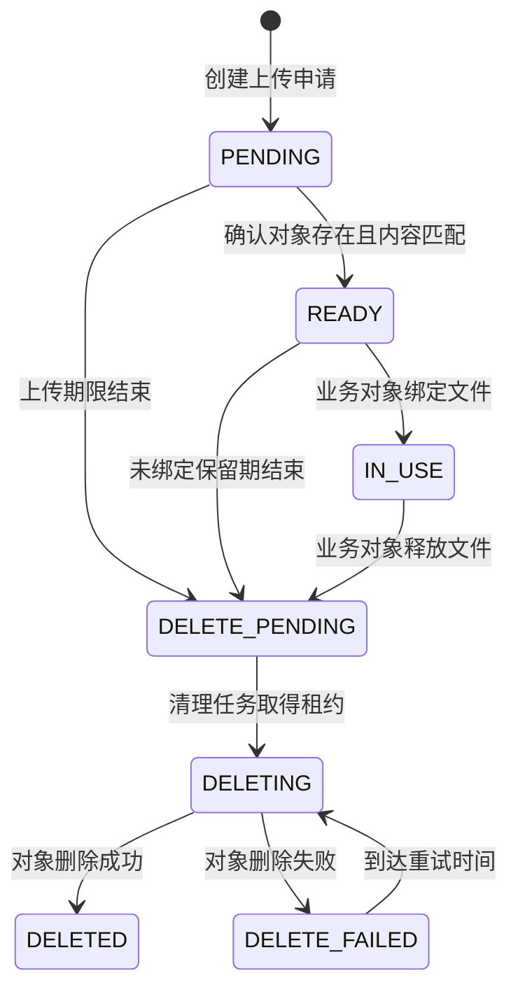
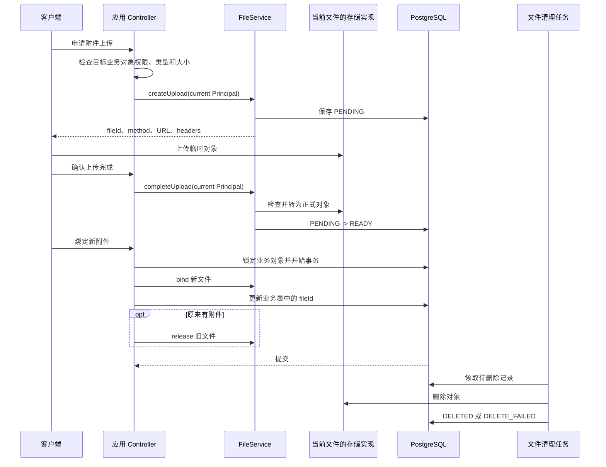

# 文件上传、使用与清理

业务表只保存一个文件地址时，以下问题无法回答：

- 上传者是否真正完成了上传；
- 上传内容是否与申请一致；
- 文件已上传但从未被业务使用时如何处理；
- 业务引用删除后，旧文件是否仍占用空间。

Sca4d-J 用文件记录保存这些事实。文件从申请上传开始，经过完成确认和业务绑定，失去引用后进入异步清理。对象字节写入本地目录还是 MinIO，不改变这套状态。

## 文件记录保存什么

[StoredFile](/javadoc/core/sca4dj-core-api/com/sca4d/core/api/storage/StoredFile.html) 包含文件 ID 、创建文件的 Principal 标识、业务用途（FileUse）、原文件名、媒体类型、字节数和 [FileStatus](/javadoc/core/sca4dj-core-api/com/sca4d/core/api/storage/FileStatus.html)。业务代码使用文件 ID 建立引用，不保存临时上传地址或对象存储地址。系统任务创建文件时使用 `SystemPrincipals` 提供的 `SystemPrincipal`，例如 `SystemPrincipals.mainPrincipal()`。

数据库中的文件记录还保存创建时选中的存储实现、临时对象键和正式对象键。这些字段只供文件服务定位字节。 StoredFile 不向业务代码返回它们。

## 状态变化



1. **创建文件**：应用先检查当前 Principal 是否可以维护目标业务对象，并校验媒体类型和大小。客户端上传调用 `createUpload` 创建 `PENDING` 记录，并取得短期上传请求。服务端持有内容流时，调用 `upload` 创建相同记录。
2. **上传字节**：客户端必须按返回的 `method` 、 URL 和 `headers` 发送内容。服务端上传时，文件服务把调用方提供的 `InputStream` 写入当前 backend 。两条路径都只写临时对象，不能覆盖正式对象。
3. **确认完成**：客户端上传由创建文件的 Principal 请求 `completeUpload`。服务端上传在 `upload` 内完成同样的核验。文件服务检查临时对象的实际媒体类型和字节数，再把对象转为正式对象，并将记录改为 `READY`。
4. **绑定业务对象**：业务 Service 在自己的事务中调用 `bind`，同时把文件 ID 写入业务表。文件记录变为 `IN_USE`。
5. **释放旧文件**：业务引用被替换或删除时，业务 Service 调用 `release`。文件记录变为 `DELETE_PENDING`，业务请求不等待实际删除结束。
6. **异步清理**：清理任务用数据库租约分批领取文件，在事务外删除临时对象和正式对象。成功后，记录变为 `DELETED`。失败时，记录重试时间并变为 `DELETE_FAILED`。

文件删除使用无限次数的固定间隔重试，间隔由 `sca4dj.storage.delete-retry-delay` 配置。等待由文件状态和下一次删除时间保存。外层清理 Job 使用 `RetryRule.once()`，避免重复计数。

`completeUpload` 、同一用途的 `bind`，以及已经进入删除流程的文件上的 `release`，都可以安全重试。对象转正成功但数据库状态尚未更新时，再次执行完成操作可以恢复中断。

先上传、确认后再由用户提交的导入流程使用 `READY` 作为短期服务端暂存状态。上传完成并通过校验后进入 `READY`。业务确认前不绑定业务表。确认成功或用户取消时，调用 `discard` 登记删除。

`READY` 文件沿用统一保留期。过期后不能通过 `openForServer` 读取。后台清理任务负责删除对象。

## 谁检查权限

`discard(fileId, use)` 只允许把未绑定的 `PENDING` 或 `READY` 文件登记为 `DELETE_PENDING`。它核对用途，并参与调用方事务。事务回滚后，文件保留原状态。重复丢弃已经进入删除流程的文件保持幂等。 `IN_USE` 文件必须在业务撤销引用后使用 `release`。

服务端调用 `openForServer(fileId)` 前，先校验业务权限与用途，并在 try-with-resources 中关闭返回的 FileContent 。服务端读取与本地签名读取都拒绝过期 `READY` 和删除状态，不因对象尚未清理而放行。

文件服务只检查上传 Principal 、文件用途、状态和期限。它不判断业务角色。应用负责决定以下事项：

- 谁可以为目标业务对象申请上传；
- 一个场景允许哪些媒体类型和大小；
- 谁可以创建、完成、绑定或读取文件；
- 哪个业务字段保存文件 ID；
- 替换或删除引用时何时释放旧文件；
- 无权读取时是否隐藏为「文件不存在」。

应用通过 `PermissionPolicy` 判断文件权限。`FileUse.scene` 是应用定义的业务场景编码。源码中未定义按 scene 注册场景规则的机制。规则写法见[文件开发规则](/capabilities/file-storage/development)。

批量申请读取地址时，只要有一个文件记录不存在，整个请求都返回文件不存在（`FileErrorCode.NOT_FOUND`），不指出具体失败项。任一文件的状态不是 `READY` 或 `IN_USE` 时，整个请求返回状态冲突（`FileErrorCode.STATE_CONFLICT`）。读取权限由应用的 `PermissionPolicy` 判断。

存储 backend 不可用时，仍返回存储不可用，不伪装成文件不存在。

## 示例：附件替换

下面的服务示例展示 Attachment 替换的顺序。 Attachment 所属的 Workspace 由应用类型表示，`WorkspaceAttachmentRepository` 由应用实现。

```java
import com.sca4d.core.api.identity.Principal;
import com.sca4d.core.api.storage.FileService;
import com.sca4d.core.api.storage.FileUpload;
import com.sca4d.core.api.storage.FileUploadIntent;
import com.sca4d.core.api.storage.FileUse;
import com.sca4d.core.api.storage.StoredFile;
import java.io.InputStream;
import org.springframework.transaction.annotation.Transactional;

public class WorkspaceAttachmentFlow {

    private static final String SCENE = "workspace-attachment";

    private final FileService fileService;
    private final WorkspaceAttachmentRepository repository;

    public WorkspaceAttachmentFlow(
            FileService fileService,
            WorkspaceAttachmentRepository repository) {
        this.fileService = fileService;
        this.repository = repository;
    }

    /** 申请上传。返回的 method、URL 和 headers 交给客户端，服务端不保存它们。 */
    public FileUpload requestUpload(Principal uploader, Workspace workspace, String filename) {
        FileUse use = new FileUse(SCENE, workspace);
        FileUploadIntent intent = new FileUploadIntent(use, filename, "application/pdf", 2_097_152L);
        return fileService.createUpload(uploader, intent);
    }

    /** 客户端上传完成后确认文件，文件进入 READY。 */
    public StoredFile confirmUpload(Principal uploader, long fileId) {
        return fileService.completeUpload(fileId, uploader);
    }

    /** 服务端已持有内容流时，直接创建并上传文件。 */
    public StoredFile uploadFromServer(Principal uploader, Workspace workspace, InputStream content) {
        FileUploadIntent intent = new FileUploadIntent(
                new FileUse(SCENE, workspace), "report.pdf", "application/pdf", 1_024L);
        return fileService.upload(uploader, intent, content);
    }

    /** 在业务事务内绑定新文件，并释放原来保存的文件。 */
    @Transactional
    public void replace(Workspace workspace, long newFileId) {
        StoredFile file = fileService.bind(newFileId, new FileUse(SCENE, workspace));
        Long oldFileId = repository.swapAttachment(workspace.id(), file.fileId());
        if (oldFileId != null) {
            fileService.release(oldFileId, new FileUse(SCENE, workspace));
        }
    }
}
```

`fileService.upload` 的返回值是 `READY` 文件。它不自动绑定业务对象，业务代码仍需调用 `bind`。

示例中的 `Workspace` 与 `WorkspaceAttachmentRepository` 由应用定义。 `FileUploadIntent` 的 `sizeBytes` 与 `contentType` 必须符合场景允许的范围，文件服务会在完成确认时核对实际内容。

## 失败时会发生什么

- 客户端上传请求无法签发，或服务端上传的内容流无法写入时，已创建的 `PENDING` 记录等待到期清理。调用方不会得到存储凭据、容器或对象键。
- 完成确认找不到对象时返回无效上传。实际类型或大小不符时返回内容不匹配。存储实现不可用时返回存储不可用。
- `READY` 文件过期后，不能再绑定或生成读取地址，即使清理任务尚未删除对象。
- 文件释放后，字节可能要等清理任务重试成功才消失。业务代码必须先撤销引用和读取权限，不能等待对象删除后才提交业务事务。

## 附件替换时序



同一业务对象的分布式锁会串行处理并发替换。绑定新文件、更新业务表中的 `fileId` 和释放旧文件位于同一 PostgreSQL 事务。任一步失败都会回滚这些数据库变化。实际删除在提交后异步执行，因此删除失败不会撤销已经完成的附件替换。文件状态只描述字节的生命周期，业务引用由业务表保存。

字节怎样写入本地目录或 MinIO，见[文件存储实现](/capabilities/file-storage/storage-backends)。
