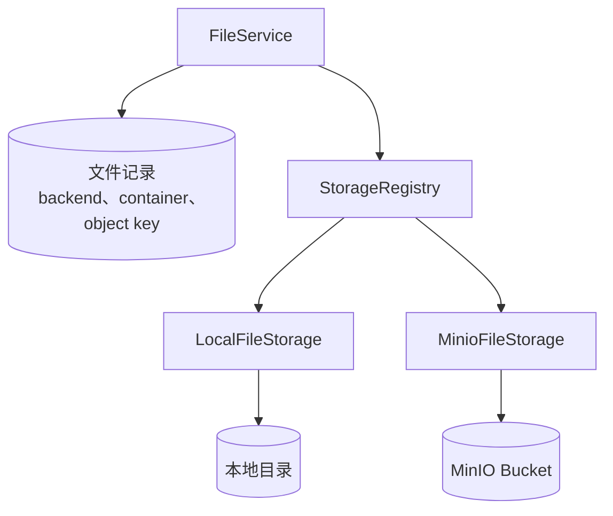

# 文件存储实现

文件存储实现只处理对象字节。它接收文件服务生成的对象键，签发短期上传或读取地址，检查对象内容，把临时对象转为正式对象，并执行删除。文件属于哪个业务对象、谁可以访问、何时释放，由文件记录和应用决定。

## 共同接口

本地目录和 MinIO 都实现 [FileStorage](/javadoc/core/sca4dj-core-api/com/sca4d/core/api/storage/FileStorage.html)：

- `backendId()` 返回稳定实现标识；
- `defaultContainer()` 返回新文件使用的容器或目录名称；
- `checkAvailable()` 在启动时检查必要资源；
- `prepareUpload` 签发客户端上传请求；
- `write` 把服务端内容流写入临时对象；
- `inspect` 读取临时对象或正式对象的媒体类型和大小；
- `promote` 把临时对象转为正式对象；
- `prepareAccess` 签发短期读取地址，`open` 打开内容流；
- `delete` 删除对象，并且必须允许重复调用。

文件记录在创建时保存 backend ID 、容器和对象键。修改默认 backend 只影响以后创建的文件，历史文件继续使用原来的实现。因此，停用一个存储实现前，必须确认已经没有文件记录引用它。



StorageRegistry 要求 backend ID 唯一、不能为空白，也不能包含首尾空白，并确认默认 backend 已经启用。文件服务每次按文件记录中的 backend ID 选择实现，不根据当前默认值重新解释历史记录。

## 存储实现与上传途径

存储实现和上传途径是两个独立维度。 `sca4dj.storage.backend.default` 决定新文件使用 Local 还是 MinIO 。应用调用 `FileService.createUpload` 或 `FileService.upload`，决定内容由客户端还是服务端送入。文件记录、状态、业务绑定和清理规则不随组合改变。

| 存储实现 | 客户端签名上传 | 服务端上传 |
|---|---|---|
| Local | 客户端 PUT 到应用提供的短期签名路由，应用把内容写入目录 | `FileService.upload` 直接把 InputStream 写入目录 |
| MinIO | 客户端 PUT 到 MinIO 预签名地址 | `FileService.upload` 通过 MinIO SDK 写入 Bucket |

服务端上传成功后返回 `READY` 文件，不自动绑定业务对象。业务 Service 仍需在自己的事务中调用 `bind` 并保存 `fileId`。

业务代码不能直接调用 `FileStorage.write`。否则，不会创建文件记录，也无法执行绑定、到期和清理规则。

## 本地目录

LocalFileStorage 把对象保存在配置根目录下。它适合本机开发、测试，或所有应用实例都能访问同一共享文件系统的部署。

本地目录不能自己生成对象存储预签名 URL 。因此，应用需要提供两个匿名路由：

- PUT 路由接收上传内容；
- GET 路由返回文件流。

这两个路由不要求 Session，但请求必须带文件服务签发的加密短期 Token 。 Token 绑定应用运行命名空间、 PUT 或 GET 动作、文件 ID 和到期时间。文件服务验签后，还会检查文件状态、上传期限、媒体类型和精确字节数。模块本身不暴露这两个路由，路由由应用实现，见[Storage Local 模块](/capabilities/file-storage/storage-local)。

LocalFileStorage 会拒绝绝对路径、 `..` 和路径中的符号链接。上传先写入随机 `.part` 文件，实际字节数匹配后才原子替换目标。

应用不能把根目录直接发布为静态目录。反向代理和访问日志也不能记录传输 Token 。

多实例使用本地存储时，每个实例必须看到同一目录。否则，一个实例创建的文件在另一个实例上无法完成或读取。

## MinIO

MinioFileStorage 使用内部端点执行 Bucket 检查、对象检查、复制和删除。它使用公开端点生成浏览器可访问的短期 PUT/GET URL 。内部端点和公开端点必须指向同一 Bucket 和对象，只是网络访问位置可以不同。

应用启动时会检查 Bucket 。 Bucket 不存在且 `create-bucket` 为 `true` 时，创建它。无法检查或创建时，应用启动失败，不会注册一个不可用的默认存储实现。

完成上传时，MinIO 实现先读取临时对象的媒体类型和大小，再复制到正式对象键并删除临时对象。复制成功但首次删除临时对象失败时，不会删除已经生成的正式对象。后续清理会再次执行幂等删除。

预签名 URL 只允许访问指定对象和动作，不代表 Bucket 可以匿名读取。 Access Key 与 Secret Key 只进入受保护配置，不能返回给客户端或写入日志。模块的代码默认值是开发用的 `minioadmin`，生产环境必须通过配置覆盖。

## 配置示例

下面的配置启用两种实现，并把新文件默认放在 MinIO 中。环境变量名称和地址由部署方决定。

```yaml
sca4dj:
  storage:
    backend:
      default: minio
    transfer-base-url: https://app.example.internal
    delete-retry-delay: PT10M
    local:
      enabled: true
      backend-id: local
      container: files
      root: /var/lib/example-app/files
    minio:
      enabled: true
      backend-id: minio
      endpoint: http://minio.internal:9000
      public-endpoint: https://files.example.internal
      region: us-east-1
      access-key: ${MINIO_ACCESS_KEY}
      secret-key: ${MINIO_SECRET_KEY}
      bucket: example-app
      create-bucket: true
```

`sca4dj.storage.backend.default` 必须与已启用的一个 backend ID 相同。 `sca4dj.storage.local` 与 `sca4dj.storage.minio` 的 `enabled` 默认值都是 `true`。

## 怎样选择

| 情况 | 选择 |
|---|---|
| 本机开发、单实例测试 | 本地目录或 MinIO 都可以；默认配置使用 MinIO |
| 多实例且没有共享文件系统 | 使用 MinIO |
| 多实例共享可靠挂载目录 | 可以使用本地目录，但所有实例必须看到相同路径和原子文件操作 |
| 正在从一种实现迁移到另一种 | 同时启用旧、新 backend；先迁移文件记录和对象，再停用旧实现 |

应用可以同时启用两种实现，但对象字节的保存位置不会改变[文件上传、使用与清理](/capabilities/file-storage/file-lifecycle)中的状态和权限规则。

运行配置见 [Sca4d Server 运行配置](/reference/runtime/sca4d-server#storage)。

## 扩展方式

应用可以提供其他 FileStorage 实现，例如另一种对象存储。实现类作为 Spring Bean 注册。文件模块的 StorageRegistry 接收应用上下文中所有 `FileStorage` Bean，并按 `backendId()` 建立索引。

扩展实现需要满足以下条件：

- `backendId()` 唯一，不为空白，不包含首尾空白；
- `checkAvailable()` 在资源不可用时启动失败，不注册不可用的实现；
- `delete` 必须允许重复调用，清理任务依赖这一点重试；
- 短期地址只允许访问指定对象和动作，不授予 Bucket 或目录的匿名访问。

扩展实现后，通过 `sca4dj.storage.backend.default` 选择新文件使用的实现。已有文件记录仍按创建时的 backend ID 访问，因此新实现不能替代仍被引用的旧实现，除非完成对象和记录的迁移。
