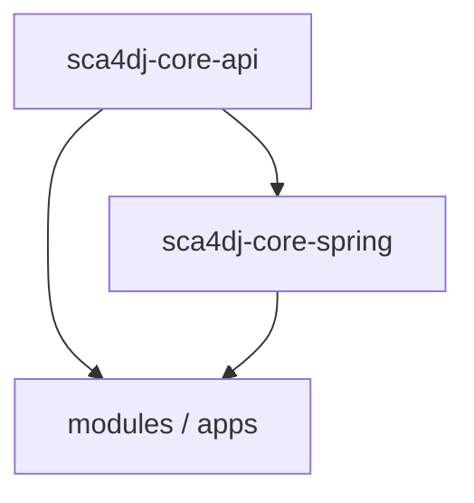
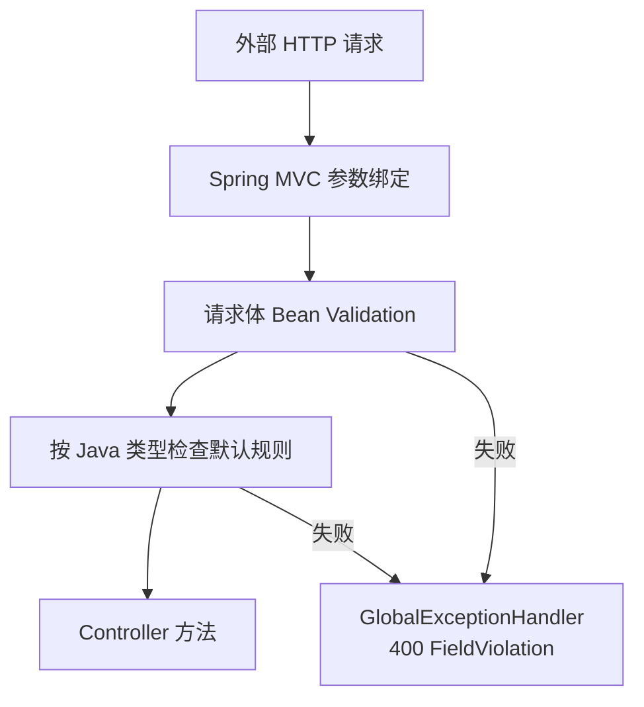
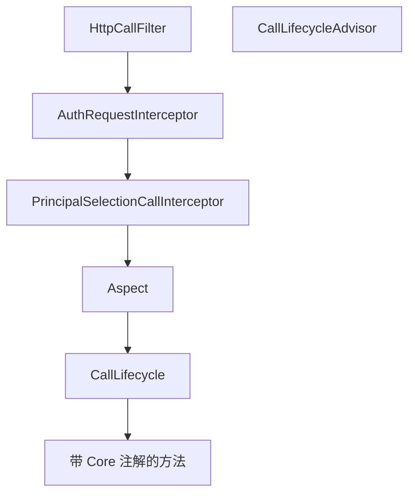
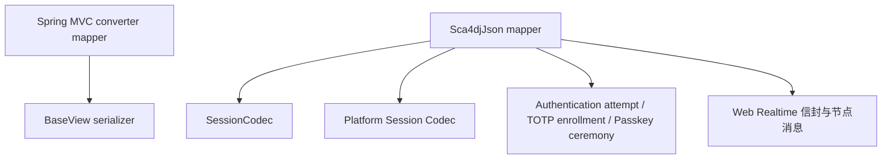

# 核心层

`core/` 包含两个 Gradle 工程。`sca4dj-core-api` 定义模块与应用共同使用的无 Spring 接口和基础类型。`sca4dj-core-spring` 将这些接口接入 Spring MVC、Bean Validation、Jackson、AOP 和自动配置。它还使用必需的 Redis 连接，装配分布式锁、幂等存储和共享限流的实现。

本页面向需要选择依赖、接入 Core 能力或判断某项功能归属的开发者。公开类型的构造方式、返回值和失败结果，可以在[核心技术规格](/reference/#java-api-参考)中按包路径查询。

## Gradle 工程与依赖

| Gradle 工程 | 负责的对象 | 可以依赖 | 不负责 |
|---|---|---|---|
| `sca4dj-core-api` | 身份、认证、权限、文件存储、业务消息、Web Realtime、Gateway 回调、调用生命周期和数据操作等公开接口 | JDK、Hutool、Jackson Databind、SLF4J 和 libphonenumber | Spring 接入、模块实现和数据库 |
| `sca4dj-core-spring` | Spring MVC、Gateway 注册和回调分发、Bean Validation、Jackson、AOP、Redisson 分布式锁、Bucket4j Redis 令牌桶、Redis Lua 幂等状态机和自动配置 | `sca4dj-core-api`、Spring、Spring Boot Redis 连接信息、Redisson 和 Bucket4j | IAM、认证流程、业务数据存储实现和应用业务规则 |



图中的箭头表示「被依赖」。模块只需要 Java 接口时，依赖 `core-api`。实现 Spring MVC、自动配置或 Redis 并发机制时，依赖 `core-spring`。Core 不依赖具体模块或应用。

## Gateway 回调

[GatewayCallback](/javadoc/core/sca4dj-core-api/com/sca4d/core/api/gateway/GatewayCallback.html) 用稳定编码、请求类型和原始 HTTP 结果描述一个外部回调。

[GatewayCallbackDispatcher](/javadoc/core/sca4dj-core-spring/com/sca4d/core/spring/gateway/GatewayCallbackDispatcher.html) 收集应用声明的 Bean，并把 `/callbacks/{code}` JSON 请求转换为对应类型。

[GatewayRegistrationLifecycle](/javadoc/core/sca4dj-core-spring/com/sca4d/core/spring/gateway/GatewayRegistrationLifecycle.html) 把当前实例的回调编码和可达地址登记到独立 Gateway。

Core 不定义 EMQX 等外部系统的回调编码、Secret Header 或业务输入类型。具体应用声明这些值和认证规则。独立 Gateway 只按回调编码选择实例。Gateway 和 Server 的完整关系见[负载均衡 Gateway](/capabilities/realtime-gateway/gateway)。

## 并发机制与 Redis

普通写入不统一携带 `Version`。能够接受覆盖的资料和状态，使用名称明确的无条件 Repository 方法。

数据完整性由以下机制共同保证：主键、唯一、非空、Repository 的同事务引用与单行规则校验，以及原子状态条件。具体应用的业务 Schema 决定是否建立物理外键和业务 CHECK。

不建立物理外键和业务 CHECK 时，模块必须显式处理关联写入、删除顺序、单行规则和并发失败。Quartz 官方 JDBC JobStore 表保留其内部约束。

需要避免客户端覆盖新内容时，Controller 通过 `@IfMatch` 要求强 ETag。Repository 使用 [VersionConditions](/javadoc/core/sca4dj-core-api/com/sca4d/core/api/concurrent/VersionConditions.html) 解析当前 `Version`，并执行同一条条件 SQL。

[RedisDistributedLock](/javadoc/core/sca4dj-core-spring/com/sca4d/core/spring/redis/RedisDistributedLock.html) 为跨实例竞争的资源提供互斥。

[RedisRateLimiter](/javadoc/core/sca4dj-core-spring/com/sca4d/core/spring/redis/RedisRateLimiter.html) 通过 Bucket4j Redis CAS 保存共享令牌桶。

[RedisIdempotencyStore](/javadoc/core/sca4dj-core-spring/com/sca4d/core/spring/redis/RedisIdempotencyStore.html) 通过 Lua 原子操作维护处理所有权和成功结果。

分布式锁使用 LockKey，它继承 Key，因此锁名称带有 App 隔离前缀。App 名称和 Key 的规则见[名称与应用隔离](/capabilities/foundation/name-and-isolation)。

CallLifecycle 的内置参与者包括 IdentityCallInterceptor、PermissionCallInterceptor、RateLimitCallInterceptor、IdempotencyCallInterceptor、LockCallInterceptor、VersionCallInterceptor 和 AuditCallInterceptor，其相对顺序由 CallLifecycleConfiguration 固定。IdempotencyCallInterceptor 依赖 IdempotencyStore，LockCallInterceptor 依赖 DistributedLock，RateLimitCallInterceptor 依赖 RateLimiter。这些组件都不依赖 Bucket4j、Redisson 或 Redis 类型。

Core Spring 负责注入 Redis 实现。任一必需实现缺失时，应用启动失败。Core 不提供内存回退、空 Bean 或运行时占位实现。

`@RateLimited` 默认按具体方法全局限流。也可以直接选择 IP、User-Agent、Subject 和 Account。选择多个维度时，每个维度各自使用独立令牌桶。自定义业务维度仍由 `keyResolver` 解析。声明方式、连续补充规则、缺失调用数据和拒绝响应，见[并发规则](/capabilities/data-configuration/concurrency-development)。

普通并发写入使用原子 SQL，条件为状态、版本、业务序号或租约。

必须跨事务串行的业务对象，先取得 Redis 分布式锁，再开始数据库事务，并在事务中重新读取当前值。

任务节点领取使用 `FOR UPDATE SKIP LOCKED`。Outbox、Storage 清理和 IoT 状态机的 Mapper 中没有显式行锁语句。Setting 初始化使用事务级 PostgreSQL advisory lock（`pg_try_advisory_xact_lock`），用于避免同一数据库中的初始化定义互相覆盖。

并发经版本号或 Redis 租约表达，见[并发规则](/capabilities/data-configuration/concurrency-development)。

## 全局 ID

[IdGenerator](/javadoc/core/sca4dj-core-api/com/sca4d/core/api/id/IdGenerator.html) 让模块在写数据库前取得正整数 ID，不把公共模块绑定到数据库序列或某种算法。

[SnowflakeIdGenerator](/javadoc/core/sca4dj-core-spring/com/sca4d/core/spring/id/SnowflakeIdGenerator.html) 是 Spring 默认实现。具体应用声明自己的 IdGenerator Bean 后，会替换它。

默认实现把 [IdProperties](/javadoc/core/sca4dj-core-spring/com/sca4d/core/spring/config/IdProperties.html) 的 `sca4dj.id.node-id` 拆成 Hutool Snowflake 的 worker ID 和 data center ID。多实例部署必须使用不同的 nodeId。Sca4d-J 不会自动分配或检查重复。算法、配置示例和适用范围，见[全局 ID](/capabilities/foundation/global-id)。

## MyBatis 单值类型转换

[LongValueTypeHandler](/javadoc/core/sca4dj-core-spring/com/sca4d/core/spring/persistence/mybatis/LongValueTypeHandler.html) 和 [StringValueTypeHandler](/javadoc/core/sca4dj-core-spring/com/sca4d/core/spring/persistence/mybatis/StringValueTypeHandler.html) 通过调用方提供的对象构造函数和值读取函数，在 MyBatis 中读写 BIGINT 和 VARCHAR。

具体模块在自己的自动配置中注册所负责的类型。Core 不读取模块类型，也不要求这些类型实现共同接口。

## 敏感数据加密

- [EncryptedSecret](/javadoc/core/sca4dj-core-api/com/sca4d/core/api/security/EncryptedSecret.html) 用 keyId 和密文字节保存加密结果。
- [SecretCipher](/javadoc/core/sca4dj-core-api/com/sca4d/core/api/security/SecretCipher.html) 表示单把密钥的加解密操作。
- [SecretKeyring](/javadoc/core/sca4dj-core-api/com/sca4d/core/api/security/SecretKeyring.html) 分开选择新数据使用的 active 密钥，以及旧数据解密使用的历史密钥。

Core Spring 自动配置可以从 `sca4dj.secret-keyring` 创建 AES-256-GCM Keyring。TOTP 模块已经使用它保存加密 Secret。

当前没有外部 KMS/Vault 集成、轮换作业或批量重加密任务。可配置哪些密钥、active 密钥怎样选择，以及轮换时的修改顺序，见[敏感数据加密与密钥轮换](/capabilities/data-configuration/secret-encryption)。

## 业务消息

- [Event](/javadoc/core/sca4dj-core-api/com/sca4d/core/api/event/Event.html) 保存已经发生的业务事实。
- [EventType](/javadoc/core/sca4dj-core-api/com/sca4d/core/api/event/EventType.html) 声明稳定的事件编码、协议版本和 payload 类型。
- [DispatchReceipt](/javadoc/core/sca4dj-core-api/com/sca4d/core/api/messaging/DispatchReceipt.html) 返回一次消息发布的 `Id` 标识和分发状态。
- [MessageBus](/javadoc/core/sca4dj-core-api/com/sca4d/core/api/messaging/MessageBus.html) 按 [DispatchPolicy](/javadoc/core/sca4dj-core-api/com/sca4d/core/api/messaging/DispatchPolicy.html) 的 `Mode` 提供立即发布、提交后发布和 Outbox 可靠发布。
- [MessageConsumer](/javadoc/core/sca4dj-core-api/com/sca4d/core/api/messaging/MessageConsumer.html) 声明 Consumer 的接口约定。

Core 不包含 RabbitMQ、Outbox 或 Consumer 容器实现。Messaging 模块实现这些接口。Outbox 只保证发布。RabbitMQ 保存持久消息。消费失败直接进入各 Consumer 的 DLQ。完整关系见[业务消息与可靠发布](/capabilities/messaging-notification/domain-events)。

## Web Realtime

[ConnectionId](/javadoc/core/sca4dj-core-api/com/sca4d/core/api/connection/ConnectionId.html)、[Connection](/javadoc/core/sca4dj-core-api/com/sca4d/core/api/connection/Connection.html) 和 [ConnectionRegistry](/javadoc/core/sca4dj-core-api/com/sca4d/core/api/connection/ConnectionRegistry.html) 表达应用对外持续网络连接的共同生命周期。

[WebRealtimeTarget](/javadoc/core/sca4dj-core-api/com/sca4d/core/api/webrealtime/WebRealtimeTarget.html) 支持 Account、Subject、Principal、Resource、Topic、Session 和 Connection。SSE、STOMP 和 MQTT 都使用 Connection。具体模块仍负责协议句柄和消息投递。

Core 不定义 WebSocket 帧、SSE emitter、Redis 索引或节点传输实现。Web Realtime 模块实现连接生命周期、本机投递和可选的 RabbitMQ 跨实例路由。具体关系见 [Web Realtime](/capabilities/realtime-gateway/realtime)。

## 文件存储

[FileService](/javadoc/core/sca4dj-core-api/com/sca4d/core/api/storage/FileService.html) 是应用用于创建上传、确认文件、绑定用途和读取内容的接口。

[FileStorage](/javadoc/core/sca4dj-core-api/com/sca4d/core/api/storage/FileStorage.html) 是 Local、MinIO 等对象存储实现需要遵守的接口。

文件状态、上传结果、访问地址和存储对象描述都位于 `sca4dj-core-api`。应用不依赖 Storage 模块包。

`sca4dj-storage-file` 保存文件记录并实现 FileService。`sca4dj-storage-local` 和 `sca4dj-storage-minio` 提供可按 `backendId` 选择的 FileStorage。应用仍在 Gradle 中选择要装配的实现。Core 不读取数据库、文件系统或 MinIO。

## HTTP 调用生命周期

Core Spring 的固定 JSON 字段、错误状态、分页、调用标识、ETag 和客户端状态响应头，见 [HTTP API 通用约定](/reference/http/common)。具体应用开放哪些路由，以及每条路由的认证和权限要求，由具体应用自己的 HTTP API 规格说明。

外部 HTTP 输入在 Spring MVC 完成参数绑定后，由 [HttpInputValidationAspect](/javadoc/core/sca4dj-core-spring/com/sca4d/core/spring/web/HttpInputValidationAspect.html) 检查。

默认规则由 Java 数据类型决定，包括整数是否为正数、字符串最大长度和容器最大数量。它们不依赖 `accountId`、`roleIds` 等字段名称。

Service、Repository、Mapper 和应用注入参数不执行这些默认规则。



请求对象声明的显式 Bean Validation 约束先执行。

任一显式数值范围都会完全替代整数的默认正数规则。`@Size` 会完全替代字符串或容器的默认大小规则。因此，有明确业务上下限的字段，仍需在声明上写出完整范围。

[NoDefaultValidation](/javadoc/core/sca4dj-core-spring/com/sca4d/core/spring/validation/NoDefaultValidation.html) 只用于协议或业务确实不采用类型默认值的位置，不影响显式约束。

开关和最大值由 [HttpInputValidationProperties](/javadoc/core/sca4dj-core-spring/com/sca4d/core/spring/config/HttpInputValidationProperties.html) 配置。



图中节点的职责如下：

- [HttpCallFilter](/javadoc/core/sca4dj-core-spring/com/sca4d/core/spring/web/HttpCallFilter.html) 为请求建立 [Call](/javadoc/core/sca4dj-core-api/com/sca4d/core/api/call/Call.html)。
- [AuthRequestInterceptor](/javadoc/modules/auth/sca4dj-auth/com/sca4d/auth/web/AuthRequestInterceptor.html) 按 Handler 注解恢复允许的 [会话（Session）](/javadoc/core/sca4dj-core-api/com/sca4d/core/api/authentication/Session.html)，并写入当前调用。没有会话时，继续匿名请求。
- [PrincipalSelectionCallInterceptor](/javadoc/core/sca4dj-core-spring/com/sca4d/core/spring/identity/PrincipalSelectionCallInterceptor.html) 只在 `@CurrentPrincipal` 声明处选择业务身份，并将结果写入 Call。
- [CallLifecycleAdvisor](/javadoc/core/sca4dj-core-spring/com/sca4d/core/spring/call/CallLifecycleAdvisor.html) 为每个带 Core 注解或 `@IfMatch` 的具体方法建立 [CallExecution](/javadoc/core/sca4dj-core-api/com/sca4d/core/api/call/CallExecution.html)，再交给 [CallLifecycle](/javadoc/core/sca4dj-core-api/com/sca4d/core/api/call/CallLifecycle.html)。生命周期只消费外围组件已经准备好的身份和调用数据。

固定执行顺序及每一处失败结果，见[调用生命周期](/capabilities/identity-access/call-lifecycle)。

认证完成后怎样确定本次调用采用的业务身份，见 [Principal 选择](/capabilities/identity-access/principal-selection)。Operation、业务资源、权限策略和资源范围之间的关系，见[权限判断与授权数据](/capabilities/identity-access/authorization)。

核心层不依赖具体模块。某个模块独有的身份、表结构、认证方式或业务流程，不进入 `core/`。多个模块需要协作时，先在 `core-api` 中确认是否确实存在长期稳定的公开概念，再新增接口。

## 数据操作、本地化与 View

```mermaid
flowchart TD
    Pipeline[Pipeline]
    Stage[PipelineStage]
    Ops[DataOps]
    Values[DataKey / DataValues]
    Graph[DataGraph]
    Executor[DataGraphExecutor]
    Jackson[HTTP Jackson<br/>long 输出为字符串]
    View[BaseView / ViewJson]
    Concrete[具体 View 定制]
    Localize[@Localize 内置定制]
    Text[TextLocalizer]
    Fields[LocalizedFields<br/>随业务行读取]
    Output[HTTP JSON]
    Pipeline --> Stage
    Stage --> Ops
    Stage --> Values
    Values --> Graph --> Executor
    Ops --> View --> Concrete
    Jackson --> View --> Output
    Text --> Localize --> View
    Fields --> View
```

[数据操作工具（DataOps）](/capabilities/data-configuration/data-operations) 接收已有值，在内存中处理文本、数值、集合、字节、JSON 和 ID。字节入口按偏移和 ByteOrder 读写数值并计算校验值。JSON 入口在 String、`byte[]`、普通 Java 值和不可变对象快照之间转换。Repository 查询、事务和外部操作留在调用 DataOps 的阶段或业务方法中。

[Pipeline](/javadoc/core/sca4dj-core-api/com/sca4d/core/api/pipeline/Pipeline.html) 按固定顺序调用类型相接的 [PipelineStage](/javadoc/core/sca4dj-core-api/com/sca4d/core/api/pipeline/PipelineStage.html)。阶段可以调用 DataOps，也可以通过 [DataKey](/javadoc/core/sca4dj-core-api/com/sca4d/core/api/data/DataKey.html) 和 [DataValues](/javadoc/core/sca4dj-core-api/com/sca4d/core/api/data/DataValues.html) 传递一组类型化字段。阶段失败时，PipelineExecutionException 保存实际 stage code。

[DataGraph](/capabilities/data-configuration/data-graph) 使用 DataKey 声明多个输入、操作依赖和输出。[DataGraphExecutor](/javadoc/core/sca4dj-core-api/com/sca4d/core/api/data/DataGraphExecutor.html) 可以按拓扑顺序同步执行。它也可以使用调用方提供的 Executor，并行执行无共享可变状态的节点。

固定的「解析、转换、映射」过程使用 Pipeline。某个输出必须等待多个输入或其他节点结果时，使用 DataGraph。[Pipeline、Job 与定时调度](/capabilities/jobs-scheduling/pipeline-job-scheduling) 继续说明 Pipeline 怎样作为持久化工作节点执行。

[LocalizableText](/javadoc/core/sca4dj-core-api/com/sca4d/core/api/i18n/LocalizableText.html) 是静态消息和动态翻译文本的共同输入。[TextLocalizer](/javadoc/core/sca4dj-core-api/com/sca4d/core/api/i18n/TextLocalizer.html) 对静态消息使用应用支持列表，对动态文本保留准确的请求 Locale。它本身不读取 HTTP 请求。

| 文本来源 | Core 类型 | 数据位置 | 最终回退 |
|---|---|---|---|
| 模块固定消息 | MessageText | `META-INF/sca4dj/i18n/<catalog>/<language-tag>.properties` | 默认 Locale，再返回消息键 |
| 独立动态翻译 | TranslatedText | 由负责该业务数据的模块读取 | 默认 Locale，再返回业务回退文本 |
| 一行业务数据的多个动态字段 | LocalizedFields | 负责模块表中的单个 `i18n` JSONB 列 | 默认 Locale；仍缺失时失败 |

Spring 层的语言解析由三个组件分工完成：

- RequestLocaleResolver 保留 `Accept-Language` 中优先级最高的合法 Locale。
- ClasspathMessageCatalog 扫描模块资源。
- CatalogMessageSource 把请求 Locale 转换为静态目录支持的 Locale，并供 Bean Validation 使用。

业务 Service 不读取 LocaleContextHolder 来拼接语言分支。

[LocalizedFields](/javadoc/core/sca4dj-core-api/com/sca4d/core/api/i18n/LocalizedFields.html) 使用 Locale 与字段键两级映射，保存一行业务数据的完整多语言字段。负责模块使用 [LocalizedFieldsSchema](/javadoc/core/sca4dj-core-api/com/sca4d/core/api/i18n/LocalizedFieldsSchema.html) 校验自己的允许字段、默认 Locale 和长度。标准持久化列固定命名为 `i18n`。[LocalizedFieldsTypeHandler](/javadoc/core/sca4dj-core-spring/com/sca4d/core/spring/persistence/mybatis/LocalizedFieldsTypeHandler.html) 只为 LocalizedFields 转换 PostgreSQL JSONB，不处理任意 JSONB。

[最终 JSON 定制（BaseView）](/javadoc/core/sca4dj-core-spring/com/sca4d/core/spring/web/view/BaseView.html) 在 Jackson 完成普通 Bean 序列化后，修改内存中的最终对象。

[ViewJson](/javadoc/core/sca4dj-core-spring/com/sca4d/core/spring/web/view/ViewJson.html) 是具体 View 使用的定制入口。它使用当前 HTTP ObjectMapper 序列化普通值，并把路径、合并和 JSON 类型操作交给 DataOps.JsonPipe。

依赖顺序固定为：DataOps、BaseView 与 ViewJson、具体 View 定制。`core-api` 不反向依赖 Spring View。

[@Localize](/javadoc/core/sca4dj-core-spring/com/sca4d/core/spring/web/view/Localize.html) 是 BaseView 在 action 和 render 之前执行的内置 ViewJson 定制。它不是 BaseView 的唯一职责。

`source` 使用 protected、零参数的 LocalizableText 方法。`key` 从 BaseView 构造时已经持有的 LocalizedFields 读取。

两种方式都只读取当前 View 已有的数据。Repository 在构造 View 之前，把 `i18n` 与主记录一次查出。序列化阶段不执行 JOIN、逐行补查或阻塞 IO。

[BaseViewSerializer](/javadoc/core/sca4dj-core-spring/com/sca4d/core/spring/web/view/BaseViewSerializer.html) 先把默认 Bean JSON 完整写入内存，再执行本地化、登记 action 和最终 render。所有步骤成功后，才向实际 generator 写出一次 ObjectNode。该 Jackson 模块只装配到 Spring MVC 实际使用的 converter，不改变脚手架内部或应用自己声明的其他 ObjectMapper。

[CoreJacksonAutoConfiguration](/javadoc/core/sca4dj-core-spring/com/sca4d/core/spring/config/CoreJacksonAutoConfiguration.html) 定制 Spring Boot 创建的通用 HTTP mapper，并创建 [@Sca4djJson](/javadoc/core/sca4dj-core-spring/com/sca4d/core/spring/json/Sca4djJson.html) 限定的脚手架内部 mapper。HTTP mapper 把 Java `long` 和 Long 输出为十进制字符串。内部 mapper 固定使用 Java Time、ISO 时间文本和严格类型绑定。

## JSON mapper 所有权



HTTP JSON 和脚手架内部 JSON 的读者及格式要求不同，因此使用两个 mapper。

Session 的传输格式、Platform payload、认证 Redis 状态、TOTP enrollment、Passkey ceremony、Messaging 信封和 Web Realtime 信封都属于脚手架内部稳定数据。这些数据直接共用一个 mapper，不再按模块重复创建。

`@Sca4djJson` Bean 不是默认候选。应用替换它时，会同时改变全部脚手架内部格式，不能只改变其中一个模块。

Core Spring 还使用应用唯一或 `@Primary RedisConnectionFactory`，创建 [@Sca4djRedis](/javadoc/core/sca4dj-core-spring/com/sca4d/core/spring/redis/Sca4djRedis.html) 限定的字符串模板。Auth、TOTP、Passkey 和 Web Realtime 只注入这个模板。应用普通 Redis Bean 不会改变它们的连接。

Sa-Token 继续使用 `sa-token-redis-template` 自带的 DAO，并通过同一个默认连接工厂访问 Redis。

## 地区与公共校验

[RegionCatalog](/capabilities/data-configuration/region-and-phone) 把 libphonenumber 元数据转换成 Core 自己的地区和号码类型，不向调用方暴露第三方类型。

`core-spring` 中的 [@PhoneNumber](/capabilities/data-configuration/phone-number-validation) 使用该目录校验规范 E.164 输入。校验只判断格式和元数据，不判断号码归属、分配状态或可达性。

公共校验注解只处理跨应用稳定的输入语法。Req 表达必填，BizId 表达业务编码格式，DisplayName 和 SafeText 限制长度与控制字符，MacAddress 限制冒号分隔格式。

数据库唯一性、对象存在、权限、敏感词和具体业务状态，继续由负责该业务动作的 Service 检查。

[@TimeRange](/javadoc/core/sca4dj-core-spring/com/sca4d/core/spring/validation/TimeRange.html) 在对象上指定两个可读取的 Instant 属性。两者非空时，要求开始时间严格早于结束时间，相等也不通过。任意一端为空时，跳过比较，必填由单独的约束声明。可以为同一对象声明多组时间范围，失败结果指向结束属性。

身份、会话、认证、调用生命周期和权限的规格入口见[技术规格文档](/reference/)。

## 示例

下例演示应用把 Core 能力组合到一个 Controller 方法上：工作区内的文档更新要求强 ETag、权限和账号维度限流，Service 在写入前用 IdGenerator 取得 ID，并用 BusinessException 报告业务失败。

依赖声明：

```kotlin
dependencies {
    implementation(project(":core:sca4dj-core-spring"))
}
```

Controller 声明调用约束。`DocumentOperations`、`DocumentService`、`DocumentChangeRequest` 和 `DocumentView` 是应用自己的类型：

```java
import com.sca4d.core.api.annotation.RateLimited;
import com.sca4d.core.api.annotation.RequirePermission;
import com.sca4d.core.api.concurrent.RateLimit;
import com.sca4d.core.spring.web.ApiResponse;
import com.sca4d.core.spring.web.annotation.IfMatch;

@RestController
@RequestMapping("/workspaces/{workspaceId}/documents")
class DocumentController {
    private final DocumentService documents;

    DocumentController(DocumentService documents) {
        this.documents = documents;
    }

    @PatchMapping("/{documentId}")
    @IfMatch
    @RequirePermission(operation = DocumentOperations.UPDATE_VALUE)
    @RateLimited(dimensions = RateLimit.Dim.ACCOUNT, permits = 30, windowSeconds = 60)
    public ApiResponse<DocumentView> update(
            @PathVariable long workspaceId,
            @PathVariable long documentId,
            @Valid @RequestBody DocumentChangeRequest request) {
        return ApiResponse.ok(DocumentView.from(documents.update(workspaceId, documentId, request)));
    }
}
```

Service 创建文档时取得 ID。`DOCUMENT_TITLE_DUPLICATED` 是应用在自己的 ErrorCode 枚举中声明的错误码：

```java
import com.sca4d.core.api.error.exception.BusinessException;
import com.sca4d.core.api.id.Id;
import com.sca4d.core.api.id.IdGenerator;

@Service
class DocumentService {
    private final IdGenerator ids;
    private final DocumentRepository repository;

    DocumentService(IdGenerator ids, DocumentRepository repository) {
        this.ids = ids;
        this.repository = repository;
    }

    Document create(long workspaceId, String title) {
        if (repository.existsTitle(workspaceId, title)) {
            throw new BusinessException(DocumentErrorCode.DOCUMENT_TITLE_DUPLICATED, null, title);
        }
        Id documentId = ids.nextId();
        return repository.insert(documentId.value(), workspaceId, title);
    }
}
```

`RateLimit.Dim.ACCOUNT` 使限流按账号拆分令牌桶。请求缺少 `If-Match` 或携带的 ETag 过期时，调用在 Service 执行前被拒绝，失败结果见[并发规则](/capabilities/data-configuration/concurrency-development)。
