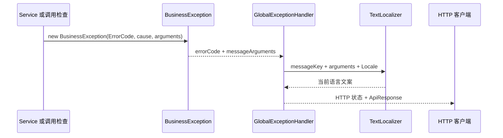

# 错误码与业务异常

错误码是程序能够稳定识别的失败标识。本页涵盖错误码、错误消息、Java 异常和 HTTP 状态各自的职责，适用于定义业务错误的开发者。读完后，开发者应能为一个业务失败选择正确的错误码、错误类别和 HTTP 状态。

- 错误码告诉客户端具体发生了什么。
- 消息告诉当前语言的用户应如何理解该失败。
- 异常把失败传递给调用者。
- HTTP 状态让浏览器、代理和通用客户端识别失败的大类。

只返回字符串消息会产生两个直接问题。第一，文案翻译或调整后，客户端的判断失效。第二，不同模块可能使用相同文案表达不同失败。

只返回 HTTP 状态也不够。例如，多个业务冲突都可以是 `409`。客户端仍需要区分「角色正在使用」和「资源版本过期」。

[RFC 9457](https://www.rfc-editor.org/rfc/rfc9457) 定义了 HTTP API 通用的 Problem Details 格式，使用 `type` URI 识别问题类型。Sca4d-J 当前不输出 `application/problem+json`。它使用自己的 ApiResponse，字段如下：

- `code` 保存错误码。
- `messageKey` 和 `messageArgs` 支持客户端重新本地化。
- `message` 保存服务端生成的当前语言文案。
- `callId` 用于关联请求。

两种格式解决相近问题，但字段和媒体类型不兼容。

## 从业务失败到 HTTP 响应



[ErrorCode](/javadoc/core/sca4dj-core-api/com/sca4d/core/api/error/ErrorCode.html) 要求每个错误提供全局 `code`、[ErrorCategory](/javadoc/core/sca4dj-core-api/com/sca4d/core/api/error/ErrorCategory.html) 和 `messageKey`。

业务代码抛出 [BusinessException](/javadoc/core/sca4dj-core-api/com/sca4d/core/api/error/exception/BusinessException.html) 时，可以附带消息参数和原始异常。构造器有两个：`BusinessException(ErrorCode)` 和 `BusinessException(ErrorCode, Throwable, Object...)`。异常自身的 `message` 只是错误码，不是最终客户端文案。

GlobalExceptionHandler 按错误类别映射 HTTP 状态：

| ErrorCategory | HTTP 状态 |
|---|---|
| `VALIDATION` | `400 Bad Request` |
| `AUTHENTICATION` | `401 Unauthorized` |
| `PERMISSION` | `403 Forbidden` |
| `NOT_FOUND` | `404 Not Found` |
| `CONFLICT` | `409 Conflict` |
| `RATE_LIMIT` | `429 Too Many Requests` |
| `UNAVAILABLE` | `503 Service Unavailable` |
| `INTERNAL` | `500 Internal Server Error` |

HttpErrorCode 可以为特定 HTTP 问题直接指定状态，例如 `405`、`413`、`428` 和 `412`。

未分类异常统一返回 `CoreErrorCode.INTERNAL`。完整异常只写入服务端日志。

SSE 请求发生 4xx 业务失败时，只返回状态码，不返回 ApiResponse 响应体。

## 为什么使用枚举和号段

每个模块用枚举声明自己的错误集合。编译器可以检查引用，搜索代码也能找到所有抛出位置。

[@ErrorCodeRange](/javadoc/core/sca4dj-core-api/com/sca4d/core/api/error/ErrorCodeRange.html) 为枚举分配整数区间。[ErrorCodeCatalog](/javadoc/core/sca4dj-core-api/com/sca4d/core/api/error/ErrorCodeCatalog.html) 可以检查以下内容：编码是否为整数文本、编码是否位于区间内，以及多个枚举的编码和区间是否重复。

完整定义见下方「示例」。枚举的每个常量声明编码、类别和消息键，业务代码用常量抛出 BusinessException。

编号一旦被客户端使用，就不能改成另一种含义。删除的错误码也不应立即复用。否则，旧客户端和历史记录会错误解释新失败。

`messageKey` 可以调整对应翻译，但 `code` 和业务含义应保持稳定。

失败的身份是 `code`，不是文案或 HTTP 状态。

## 示例

以下示例为文档模块定义错误码枚举，并在 Service 中抛出。号段 `2400` 至 `2499` 仅用于示意，实际号段不得与已有枚举重叠。

```java
import com.sca4d.core.api.error.ErrorCategory;
import com.sca4d.core.api.error.ErrorCode;
import com.sca4d.core.api.error.ErrorCodeRange;

@ErrorCodeRange(start = 2400, end = 2499)
public enum DocumentErrorCode implements ErrorCode {
    DOCUMENT_NOT_FOUND("2400", ErrorCategory.NOT_FOUND, "error.document.not-found"),
    DOCUMENT_LOCKED("2401", ErrorCategory.CONFLICT, "error.document.locked");

    private final String code;
    private final ErrorCategory category;
    private final String messageKey;

    DocumentErrorCode(String code, ErrorCategory category, String messageKey) {
        this.code = code;
        this.category = category;
        this.messageKey = messageKey;
    }

    @Override
    public String code() {
        return code;
    }

    @Override
    public ErrorCategory category() {
        return category;
    }

    @Override
    public String messageKey() {
        return messageKey;
    }
}
```

```java
import com.sca4d.core.api.error.exception.BusinessException;

if (document == null) {
    throw new BusinessException(DocumentErrorCode.DOCUMENT_NOT_FOUND);
}
if (document.locked()) {
    throw new BusinessException(DocumentErrorCode.DOCUMENT_LOCKED, null, document.lockedBy());
}
```

第二处抛出携带一个消息参数 `document.lockedBy()`。`messageKey` 对应的文案在应用的消息资源中按语言配置，参数由 TextLocalizer 填入。

两处抛出的 HTTP 状态分别为 `404` 和 `409`，响应体 `code` 为 `"2400"` 和 `"2401"`。

## 当前编号和检查情况

- CoreErrorCode：`1000` 至 `1099`；
- HttpErrorCode：`1100` 至 `1199`；
- IamErrorCode：`2000` 至 `2099`；
- AuthErrorCode：`2100` 至 `2199`；
- RbacErrorCode：`2700` 至 `2709`；
- PasswordErrorCode：`2200` 至 `2299`。

以上列出的号段互不重叠。ErrorCodeCatalog 能拒绝不同枚举之间的号段重叠，但现行 Spring 装配没有创建该目录，因此运行时不会在启动时检查号段冲突。

ErrorCodeCatalog 当前由 CoreUtilitiesTest 验证。当前没有自动扫描模块错误码的实现。要让号段规则成为启动保证，应用必须显式收集所有错误码枚举，并创建目录。
