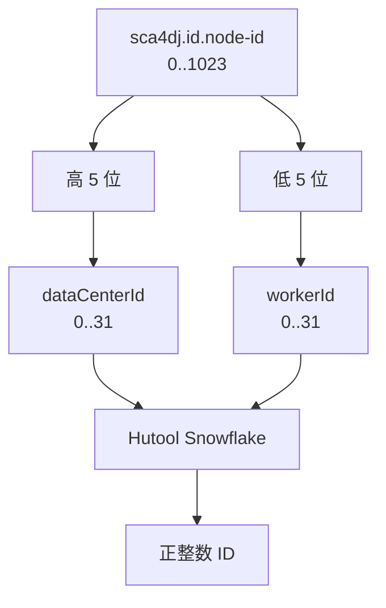

# 全局 ID

Sca4d-J 的 Subject、Account、Principal、角色等数据，会在应用进程中先生成 ID，再写入各自模块的数据表。它们都需要正整数 ID。但 Core 不能要求每个模块直接依赖某个数据库序列或第三方算法。因此，[IdGenerator](/javadoc/core/sca4dj-core-api/com/sca4d/core/api/id/IdGenerator.html) 只定义「取得下一个正整数 ID」，Spring 默认实现则选择 Snowflake。

本页面向需要理解 ID 生成方式、配置 `nodeId` 或替换 IdGenerator 的开发者。读完后，开发者应能判断多实例部署需要为每个实例分配什么编号，以及默认实现不保证什么。

## 为什么不让每张表自己生成

在写数据库之前得到 ID，有三个直接结果：

- 一个事务可以先建立 Subject、Account、Principal 等对象之间的关系，再统一写入；
- Service 不需要为了取得主键而逐表插入并读取数据库返回值；
- 具体应用可以用自己的 ID 服务替换默认算法，而模块继续依赖同一个 IdGenerator。

这不表示所有数据都应共用一张序列表。IdGenerator 只约定值为正数。它不约定严格递增、连续、不可猜测，也不约定带有业务类型信息。

常见的 ID 方案各自需要承担不同成本：

| 方案 | 直接结果 |
|---|---|
| 数据库自增或 Sequence | 数据库分配顺序值，写入方需要依赖对应数据库和取值方式 |
| UUID | 各实例可以独立生成，但值是 128 位，当前 long 主键和 ID 值类型不能直接使用 |
| 独立 ID 服务 | 可以集中分配编号和租约，但每次生成依赖远程服务或本地号段缓存 |
| Snowflake | 当前进程直接生成 long，部署必须分配不重复的节点编号并管理系统时钟 |

Sca4d-J 的默认实现选择最后一种方案。现有 ID 类型都保存 long，生成时不访问数据库或远程服务。IdGenerator 保留替换入口。具体应用可以根据数据库、部署平台和跨系统协议，改用其他方案。

## 默认 Snowflake 怎样工作

[SnowflakeIdGenerator](/javadoc/core/sca4dj-core-spring/com/sca4d/core/spring/id/SnowflakeIdGenerator.html) 使用 [Hutool Snowflake](https://plus.hutool.cn/apidocs/cn/hutool/core/lang/Snowflake.html)。Hutool 将它说明为 Twitter 的 Snowflake 算法。

该算法把时间、节点和同一毫秒内的序列组合进一个 long。因此，生成 ID 不需要每次访问数据库。Hutool 使用 worker ID 与 data center ID 各 5 位的模型，两者各允许 `0..31`。

Hutool 5.8.47 的 64 位结构是：1 位符号位、41 位相对毫秒时间、5 位 data center ID、5 位 worker ID 和 12 位同毫秒序列。

- 符号位固定为 0，因此结果是正数。
- 两个节点字段一共支持 1024 种组合。
- 12 位序列表示单个节点在同一毫秒内可以分配 4096 个序号。

这些数字来自 Hutool 当前版本的官方 API。它们不是 IdGenerator 接口对其他实现的要求。

Sca4d-J 只向部署暴露一个 `0..1023` 的 nodeId，并将其拆成 Hutool 的两个参数：

```text
nodeId 的高 5 位 -> dataCenterId
nodeId 的低 5 位 -> workerId
```



这里的 data center 和 worker 只是算法字段。它们不要求部署平台真的按机房和进程分别管理两个编号。部署系统只需要保证，所有同时生成 ID 的 Sca4d-J 实例使用不同的 nodeId。

## 多实例部署必须分配不同编号

[IdProperties](/javadoc/core/sca4dj-core-spring/com/sca4d/core/spring/config/IdProperties.html) 的配置键是 `sca4dj.id.node-id`，默认值为 `0`。具体应用的运行配置负责为该键提供每个实例的 nodeId。

单实例开发环境可以使用默认值。两个或更多实例同时运行时，如果它们使用相同的 nodeId，就可能在相同毫秒和相同序列位置生成同一个 ID。数据库主键或唯一约束可能让其中一次写入失败。没有约束的数据，还可能发生错误关联。

```yaml
sca4dj:
  id:
    node-id: 17
```

容器编排、虚拟机部署或本地多进程运行，都必须为实例分配稳定且不重复的 `0..1023` 编号。

Sca4d-J 当前不会从主机名、IP 地址、Pod 序号或 Redis 自动申请编号。它也不会检查另一实例是否正在使用相同的值。

唯一性由 nodeId 分配保证，不由数据库约束兜底。

## 当前使用位置

IdentityService 的 `createSubject`、`createAccount`、`createPrincipal` 和 `addIdentifier` 分别为 Subject、Account、Principal 和 AccountIdentifier 生成 ID。RbacService 与 PlatformRbacService 为新建角色生成 ID。它们只调用 `nextId()`，不知道默认实现采用 Snowflake。

Core Spring 使用 `@ConditionalOnMissingBean` 注册默认生成器。具体应用声明自己的 IdGenerator Bean 后，Spring 保留该 Bean，不再创建 SnowflakeIdGenerator。

替换实现仍必须返回正整数，并负责跨实例唯一性。如果实现可能返回零、负数或重复值，各模块的值类型、主键和关系写入会失败。

## 示例

以下示例在 Service 中为工作区和成员预先生成 ID，再写入同一事务。`IdGenerator.nextId()` 返回 `Id`，`Id.value()` 返回 `long`。

```java
import com.sca4d.core.api.id.Id;
import com.sca4d.core.api.id.IdGenerator;

public class WorkspaceService {

    private final IdGenerator idGenerator;

    public WorkspaceService(IdGenerator idGenerator) {
        this.idGenerator = idGenerator;
    }

    public Id createWithOwner(String name) {
        Id workspaceId = idGenerator.nextId();
        Id memberId = idGenerator.nextId();
        // 在同一事务中写入工作区，以及关联 workspaceId 的创建者成员 memberId
        return workspaceId;
    }
}
```

每个实例使用不同的 `nodeId`：

```yaml
sca4dj:
  id:
    node-id: 17
```

超出 `0..1023` 的值会使 IdProperties 抛出 `IllegalArgumentException`，应用无法启动。

## 扩展方式

应用声明自己的 IdGenerator Bean 即可替换默认实现。Core Spring 的默认 Bean 带有 `@ConditionalOnMissingBean`，发现应用 Bean 后不再创建 SnowflakeIdGenerator。

```java
import com.sca4d.core.api.id.Id;
import com.sca4d.core.api.id.IdGenerator;
import org.springframework.context.annotation.Bean;
import org.springframework.context.annotation.Configuration;

@Configuration
public class WorkspaceIdConfiguration {

    @Bean
    IdGenerator idGenerator(RemoteIdClient client) {
        return () -> Id.of(client.nextPositive());
    }
}
```

`RemoteIdClient` 是应用自己的类型，用于示意外部 ID 服务。返回值必须是正整数。

## 不适合用作什么

Snowflake ID 大致按生成时间排序，但不是严格连续的业务序号。节点并发、时间变化和同毫秒序列都会产生间隔。

它也不具备安全随机性，不能当作密码、Token、验证码或访问权限判断依据。

默认包装器没有另外规定时钟回拨处理、纪元或位布局兼容期。这些行为跟随当前 Hutool 实现。

Core Spring 的 HTTP JSON 使用 [CoreJacksonAutoConfiguration](/javadoc/core/sca4dj-core-spring/com/sca4d/core/spring/config/CoreJacksonAutoConfiguration.html) 把 Java `long` 和 Long 写成十进制字符串。前端不得将其转换成 JavaScript `number`。

Session 的传输格式、Redis 事件和其他协议各自使用自己的 mapper 或编码器，不从 HTTP 规则推断格式。

需要长期解析 Snowflake 时间字段，或对时钟异常有专门要求的具体应用，应先固定相应协议和测试。之后再决定继续使用默认实现，还是替换 IdGenerator。
