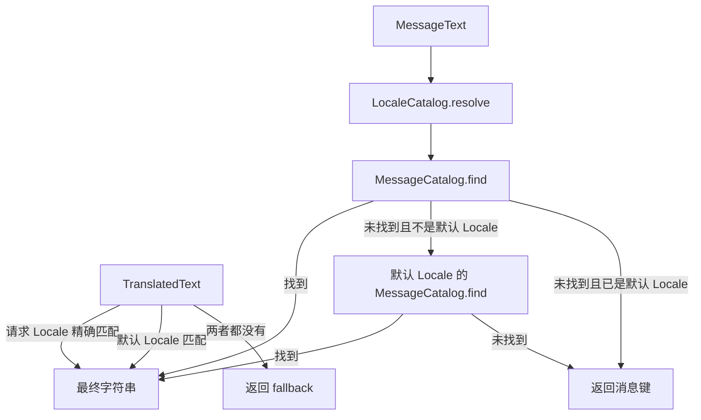

# 语言环境与国际化

本页涵盖 Core 的 Locale 目录、静态消息、动态多语言文本和请求语言解析。本页适用于需要返回本地化文本或保存多语言业务数据的开发者。读完后，开发者能判断一段文本应放入静态消息目录还是动态字段，并知道请求语言如何被选择。

## 概念

Core 把两类文本分开处理。

- 静态消息由模块在类路径资源中提供，使用 `MessageText.of(key, arguments...)` 表示，由 `MessageCatalog` 按 Locale 查找和格式化。
- 动态翻译属于业务数据本身，使用 `TranslatedText.of(translations, fallback)` 或 `LocalizedFields` 表示，文本随业务行一起保存。

例如，应用配置 `sca4dj.i18n.supported-locales` 为 `zh-CN` 和 `en-US`，`sca4dj.i18n.default-locale` 为 `zh-CN`。

- 请求 Locale 为 `en-GB` 时，`LocaleCatalog.resolve` 没有精确匹配，于是选择同语言的第一个配置项 `en-US`。
- 请求 Locale 为 `fr-FR` 时，没有同语言配置项，于是选择默认 Locale `zh-CN`。

`ErrorCode` 只保存 `messageKey`，文案由本模块按请求 Locale 解析，见[错误码与业务异常](/capabilities/foundation/error-model)。

## 核心对象

| 对象 | 负责 | 不负责 |
|---|---|---|
| `LocaleCatalog` | 保存去重后的支持列表（保持配置顺序）和默认 Locale，并用 `resolve` 选择支持的 Locale | 读取配置文件，加载消息 |
| `MessageCatalog` | 按消息键和 Locale 查找并格式化静态消息 | 处理动态业务数据 |
| `ClasspathMessageCatalog` | 读取类路径中的 I18n 资源文件，并检查同一 Locale 下的消息键重复 | 决定请求使用哪个 Locale |
| `MessageText` | 保存静态消息的键和模板参数 | 查找消息内容 |
| `TranslatedText` | 保存动态数据已有的 Locale 文本和业务回退文本 | 从资源文件读取文本 |
| `LocalizedFields` | 保存一行业务数据中 Locale、字段键和文本的关系 | 校验字段规则 |
| `LocalizedFieldsSchema` | 校验允许的字段键、必填字段键和每个字段的最大长度 | 保存业务数据 |
| `TextLocalizer` | 把 `MessageText`、`TranslatedText` 或 `LocalizedFields` 转换为字符串 | 修改业务数据 |
| `RequestLocaleResolver` | 从 `Accept-Language` 返回请求 Locale | 修改请求或响应中的 Locale |
| `CatalogMessageSource` | 把 `MessageCatalog` 接入 Spring 和 Bean Validation 使用的 `MessageSource` | 定义消息内容 |

`LocalizableText` 的构造函数为包级可见。因此，子类只能定义在 `com.sca4d.core.api.i18n` 包中。当前子类为 `MessageText` 和 `TranslatedText`。

### 静态消息与动态文本的查找顺序



`TextLocalizer.localize(MessageText, Locale)` 先使用 `LocaleCatalog.resolve` 选择支持的 Locale，再查找消息。

`TranslatedText` 只按请求 Locale 精确匹配，没有同语言回退。然后，它尝试默认 Locale，最后返回业务回退文本。

两者的回退规则不同。调用方应按数据来源选择类型。

`LocalizedFields` 使用 `TextLocalizer.localize(fields, key, requestedLocale)`。它先按请求 Locale 查找字段，再按默认 Locale 查找。两者都没有时，抛出 `IllegalArgumentException`。

## 请求语言解析

`RequestLocaleResolver` 注册为名为 `localeResolver` 的 Spring `LocaleResolver`。它按以下规则返回 Locale：

- 请求没有 `Accept-Language` 头时，返回 `LocaleCatalog.defaultLocale()`
- 按 `HttpServletRequest.getLocales()` 的顺序，返回第一个含语言的 Locale
- 所有条目都不含语言时，返回默认 Locale

`RequestLocaleResolver` 返回的 Locale 没有经过支持列表截断。支持列表只在 `LocaleCatalog.resolve` 中使用。因此，动态字段可以使用支持列表之外的合法 Locale。`setLocale` 每次调用都抛出 `UnsupportedOperationException`。

`LocaleCatalog.resolve(List<Locale>)` 按请求顺序逐个尝试：先精确匹配，再匹配同语言的第一个配置项，都没有时进入下一个请求 Locale。全部请求都没有匹配时，返回默认 Locale。

## 配置

| 配置键 | 类型 | 默认值（源码） | 作用 |
|---|---|---|---|
| `sca4dj.i18n.supported-locales` | `List<String>`，BCP 47 语言标签 | 空列表 | 应用支持的 Locale，顺序决定同语言回退的选择 |
| `sca4dj.i18n.default-locale` | `String`，BCP 47 语言标签 | 空字符串 | 请求语言不受支持或缺失时使用的 Locale |

空字符串或空列表不能通过 `LocaleCatalog` 的校验。除非应用声明自己的 `LocaleCatalog` Bean，否则必须配置这两个键。

`ClasspathMessageCatalog` 扫描 `classpath*:META-INF/sca4dj/i18n/*/*.properties`。文件名必须是 BCP 47 语言标签，例如 `zh-CN.properties`。文件内容按 UTF-8 读取。目录名可以是模块自己的名称。

以下 Bean 使用 `@ConditionalOnMissingBean` 注册。应用声明同类型的 Bean 时，Core 不再创建默认实现：

- `localeCatalog`
- `messageCatalog`
- `textLocalizer`
- `messageSource`（使用 `MessageSource` 的标准 Bean 名称）
- `localeResolver`（使用 `DispatcherServlet` 的标准 Bean 名称）

## 示例

以下示例为文档模块提供静态消息，并在 Service 中保存和读取工作区的多语言名称。

资源文件放在 `src/main/resources/META-INF/sca4dj/i18n/document/zh-CN.properties` 和 `en-US.properties`，模板按 `java.text.MessageFormat` 格式化：

```properties
# zh-CN.properties
error.document.locked=文档已被 {0} 锁定
```

```properties
# en-US.properties
error.document.locked=The document is locked by {0}
```

```yaml
sca4dj:
  i18n:
    supported-locales: zh-CN,en-US
    default-locale: zh-CN
```

```java
import com.sca4d.core.api.i18n.LocalizedFields;
import com.sca4d.core.api.i18n.MessageText;
import com.sca4d.core.api.i18n.TextLocalizer;
import com.sca4d.core.api.i18n.TranslatedText;
import java.util.Locale;
import java.util.Map;

// 静态消息
MessageText locked = MessageText.of("error.document.locked", "Alice");
String text = textLocalizer.localize(locked, Locale.forLanguageTag("en-GB"));
// en-GB 回退到 en-US，结果为 "The document is locked by Alice"

// 随业务数据保存的动态文本
TranslatedText title = TranslatedText.of(
        Map.of(Locale.forLanguageTag("zh-CN"), "季度计划"),
        "季度计划");
String shown = textLocalizer.localize(title, Locale.forLanguageTag("fr-FR"));
// 没有 fr-FR，使用默认 Locale zh-CN 的文本

// 一行业务数据中的多个字段
LocalizedFields fields = LocalizedFields.of(Map.of(
        Locale.forLanguageTag("zh-CN"), Map.of("name", "产品组工作区"),
        Locale.forLanguageTag("en-US"), Map.of("name", "Product Workspace")));
String name = textLocalizer.localize(fields, "name", Locale.forLanguageTag("en-US"));
```

`textLocalizer` 是 Core 注册的 TextLocalizer Bean。`supported-locales` 的写法遵循 Spring 对 `List<String>` 的绑定规则。

## 扩展方式

- 新增模块的静态消息：在模块类路径下放置 `META-INF/sca4dj/i18n/<目录名>/<语言标签>.properties`，ClasspathMessageCatalog 扫描 `classpath*:META-INF/sca4dj/i18n/*/*.properties` 发现。同一 Locale 下的消息键不得与其他模块重复。
- 替换 Locale 目录、消息目录或本地化器：声明同类型的 Bean，参见上文 `@ConditionalOnMissingBean` 列表。

## 限制与失败结果

| 位置 | 条件 | 结果 |
|---|---|---|
| `LocaleCatalog` 构造 | 支持列表为空 | `IllegalArgumentException`，消息为「至少需要一个支持的 Locale」 |
| `LocaleCatalog` 构造 | 同一 Locale 出现两次（规范化后比较） | `IllegalArgumentException` |
| `LocaleCatalog` 构造 | 默认 Locale 不在支持列表中 | `IllegalArgumentException` |
| `LocaleCatalog` 构造 | Locale 不含语言 | `IllegalArgumentException` |
| `ClasspathMessageCatalog` 加载 | 同一 Locale 下出现重复消息键 | `IllegalStateException`，消息包含 Locale、键和资源位置 |
| `ClasspathMessageCatalog` 加载 | 资源文件不是 `.properties` 文件，或文件名中的标签不含语言 | `IllegalStateException` |
| `ClasspathMessageCatalog` 加载 | 读取资源时出现 I/O 错误 | `CoreSpringException`，消息为「读取模块 I18n 资源失败」 |
| `MessageText.of` | 消息键为空白字符串 | `IllegalArgumentException`，消息为「消息键不能为空白」 |
| `MessageText.of` | 参数包含 `null` | `NullPointerException` |
| `TextLocalizer.localize(MessageText, Locale)` | 请求 Locale 和默认 Locale 都没有该键 | 返回消息键本身，并记录缺失键警告 |
| `TextLocalizer.localize(TranslatedText, Locale)` | 请求 Locale 和默认 Locale 都没有翻译 | 返回 `TranslatedText` 的业务回退文本 |
| `TextLocalizer.localize(LocalizedFields, String, Locale)` | 请求 Locale 和默认 Locale 都没有该字段 | `IllegalArgumentException`，消息为「动态国际化字段缺少默认文本」 |
| `TranslatedText.of` | 任一翻译文本为空白字符串 | `IllegalArgumentException` |
| `LocalizedFields` 构造 | 字段键或字段文本为空白字符串 | `IllegalArgumentException` |
| `RequestLocaleResolver.setLocale` | 任何调用 | `UnsupportedOperationException` |

缺失的静态消息键会按原样返回，因此页面可能显示消息键。源码中的缺失键警告最多记录 256 个不同的键。

缺失的动态字段会抛出异常。调用方需要在保存数据时保证默认 Locale 的文本存在。`LocalizedFieldsSchema` 提供按默认 Locale 校验的方法，见 `validate(LocalizedFields, Locale)` 的 Javadoc。

## 相关页面

- [核心层](/capabilities/foundation/core)
- [错误码与业务异常](/capabilities/foundation/error-model)
- [数据访问与持久化](/capabilities/data-configuration/data-access-and-persistence)
- [HTTP API 通用约定](/reference/http/common)
- [Java API 参考](/reference/#java-api-参考)
