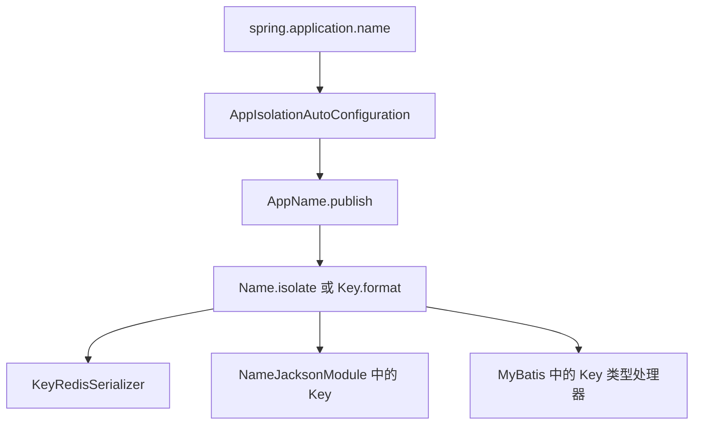

# 名称与应用隔离

`Name`、`NameFormat`、`Key` 与 App 隔离前缀之间的关系如下。本页适用于需要在日志、Redis key、数据库字段或 JSON 中输出名称的开发者。读完后，开发者能判断一个名称是否会加上 App 前缀，以及前缀来自哪个配置。

## 概念

同一个逻辑名称在不同场合需要不同的文本形式。操作编码使用冒号分隔，资源类型使用斜杠分隔，点式逻辑名称使用点分隔。`NameFormat` 只在输出时选择分隔符，不改变名称本身。

`Name` 的相等性由对象类型和内部字符串决定。`NameFormat` 不参与比较，因此同一个名称使用不同格式输出时仍然相等。已经隔离的名称与普通 `Name` 的类型不同，二者不相等。

App 隔离前缀由进程启动时发布的 App 名称决定。测试中使用 `sca4d-test` 发布 App 名称，`AppName` 把它转换为 `SCA4D_TEST`。

此时，`new Name("orders").isolate()` 的 `format(NameFormat.COLON)` 输出为 `SCA4D_TEST:orders`。普通 `Name.format(NameFormat.COLON)` 输出为 `orders`，不加前缀。

两个应用共用同一个 Redis 或数据库时，前缀使它们的键互不重叠。

## 核心对象

| 对象 | 负责 | 不负责 |
|---|---|---|
| `Name` | 保存非空白名称原文，提供 `format(NameFormat)`、`isolate()` 和 `isolate(NameFormat)` | 解释普通名称的分隔符结构 |
| `NameFormat` | 定义 `COLON`、`SLASH` 和 `DOT` 三种分隔符，并用 `join(List<String>)` 连接节点 | 保存名称值，参与相等性比较 |
| `AppIsolation` | 通过 `appName()` 返回隔离依据，默认返回 `AppName.current()` | 保存实例 ID；源码说明实例 ID 不参与隔离 |
| `AppName` | 把 App 名称转换为标准形式，并在进程内发布一次 | 读取配置文件 |
| `AppIsolationAutoConfiguration` | 读取 `spring.application.name`，注册 Bean `sca4djAppName` 并发布 App 名称 | 发布之后修改 App 名称 |
| `Key` | 继承 `Name`，`format` 输出带 App 前缀的完整键，`parse` 检查并移除前缀 | 决定业务编码本身 |
| `Code` | 继承 `Name`，`format` 只输出逻辑编码 | 添加 App 前缀 |
| `TreeCode` | 继承 `Code`，提供 `child`、`append`、`isUnder` 等层级操作 | 限定节点数量或字符数 |
| `Attribute` | 继承 `TreeCode`，表示对象携带的一个固定属性值，拒绝通配节点和超过 128 字符的编码 | 判断属性属于哪条轴 |
| `OperationCode` | 继承 `TreeCode`，表示一个 Operation 的固定编码，至少两个节点、不超过 128 字符，通配节点只能在最后一段 | 表示资源类型、Permission 动作或属性 |
| `Display` | 保存被声明对象的名称消息键和说明消息键；`Display.of(prefix, code)` 按 `Code` 推导，`Display.of(nameKey)` 直接指定 | 保存文本，参与对象身份判断 |
| `AttributeAxis` | 保存一个轴根 `Attribute` 和取值约束 `AttributeConstraint`；`contains(attribute)` 在属性是轴根的严格后代时返回 `true` | 检查某个对象是否满足约束，检查由使用属性的对象完成 |

`Code` 保持业务编码的稳定形式。`NameJacksonModule` 的源码注释也说明，只有 `Key` 按 App 隔离输出。

### Display

`Display` 回答被声明对象在界面上叫什么、怎么解释，身份仍由对象的 `Code` 决定。它只保存两个国际化消息键，文本由调用方按当前语言从 i18n 资源查找。

- 说明消息键固定为名称消息键加 `.description`。
- `Display.of(prefix, code)` 按 `Code` 推导名称消息键：前缀加编码每个节点的小写形式，`_` 换成 `-`，通配节点 `*` 写成 `all`，用 `.` 连接。例如前缀 `order` 与 `ORDERS:INVOICE_LINES:READ` 得到 `order.orders.invoice-lines.read`。
- `Display.of(nameKey)` 用于推导结果与已有资源键不一致的例外。
- `Display` 的相等性比较运行时类型和名称消息键。

Operation 目录的使用见 [Operation 与权限声明](/capabilities/identity-access/operation-declaration)。

### Attribute 与 Tag

`Attribute` 是用于业务判断的固定事实，例如 Operation 的读写意图。它可以出现在 `if` 判断中，由对象的 `has`、`hasUnder` 等方法判断。属性值位于某条属性轴的轴根之下，Operation 目录预先登记 `INTENT`、`NATURE`、`RISK` 和 `VISIBILITY` 四条标准轴，轴的声明和校验见 [Operation 与权限声明](/capabilities/identity-access/operation-declaration)。

`Attribute` 继承 `TreeCode`，但相等性按运行时类型比较。与它节点相同的 `TreeCode` 不相等，`Attribute` 的 `equals` 对该 `TreeCode` 返回 `false`。需要只比较节点时使用 `sameCode`。`Attribute` 的 `child`、`append` 返回 `Attribute`，不会退回 `TreeCode`。

`OperationCode` 与 `Attribute` 采用同样的类型规则：相等性按运行时类型比较，`child`、`append` 返回 `OperationCode`。它的使用见 [Operation 与权限声明](/capabilities/identity-access/operation-declaration)。

Tag 是另一个概念：用于分组、检索、筛选和展示的标签，可以有多个，但不参与 `if` 判断。当前没有 Tag 类型或 API，只有 `Attribute`。

`Name` 的隔离结果是新的不可变对象。对已经隔离的对象再次调用 `isolate`，返回同一个对象，不会重复添加前缀。



图中的 `AppName` 在 `sca4djAppName` Bean 创建时发布。`Key` 在写入 Redis、JSON 和 MyBatis 时都调用 `format(NameFormat.COLON)`，因此这些位置输出的 `Key` 文本包含 App 前缀。`Code` 在同样的位置输出时不包含前缀。

## 配置

| 配置键 | 默认值 | 作用 |
|---|---|---|
| `spring.application.name` | 源码中未定义默认值，`AppIsolationAutoConfiguration` 使用 `getRequiredProperty` 读取 | 作为 App 名称，转换后成为所有隔离 `Key` 的前缀 |

`AppName.normalize` 的转换规则如下：

- 允许 ASCII 字母、数字、下划线和连字符
- 连字符替换为下划线
- 字母转为大写
- 转换结果只能包含大写字母、数字和下划线

例如，`sca4d-test` 转换为 `SCA4D_TEST`。`app:name` 因包含冒号而被拒绝。`sca4djAppName` Bean 的 `defaultCandidate` 为 `false`，因此不会作为同类型的默认候选 Bean。

## 限制与失败结果

| 位置 | 条件 | 结果 |
|---|---|---|
| `Name` 构造 | 参数为 `null` | `NullPointerException`，消息为「名称不能为空」 |
| `Name` 构造 | 参数为空白字符串 | `IllegalArgumentException`，消息为「名称不能为空白」 |
| `AppName.normalize` | 包含允许字符以外的字符 | `IllegalArgumentException` |
| `AppName.current` | 发布 App 名称之前调用 | `IllegalStateException` |
| `AppName.publish` | 进程中已发布另一个名称 | `IllegalStateException`；重复发布相同名称允许 |
| `Attribute` 构造 | 编码含通配节点 `*`，或冒号格式文本超过 128 字符 | `IllegalArgumentException`，消息为「Attribute 必须是最多 128 字符的固定编码」 |
| `Key.parse` | 字符串不以当前 App 前缀开头 | `IllegalArgumentException`，消息为「Key 的 App 隔离前缀不匹配」 |
| `Key.fromSegments` | 动态文本段的 `V_` 编码与解码结果不一致 | `IllegalArgumentException`，消息为「Key 动态文本编码无效」 |
| `KeyRedisSerializer.deserialize` | 同槽标记无效，或反序列化后重新输出的文本与输入不同 | `IllegalArgumentException` |

`Key.parse` 检查前缀。`Key.fromSegments` 不检查前缀，只在序列化时使用。

配置错误在应用启动时暴露。App 名称在运行中不能改变。修改配置后，必须重新启动进程。

## 示例

以下示例假设 `spring.application.name` 为 `docs-app`，转换后的 App 名称为 `DOCS_APP`。

```java
import com.sca4d.core.api.name.Key;
import com.sca4d.core.api.name.NameFormat;
import com.sca4d.core.api.name.code.TreeCode;

TreeCode code = TreeCode.of("DOCUMENT/DETAIL");
Key key = Key.of(code, 42L);

key.format(NameFormat.COLON);   // DOCS_APP:DOCUMENT:DETAIL:42
code.format(NameFormat.SLASH);  // DOCUMENT/DETAIL
key.isUnder(TreeCode.of("DOCUMENT")); // true

Key parsed = Key.parse("DOCS_APP:DOCUMENT:DETAIL:42", NameFormat.COLON);
// parsed 与 key 相等
```

`Key.of(Code, long...)` 追加数字段，`Key.of(Code, String...)` 追加动态文本段。动态文本在 Key 中以 `V_` 加十六进制 UTF-8 编码保存。

`Key.parse` 遇到其他 App 前缀时抛出 `IllegalArgumentException`。

```yaml
spring:
  application:
    name: docs-app
```

## 相关页面

- [核心层](/capabilities/foundation/core)
- [全局 ID](/capabilities/foundation/global-id)
- [数据访问与持久化](/capabilities/data-configuration/data-access-and-persistence)
- [缓存开发](/capabilities/data-configuration/cache-development)
- [Java API 参考](/reference/#java-api-参考)
