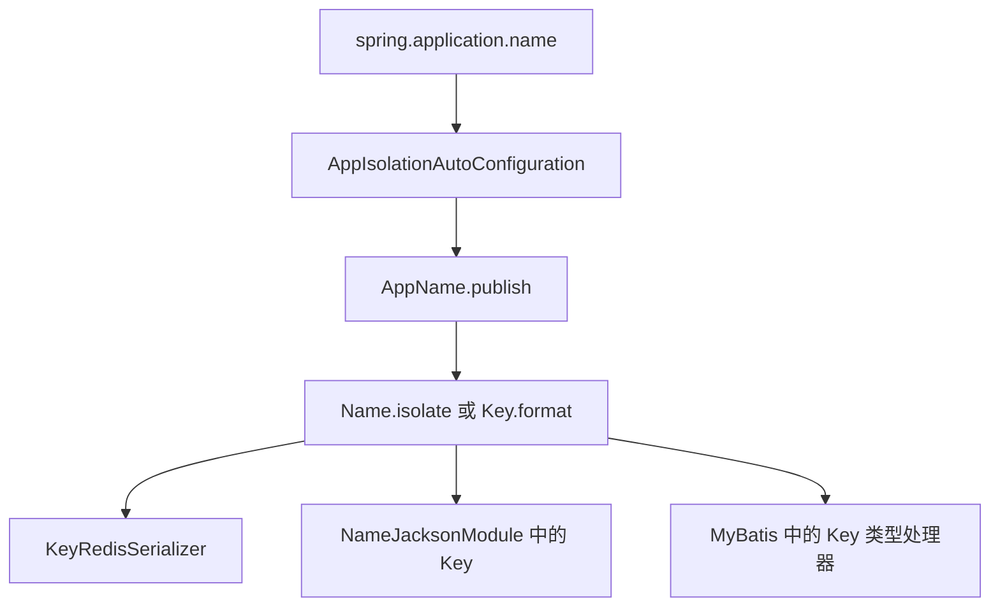

# 名称与应用隔离

`Name`、`NameFormat`、`Key` 与 App 隔离前缀之间的关系如下。本页适用于需要在日志、Redis key、数据库字段或 JSON 中输出名称的开发者。读完后，开发者能判断一个名称是否会加上 App 前缀，以及前缀来自哪个配置。

## 概念

同一个逻辑名称在不同场合需要不同的文本形式。操作编码使用冒号分隔，资源类型使用斜杠分隔，点式逻辑名称使用点分隔。`NameFormat` 只在输出时选择分隔符，不改变名称本身。

`Name` 的相等性由对象类型和内部字符串决定。`NameFormat` 不参与比较，因此同一个名称使用不同格式输出时仍然相等。已经隔离的名称与普通 `Name` 的类型不同，二者不相等。

App 隔离前缀由进程启动时发布的 App 名称决定。测试中使用 `sca4d-test` 发布 App 名称，`AppName` 把它转换为 `SCA4D_TEST`。

此时，`new Name("orders").isolate()` 的 `format(NameFormat.COLON)` 输出为 `SCA4D_TEST:orders`。普通 `Name.format(NameFormat.COLON)` 输出为 `orders`，不加前缀。

两个应用共用同一个 Redis 或数据库时，前缀使它们的键互不重叠。

## 核心对象

| 对象 | 负责 | 不负责 |
|---|---|---|
| `Name` | 保存非空白名称原文，提供 `format(NameFormat)`、`isolate()` 和 `isolate(NameFormat)` | 解释普通名称的分隔符结构 |
| `NameFormat` | 定义 `COLON`、`SLASH` 和 `DOT` 三种分隔符，并用 `join(List<String>)` 连接节点 | 保存名称值，参与相等性比较 |
| `AppIsolation` | 通过 `appName()` 返回隔离依据，默认返回 `AppName.current()` | 保存实例 ID；源码说明实例 ID 不参与隔离 |
| `AppName` | 把 App 名称转换为标准形式，并在进程内发布一次 | 读取配置文件 |
| `AppIsolationAutoConfiguration` | 读取 `spring.application.name`，注册 Bean `sca4djAppName` 并发布 App 名称 | 发布之后修改 App 名称 |
| `Key` | 继承 `Name`，`format` 输出带 App 前缀的完整键，`parse` 检查并移除前缀 | 决定业务编码本身 |
| `Code` | 继承 `Name`，`format` 只输出逻辑编码 | 添加 App 前缀 |

`Code` 保持业务编码的稳定形式。`NameJacksonModule` 的源码注释也说明，只有 `Key` 按 App 隔离输出。

`Name` 的隔离结果是新的不可变对象。对已经隔离的对象再次调用 `isolate`，返回同一个对象，不会重复添加前缀。



图中的 `AppName` 在 `sca4djAppName` Bean 创建时发布。`Key` 在写入 Redis、JSON 和 MyBatis 时都调用 `format(NameFormat.COLON)`，因此这些位置输出的 `Key` 文本包含 App 前缀。`Code` 在同样的位置输出时不包含前缀。

## 配置

| 配置键 | 默认值 | 作用 |
|---|---|---|
| `spring.application.name` | 源码中未定义默认值，`AppIsolationAutoConfiguration` 使用 `getRequiredProperty` 读取 | 作为 App 名称，转换后成为所有隔离 `Key` 的前缀 |

`AppName.normalize` 的转换规则如下：

- 允许 ASCII 字母、数字、下划线和连字符
- 连字符替换为下划线
- 字母转为大写
- 转换结果只能包含大写字母、数字和下划线

例如，`sca4d-test` 转换为 `SCA4D_TEST`。`app:name` 因包含冒号而被拒绝。`sca4djAppName` Bean 的 `defaultCandidate` 为 `false`，因此不会作为同类型的默认候选 Bean。

## 限制与失败结果

| 位置 | 条件 | 结果 |
|---|---|---|
| `Name` 构造 | 参数为 `null` | `NullPointerException`，消息为「名称不能为空」 |
| `Name` 构造 | 参数为空白字符串 | `IllegalArgumentException`，消息为「名称不能为空白」 |
| `AppName.normalize` | 包含允许字符以外的字符 | `IllegalArgumentException` |
| `AppName.current` | 发布 App 名称之前调用 | `IllegalStateException` |
| `AppName.publish` | 进程中已发布另一个名称 | `IllegalStateException`；重复发布相同名称允许 |
| `Key.parse` | 字符串不以当前 App 前缀开头 | `IllegalArgumentException`，消息为「Key 的 App 隔离前缀不匹配」 |
| `Key.fromSegments` | 动态文本段的 `V_` 编码与解码结果不一致 | `IllegalArgumentException`，消息为「Key 动态文本编码无效」 |
| `KeyRedisSerializer.deserialize` | 同槽标记无效，或反序列化后重新输出的文本与输入不同 | `IllegalArgumentException` |

`Key.parse` 检查前缀。`Key.fromSegments` 不检查前缀，只在序列化时使用。

配置错误在应用启动时暴露。App 名称在运行中不能改变。修改配置后，必须重新启动进程。

## 示例

以下示例假设 `spring.application.name` 为 `docs-app`，转换后的 App 名称为 `DOCS_APP`。

```java
import com.sca4d.core.api.name.Key;
import com.sca4d.core.api.name.NameFormat;
import com.sca4d.core.api.name.code.TreeCode;

TreeCode code = TreeCode.of("DOCUMENT/DETAIL");
Key key = Key.of(code, 42L);

key.format(NameFormat.COLON);   // DOCS_APP:DOCUMENT:DETAIL:42
code.format(NameFormat.SLASH);  // DOCUMENT/DETAIL
key.isUnder(TreeCode.of("DOCUMENT")); // true

Key parsed = Key.parse("DOCS_APP:DOCUMENT:DETAIL:42", NameFormat.COLON);
// parsed 与 key 相等
```

`Key.of(Code, long...)` 追加数字段，`Key.of(Code, String...)` 追加动态文本段。动态文本在 Key 中以 `V_` 加十六进制 UTF-8 编码保存。

`Key.parse` 遇到其他 App 前缀时抛出 `IllegalArgumentException`。

```yaml
spring:
  application:
    name: docs-app
```

## 相关页面

- [核心层](/capabilities/foundation/core)
- [全局 ID](/capabilities/foundation/global-id)
- [数据访问与持久化](/capabilities/data-configuration/data-access-and-persistence)
- [缓存开发](/capabilities/data-configuration/cache-development)
- [Java API 参考](/reference/#java-api-参考)
