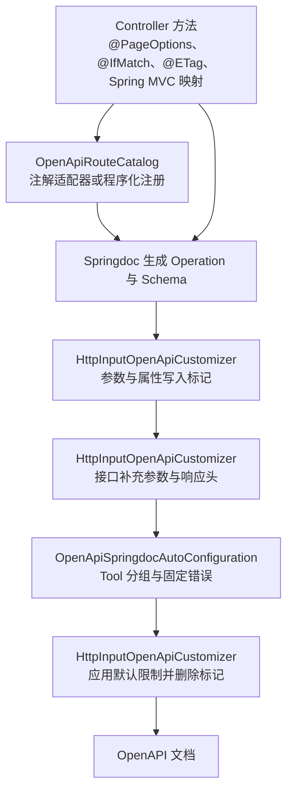

# OpenAPI 文档生成

OpenAPI 文档由 Springdoc 生成。脚手架在其上补充统一的基础信息、HTTP 输入的默认限制、分页与排序参数，以及开放 API 分组。

本页涵盖这些配置的入口、参数到 Schema 的映射规则、`OpenApiRouteDefinition` 与 Operation 的关系，以及生成相关的失败结果。本页适用于新增 Controller、开放 API 路由或调整文档配置的开发者。开放路由由 `OpenApiRouteCatalog` 在启动期登记并冻结，`@OpenApiRoute` 只是其中一种声明适配方式。HTTP 响应中字段的约定见 [HTTP API 通用约定](/reference/http/common#openapi)。

## 概念

Springdoc 根据 Spring MVC 的 Controller 方法生成 Operation 与 Schema。脚手架要求文档与运行时行为一致，因此在生成过程中加入三类内容。

- 类型映射：HTTP JSON 把 Java 的 `Long` 与 `long` 写成十进制字符串。`CoreOpenApiConfiguration` 把对应 Schema 替换为字符串，描述为「64 位整数的十进制字符串」。
- 默认限制：`HttpInputOpenApiCustomizer` 把运行时的默认校验写入参数与请求体 Schema，例如整数的正数要求、字符串最大长度和容器最大元素数。
- 声明补充：`@IfMatch` 增加 `If-Match` 请求头，`@ETag` 为成功响应增加 `ETag` 响应头，`PageRequest` 与 `ListParameters` 增加 `page`、`size` 和 `sort` 参数。

例如，一个未声明显式范围的 `Long` 字段，在 `positive-integer-enabled` 为 `true` 时生成字符串 Schema，并设置模式 `^[1-9][0-9]*$`。

一个 `PageRequest` 参数生成 `page` 和 `size`。

- `page` 的最小值为 1，默认值为 1。
- `size` 的最小值为 1，默认值为 `sca4dj.core.pagination.default-size`。
- `size` 的最大值是 `sca4dj.core.pagination.max-size` 与 `@PageOptions.maxSize` 中较小的值。

## 核心对象

| 对象 | 负责 | 不负责 |
| --- | --- | --- |
| `CoreOpenApiConfiguration` | 在 `sca4dj.core.openapi.enabled` 为 `true` 时注册 Springdoc 类型替换、默认 `OpenAPI` Bean 和 `HttpInputOpenApiCustomizer` Bean | 声明 Controller 路由，决定接口的认证要求 |
| `HttpInputOpenApiCustomizer` | 为参数、属性和接口写入类型标记，补充 `If-Match`、`ETag`、`page`、`size` 和 `sort`，在最终文档中应用默认限制并删除内部标记 | 执行运行时校验，运行时校验由 `HttpInputValidationAspect` 执行 |
| `OpenApiSpringdocAutoConfiguration` | 注册开放 API 的安全方案和固定错误 Schema，只把 `OpenApiRouteCatalog` 中的路由放入 `openapi` 分组，为这些方法设置 `operationId`、扩展字段、安全要求和固定错误响应，并在存在认证端点时注册 Token 路径 | 签发 Token，校验 Bearer 或 HMAC 凭据 |
| `OpenApiRouteCatalog` | 收集注解适配器和 `OpenApiRouteRegistrar` 注册的定义，检查唯一性、Spring MVC 映射和 Operation 权限一致性，发布只读查询快照 | 生成文档内容、读取请求凭据或执行权限检查 |
| `OpenApiRouteDefinition` | 保存 HTTP 方法、路径、Tool 名称和 Operation，与声明方式无关 | 注册 Spring MVC 映射、认证或业务权限判断 |
| `@OpenApiRoute` | 组合 Spring MVC 的 `RequestMapping`，并把 Tool 元数据交给启动期适配器 | 运行时认证和 Operation 检查 |



## 基础文档与类型映射

- `CoreOpenApiConfiguration` 的静态初始化修改 Springdoc 的全局配置。`Long` 与 `long` 被替换为字符串 Schema，并忽略 `PageRequest` 与 `ListParameters` 这两个 Java 类型。该配置关闭时，这些替换也不会注册。
- 默认 `OpenAPI` Bean 只在应用没有声明同类型 Bean 时创建（`@ConditionalOnMissingBean`）。标题由 `spring.application.name` 的值加上空格和 `API` 组成。若该属性未配置，则使用 `Sca4d-J`。该 Bean 注册 `bearerAuth` 安全方案。版本与方案字段的取值见 [HTTP API 通用约定](/reference/http/common#openapi)。

## 参数映射规则

`HttpInputOpenApiCustomizer` 按 Java 类型和注解决定 Schema 中写入的限制。

- 整数类型（`byte`、`short`、`int`、`long` 及其包装类型，以及 `BigInteger`）在没有显式范围注解时，若 `positive-integer-enabled` 为 `true`，则执行以下规则：数值 Schema 的最小值设为 1；字符串 Schema（例如 `Long`）的模式设为 `^[1-9][0-9]*$`。
- 显式的数值范围注解（如 `@Min`、`@Max`、`@Positive`、`@DecimalMin`）替代上述默认正数规则。
- 字符串没有显式 `@Size` 时，`maxLength` 为 `max-string-length`。数组与集合没有显式 `@Size` 时，`maxItems` 为 `max-container-size`。带有 `additionalProperties` 的对象，`maxProperties` 为 `max-container-size`。
- 显式的 `@Size` 替代字符串与容器的默认限制。
- 标注在方法或 Controller 类上的 `@NoDefaultValidation`，跳过该接口的默认限制。标注在参数或字段上时，只跳过该 Schema。显式约束仍写入文档。
- `ListParameters` 增加 `page`、`size` 和可重复的 `sort`。`sort` 的每一项匹配 `^[A-Z][A-Z0-9_]*,(ASC|DESC)$`，项数上限为 `sca4dj.core.sort-max-fields`。允许排序的字段由具体接口声明。
- `PageRequest` 只增加 `page` 与 `size`。
- `@IfMatch` 的接口增加必填的 `If-Match` 请求头。返回数据类型的公开方法标注 `@ETag` 时，成功（2xx）响应增加 `ETag` 响应头。

## 与 Operation 的关系

- 每个开放 API 路由由 `OpenApiRouteDefinition` 保存 HTTP 方法、路径、`toolGroup`、`toolName` 和 `operation`。`operation` 引用 `OperationCatalog` 中已经注册的固定编码。
- `OpenApiRouteCatalog` 同时接受 `OpenApiRouteAnnotationRegistrar` 和应用提供的 `OpenApiRouteRegistrar`，检查路由是否重复、Tool 名称是否重复、标准操作标识是否重复、Controller 方法是否有 Spring MVC 映射，以及是否声明了与 `operation` 相同的 `@RequirePermission`。
- Tool 的 `operationId` 由 `toolGroup` 加上首字母大写的 `toolName` 组成。
- `openapi` 分组只包含登记到 `OpenApiRouteCatalog` 的方法。普通 Controller 方法不进入该分组。
- Tool 接口的安全要求为 `openApiBearer` 或 `openApiHmac` 之一。`400`、`401`、`403` 和 `500` 的固定错误响应，只在接口没有对应响应时添加。

## 配置

| 配置键 | 默认值 | 作用 |
| --- | --- | --- |
| `sca4dj.core.openapi.enabled` | `true` | 设为 `false` 时 `CoreOpenApiConfiguration` 不生效，默认 `OpenAPI` Bean、类型替换和 `HttpInputOpenApiCustomizer` 都不注册 |
| `sca4dj.core.http.input.validation.positive-integer-enabled` | `true` | 无显式范围的整数是否在 Schema 中要求大于零 |
| `sca4dj.core.http.input.validation.string-size-enabled` | `true` | 无显式 `@Size` 的字符串是否写入 `maxLength` |
| `sca4dj.core.http.input.validation.max-string-length` | `4096` | 字符串默认最大字符数，必须为正数 |
| `sca4dj.core.http.input.validation.container-size-enabled` | `true` | 无显式 `@Size` 的容器是否写入 `maxItems` 或 `maxProperties` |
| `sca4dj.core.http.input.validation.max-container-size` | `1000` | 容器默认最大元素数，必须为正数 |
| `sca4dj.core.pagination.default-size` | `20` | `size` 参数的默认值 |
| `sca4dj.core.pagination.max-size` | `200` | `size` 参数的最大值上限 |
| `sca4dj.core.sort-max-fields` | `5` | `sort` 参数的最多项数，取值范围为 1 到 20 |

`sca4dj.core.http.input.validation.request-body-validation-enabled` 只控制运行时的请求体校验，不影响文档生成。

## 限制与失败结果

| 场景 | 结果 | 调用方处理 |
| --- | --- | --- |
| Springdoc 类不在运行类路径中 | `CoreOpenApiConfiguration` 与 `OpenApiSpringdocAutoConfiguration` 的类条件不满足，两者都不注册。源码中未定义额外的错误输出 | 确认 Springdoc 依赖在运行类路径中 |
| `sca4dj.core.openapi.enabled` 为 `false` | Core 的基础文档配置不注册 | 需要脚手架基础文档时保持 `true` |
| `OpenApiRouteDefinition` 的路径不以 OpenAPI 路径前缀加 `/` 开头，包含重复斜杠、查询参数或片段，或 HTTP 方法为空 | `IllegalArgumentException`，在 `OpenApiRouteDefinition` 中抛出 | 修正路由定义 |
| 路由重复、Tool 名称重复或标准操作标识重复 | `IllegalStateException`，在 `OpenApiRouteCatalog` 中抛出 | 删除重复声明 |
| 路由没有对应的 Spring MVC Handler | `IllegalStateException`，在 `OpenApiRouteCatalog` 冻结目录时抛出 | 保留有效的 `@GetMapping` 等映射，或让注册器指向有效的 Spring MVC 映射 |
| Controller 方法缺少与 `operation` 相同的 `@RequirePermission` | `IllegalStateException`，消息包含方法签名 | 添加相同 Operation 的权限声明 |
| 认证端点路径不是非根绝对路径，或以斜杠结尾，或包含重复斜杠、查询字符串与片段 | `IllegalArgumentException`，在 `OpenAuthenticationEndpoint` 构造时抛出 | 修正应用声明的认证端点路径 |
| Token 处理方法不存在 | `OpenapiException`，消息为「OpenAPI Token Handler 方法不存在」 | 检查 Token Handler 的方法与模块版本是否一致 |
| 定制器在生成过程中抛出异常 | 定制器源码中没有捕获异常。异常的传播方式由 Springdoc 决定，源码中未定义具体的响应 | 以 Springdoc 的实际行为为准 |
| 接口或参数标注 `@NoDefaultValidation` | 不写入默认限制，显式约束仍然写入 | 需要保留默认限制时不要标注 |

`@IfMatch` 与 `@ETag` 把版本号写成 `If-Match` 与 `ETag` 头，与[并发规则](/capabilities/data-configuration/concurrency-development)中的版本条件对应。

## 示例

以下示例是一个文档列表接口、一个带版本校验的更新接口和一个开放 API 路由。`DocumentView`、`DocumentService` 和 `document:read` 是应用自己的类型与已注册的 Operation 编码。

```java
import com.sca4d.core.api.annotation.RequirePermission;
import com.sca4d.core.api.concurrent.Version;
import com.sca4d.core.api.query.Page;
import com.sca4d.core.api.query.PageRequest;
import com.sca4d.core.spring.web.ApiResponse;
import com.sca4d.core.spring.web.annotation.ETag;
import com.sca4d.core.spring.web.annotation.IfMatch;
import com.sca4d.core.spring.web.annotation.PageOptions;
import com.sca4d.openapi.web.annotation.OpenApiRoute;
import org.springframework.web.bind.annotation.*;

@RestController
@RequestMapping("/workspaces/{workspaceId}/documents")
public class DocumentController {

    private final DocumentService documents;

    public DocumentController(DocumentService documents) {
        this.documents = documents;
    }

    // 文档生成 page、size 参数，size 最大值为 100
    @GetMapping
    @RequirePermission(operation = "document:read")
    public ApiResponse<Page<DocumentView>> list(
            @PathVariable long workspaceId,
            @PageOptions(maxSize = 100) PageRequest page) {
        return ApiResponse.ok(documents.find(workspaceId, page));
    }

    // 文档生成必填的 If-Match 请求头
    @PatchMapping("/{documentId}")
    @IfMatch
    @RequirePermission(operation = "document:update")
    public ApiResponse<Void> rename(
            @PathVariable long workspaceId,
            @PathVariable long documentId,
            @RequestBody RenameRequest request) {
        documents.rename(documentId, request);
        return ApiResponse.ok();
    }

    // 登记到 openapi 分组，operation 必须与 @RequirePermission 一致
    @OpenApiRoute(
            method = RequestMethod.GET,
            path = "/openapi/documents/{documentId}",
            toolGroup = "document",
            toolName = "getDocument",
            operation = "document:read")
    @RequirePermission(operation = "document:read")
    public ApiResponse<DocumentView> get(@PathVariable long documentId) {
        return ApiResponse.ok(documents.get(documentId));
    }
}

public class DocumentView {

    private final Version version;

    // 成功响应增加 ETag 响应头；返回 null 时不发布该响应头
    @ETag
    public Version revision() {
        return version;
    }
}
```

`@ETag` 标注在返回数据类型的公开方法上，而不是 Controller 方法上。示例中的 Tool 的 `operationId` 为 `documentGetDocument`。

不使用 `@OpenApiRoute` 时，Controller 保留普通 Spring MVC 映射，再由 `OpenApiRouteRegistrar` 登记 Tool 元数据：

```java
@GetMapping(value = "/openapi/documents/{documentId}", produces = MediaType.APPLICATION_JSON_VALUE)
@RequirePermission(operation = "document:read")
public ApiResponse<DocumentView> get(@PathVariable long documentId) {
    return ApiResponse.ok(documents.get(documentId));
}

@Bean
OpenApiRouteRegistrar documentOpenApiRoutes() {
    return routes -> routes.register(
            DocumentController.class,
            "get",
            new OpenApiRouteDefinition(
                    RequestMethod.GET,
                    "/openapi/documents/{documentId}",
                    "document",
                    "getDocument",
                    TreeCode.ofColon("document:read")),
            long.class);
}
```

注册器和注解适配器生成相同的 `OpenApiRouteCatalog` 条目。HTTP 映射仍可使用 Spring MVC 注解，也可以由应用自己的 `RequestMappingHandlerMapping` 注册器完成。

只调整默认限制时，修改配置：

```yaml
sca4dj:
  core:
    openapi:
      enabled: true
    http:
      input:
        validation:
          max-string-length: 2048
    pagination:
      default-size: 20
      max-size: 200
```

## 扩展方式

- 默认 `OpenAPI` Bean 带有 `@ConditionalOnMissingBean`。应用声明自己的 `OpenAPI` Bean 后，Core 不再创建默认实现。
- 开放 API 路由由 `OpenApiRouteDefinition` 表达。应用可以使用 `@OpenApiRoute`，也可以提供 `OpenApiRouteRegistrar`；`OpenApiRouteCatalog` 在启动时统一校验并冻结路由。
- 认证端点由应用提供 OpenAuthenticationEndpoint，OpenApiSpringdocAutoConfiguration 发现后注册 Token 路径。

## 相关页面

- [HTTP API 通用约定](/reference/http/common#openapi)：OpenAPI 基础定义、字段约定和运行时输入校验的参考。
- [核心层](/capabilities/foundation/core)：`CoreOpenApiConfiguration` 所在的 Core Spring 模块与依赖关系。
- [错误码与业务异常](/capabilities/foundation/error-model)：固定错误响应所使用的错误结构。
- [Java API 参考](/javadoc/core/sca4dj-core-spring/com/sca4d/core/spring/openapi/HttpInputOpenApiCustomizer.html)：`HttpInputOpenApiCustomizer` 的公开方法签名。
