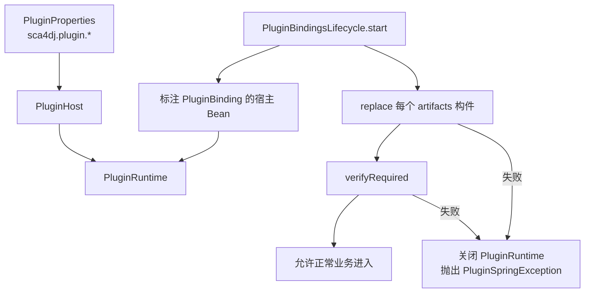
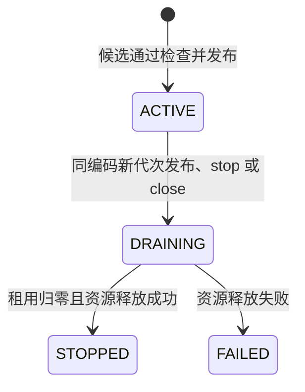
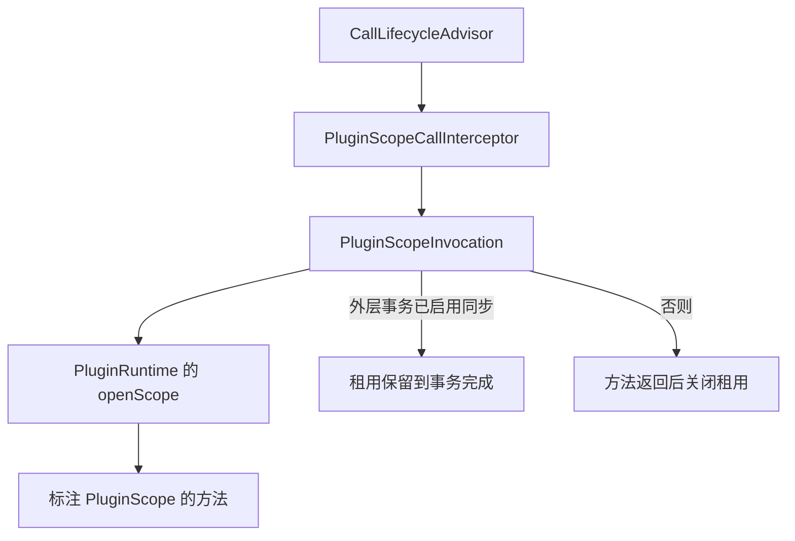

# 插件机制

插件机制让 App 把生成的 API 接口约定绑定到宿主服务，并从本地 JAR 加载实现扩展接口的插件。

本页涵盖插件的加载、替换、停止与状态，`@PluginScope` 对同步调用的固定方式，以及各类失败的结果。本页适用于判断插件替换会影响哪些调用的开发者，以及维护插件运行时的开发者。插件的编写、构建和部署步骤见[为 App 开放插件 API](/tutorials/app-plugins)。

## 概念

插件运行时（`PluginRuntime`）管理一个 App 的三类内容：宿主服务的绑定、插件提供的扩展实现，以及同步调用期间固定使用的插件代次。

插件代次（generation）是一次加载得到的插件入口、私有依赖、配置快照和接口实现的组合。同一个插件编码（`TreeCode`）同一时间只有一个活动代次。

App 在构建时生成接口约定（`ApiContract`），该约定描述服务与扩展的操作签名。插件只针对生成的约定编程。插件类加载器只共享 App API 共享清单中列出的类型。宿主不把任意业务类交给插件。

例如，App 调用 `replace(Path, Duration)` 加载与已有插件编码相同的新构件。返回值 `PluginUpdate` 的 `current()` 为新代次，`previous()` 为旧代次的清理状态。首次加载时，`previous()` 为空。新代次发布后接受新调用，旧代次在已有调用结束后释放。

## 核心对象

| 对象 | 负责 | 不负责 |
| --- | --- | --- |
| `PluginRuntime` | 登记接口约定、绑定宿主服务、加载、替换、重载和停止插件，打开调用作用域，返回状态快照 | 创建 Spring Bean，读取插件元信息和 App 配置 |
| `DefaultPluginRuntime` | 维护代次目录、候选代次发布、旧代次排空和资源释放 | 解析 JAR 内容，这由插件加载器完成 |
| `Pf4jPluginLoader` | 为每个代次创建独立类加载器，只共享宿主声明的类，拒绝重复共享类、多版本类和 Boot 嵌套依赖 | 决定候选能否发布或绑定是否冲突 |
| `PluginHost` | 根据 `META-INF/sca4dj/api.properties` 选择唯一的 App API 描述，读取共享清单，校验配置类型，登记接口约定 | 扫描宿主 classpath 中的业务类 |
| `PluginBindingsLifecycle` | 在 Spring 启动阶段绑定 `@PluginBinding` 宿主 Bean，加载 `sca4dj.plugin.artifacts`，检查必需扩展 | 运行中的插件替换和停止 |
| `PluginMountResolver` | 把标注 `@PluginMount` 的注入点解析为生成客户端 | 解析没有标注 `@PluginMount` 的依赖 |
| `PluginScopedBeans`、`PluginScopeCallInterceptor` | 为标注 `@PluginScope` 的 `@Bean` 工厂结果和方法调用打开插件作用域 | 决定 Call 的身份和事务传播 |
| `PluginStatus` | 代次的只读快照，包含阶段、使用数量、构件摘要和失败类名 | 持有插件实现对象 |

## 启动装配

`PluginAutoConfiguration` 只在 `sca4dj.plugin.enabled` 为 `true` 时生效。它先创建 `PluginHost` 和 `PluginRuntime`。

`PluginBindingsLifecycle` 在单例、迁移及系统身份准备完成后启动。启动时依次执行三步：

1. 绑定带 `@PluginBinding` 的宿主 Bean。
2. 替换 `sca4dj.plugin.artifacts` 中的每个构件。
3. 调用 `verifyRequired()` 检查必需扩展。



指向接口的 `@PluginBinding` 使用生成的 `<声明类型>Contract` 创建绑定。指向类的 `@PluginBinding` 使用生成的 `<声明类型>ApiBinding` 创建绑定。

绑定的是 Spring 已经完成代理的 Bean，因此插件调用仍经过原有的事务和权限代理。

## 代次替换与停止

候选代次按以下顺序处理，任一步失败时都不发布：

1. 复制构件，读取 App 配置（首次加载调用 `load`，重载调用 `reload`）。
2. 加载插件入口，检查插件描述中的 API 版本范围与生成描述的 `api.version` 是否匹配。
3. 调用插件入口的 `onLoad`，插件在 `CandidateContext` 中登记扩展实现。
4. 在锁内检查扩展编码是否与其他代次冲突，以及新代次是否保留旧代次提供的全部扩展。
5. 发布新代次，把它设为活动代次，并把旧代次置为 `DRAINING`。

候选失败的代次不出现在 `statuses()` 的结果中，已有代次继续接受调用。

发布后，`replace` 与 `reload` 等待旧代次的租用归还。等待时间由 `drainTimeout` 决定。方法返回时，已等待到旧租用释放或超时。



- 等待超时或线程中断时，新代次保持 `ACTIVE`，旧代次保持 `DRAINING`，最后一个租用归还后再释放。
- 释放代次时依次调用插件入口的卸载回调、App 配置的 `unload`、关闭类加载器并删除构件副本。任一步失败时，其余步骤仍然执行，代次进入 `FAILED`，`PluginStatus.failure()` 返回异常类名。
- `stop(id, drainTimeout)` 先把插件从活动目录移除并将代次置为 `DRAINING`，然后等待旧调用结束。含必需扩展的插件不能被普通停止。
- `reload(id, drainTimeout)` 使用活动代次保存的构件副本，重新创建 App 配置和插件实例。它不重新读取原部署文件，也不能改变插件编码。
- `close()` 将全部活动代次置为 `DRAINING`，以零等待时间尝试释放，并拒绝之后的新作用域。

旧代次在调用结束后释放，进行中的调用不会因替换而中断。

## 调用作用域

`@PluginScope` 可以标注类、方法或 `@Bean` 工厂方法。

- 标注在方法或类型上时，`CallLifecycleAdvisor` 通过 `PluginScopeCallInterceptor` 接入调用生命周期。随后，`PluginScopeInvocation` 调用 `PluginRuntime.openScope()`，取得租用（`PluginLease`）。
- 标注在 `@Bean` 工厂方法上时，`PluginScopedBeans` 把返回对象包装为代理。代理的每次方法调用都打开插件作用域。



- 最外层入口没有已有 Call 时，`pluginScopeMethodBinding` 创建 system Call。已有 Call 时复用当前 Call。
- 嵌套的作用域复用外层快照，同一次调用不会混用更新前后的实现。
- 外层 Spring 事务已启用事务同步时，租用保持到事务提交或回滚完成后关闭。
- 调用插件的目标对象时，运行时临时把线程的上下文类加载器切换为该代次的类加载器，返回或抛出异常后恢复。
- 替换、重载、停止和关闭都必须在调用作用域外执行。
- `PluginScope` 面向同步操作。插件实现对象、私有依赖对象和插件私有的 `Class` 对象，不能作为调用参数或返回值离开调用范围。

## 与生成接口约定的关系

- App 使用 `@PluginService` 与 `@PluginOperation` 声明宿主服务和操作。使用 `@PluginExtension` 声明插件可以提供的扩展，其 `required` 默认为 `false`。
- `required` 为 `true` 的扩展必须由插件加载。否则，`verifyRequired()` 失败。
- 构建时生成 `ApiContract`、类型安全客户端和绑定分发器。构建步骤见[为 App 开放插件 API](/tutorials/app-plugins)。
- `PluginHost` 在启动时读取 `META-INF/sca4dj/api.properties` 中的 `api.id`、`api.version`、`api.entry`、`api.contracts`、`api.shared-index` 和 `api.configuration-type`，只选择编码与 `sca4dj.plugin.api` 相同的描述。
- 插件描述中的 API 版本范围必须匹配 `api.version`，否则候选代次失败。
- 插件登记扩展时，实现对象必须提供接口约定中的 API 方法。缺失时，候选代次失败。

## 配置

| 配置键 | 默认值 | 作用 |
| --- | --- | --- |
| `sca4dj.plugin.enabled` | 未设置，不启用 | 设为 `true` 时装配插件适配 |
| `sca4dj.plugin.api` | 无，启用时必须设置 | App API 编码，必须与生成描述中的 `api.id` 一致，为空时启动失败 |
| `sca4dj.plugin.artifacts` | 空列表 | 启动时依次替换加载的本地 JAR 路径，每个路径都必须加载成功 |
| `sca4dj.plugin.cache-directory` | `build/plugin-cache` | 保存构件副本的目录，代次使用副本，修改原文件不影响已加载代次 |
| `sca4dj.plugin.drain-timeout` | `PT30S`（30 秒） | 替换或停止时等待旧调用结束的时长，必须非负，零表示不等待 |

启动时的配置示例见[为 App 开放插件 API](/tutorials/app-plugins)。

## 限制与失败结果

| 场景 | 结果 | 调用方处理 |
| --- | --- | --- |
| 启动时找不到唯一的 App API 描述、共享清单缺失或重复、配置类型不一致 | `IllegalStateException`，应用启动失败 | 检查构件是否与 App API 来自同一次构建，以及 `sca4dj.plugin.api` 是否与生成描述一致 |
| 启动时必需插件装配失败（绑定、替换或必需扩展检查任一失败） | `PluginSpringException`，消息为「App 必需插件装配失败」，运行时在抛出前已关闭 | 按 cause 修正构件、配置或路径后重新启动 |
| 替换或重载的候选代次失败，包括构件读取失败、API 版本不兼容、扩展编码冲突、移除旧扩展、构件包含重复共享类或多版本类 | `PluginException`，消息为「插件候选加载失败: <异常简单类名>」，原异常为 cause，原代次继续接受调用 | 读取 cause，修正构件后重新调用 `replace` 或 `reload` |
| 等待旧代次超时或线程中断 | 方法正常返回，新代次为 `ACTIVE`，旧代次为 `DRAINING` | 通过 `statuses()` 或 `PluginUpdate.previous()` 观察状态，旧代次在最后一个租用归还后释放 |
| 代次资源释放失败 | 代次为 `FAILED`，`PluginStatus.failure()` 返回异常类名，错误日志记录异常 | 按日志处理，`FAILED` 代次不再作为活动代次 |
| 停止含必需扩展的插件 | `IllegalStateException`，消息为「必需扩展只能替换或随 App 关闭」，活动目录不变 | 使用替换更新或关闭 App |
| 停止或重载未启用的插件编码 | `PluginUnavailableException`，消息为「插件未启用」，错误码为 `1098`；经 HTTP 入口返回时状态为 503 | 按暂时不可用处理，参见[错误码与业务异常](/capabilities/foundation/error-model) |
| 调用时目标不可用，或运行时已关闭 | `PluginUnavailableException`，消息为「公开目标不可用」或「插件运行机制已关闭」，错误码为 `1098` | 按暂时不可用处理 |
| 动态调用的操作、参数数量或参数类型与公开签名不一致 | `IllegalArgumentException`，消息包括「操作未公开」「调用参数数量不一致」「调用值与公开类型不一致」 | 修正调用参数 |
| `void` 操作返回了结果 | `IllegalStateException` | 修正宿主或插件的操作签名 |
| 管理操作在调用作用域内执行，或等待时间为负 | `IllegalStateException`，消息为「管理操作必须在调用作用域外执行，等待时间不得为负」 | 把管理调用移到作用域外 |
| 租用不在打开它的线程上关闭 | `IllegalStateException`，消息为「插件作用域必须在原线程关闭」 | 在打开作用域的线程关闭租用 |
| `@PluginScope` 方法抛出非运行时异常 | `PluginSpringException`，消息为「插件作用域调用失败」，原异常为 cause | 按 cause 处理 |
| `@PluginMount` 的扩展种类或注入类型不一致 | `IllegalArgumentException`，消息为「插件挂载类型与扩展声明不一致」 | 修正 `@PluginMount` 的编码或注入类型 |

## 相关页面

- [为 App 开放插件 API](/tutorials/app-plugins)：插件的声明、构建、编写、配置和部署步骤。
- [调用生命周期](/capabilities/identity-access/call-lifecycle)：`@PluginScope` 接入的 Call 拦截链。
- [错误码与业务异常](/capabilities/foundation/error-model)：`PluginUnavailableException` 所属的业务异常体系。
- [核心层](/capabilities/foundation/core)：插件接口所使用的 Core 接口与基础类型。

## 示例

下例让工作区应用开放一个文档审核策略扩展。宿主提供只读事实服务，插件提供策略实现。`DocumentFacts`、`DocumentPolicy` 与 `WorkspaceDocumentFacts` 是应用自己的类型。

宿主声明服务与必需扩展：

```java
import com.sca4d.core.api.plugin.PluginExtension;
import com.sca4d.core.api.plugin.PluginOperation;
import com.sca4d.core.api.plugin.PluginService;

@PluginService("WORKSPACE:DOCUMENT:FACTS")
public interface DocumentFacts {
    @PluginOperation("COUNT_ATTACHMENTS")
    int countAttachments(long documentId);
}

@PluginExtension(value = "WORKSPACE:DOCUMENT:POLICY", required = true)
public interface DocumentPolicy {
    @PluginOperation("CAN_PUBLISH")
    boolean canPublish(long documentId, int attachmentCount);
}
```

宿主 Bean 绑定到公开接口，并在需要策略的方法上打开插件作用域。同一次调用内，策略不会在更新前后的实现之间切换：

```java
import com.sca4d.core.api.plugin.PluginBinding;
import com.sca4d.core.api.plugin.PluginMount;
import com.sca4d.core.api.plugin.PluginScope;

@Service
@PluginBinding(DocumentFacts.class)
public class WorkspaceDocumentFacts implements DocumentFacts {
    @Override
    public int countAttachments(long documentId) {
        return attachments.countByDocument(documentId);
    }
}

@Service
class DocumentPublishService {
    private final DocumentPolicy policy;
    private final DocumentFacts facts;

    DocumentPublishService(
            @PluginMount("WORKSPACE:DOCUMENT:POLICY") DocumentPolicy policy,
            DocumentFacts facts) {
        this.policy = policy;
        this.facts = facts;
    }

    @PluginScope
    boolean publishable(long documentId) {
        return policy.canPublish(documentId, facts.countAttachments(documentId));
    }
}
```

应用启用插件机制并列出启动时加载的构件：

```yaml
sca4dj:
  plugin:
    enabled: true
    api: WORKSPACE:SERVER
    artifacts:
      - plugins/document-policy-1.0.0.jar
    cache-directory: build/plugin-cache
    drain-timeout: PT30S
```

运行期替换由管理代码在调用作用域外执行：

```java
PluginUpdate update = runtime.replace(Path.of("plugins/document-policy-1.1.0.jar"), Duration.ofSeconds(30));
PluginStatus current = update.current();   // 新代次，状态 ACTIVE
PluginStatus previous = update.previous(); // 旧代次，排空后为 STOPPED；首次加载时为 null
```

`DocumentPolicy` 的 `required` 为 `true`，因此 `sca4dj.plugin.artifacts` 中没有提供该扩展的构件时，`verifyRequired()` 失败，应用启动失败。在这种状态下，普通 `stop` 也会被拒绝，只能替换或随应用关闭。

## 扩展方式

应用向框架提供三类实现：

- 宿主服务：应用用 `@PluginService` 与 `@PluginOperation` 声明，用 `@PluginBinding` 把 Spring Bean 绑定到公开接口。`PluginBindingsLifecycle` 在启动阶段绑定带 `@PluginBinding` 的 Bean。
- 扩展点：应用用 `@PluginExtension` 声明。插件在 `onLoad` 中向 `PluginContext` 登记实现，`PluginMountResolver` 把带 `@PluginMount` 的注入点解析为生成客户端。
- 配置提供者：应用注册 `PluginConfiguration` Bean，把候选 JAR 的元信息映射为 `PluginDescriptor`。`PluginAutoConfiguration` 在 `sca4dj.plugin.enabled` 为 `true` 时读取该 Bean。

插件入口由 `PluginEntrypoint` 描述，类名来自插件元信息中的 `main`。框架通过 `Pf4jPluginLoader` 为每个代次创建独立类加载器，并只共享 App API 共享清单中的类型。插件 JAR 的构建步骤见[为 App 开放插件 API](/tutorials/app-plugins)。
