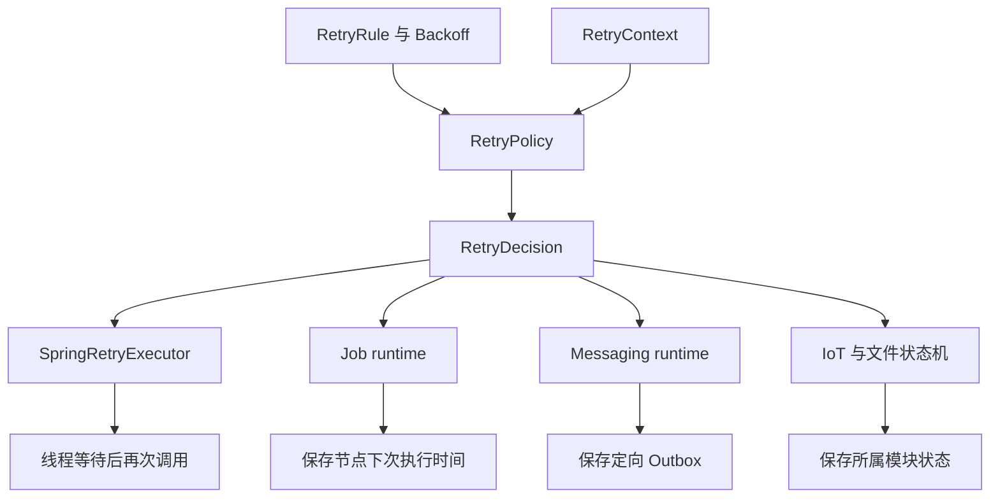

# 重试规则与执行

Retry 是 Core 的独立基础能力。本页适用于需要为任务、消息、设备或文件操作声明重试规则的开发者。读完后，开发者能选择合适的规则，判断失败结果，并确认执行进度由哪个模块保存。

RetryRule 保存次数和退避规则。RetryPolicy 根据失败事实作出决定。RetryExecutor 执行同步操作。Job、Messaging、IoT 和文件清理使用共同规则，各自保存执行进度并处理最终失败。

## 概念与范围

| 类型 | 职责 |
|---|---|
| RetryRule | 包含首次执行的次数限制，以及固定、指数或序列退避 |
| Backoff | 根据已经开始的尝试次数计算等待时长 |
| RetryContext | 当前尝试序号和类型化失败事实 |
| RetryPolicy | 无副作用地返回继续或停止决定 |
| RetryDecision | 相对等待时长或稳定停止原因 |
| RetryExecutor | 同步执行、等待及再次尝试 |
| RetryListener | 观察失败决定、等待开始结束和成功 |

公共类型位于 [Core Retry 包](/javadoc/core/sca4dj-core-api/com/sca4d/core/api/retry/package-summary.html)。策略不访问数据库、不发送消息，也不持有执行进度。同一个不可变规则和无状态策略可以并发复用。



重试的范围是一次明确的操作。Call 不自动重跑认证、权限、业务操作和审计。Pipeline 不自动恢复内部 Stage。持久化 PipelineJob 重试一个节点时，从该节点 Pipeline 的起点重新执行。

## 声明规则

```java
RetryRule once = RetryRule.once();

RetryRule fixed = RetryRule.atMost(
        3, Backoff.fixed(Duration.ofSeconds(5)));

RetryRule exponential = RetryRule.atMost(
        5, Backoff.exponential(
                Duration.ofSeconds(1), 2.0, Duration.ofMinutes(5)));

RetryRule sequence = RetryRule.unlimited(
        Backoff.sequence(
                Duration.ofSeconds(1),
                Duration.ofSeconds(5),
                Duration.ofSeconds(30)));
```

次数包含首次执行。最多 3 次表示第一次失败后还有 2 次机会。首次执行不等待，第一次失败使用第一个间隔。指数退避在最大间隔处封顶。序列用完后，重复最后一项。

有限规则允许零间隔，用于局部条件更新冲突。无限规则必须每次等待正数间隔。

时长必须为可用 Java long 毫秒表示的非负整数毫秒。指数倍率必须为大于 1 的有限值。规则不提供随机抖动、整体期限、熔断或动态配置中心。

## 同步调用

以下示例的 `deviceClient` 是具体应用定义的查询客户端，`retries` 是注入的 RetryExecutor：

```java
RetryPolicy<Throwable> policy = RetryPolicy.forFailures(
        RetryRule.atMost(3, Backoff.fixed(Duration.ofSeconds(1))),
        failure -> failure instanceof ConnectException);

DeviceStatus status = retries.execute(
        policy,
        () -> deviceClient.queryStatus(deviceId));
```

操作正常返回即成功，允许合法的 null 结果。不可重试或次数耗尽时，抛出最后一次原始异常。Error、取消和中断不按普通异常重试。

等待中断时抛出 RetryInterruptedException，并保留线程中断标记。返回 CompletionStage 不表示执行器会等待其异步结果。

每次尝试需要新事务时，由回调显式进入新事务。重试等待不能延续已经失败的事务。执行器不自动建立 Call、锁或幂等键。监听器异常只记录告警，不重跑操作。

### Spring Retry 实现

Core Spring 在类路径存在 `org.springframework.retry:spring-retry`，且没有其他 RetryExecutor Bean 时，注册 SpringRetryExecutor。具体应用添加该库的运行时依赖，版本沿用 Spring Boot BOM。

未添加该依赖时，其他 Core 功能仍然可用。启用 MQTT 入站处理时，则必须提供执行器。

实现使用 RetryTemplate，并将判断和退避委托给 Core Policy。同一次失败只计算一次决定。应用可以提供自己的 RetryExecutor 替换实现，不需要修改规则或持久化模块。本功能不启用全局 `@EnableRetry`，也不自动代理业务方法。

## 持久化与领域接入

Job 和 Handler 通过 `retryRule()` 声明规则。Job 在节点创建时冻结规则。Messaging 在首次成功登记消费重试链时冻结规则。

快照只保存版本、次数和退避数据，不保存 Java 类名、lambda 或异常对象。

RetryRuleCodec 实现已有的 VersionedCodec 接口，由 Core Jackson 装配，并注入带 Sca4djJson 限定的共享映射器。MyBatis 使用已有的 StringValueTypeHandler，在 SQL 读写时编解码。Job 和 Outbox 的数据对象直接持有 RetryRule，不自行创建映射器或解析 JSON。

```java
@Override
public RetryRule retryRule() {
    return RetryRule.atMost(
            5,
            Backoff.exponential(
                    Duration.ofSeconds(1), 2.0, Duration.ofSeconds(30)));
}
```

| 场景 | 规则之后的执行方式 |
|---|---|
| Job 节点失败 | 保存下一次可领取时间，由 Worker 继续处理 |
| Rabbit Handler 失败 | 提交定向 Outbox 后确认原消息，到期只投递原 Handler |
| Outbox 发布失败 | 持续指数退避，独立累计代理发布次数 |
| IoT 传输失败与 ACK 超时 | 领域策略组合共同规则，状态机处理取消、过期和失败码 |
| 文件删除失败 | 保存下次删除时间；外层清理 Job 不再增加重试 |
| Gateway 注册失败 | 生命周期调度器安排下一次注册；成功后恢复正常续租周期 |
| 局部并发冲突 | 重新读取并条件更新，仅重复明确的局部操作 |

IoT 原有的领域 RetryPolicy 包含 DeviceDownlink 和稳定策略 code，不直接替换为 Core 的泛型策略。IoT 领域策略组合共同规则后，把决定转换为原有的 IoT 结果。协议 ACK 等待、消息过期和业务幂等由 IoT 负责。

HTTP Retry-After 是调用方的等待提示。SDK 重连、心跳、周期对账、验证码尝试次数和人工重新提交，保持原有职责。SMS 的 PENDING 查询继续查询已有发送结果。结果未确定时，不重新发送。

同一层失败只由一个机制负责重试，避免次数叠加。

## 示例

以下示例为附件上传到对象存储时重试网络连接失败。`attachmentClient` 是应用定义的客户端，`retries` 是注入的 RetryExecutor。

```java
import com.sca4d.core.api.retry.Backoff;
import com.sca4d.core.api.retry.RetryExecutor;
import com.sca4d.core.api.retry.RetryPolicy;
import com.sca4d.core.api.retry.RetryRule;
import java.net.ConnectException;
import java.time.Duration;

public class AttachmentUploader {

    private static final RetryPolicy<Throwable> POLICY = RetryPolicy.forFailures(
            RetryRule.atMost(
                    4,
                    Backoff.exponential(Duration.ofSeconds(1), 2.0, Duration.ofSeconds(10))),
            failure -> failure instanceof ConnectException);

    private final RetryExecutor retries;
    private final AttachmentClient attachmentClient;

    public AttachmentUploader(RetryExecutor retries, AttachmentClient attachmentClient) {
        this.retries = retries;
        this.attachmentClient = attachmentClient;
    }

    public String upload(long documentId, byte[] content) {
        return retries.execute(POLICY, () -> attachmentClient.put(documentId, content));
    }
}
```

最多执行 4 次，失败后等待 1 秒、2 秒、4 秒再执行。`ConnectException` 以外的异常不重试，直接抛出。次数耗尽时抛出最后一次异常。

在 Spring Boot 应用中添加依赖，使 SpringRetryExecutor 生效：

```kotlin
dependencies {
    runtimeOnly("org.springframework.retry:spring-retry")
}
```

## 扩展方式

- 替换同步执行器：应用声明 RetryExecutor Bean。CoreRetryConfiguration 使用 `@ConditionalOnMissingBean(RetryExecutor.class)` 注册默认实现，发现应用 Bean 后不再创建。
- 为持久化执行声明规则：Job 或 Handler 重写 `retryRule()`，框架在创建节点或首次登记消费重试链时读取并冻结。
- 自定义停止条件：用 `RetryPolicy.forFailures` 传入判断函数，或实现 RetryPolicy。

## 失败与恢复

继续重试使用相对 Duration。持久化模块用自己的 Clock 计算并保存绝对时刻。

Core 停止原因包括 DISABLED、NOT_RETRYABLE 和 ATTEMPTS_EXHAUSTED。领域模块负责映射最终业务失败码。

持久化运行采用至少一次执行。操作成功但结果未保存，或 Broker 接收后发布结果写回失败，均可能再次执行。必须使用稳定业务键、唯一约束或外部幂等键保护副作用。

同一层失败只由一个机制负责重试。Job 已负责节点恢复时，不默认再包一层 Spring Retry。文件已经按记录安排删除时，扫描 Job 使用 `once()`。

不同层的次数分别记录。例如，Outbox 发布失败不能消耗 Handler 的业务消费次数。

运行日志区分当前尝试、停止原因和下次执行时间，不保存操作参数或完整消息内容。已有模块的计数器和 RetryListener 可以观察执行结果。
