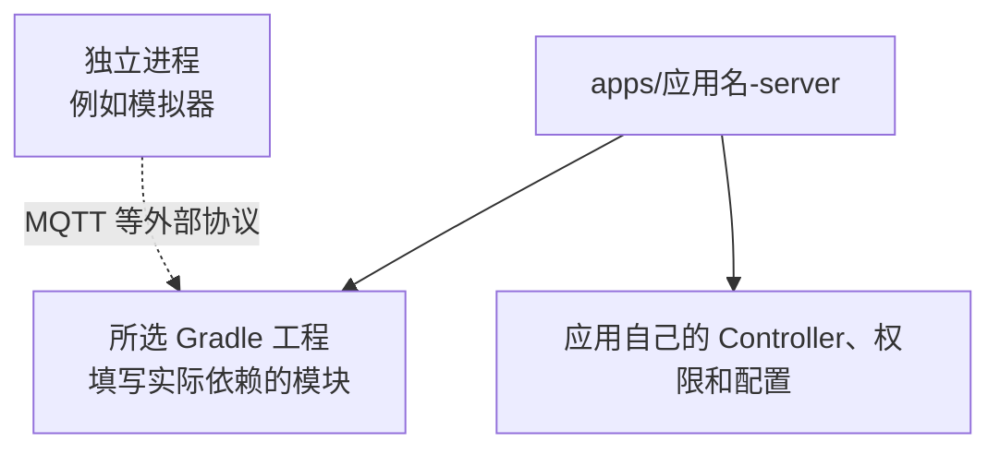
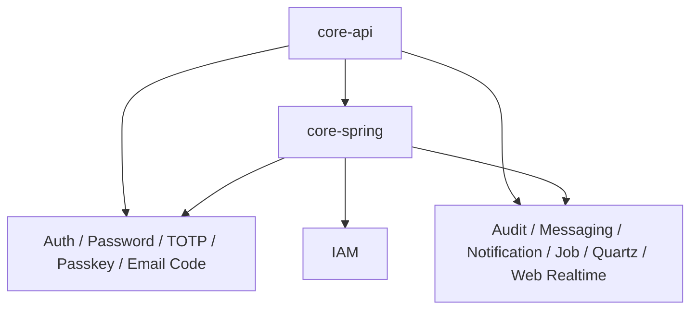
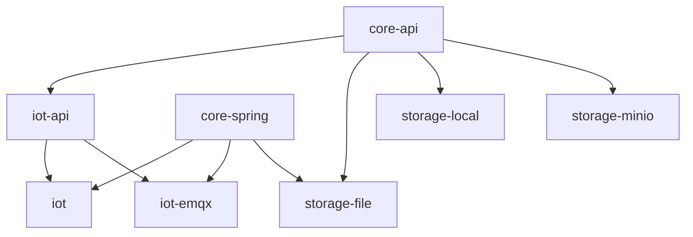

# 系统组成

采用 Sca4d-J 的应用，无需把身份、认证、消息、文件和设备接入代码复制到同一个工程中。仓库将稳定的接口、可选实现和最终应用分开。应用只选择需要的 Gradle 工程，并在自己的 Controller、权限和配置中组合它们。

本页面向创建具体应用或选择模块的开发者。读完后，开发者能确定需要声明哪些 Gradle 工程，以及各层的依赖方向和职责范围。

## 仓库里有什么

`settings.gradle.kts` 当前登记以下工程：

| 层次 | Gradle 工程 | 负责的内容 |
|---|---|---|
| Core | `core:sca4dj-core-api` | 不依赖 Spring 的基础类型和公开接口 |
| Core | `core:sca4dj-core-spring` | Spring MVC、AOP、Redis、MyBatis 和自动配置接入 |
| Gateway | `gateway:sca4d-gateway` | API、SSE、WebSocket 和回调的独立负载均衡入口 |
| Gateway | `gateway:sca4dj-gateway-loki` | 可选的 Loki 日志写入认证与代理自动配置 |
| 身份与认证 | `modules:iam:sca4dj-iam` | 身份、账号、Principal 和授权数据 |
| 身份与认证 | `modules:auth:sca4dj-auth` | 认证引擎和 Session |
| 身份与认证 | `modules:auth:sca4dj-auth-password`、`sca4dj-auth-totp`、`sca4dj-auth-passkey`、`sca4dj-auth-email`、`sca4dj-auth-sms`、`sca4dj-auth-federation`、`sca4dj-auth-shared-secret`、`sca4dj-auth-hmac`、`sca4dj-auth-x509` | Password、TOTP、Passkey、Email Code、SMS、联合登录、共享密钥、HMAC 和 X.509 认证方法 |
| 运行任务 | `modules:audit:sca4dj-audit`、`modules:messaging:sca4dj-messaging`、`modules:notification:sca4dj-notification`、`modules:notification:sca4dj-notification-email`、`modules:notification:sca4dj-notification-sms`、`modules:job:sca4dj-job`、`modules:scheduling:sca4dj-scheduling-quartz` | 审计、可靠业务消息、通知、持久化任务和 Quartz 调度 |
| 在线通信 | `modules:web-realtime:sca4dj-web-realtime` | 浏览器 SSE 与 WebSocket/STOMP 消息 |
| IoT | `modules:iot:sca4dj-iot-api`、`sca4dj-iot`、`sca4dj-iot-emqx`、`sca4dj-iot-timescale` | 设备接口约定、设备领域状态、EMQX/MQTT 接入和 TimescaleDB 时序存储 |
| 接口与扩展 | `modules:openapi:sca4dj-openapi`、`modules:plugin:sca4dj-plugin`、`sca4dj-plugin-pf4j`、`sca4dj-plugin-spring` | OpenAPI 文档生成、插件接口、PF4J 加载和 Spring 装配 |
| Storage | `modules:storage:sca4dj-storage-file`、`sca4dj-storage-local`、`sca4dj-storage-minio` | 文件生命周期、本地目录对象和 MinIO 对象 |
| App | `apps:<应用名>-server` | HTTP API、权限、模块组合、配置和启动 |
| App | `apps:<应用名>-iot-simulator` | 独立 MQTT 连接模拟进程，不是 Server 的库依赖或业务服务 App |

具体应用的前端（例如 `frontends:<应用名>-admin`）可以由 Gradle 登记，但后端依赖图不把它作为 Java 工程使用。`settings.gradle.kts` 登记哪些 App，由具体应用决定。

Gateway 是独立运行模块，不属于 `apps/`，也不依赖具体业务模块。

## 具体应用实际选择了什么

具体应用的 Server 在 `apps:<应用名>-server/build.gradle.kts` 中声明直接工程依赖，并决定运行时装配哪些模块。

下图是模板。具体应用把节点替换为实际选择的 Gradle 工程。未选择的模块不出现在图中。图只显示应用直接依赖的工程。它不是所有模块之间的依赖图，也不展开第三方构件。



| 位置 | 具体应用填写的内容 |
|---|---|
| 所选 Gradle 工程 | `build.gradle.kts` 中声明的工程路径，以及每个依赖的配置 |
| 应用自己的 Controller、权限和配置 | HTTP 路由、权限编码、产品启停状态和跨模块业务事务 |
| 独立进程 | 通过 MQTT 等外部协议与运行中服务交互的进程，不作为 Server 的库依赖 |

依赖配置也有运行含义。应用源码直接使用的模块使用 `implementation`。只在运行时装配 Bean 和自动配置、且应用源码不直接引用其类型的模块，使用 `runtimeOnly`。`runtimeOnly` 的模块仍会在运行时生效。

独立进程不出现在 Server 的 `dependencies` 中。它通过 MQTT 与运行中的 Broker 通信。

## 工程之间的直接 Gradle 依赖

模块层的直接依赖可以压缩为三组，而不用把全部节点挤进一张图。



图中箭头从被依赖工程指向使用它的工程。Password 的编译期项目依赖只有 Core API，Core Spring 只以 `runtimeOnly` 装配。IAM 只直接依赖 Core Spring。其余节点是否同时依赖 Core API 和 Core Spring，可在各自 `build.gradle.kts` 的 `dependencies` 中确认。



IoT base 的 Gradle 直接依赖只有 IoT API 和 Core Spring，其源码也没有引用 Auth 或 IAM 的包。这不表示所有模块都可以读取其他模块的内部数据。

EMQX 只依赖 IoT API 和 Core Spring。因此，适配器通过设备连接、上行接收和下行发布的接口与 IoT base 协作。

独立 Gateway 只依赖 Core API 中定义的 HTTP 路径、Header 和回调编码。Core Spring 让 Server 注册租约并分发回调。具体应用声明实际回调。完整职责和失败情况见[负载均衡 Gateway](/capabilities/realtime-gateway/gateway)。

## 依赖规则与构建事实不是一回事

前述箭头只回答「当前构建文件直接声明了什么」。长期规则回答「修改时允许怎样协作」。

- App 可以选择模块并调用模块公开 API。模块不依赖 App。
- Core 不依赖具体模块或 App。
- 模块不能读取另一个模块的 Repository、Mapper、持久化对象或内部包。确需协作时，使用稳定公开接口。
- 模块只装配 Java 类型、Service、扩展点和自动配置。模块不定义具体应用的业务 Controller、权限、菜单或 HTTP 数据类型。
- 公开类型签名需要的工程使用 `api`。模块内部实现使用 `implementation`。只在自动配置或运行时发现的实现使用 `runtimeOnly`。`runtimeOnly` 不表示该功能可以不启动。

例如，[AuthenticationAttempts](/javadoc/core/sca4dj-core-api/com/sca4d/core/api/authentication/AuthenticationAttempts.html) 通过 [AuthenticationPolicy](/javadoc/core/sca4dj-core-api/com/sca4d/core/api/authentication/AuthenticationPolicy.html) 读取具体应用的动作要求。它通过 [AuthenticationMethod](/javadoc/core/sca4dj-core-api/com/sca4d/core/api/authentication/AuthenticationMethod.html) 调用装配的认证方法。Password 通过 [AccountDirectory](/javadoc/core/sca4dj-core-api/com/sca4d/core/api/identity/AccountDirectory.html) 查找账号，不读取 IAM Mapper。

依赖统一从 `apps` 指向 `modules`，再指向 `core`。

## 各层如何协作

### Core

[核心层](/capabilities/foundation/core) 定义身份、会话、调用评估、权限、并发、消息、通知、文件、任务、在线通信和 Gateway 回调的共享接口与类型。

Core Spring 把这些接口接入 Spring。应用提供 Redis 后，Core Spring 实现分布式锁、限流和共享运行数据。

Core 不保存 IAM、IoT、通知渠道或文件的业务状态。

### Modules

模块负责可以独立选择的功能和它拥有的数据。典型协作如下：

- Audit 实现 Core 审计写入接口。具体应用决定哪些动作必须审计，以及谁能查询。
- Notification 负责按接收人和渠道分派通知。Notification Email 保存 SMTP 配置与多语言模板，并执行邮件投递。
- IoT base 保存 Product、已发布物模型、Device、reported、desired 和可靠下行事实。EMQX 模块只转换 Broker 协议。
- Storage File 保存文件元数据和状态。本地目录与 MinIO 模块只实现字节对象操作。
- Messaging、Job 和 Quartz 分别处理可靠业务消息、持久化任务和触发计划，不把三种状态合成一个对象。

文件状态见[文件上传、使用与清理](/capabilities/file-storage/file-lifecycle)，字节保存位置见[文件存储实现](/capabilities/file-storage/storage-backends)。设备状态见 [IoT 设备生命周期](/capabilities/iot/device-lifecycle)，审计写入见 [Audit 模块](/capabilities/operations-observability/audit)。

### Apps

应用定义 HTTP 路由、权限、产品启停状态和跨模块业务事务。

`apps/<应用名>-server` 直接引用所需模块，并为所选模块定义对应的 Controller。它还按业务需求决定权限范围，以及可选模块是否装配。模块自动配置不会替应用新增这些业务路由。

每个 App 必须用 `spring.application.name` 声明技术 ID。Core Spring 据此发布 AppName。Redis、Auth、IoT、Storage、Messaging 和 Web Realtime 使用它隔离共享资源名称，规则见[名称与应用隔离](/capabilities/foundation/name-and-isolation)。产品展示名称、OpenAPI 联系人和前端标题不进入 AppName。

应用唯一或 `@Primary RedisConnectionFactory` 是 Sca4d-J 基础设施 Redis。Core Spring 从它创建 [@Sca4djRedis](/javadoc/core/sca4dj-core-spring/com/sca4d/core/spring/redis/Sca4djRedis.html) 模板。应用增加其他 Redis 时，必须使用独立限定 Bean。

### Gateway

`gateway:sca4d-gateway` 是 Sca4d-J 的独立负载均衡入口。它不选择业务模块，不读取数据库，也不执行应用回调。

Server 通过 Core Spring 注册基础地址、readiness 路径和回调编码。Gateway 只在租约有效且 readiness 成功的实例中轮询选择。

注册表是 Gateway 进程内状态，不是跨 Gateway 副本共享的数据。一个 Gateway 进程只管理一个应用集群。配置的 backend service ID 不提供多应用 namespace。

公开路由由 `spring.cloud.gateway.server.webflux.routes` 定义。转发到动态注册 Server 的路由使用 RegisteredServer Filter。其他 HTTP(S) 代理路由不会获得 Gateway Secret。

`gateway:sca4dj-gateway-loki` 通过 Spring Boot AutoConfiguration 提供可选日志写入路由。组装工程不需要该功能时，可以不声明 addon 依赖。

## 应用依赖、构建工具与数据库初始化

使用数据库的 App 应用 `com.sca4dj.app` 插件。插件提供的 `initFlyway` 从运行时 classpath 收集模块 `META-INF/sca4dj/schema` 片段，按组件依赖顺序生成 App 的第一份迁移。

生成后由 App 维护 Flyway 历史，不能覆盖已经存在的迁移。

根版本目录 `gradle/libs.versions.toml` 是主构建和 Included Build 的第三方版本来源。公开签名需要的依赖使用 `api`。仅实现内部使用的依赖使用 `implementation`。由自动配置或驱动在运行时发现的实现使用 `runtimeOnly`。测试依赖不改变生产依赖图。

## 示例

下例是一个工作区应用的 Server 构建文件。它直接使用 IAM、认证和审计的公开类型，所以使用 `implementation`。消息和文件存储只需要在运行时装配，所以使用 `runtimeOnly`。

```kotlin
plugins {
    java
    id("org.springframework.boot")
    id("io.spring.dependency-management")
    id("com.sca4dj.app")
}

dependencies {
    implementation(project(":core:sca4dj-core-spring"))
    implementation(project(":modules:iam:sca4dj-iam"))
    implementation(project(":modules:auth:sca4dj-auth"))
    implementation(project(":modules:auth:sca4dj-auth-password"))
    implementation(project(":modules:audit:sca4dj-audit"))
    runtimeOnly(project(":modules:messaging:sca4dj-messaging"))
    runtimeOnly(project(":modules:storage:sca4dj-storage-file"))
    runtimeOnly(project(":modules:storage:sca4dj-storage-local"))
}
```

对应的最小应用配置声明技术 ID：

```yaml
spring:
  application:
    name: workspace-server
```

声明后生成数据库初始化迁移：

```bash
./gradlew :apps:workspace-server:initFlyway
```

`initFlyway` 从运行时 classpath 收集已选模块的 `META-INF/sca4dj/schema` 片段。未选择的模块不会出现在迁移中。
