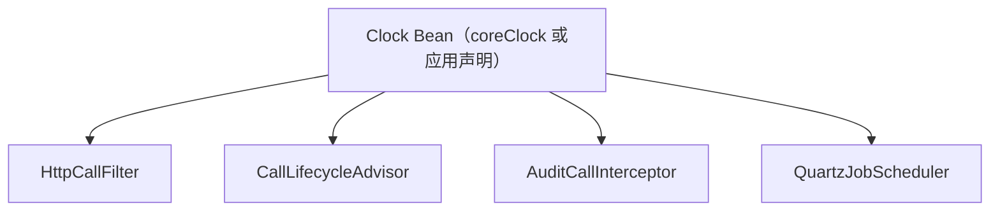

# 时间与时钟

本页涵盖 Core 的时钟 Bean、时间工具类、时间格式常量和内部 JSON 映射器的日期输出约定。本页适用于需要读取当前时间、格式化时间或在测试中固定时间的开发者。读完后，开发者能确定时间来自哪个 `Clock`，并知道 Core 提供的格式和输出形式。

## 概念

依赖当前时间的组件接收 `java.time.Clock`，不直接读取系统时间。调用生命周期、HTTP 调用过滤器、审计拦截器和 Quartz 调度器的构造函数都接收 `Clock`。应用不声明 `Clock` Bean 时，Core 注册 `Clock.systemUTC()`。

测试可以传入固定时钟。调用生命周期相关的源码测试，使用 `Clock.fixed(...)` 构造这些组件。

`TimeUtils.now(clock)` 返回 `clock.instant()`。时间换算使用调用方传入的 `ZoneId`。`TimeUtils` 和 `TimeFormats` 不读取 JVM 默认时区。

## 核心对象

| 对象 | 负责 | 不负责 |
|---|---|---|
| `coreClock`（`Clock` Bean） | 提供 `Clock.systemUTC()`，只在应用没有声明 `Clock` Bean 时注册 | 管理时区或时钟同步 |
| `TimeUtils` | 通过 `now(Clock)` 读取时间点，通过 `toLocalDateTime(Instant, ZoneId)` 和 `startOfDay(LocalDate, ZoneId)` 按指定时区换算 | 读取默认时区，保存时间 |
| `TimeFormats` | 提供 `DATE`、`TIME`、`DATE_TIME` 常量，以及四个格式化方法 | 解析文本 |
| `Sca4djMapper` | 内部使用的 `ObjectMapper`，注册 `JavaTimeModule` 并关闭时间戳输出 | HTTP 或业务 `ObjectMapper` 的配置 |

`Sca4djMapper` 的源码标注为 `@ApiStatus.Internal`，只用于脚手架的持久化、Session 和内部消息。业务和客户端协议使用各自的 `ObjectMapper`，不继承该映射器的配置。



图中的所有组件使用同一个 `Clock` Bean。Quartz 自动配置把 `Clock` 写入 `SchedulerContext` 的键 `sca4djClock`。`QuartzDispatchJob` 执行时从该键读取。应用替换 `Clock` Bean 后，上述组件的时间来源同时改变。

时间来源是构造函数参数，而不是静态调用，测试替换一次 `Clock` Bean 即可固定全部时间。

## 格式约定

| 常量或方法 | 输出格式 | 说明 |
|---|---|---|
| `TimeFormats.DATE` | `yyyy-MM-dd` | ISO 本地日期格式 |
| `TimeFormats.TIME` | `HH:mm:ss` | 不包含小数秒 |
| `TimeFormats.DATE_TIME` | `yyyy-MM-dd HH:mm:ss` | 不包含小数秒和时区偏移 |
| `formatDate(LocalDate)` | `DATE` 格式 | 使用 `TimeFormats.DATE` |
| `formatTime(LocalTime)` | `TIME` 格式 | 使用 `TimeFormats.TIME` |
| `formatDateTime(LocalDateTime)` | `DATE_TIME` 格式 | 不转换时区 |
| `formatInstant(Instant, ZoneId)` | `DATE_TIME` 格式 | 先把时间点转换为调用方指定的时区 |

`Sca4djMapper` 注册 `JavaTimeModule`，并禁用 `SerializationFeature.WRITE_DATES_AS_TIMESTAMPS`。因此，内部映射器输出 Java 时间类型时使用 ISO 文本，而不是数字时间戳。

## 配置

源码中未定义时间相关的配置键。替换时钟的方式是在应用中声明类型为 `Clock` 的 Bean。

`coreClock` 使用 `@ConditionalOnMissingBean`。应用声明 `Clock` Bean 后，不会再注册 `Clock.systemUTC()`。

源码中未定义 `TimeUtils` 或 `TimeFormats` 的默认时区。调用方需要在调用时传入 `ZoneId`。

## 示例

以下示例在 Service 中读取当前时间，并按成员所在时区输出文档的最后修改时间。

```java
import com.sca4d.core.api.runtime.TimeFormats;
import com.sca4d.core.api.runtime.TimeUtils;
import java.time.Clock;
import java.time.Instant;
import java.time.LocalDate;
import java.time.ZoneId;

public class DocumentService {

    private final Clock clock;

    public DocumentService(Clock clock) {
        this.clock = clock;
    }

    public Instant touch() {
        return TimeUtils.now(clock);
    }

    public String modifiedAtText(Instant modifiedAt, ZoneId memberZone) {
        return TimeFormats.formatInstant(modifiedAt, memberZone);
    }

    public Instant todayStart(ZoneId memberZone) {
        LocalDate today = TimeUtils.toLocalDateTime(TimeUtils.now(clock), memberZone).toLocalDate();
        return TimeUtils.startOfDay(today, memberZone);
    }
}
```

测试中传入固定时钟：

```java
Clock fixed = Clock.fixed(Instant.parse("2026-01-01T00:00:00Z"), ZoneId.of("UTC"));
DocumentService service = new DocumentService(fixed);
service.modifiedAtText(service.touch(), ZoneId.of("Asia/Shanghai"));
// 2026-01-01 08:00:00
```

## 扩展方式

应用声明类型为 `Clock` 的 Bean 即可替换默认时钟。`coreClock` 使用 `@ConditionalOnMissingBean`，Spring 发现应用 Bean 后不再注册 `Clock.systemUTC()`。

```java
@Bean
Clock applicationClock() {
    return Clock.systemUTC();
}
```

## 限制与失败结果

| 位置 | 条件 | 结果 |
|---|---|---|
| `TimeUtils.now` | `clock` 为 `null` | `NullPointerException`，消息为「时钟不能为空」 |
| `TimeUtils.toLocalDateTime` | `instant` 为 `null` | `NullPointerException`，消息为「时间点不能为空」 |
| `TimeUtils.toLocalDateTime` | `zoneId` 为 `null` | `NullPointerException`，消息为「时区不能为空」 |
| `TimeUtils.startOfDay` | `date` 为 `null` | `NullPointerException`，消息为「日期不能为空」 |
| `TimeUtils.startOfDay` | `zoneId` 为 `null` | `NullPointerException`，消息为「时区不能为空」 |
| `TimeFormats.formatDate`、`formatTime`、`formatDateTime` | 参数为 `null` | `NullPointerException`，消息分别为「日期不能为空」「时间不能为空」「日期时间不能为空」 |
| `TimeFormats.formatInstant` | 时间点或时区为 `null` | `NullPointerException`，消息分别为「时间点不能为空」「时区不能为空」 |

`TimeFormats.DATE_TIME` 不包含时区信息。`TimeFormats.formatInstant` 按传入的 `ZoneId` 换算时间，但输出文本中不含时区标识。需要输出时区的调用方应定义自己的格式。

## 相关页面

- [核心层](/capabilities/foundation/core)
- [全局 ID](/capabilities/foundation/global-id)
- [调用生命周期](/capabilities/identity-access/call-lifecycle)
- [定时任务配置](/capabilities/jobs-scheduling/quartz-configuration)
- [HTTP API 通用约定](/reference/http/common)
- [Java API 参考](/reference/#java-api-参考)
