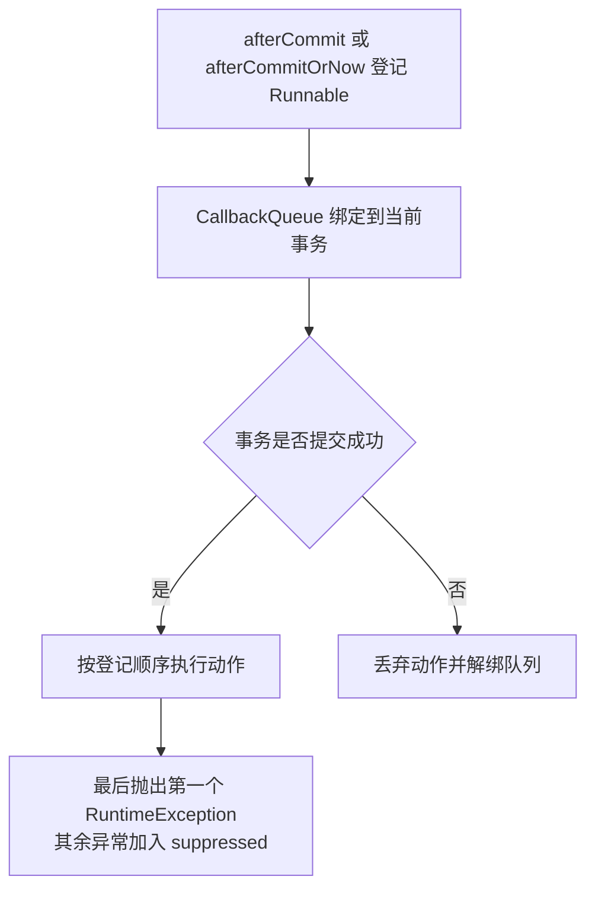
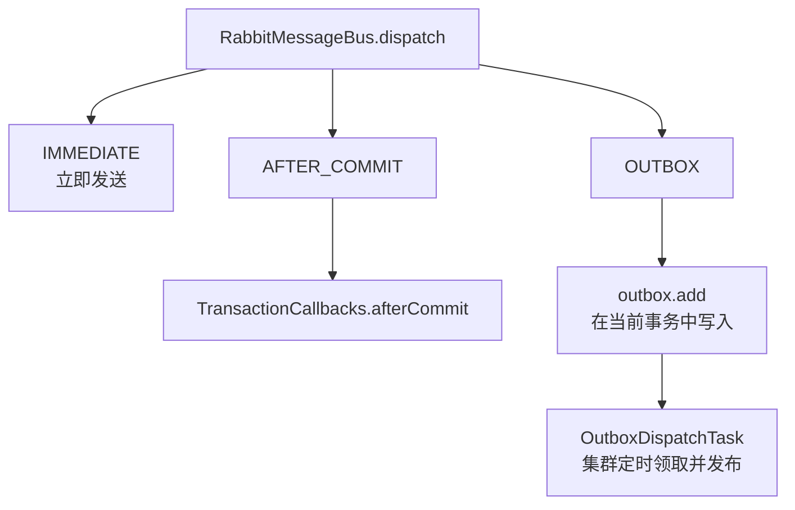

# 事务提交后回调

事务提交后回调（`TransactionCallbacks`）把进程内动作登记到当前 Spring 事务。事务成功提交后执行这些动作，事务回滚时丢弃它们。

本页涵盖两个登记入口的差异、无事务时的行为、动作失败的结果，以及它与业务消息 Outbox 的关系。本页适用于需要在数据库提交后执行通知、缓存失效等进程内动作的开发者。读完后，开发者能判断一个动作应使用哪个入口，并判断动作失败时数据库结果是否保留。

## 概念

数据库写入与进程内动作需要保持一致时，动作只能在提交成功后执行。例如，`RabbitMessageBus` 的 `AFTER_COMMIT` 分发模式先编码消息，再通过 `TransactionCallbacks.afterCommit` 把发送登记到事务中。事务提交后才调用 `publisher.send`。事务回滚时，消息不会发出。

`TransactionCallbacks` 只负责登记和执行动作。它不开启、提交或回滚事务，也不持久化动作，更不重试失败的动作。动作在提交线程上执行。

## 核心对象

| 对象 | 负责 | 不负责 |
| --- | --- | --- |
| `TransactionCallbacks` | 提供 `afterCommit` 与 `afterCommitOrNow` 两个静态入口，为每个事务绑定唯一的回调队列 | 开启、提交或回滚事务，持久化或重试动作 |
| 回调队列（`TransactionCallbacks` 内部的 `CallbackQueue`） | 保存登记的 `Runnable`，事务提交后按登记顺序执行，回滚时丢弃 | 对外暴露，处理数据库写入 |
| 动作（`Runnable`） | 执行不再依赖原事务继续写库的进程内操作 | 决定事务是否提交 |



## 两个入口

- `afterCommit(Runnable)` 要求当前线程存在真实事务，且事务同步已启用。不满足时抛出 `IllegalStateException`，消息为「提交后动作要求当前线程存在已启用同步的真实事务」。
- `afterCommitOrNow(Runnable)` 在没有真实事务时，立即在调用线程执行动作。存在真实事务但事务同步未启用时，抛出 `IllegalStateException`，消息为「当前真实事务未启用同步，不能提前执行提交后动作」。
- 两个入口的参数为 `null` 时，抛出 `NullPointerException`，消息为「事务提交后动作不能为空」。
- `afterCommitOrNow` 用于公开接口约定既可能在事务内、也可能在事务外调用的情况。使用该入口的源码类包括 `DeviceChangeNotifier` 和 `SaTokenSessionControl`。

## 执行顺序

- 同一事务中的所有登记共享一个队列，动作按登记顺序执行。
- 提交回调执行期间登记的新动作，接在队列末尾执行。
- 事务挂起时，队列从线程解绑，恢复后重新绑定。这样，内层 `REQUIRES_NEW` 事务的动作与外层事务互相隔离。
- 回滚时，`afterCompletion` 收到的状态不是 `STATUS_COMMITTED`。队列随后解绑，动作不执行。

## 动作失败

- 一个动作抛出 `RuntimeException` 时，队列仍执行后续动作。全部执行后，抛出第一个异常，其余异常加入 `addSuppressed`。
- 在提交回调中执行时，异常沿提交调用链抛出。此时事务已经提交，调用方不能据此把该事务当作回滚。
- 在 `afterCompletion` 中执行剩余动作时，异常只记录为 `ERROR` 日志，消息为「事务提交后动作失败，数据库已提交」，不向调用方抛出。已执行的动作不会重放。源码注释说明，这类失败需要根据日志人工补偿。
- 同一事务已绑定其他提交后动作资源时，登记失败，抛出 `IllegalStateException`，消息为「当前事务已绑定其他提交后动作资源」。

## 与 Outbox 的关系

业务消息的分发由 `RabbitMessageBus.dispatch` 按 `DispatchPolicy.Mode` 选择处理方式。三种模式的差异如下。



- `IMMEDIATE` 立即发送，不经过事务回调。
- `AFTER_COMMIT` 通过 `TransactionCallbacks.afterCommit` 在提交后发送。发送失败时记录 `WARN` 日志，本次不重试。源码中的日志文字为「事务已提交但允许丢失的业务消息发布失败，本次不重试」。
- `OUTBOX` 在当前事务中写入 Outbox 记录。之后，集群定时器触发 `OutboxDispatchTask`，领取并发布到期的记录。该模式不使用 `TransactionCallbacks`。
- `AFTER_COMMIT` 与 `OUTBOX` 都要求当前线程存在活跃事务。不存在时，抛出 `IllegalStateException`，消息为「...要求当前线程存在活跃事务」。

需要在数据库提交后可靠发布的消息，使用 `OUTBOX`。`AFTER_COMMIT` 的失败不重试，只适用于源码中允许丢失的后续发送。

本页的回调只用于允许丢失或可由日志补偿的动作，需要可靠发布时使用 `OUTBOX`。

## 示例

以下示例在文档保存事务提交后清除进程内缓存。事务回滚时，缓存不被清除。`DocumentRepository` 和 `DocumentCache` 是应用自己的类型。

```java
import com.sca4d.core.spring.transaction.TransactionCallbacks;
import org.springframework.stereotype.Service;
import org.springframework.transaction.annotation.Transactional;

@Service
public class DocumentService {

    private final DocumentRepository documents;
    private final DocumentCache cache;

    public DocumentService(DocumentRepository documents, DocumentCache cache) {
        this.documents = documents;
        this.cache = cache;
    }

    @Transactional
    public void rename(long documentId, String title) {
        documents.rename(documentId, title);
        TransactionCallbacks.afterCommit(() -> cache.evict(documentId));
    }

    // 既可能在事务内、也可能在事务外调用
    public void refresh(long documentId) {
        TransactionCallbacks.afterCommitOrNow(() -> cache.evict(documentId));
    }
}
```

`rename` 在事务内登记动作，事务提交后执行。`refresh` 在没有真实事务时立即执行。在没有事务的线程上对 `afterCommit` 的调用会抛出 `IllegalStateException`。

## 开发规则

- 动作必须在事务提交后执行时，使用 `afterCommit`。动作在事务外调用时也必须成立时，使用 `afterCommitOrNow`。
- 动作只使用已经提交的数据或进程内状态，不在动作中依赖原事务继续写库。
- 动作自行处理可恢复的失败。数据库提交后，动作失败不会回滚已经提交的事务。
- 生产代码使用 `TransactionCallbacks` 登记提交后动作，不直接注册 Spring 事务同步。
- 本能力没有配置项。源码中未定义相关配置键。

## 相关页面

- [核心层](/capabilities/foundation/core)：`TransactionCallbacks` 所在的 Core Spring 模块与依赖关系。
- [业务消息与可靠发布](/capabilities/messaging-notification/domain-events)：`AFTER_COMMIT` 与 `OUTBOX` 分发模式的完整说明。
- [Java API 参考](/javadoc/core/sca4dj-core-spring/com/sca4d/core/spring/transaction/TransactionCallbacks.html)：`TransactionCallbacks` 的公开方法签名。
