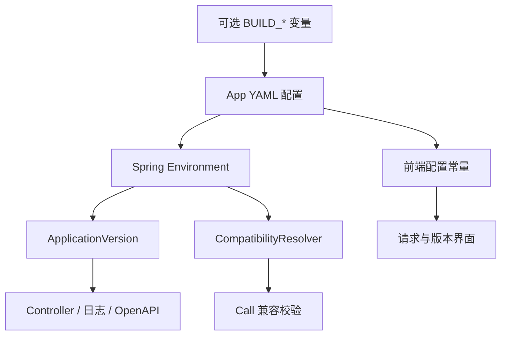

# 版本配置与接口兼容

YAML 是应用版本、协议 Header 与兼容规则的声明入口。ApplicationVersion 是加载配置后的不可变版本快照，CompatibilityResolver 执行兼容规则。两者不依赖 Gradle、Vite、CI 或固定构建产物格式。

本页适用于维护应用版本、版本 Header 和兼容矩阵的开发者。读完后，开发者能确定版本信息从哪里来，客户端版本如何被判定，以及发布新接口约定前需要确认什么。

## 配置入口

具体应用的前端和 Server 可以共用 `config/version.yml`。Server 通过标准 `spring.config.import` 加载打包后的 `version.yml`。前端在 Vite 配置阶段读取同一文件。组件名称来自 YAML 的 `applications`，或 Server 已有的 `spring.application.name`。

```yaml
sca4dj:
  version:
    enabled: true
    product: <产品标识>
    component: "${spring.application.name:<应用名>-server}"
    release-version: "${BUILD_RELEASE_VERSION:dev}"
    api-contract-version: 1
    release-id: "${BUILD_RELEASE_ID:local}"
    component-build-id: "${spring.application.name:<应用名>-server}-${BUILD_ID:local}"
    source-revision: "${BUILD_COMMIT:unknown}"
    built-at: "${BUILD_TIME:unknown}"
    build-mode: "${BUILD_MODE:dev}"
    build-version: "${BUILD_VERSION:dev-local}"
```

`release-version` 和 `api-contract-version` 由 App 维护。发布版本允许使用 `dev` 等开发标识。版本模块校验 Header 安全字符、正整数接口约定版本以及必需字段。缺失、空值或未解析的变量，会使初始化失败。

没有启用 `sca4dj.version.enabled` 时，脚手架不自动创建版本对象。



## 构建工具只替换变量

Server 的普通资源处理复制 YAML，并替换其中的 `BUILD_*` 占位符。Vite 的普通配置加载器解析相同占位符，再把值写进客户端 JS。没有版本专用 Gradle 任务、插件 API 或构建清单。独立 `pnpm build` 不需要 Java、Gradle 或后端产物。

```bash
BUILD_ID=server-42 BUILD_RELEASE_ID=release-7 BUILD_COMMIT=abc123 BUILD_TIME=2026-10-13T00:00:00Z \
  ./gradlew :apps:<应用名>-server:bootJar

BUILD_ID=web-43 BUILD_RELEASE_ID=release-7 BUILD_COMMIT=abc123 BUILD_TIME=2026-10-13T00:01:00Z \
  pnpm build
```

前端命令在前端工作区执行。CI 分别提供各 Job 的 `BUILD_ID`、共同的 `BUILD_RELEASE_ID`、提交与时间。Web Job 不等待 Java Job 提供版本。

tag 流水线把 GitLab 的 `CI_COMMIT_TAG` 同时传入 `BUILD_RELEASE_VERSION` 和 `BUILD_VERSION`。Gradle 以该 tag 生成带来源提交的构件名。构建工具不自行读取 Git tag，也不判断这些值是不是合格的产品版本。

没有构建变量时，使用 YAML 明确声明的 `local`、`unknown`。不读取本机 Git 或当前时间来假装拥有构建证据。

正式产物在构建时替换构建变量，并随产物交付。部署时不重新计算。

版本对象是启动配置快照。App 可以按正常 Spring 配置优先级覆盖配置。覆盖后的值应如实用于排障，不能再把它视为原构件的独立证明。

原有 Gradle/Maven `project.version` 和 JAR 文件名继续服务于构件管理，不作为运行时兼容规则的来源。

## App 决定 Header 名称

版本头沿用既有 ConfiguredConstants 初始化机制。HttpConstants 的 `static final` 字段在配置加载完成后固定。调用方直接读字段，不在请求过程中查配置。ClientVersionResolver、响应写出、`Vary` 与 CORS 暴露头都使用这些字段。

```yaml
sca4dj:
  http:
    headers:
      client-name: "${SCA4DJ_HTTP_HEADERS_CLIENT_NAME:X-Client-Name}"
      client-release-version: "${SCA4DJ_HTTP_HEADERS_CLIENT_RELEASE_VERSION:X-Client-Release-Version}"
      client-api-contract: "${SCA4DJ_HTTP_HEADERS_CLIENT_API_CONTRACT:X-Client-Api-Contract}"
```

下面 HTTP 说明中的 `X-*` 名称均为默认值。全部版本头配置见 `config/version.yml`、`.env/application.env.example` 和 `.env/frontend.env.example`。

启动时，拒绝非法名称、大小写重复的名称、保留头，以及与 Gateway 控制头冲突的名称。

Web/H5 先使用 YAML 的 Header 配置。部署覆盖继续沿用已有的 `VITE_GLOB_HTTP_*_HEADER` 和 HttpContract。Web 使用 `_app.config.js`，H5 使用构建环境变量。

前后端必须一起修改协议名称。Java 启动后不能改变这些常量。改名需要重启，客户端同样需要更新自己的有效配置。

## 应用公开版本

具体应用的版本 Controller 提供匿名 `GET /public/version`。经默认 Gateway 前缀访问时，路径为 `/api/public/version`。它注入公共 ApplicationVersion 和应用 CompatibilityResolver，返回 `ApiResponse<VersionView>`。

VersionView 展开版本配置，并包含 `compatibility` 规则列表。响应使用 `Cache-Control: no-store`。

| 字段 | 用途 |
| --- | --- |
| `product`、`component` | 产品与构件标识 |
| `releaseVersion` | 产品发布版本 |
| `releaseId` | 发布批次 |
| `componentBuildId` | 当前实际构件身份 |
| `sourceRevision`、`builtAt` | 源码提交与构建时间 |
| `buildMode`、`buildVersion` | 配置的构建模式与构建展示值 |
| `apiContractVersion` | 当前接口约定版本，正整数 |
| `compatibility` | 当前响应实例加载的兼容矩阵 |

运行多个 Server 版本时，这些值只证明本次响应实例的构建。前端观察到响应构建变化后，丢弃旧矩阵。不能把一次查询视为整个集群的支持范围。

发布新的接口约定前，应先确保所有可接收流量的 Server 实例都支持它。然后再发布使用该约定的客户端。

## 请求与 Call

客户端携带 `X-Client-Name`、`X-Client-Release-Version`、`X-Client-Release-Id`、`X-Client-Build` 和 `X-Client-Api-Contract`。产品版本不强制采用三段数字。头值只允许字母、数字、点、下划线和短横线，并限制长度。重复头、畸形版本或只提供部分身份时，请求被拒绝。

MVC 入口解析声明，并计算 CompatibilityDecision。VersionCallBinding 使受保护 Controller 进入现有 CallLifecycle。

VersionCallInterceptor 在业务执行及幂等重放前报告拒绝，CallOutcome 为 `DENIED`。

VersionCompatibilityException 继承 BusinessException。它由现有 GlobalExceptionHandler 输出本地化消息、callId 和结构化兼容详情。没有独立错误 Advice。SSE 错误继续沿用只返回状态码的约定。

请求日志的 MDC 保存 `clientName`、`clientVersion`、`clientBuild` 和 `serverBuild`。具体应用的日志上下文直接输出这些字段。请求完成或进入异步处理时清理，避免线程复用导致版本串入下一请求。

服务器输出 `X-Server-Release-Version`、`X-Server-Release-Id`、`X-Server-Build` 和 `X-Server-Api-Contract`。兼容处理另外输出 `X-Compatibility-Status` 和实际选择的 `X-Api-Contract`。

版本选择头加入 `Vary`。跨域可读头通过 `Access-Control-Expose-Headers` 声明。是否允许跨域请求，仍由部署的 CORS 策略决定。

| 情况 | 结果 |
| --- | --- |
| `supported` | 执行选中的接口约定 |
| `deprecated` | 继续执行，通知客户端更新 |
| `blocked` 或规则未匹配 | HTTP 409，错误码 `1009`，业务不执行 |
| 声明格式错误 | HTTP 400，错误码 `1008` |
| 完全没有版本声明 | 应用显式允许时保持现有行为，状态 `unknown`；否则拒绝 |

具体应用可以在 YAML 中设定 `sca4dj.versioning.default-capability` 与 `allow-unspecified=true`，保留现有未带版本头的客户端。

显式 `@ApiCapability` 的多版本接口必须匹配矩阵，不使用旧客户端默认行为。`@VersionDiscovery` 标记版本查询入口，使已不兼容的客户端仍能取得矩阵。

版本兼容在 Call 链中判定，业务 Service 不读取请求头。

## 维护兼容矩阵

具体应用的规则来自 `config/version.yml` 中的 `sca4dj.versioning.clients`。Spring 配置系统负责加载和解析变量。CompatibilityResolver 校验规则，不读取数据库。

规则绑定客户端、能力、产品版本区间、接口约定版本、状态、适配器名称及相对入口。

声明区间时，两端必须同时提供三段非负整数，区间左闭右开。无法解析为三段发布版本的客户端标识，不命中数字区间。

同时省略 `minimum-version` 和 `maximum-version` 时，不限制发布版本。此时仍按客户端、能力和接口约定选择规则。

同一客户端、能力和接口约定的范围不得重叠。不限范围的规则，也不能与其他范围重叠。

```yaml
clients:
  - client: workspace-web
    capability: document
    minimum-version: 1.2.0
    maximum-version: 2.0.0
    contract: 1
    status: deprecated
    adapter: document-v1
    path: /documents/{id}
  - client: workspace-web
    capability: document
    minimum-version: 1.2.0
    maximum-version: 2.0.0
    contract: 2
    status: supported
    adapter: document-v2
    path: /v2/documents/{id}
```

此段是开发示例。具体应用只实现接口约定 1 时，可以只登记约定 1，并且不限制发布版本。这样做可以让 YAML 声明的非正式发布标识通过规则匹配。

规则不能凭空使业务代码支持新字段或新协议。适配器名称是应用维护的标识，不是反射类名。

显式路由版本与请求头版本不一致时，返回 `contract-conflict`，不忽略其中一个。没有显式指定接口约定时，选择匹配范围中最高可用的约定。

前端 VersionController.select 另外接受客户端已实现的接口约定列表。它只从交集中选择，并返回允许的相对路径。选择后由对应版本的客户端代码调用，不自动重放写操作。

## 同一路径和固定版本路由

两种入口共用 CompatibilityResolver。业务 Service 不读取 Servlet、请求头或 App 版本。请求和响应转换留在 Controller 或具名适配器中。

实际业务含义确实不同的操作，应由明确的业务方法表达，不能强行合并。

以下片段展示开发者调用方式。`DocumentDetails`、`DocumentV1View`、`DocumentV2View` 和 `DocumentQueryService` 代表具体应用自己的类型，`document` 为示例能力名。

```java
@GetMapping("/documents/{id}")
@ApiCapability("document")
public ApiResponse<?> get(@PathVariable long id, CompatibilityDecision decision) {
    DocumentDetails result = service.load(id);
    return switch (decision.contract()) {
        case 1 -> ApiResponse.ok(DocumentV1View.from(result));
        case 2 -> ApiResponse.ok(DocumentV2View.from(result));
        default -> throw new IllegalStateException("矩阵声明了没有实现的契约");
    };
}
```

请求体类型不同，且无法自然绑定到同一类型时，应分别声明路由与有类型的请求 DTO。不要为了统一方法签名，把整个业务模型转成 Object 或 Map。

```java
@GetMapping("/v1/documents/{id}")
@ApiCapability(value = "document", contract = 1)
public ApiResponse<DocumentV1View> getV1(@PathVariable long id) {
    return ApiResponse.ok(DocumentV1View.from(service.load(id)));
}

@GetMapping("/v2/documents/{id}")
@ApiCapability(value = "document", contract = 2)
public ApiResponse<DocumentV2View> getV2(@PathVariable long id) {
    return ApiResponse.ok(DocumentV2View.from(service.load(id)));
}
```

字段映射可复用现有 VersionedCodec/VersionedCodecCatalog，也可由具体应用的带类型转换方法实现。协议选择与序列化转换各自负责不同工作。不引入返回任意 Object 的全局适配器注册表。

```ts
await versions.load();
const selected = versions.select('document', [1, 2]);
if (!selected) throw new Error('No supported document API');
// 选择已实现的客户端；同一路径和 /v2 路径都发送实际选择的契约。
const documentApi = api.forContract(selected.contract);
// 将 selected.path 中的业务路径参数替换后，交给对应版本客户端调用。
// Vben 客户端可显式传入 versions.headers(selected.contract)。
```

发布顺序如下：

1. 先发布同时支持新旧接口约定的 Server。
2. 再发布新客户端。
3. 将旧接口约定标为 `deprecated`，并观察请求。
4. 明确停止支持时，改为 `blocked`。

URL 改名只有请求与响应的含义一致时，才可直接映射。不同 DTO 不通过 302/307 自动迁移。

## 前端构建标识

具体应用的 Web 前端可以在左侧导航栏底部显示 YAML 的 `build-version`，不依赖页脚开关。侧栏折叠时，保留版本信息入口。

移动端 H5 可以在「退出登录」按钮上方固定显示一行构建标识，不随页面内容滚动。

点击后，显示客户端与 API 的构建展示值，并重新查询 API 版本。查询失败时显示「暂不可用」，并保留客户端版本。该失败不阻塞登录，也不删除 Session。

无构建变量时显示 `dev-local`。Vben 的包版本不代表具体应用的发布版本。tag 流水线通过 `BUILD_RELEASE_VERSION` 声明发布版本，并通过 `BUILD_VERSION` 让 Web、H5 和 Server 的构建展示值保持一致。配置加载器不自行读取 Git tag，也不从包版本推断 tag。

实现位置与精确字段见源码 Javadoc。构建任务说明见[构建插件](/engineering/build-gradle-plugin)。版本没有涉及数据库迁移。回滚时，使用原构件及其原矩阵。

## 示例

下例让工作区应用的文档详情接口同时服务两个客户端约定。约定 1 返回标题，约定 2 增加附件数量。

先在 `config/version.yml` 中启用版本对象与兼容矩阵。`sca4dj.versioning.enabled` 为 `true` 时，框架绑定 `sca4dj.versioning.clients` 并创建 CompatibilityResolver，矩阵缺失或为空时启动失败：

```yaml
sca4dj:
  version:
    enabled: true
    product: workspace
    component: "${spring.application.name:workspace-server}"
    release-version: "${BUILD_RELEASE_VERSION:dev}"
    api-contract-version: 2
    release-id: "${BUILD_RELEASE_ID:local}"
    component-build-id: "${spring.application.name:workspace-server}-${BUILD_ID:local}"
    source-revision: "${BUILD_COMMIT:unknown}"
    built-at: "${BUILD_TIME:unknown}"
    build-mode: "${BUILD_MODE:dev}"
    build-version: "${BUILD_VERSION:dev-local}"
  versioning:
    enabled: true
    clients:
      - client: workspace-web
        capability: document
        minimum-version: 1.0.0
        maximum-version: 2.0.0
        contract: 1
        status: deprecated
        adapter: document-v1
        path: /documents/{id}
      - client: workspace-web
        capability: document
        minimum-version: 1.0.0
        maximum-version: 2.0.0
        contract: 2
        status: supported
        adapter: document-v2
        path: /documents/{id}
```

Controller 在同一路径上按判定结果返回不同的响应结构：

```java
import com.sca4d.core.api.version.CompatibilityDecision;
import com.sca4d.core.spring.version.ApiCapability;
import com.sca4d.core.spring.web.ApiResponse;

@GetMapping("/documents/{id}")
@ApiCapability("document")
public ApiResponse<?> get(@PathVariable long id, CompatibilityDecision decision) {
    DocumentDetails result = documents.load(id);
    return switch (decision.contract()) {
        case 1 -> ApiResponse.ok(DocumentV1View.from(result));
        case 2 -> ApiResponse.ok(DocumentV2View.from(result));
        default -> throw new IllegalStateException("矩阵声明了没有实现的契约");
    };
}
```

客户端在请求中携带身份信息和接口约定头，并可查询公开版本入口：

```bash
curl -H 'X-Client-Name: workspace-web' \
     -H 'X-Client-Release-Version: 1.4.0' \
     -H 'X-Client-Api-Contract: 2' \
     https://example.test/api/documents/42

curl https://example.test/api/public/version
```

两个接口约定的状态分别为 `deprecated` 与 `supported`。发布版本为 `1.4.0` 的客户端声明约定 2 时，执行约定 2。发布版本落在区间之外时，规则未匹配，返回 HTTP 409 与错误码 `1009`，业务不执行。

## 扩展方式

应用通过两种位置提供版本相关实现：

- 兼容矩阵：应用在 `sca4dj.versioning.clients` 中声明规则。框架在 `sca4dj.versioning.enabled=true` 时绑定为 CompatibilityResolver。
- 版本对象与判定器 Bean：框架以 `@ConditionalOnMissingBean` 创建 ApplicationVersion 与 CompatibilityResolver。应用声明同类型 Bean 后，框架保留应用的 Bean。
- 字段映射：应用实现 VersionedCodec 或在 Controller 中使用带类型的转换方法。框架不扫描适配器名称，`adapter` 只是应用维护的标识。

Controller 通过 `@ApiCapability` 声明能力，通过 `@VersionDiscovery` 标记版本查询入口。框架在 MVC 入口发现这些注解，并经 VersionCallBinding 接入 CallLifecycle。
