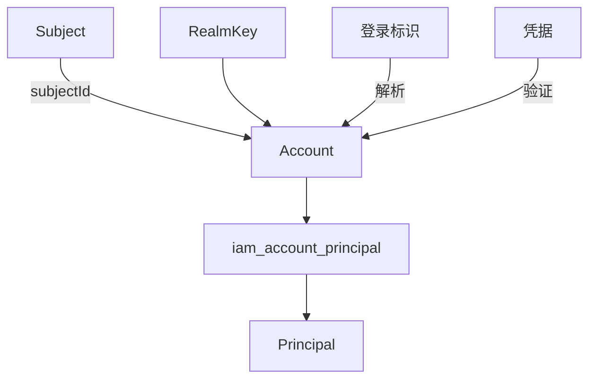

# Account

源码：`core/sca4dj-core-api/src/main/java/com/sca4d/core/api/identity/Account.java`

本页说明 Core 的 Account 类型保存什么、不保存什么，以及它与 IAM 和 Session 的关系。本页适用于需要读取或传递登录账号的开发者。读完后，开发者能确定哪些账号状态应由 IAM 保存。

Account 表示 [Subject](/capabilities/identity-access/subject) 在一个认证域中使用的登录账号。它是 Core 的具体类型，同时实现 Resource，资源类型为 `IAM/ACCOUNT`。它只保存正数 `long` Account 标识、正数 `long` Subject 标识与 [RealmKey](/javadoc/core/sca4dj-core-api/com/sca4d/core/api/identity/RealmKey.html)。Account 只回答「用哪个账号完成认证」，业务身份由 Principal 表达，Account 通过 `iam_account_principal` 关联 Principal，因此更换登录方式或认证域不需要迁移业务数据。



`new Account(accountId, subjectId, realmKey)` 要求两个数值标识为正数，`realmKey` 不能为 `null`。`accountId()`、`subjectId()` 与 `realmKey()` 分别返回账号标识、所属 Subject 标识和创建时确定的认证域。

应用不定义 PlatformAccount、MemberAccount 或其他 Account 子类型。认证域差异由 RealmKey 表达。

用户名、手机号等查找值由 IAM 的 AccountIdentifier 保存。密码等凭据按 `accountId` 归属。

Core Account 不保存状态、版本、登录标识、凭据、角色、当前 Principal 或 Session。IAM 的 [IdentityService](/javadoc/modules/iam/sca4dj-iam/com/sca4d/iam/identity/IdentityService.html) 负责持久化状态，以及 Account 与 Principal 的关系。

构造 Session 时，Account 的 `subjectId` 必须与 Session 的 Subject 一致。Session 序列化后只包含 `accountId`、`subjectId` 与 `realmKey` 三个字段。Session 不需要 Account Codec，也不保存 IAM 状态或版本。

## 示例

下面的 Service 在工作区成员登录后，读取 Session 中的 Account。
它只使用 Account 的三个值，不读取登录标识、凭据或角色。

```java
import com.sca4d.core.api.identity.Account;
import com.sca4d.core.api.identity.RealmKey;

public class AccountSummaryService {

    public String describe(Account account) {
        RealmKey realm = account.realmKey();
        return "account=" + account.accountId()
                + ", subject=" + account.subjectId()
                + ", realm=" + realm.value();
    }

    public Account sample() {
        return new Account(1001L, 2001L, new RealmKey("workspace-members"));
    }
}
```

`new Account(0L, 2001L, realm)` 或 `realmKey` 为 `null` 时构造失败。
工作区、文档等业务数据不引用 Account，而引用 Principal。
