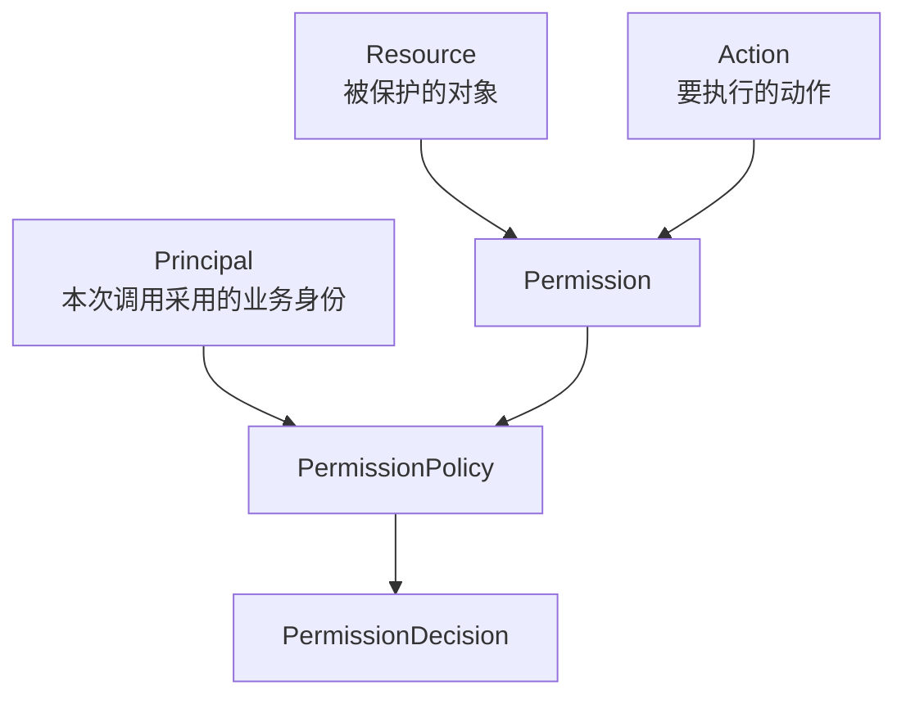
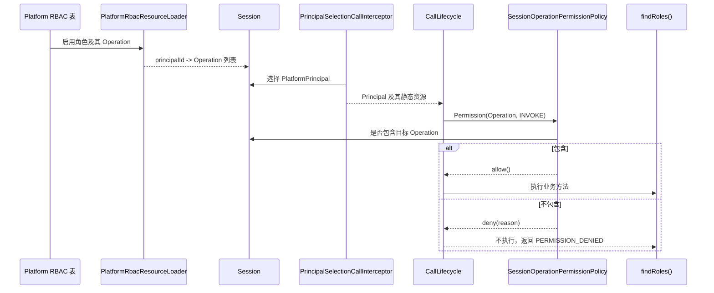
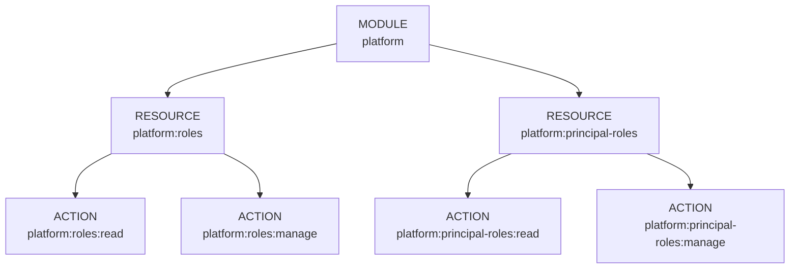
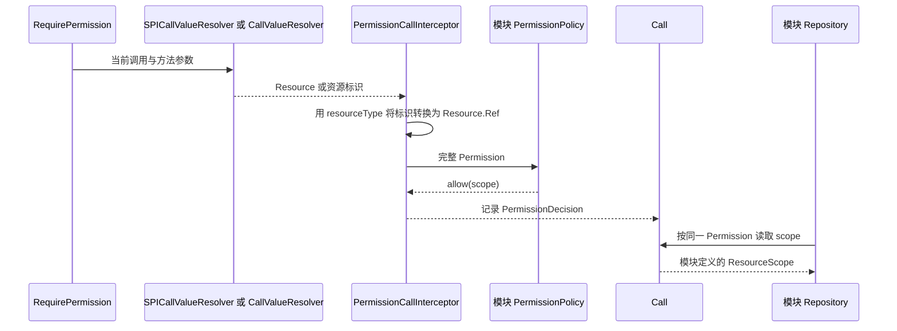

# 权限判断与授权数据

本页说明固定接口操作与业务对象权限的判断方式、授权数据的来源和失效方式。本页适用于开发 Controller、Service 和领域权限策略的开发者。读完后，开发者能判断一项检查应使用 Operation 还是业务 Resource，并能写出对应的 PermissionPolicy 和 Repository 约束。

认证回答「哪个接入者使用哪个账号完成了认证」，授权回答「当前业务身份能否对目标资源执行指定动作」。登录成功并不代表可以执行所有接口。同一个账号也可能关联多个业务身份，例如工作区成员和个人访客，每次调用必须先确定当前身份。

Sca4d-J 使用 [Principal](/capabilities/identity-access/principal) 表示本次调用采用的业务身份，使用 [Permission](/javadoc/core/sca4dj-core-api/com/sca4d/core/api/permission/Permission.html) 表示待判断的完整权限。一次权限判断必须同时包含资源和动作，不能只传一个含义不明的字符串。固定入口与业务对象使用同一种 Permission 结构，即 Resource 加 Action。



图中的 [Resource](/capabilities/identity-access/resource) 由类型和标识确定对象。[Action](/javadoc/core/sca4dj-core-api/com/sca4d/core/api/permission/Action.html) 表示读取、修改、删除或业务模块声明的其他动作。[PermissionPolicy](/javadoc/core/sca4dj-core-api/com/sca4d/core/api/permission/PermissionPolicy.html) 根据当前 Call 和完整 Permission，返回 [PermissionDecision](/javadoc/core/sca4dj-core-api/com/sca4d/core/api/permission/PermissionDecision.html)。

## 为什么既有 RBAC，也有 PermissionPolicy

访问控制早期常按用户逐项维护访问列表。系统规模增大后，每个用户分别配置权限很难审查，也容易遗漏。NIST 在 1992 年提出通用的角色访问控制模型（RBAC），随后形成统一模型和 ANSI/INCITS 标准。RBAC 把权限授予角色，再把角色分配给用户或业务身份，适合管理「编辑者可以修改文档」「管理员可以维护角色」这类稳定职责。NIST 的 [RBAC 资料](https://csrc.nist.gov/projects/role-based-access-control) 记录了这一发展过程和现行标准。

角色不能方便地表达所有数据限制。例如，同样拥有「读取设备」权限的两个主体，可能只能读取各自组织下的设备。继续为每一种组织组合创建角色，会让角色数量失控。NIST SP 800-162 对[属性访问控制（ABAC）](https://csrc.nist.gov/pubs/sp/800/162/upd2/final)的定义是：根据主体、对象、操作及环境属性与规则作出授权判断。

Sca4d-J 没有把所有授权统一成一套角色表达式，也没有声称实现完整 ABAC。它采用两种可以组合的处理方式：

- 固定业务入口使用 RBAC。角色获得 Operation，登录或刷新 Session 时，把当前具体 Operation 装入对应 Principal 的静态资源列表。
- 具体业务对象由所属模块实现 PermissionPolicy。策略可以读取该模块负责的授权数据，直接允许、拒绝，或者返回 ResourceScope。

这样安排的原因很直接。角色适合回答「能不能进入某个固定业务入口」。业务模块最清楚「允许处理哪些文档、成员或工作区数据」。Core 负责固定调用顺序和失败规则，不替业务模块设计授权表或查询条件。

## 固定接口操作

[Operation](/javadoc/core/sca4dj-core-api/com/sca4d/core/api/permission/Operation.html) 是资源类型为 `CORE/OPERATIONS` 的特殊 Resource。Resource 类型使用斜杠分层，Operation 编码使用冒号分层。判断一个固定接口时，Sca4d-J 构造：

```java
new Permission(new Operation("PLATFORM:ROLES:READ"), Action.INVOKE)
```

业务代码通常不直接构造它，而是在 Controller 或 Service 上声明实际 Operation：

```java
@CurrentPrincipal(selection = PlatformPrincipalSelection.class)
@RequirePermission(operation = PlatformOperations.ROLES_READ_VALUE)
public ApiResponse<List<RoleView>> findRoles() {
    return ApiResponse.ok(rbac.findRoles().stream().map(RoleView::from).toList());
}
```

这是 `PlatformRoleController.findRoles()` 的现行写法。`PlatformOperations.ROLES_READ_VALUE` 的值是 `PLATFORM:ROLES:READ`。`@RequirePermission` 未指定 `action` 时，固定使用 `Action.INVOKE`。



`PlatformRbacResourceLoader` 位于 IAM 模块，只在建立或刷新 Session 时读取角色授权。一次请求开始后，SessionOperationPermissionPolicy 只读取当前 Call 已绑定的静态资源，不再次查询 IAM 数据库。

角色或角色 Operation 改变后，IAM 增加 Account 的 Session 失效代次。后续请求刷新 Session 后，才使用新的 Operation。

## Operation Catalog 负责什么

[OperationCatalog](/javadoc/core/sca4dj-core-api/com/sca4d/core/api/permission/OperationCatalog.html) 收集各业务 [OperationModule](/javadoc/core/sca4dj-core-api/com/sca4d/core/api/permission/OperationModule.html)，生成固定的 `MODULE -> RESOURCE -> ACTION` 三层目录。

MODULE 编码是模块唯一锚点。模块声明局部 RESOURCE 和 ACTION 段，`OperationNode.module(...)` 在建立聚合时展开完整编码。例如，`workspaces`、`documents`、`read` 生成 `workspaces:documents:read`。因此，不同模块可以自然复用 `documents:read` 局部结构。



目录负责校验和组织应用注册的全部 Operation。只有 ACTION 可以授予角色。MODULE 和 RESOURCE 只组织和展示目录。ACTION 节点直接包含对应 Operation，不再建立另一种扁平目录项类型。

Catalog 不保存角色，不认识 RBAC 领域，也不判断当前主体是否拥有 Operation。

IAM 的 [RbacOperationModule](/javadoc/modules/iam/sca4dj-iam/com/sca4d/iam/rbac/RbacOperationModule.html) 由同一个业务模块声明 Operation 可以授予哪些 RbacDomain。PermissionSelectionRegistry 据此生成每个领域的 PermissionSelections。

`GET /system/permissions?domain=<RbacDomain 名称>` 使用对应领域的选择规则，从同一棵 Catalog 中筛出该领域的 Operation。未提供 `domain` 时，默认 `PLATFORM`。该路由由示例 App 的 `OperationController` 提供，不属于 Core。

## 业务对象权限与 ResourceScope

固定 Operation 只能说明主体是否可以调用一个入口，不能自动限制入口内部可以读取或修改的业务数据。业务模块接入对象权限时，需要完成以下内容：

1. 用该模块自己的 Resource 类型表达受保护对象或集合。
2. 用 `@RequirePermission(resource = ..., resourceType = ..., action = ...)` 读取参数中的资源标识，或通过 `resolver` 指定业务解析器。
3. 提供唯一一个能够认领该资源类型的 PermissionPolicy Bean。
4. 策略直接返回允许或拒绝。集合只允许访问一部分数据时，返回带 [ResourceScope](/javadoc/core/sca4dj-core-api/com/sca4d/core/api/permission/ResourceScope.html) 的允许结果。
5. Repository 通过 [CurrentResourceScope](/javadoc/core/sca4dj-core-spring/com/sca4d/core/spring/permission/CurrentResourceScope.html) 读取已批准范围，并把范围落实到查询或原子写入条件。



ResourceScope 只保存业务条件，不保存 SQL、MyBatis Wrapper、分页参数或 Controller 输入。范围按照完整 Permission 保存，因此同一资源的读取范围不能误用于更新或删除。

Repository 使用范围时，仍然负责构造一次数据库操作。不能先读取允许 ID，再在没有同一条件的情况下执行修改。

参数只有资源标识时，可以直接声明：

```java
@RequirePermission(
        resource = "#profileId",
        resourceType = "<资源类型>",
        action = Action.READ_VALUE)
```

这里的 `<资源类型>` 由拥有该对象的业务模块定义。表达式只取出资源标识，调用层建立资源引用。对应的 PermissionPolicy 从 Repository 读取真实对象后，检查角色和数据范围。

表达式取到完整 Resource 时，可以省略 `resourceType`。需要根据多个参数检查归属等关系时，继续声明 `resolver = <业务解析器>.class`。表达式变量和各注解的互斥规则，见调用生命周期的「注解表达式」。

具体业务对象的列表可以使用 ResourceScope。对应的 PermissionPolicy 先校验当前全局 Operation，再从业务模块保存的授权数据中得到已批准的资源标识。Repository 通过 CurrentResourceScope 取得这些标识或范围条件，并把它交给分页或查询。Service 不接收 Principal 标识，也不再次过滤查询结果。

头像流程使用具体业务 Resource 权限，但不返回 ResourceScope。

- 申请上传时，业务解析器从目标 Account 读取 PlatformUserProfile。PlatformUserProfilePermissionPolicy 判断当前 Principal 能否对 `PLATFORM/USERS/PROFILES` 的目标资料执行 `WRITE`。
- 完成上传和生成读取地址时，表达式分别读取 `#fileId` 和 `#request.fileIds`。调用层为每个去重标识建立 [Resource.Ref](/javadoc/core/sca4dj-core-api/com/sca4d/core/api/resource/Resource.html)。FilePermissionPolicy 再读取 [StoredFile](/javadoc/core/sca4dj-core-api/com/sca4d/core/api/storage/StoredFile.html)，交给文件场景规则校验上传 Account、scene 和目标资料。
- `WRITE` 仍要求原上传 Account，且只能维护本人资料。账号管理员可以维护其他资料。合法 Platform 用户头像的 `READ` 对任意已登录用户开放。
- 任一文件不存在、场景或目标不合法、状态不可读时，整个调用不执行，并统一返回文件不存在。不能通过响应区分具体失败的文件。

## 固定执行规则

[PermissionAssessment](/javadoc/core/sca4dj-core-api/com/sca4d/core/api/permission/PermissionAssessment.html) 对每项 Permission 要求恰好一个策略认领：

| 情况 | 结果 |
|---|---|
| 尚未选择 Principal | 抛出 IllegalStateException，业务方法不执行 |
| 没有策略认领资源 | 抛出 IllegalStateException，表示装配不完整 |
| 多个策略认领同一资源 | 抛出 IllegalStateException，不按 Bean 顺序猜测 |
| 策略返回 `null` | 抛出 NullPointerException |
| `ResourceScope.resourceType()` 与目标资源类型不同 | 抛出 IllegalStateException |
| 策略拒绝 | CallLifecycle 抛出 `BusinessException(CoreErrorCode.PERMISSION_DENIED)` |
| 策略允许 | 记录结果后继续执行后续检查和业务方法 |

同一次调用中的同一 Permission 只判断一次。重复声明会先去重。已经写入 Call 的结果可以复用，但不能被后一个结果覆盖。

## 示例

示例围绕「工作区中的文档」：编辑文档需要固定入口 Operation，读取文档列表需要按成员范围过滤。

### 声明 Operation 目录

模块实现 `OperationModule`，用 `OperationNode.module(...)` 声明 MODULE、RESOURCE 与 ACTION 的局部段。
下面的声明展开为 `workspaces:documents:read` 与 `workspaces:documents:write`。

```java
import com.sca4d.core.api.name.code.TreeCode;
import com.sca4d.core.api.permission.OperationModule;
import com.sca4d.core.api.permission.OperationNode;
import org.springframework.stereotype.Component;

@Component
public class WorkspaceOperationModule implements OperationModule {

    @Override
    public OperationNode.Module operationTree() {
        return OperationNode.module(
                TreeCode.ofSegment("workspaces"),
                "operation.workspaces",
                30,
                OperationNode.resource(
                        TreeCode.ofSegment("documents"),
                        "operation.workspaces.documents",
                        10,
                        OperationNode.action(TreeCode.ofSegment("read"), "operation.read", 10),
                        OperationNode.action(TreeCode.ofSegment("write"), "operation.write", 20)));
    }
}
```

### 声明接口并读取范围

Controller 用 `@RequirePermission(resource = ..., resourceType = ..., action = ...)` 声明待判断的 Permission。
`#workspaceId` 只取出资源标识，调用层用 `resourceType` 建立资源引用。

```java
@CurrentPrincipal(selection = WorkspaceMemberSelection.class)
@RequirePermission(
        resource = "#workspaceId",
        resourceType = "WORKSPACE/DOCUMENTS",
        action = Action.READ_VALUE)
public ApiResponse<List<DocumentView>> findDocuments(@PathVariable String workspaceId) {
    return ApiResponse.ok(documents.findDocuments(workspaceId));
}
```

策略认领 `WORKSPACE/DOCUMENTS` 资源，并返回带 ResourceScope 的允许结果。

```java
public class DocumentScope implements ResourceScope {

    private final Set<Long> documentIds;

    public DocumentScope(Set<Long> documentIds) {
        this.documentIds = Set.copyOf(documentIds);
    }

    public Set<Long> documentIds() {
        return documentIds;
    }

    @Override
    public TreeCode resourceType() {
        return TreeCode.ofSlash("WORKSPACE/DOCUMENTS");
    }
}

@Component
public class DocumentPermissionPolicy implements PermissionPolicy {

    private static final TreeCode TYPE = TreeCode.ofSlash("WORKSPACE/DOCUMENTS");

    private final WorkspaceMemberRepository members;

    public DocumentPermissionPolicy(WorkspaceMemberRepository members) {
        this.members = members;
    }

    @Override
    public boolean supports(Resource resource) {
        return TYPE.equals(resource.type());
    }

    @Override
    public PermissionDecision decide(Call call, Permission permission) {
        Principal principal = call.principal().orElseThrow();
        Set<Long> ids = members.findReadableDocumentIds(
                principal.principalId(), permission.resource().id());
        if (ids.isEmpty()) {
            return PermissionDecision.deny("当前成员不能读取该工作区的文档");
        }
        return PermissionDecision.allow(new DocumentScope(ids));
    }
}
```

`WorkspaceMemberRepository` 与 `WorkspaceMemberSelection` 由应用定义。

Repository 用 CurrentResourceScope 读取同一项 Permission 批准的范围，并把它写入查询条件。

```java
@Repository
public class DocumentRepository {

    private final CurrentResourceScope currentScope;
    private final DocumentMapper mapper;

    public DocumentRepository(CurrentResourceScope currentScope, DocumentMapper mapper) {
        this.currentScope = currentScope;
        this.mapper = mapper;
    }

    public List<Document> findDocuments(String workspaceId) {
        Permission permission = new Permission(
                new Resource.Ref("WORKSPACE/DOCUMENTS", workspaceId), Action.READ);
        DocumentScope scope = currentScope.scope(permission, DocumentScope.class);
        return mapper.selectByWorkspaceAndIds(workspaceId, scope.documentIds());
    }
}
```

没有找到已批准范围时，`CurrentResourceScope.scope(...)` 抛出 `BusinessException(CoreErrorCode.PERMISSION_DENIED)`。

## 扩展方式

应用通过 Spring Bean 提供扩展，Core 按以下方式发现。

| 扩展点 | 应用提供 | 发现与校验 |
|---|---|---|
| 业务对象权限 | 实现 `PermissionPolicy` 的 Bean | Core Spring 以 `List<PermissionPolicy>` 注入 `PermissionAssessment`。每项 Permission 在调用时必须恰好有一个策略的 `supports(...)` 返回 `true`，否则抛出 IllegalStateException |
| Operation 目录 | 实现 `OperationModule` 的 Bean | Core Spring 以 `List<OperationModule>` 注入 `OperationCatalog`。编码重复时，`OperationNode.module(...)` 抛出 IllegalArgumentException |
| 可授予的 RBAC 领域 | 实现 `RbacOperationModule` 的 Bean，由 `domains()` 声明领域，必要时重写 `canGrant(...)` | IAM 以 `List<RbacOperationModule>` 注入 `PermissionSelectionRegistry`，`domains()` 为空时抛出 IllegalStateException |

## 不能从当前设计推出的内容

- Operation Catalog 不是菜单目录。管理端可以用它展示授权选择，但页面路由和菜单仍由前端或具体应用负责。
- Session 中的 Operation 不是永久授权副本。角色变化通过 Session 失效和刷新生效。
- PermissionPolicy 不自动提供 ABAC 规则语言、策略文件、表达式引擎或管理页面。
- ResourceScope 不替 Repository 生成 SQL，也不替代数据库约束和事务。
- Core 不规定具体应用必须使用 RBAC。模块可以使用其他授权数据，只要通过 PermissionPolicy 返回统一判定。

相关调用顺序见[调用生命周期](/capabilities/identity-access/call-lifecycle)，业务身份如何确定见 [Principal 选择](/capabilities/identity-access/principal-selection)，Platform 角色和 Session Operation 的来源见[身份与访问管理模块](/capabilities/identity-access/iam)。
