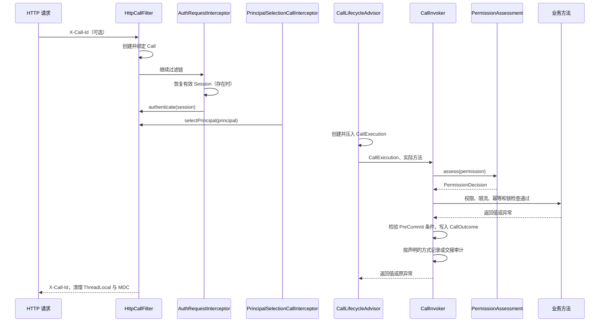
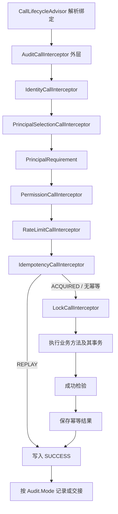

# 调用生命周期

本页说明 Call、CallExecution 和 CallLifecycle 如何在一次调用中保存身份、权限与执行结果。本页适用于维护 Core 调用生命周期和编写声明式注解的开发者。读完后，开发者能确定某一项检查由哪个组件执行，以及失败结果如何产生。

## 为什么需要一次调用内的安全状态

一个 HTTP 请求可能依次经过 Token 恢复、账号确认、业务身份选择、权限判断、限流、幂等检查、互斥执行和审计。如果每个注解都重新读取 Session、重新选择 Principal 或重新查询授权数据，同一次请求可能使用不同时间点的身份和权限，重复访问存储，也无法判断某项结果是否已经确认。

[Call](/javadoc/core/sca4dj-core-api/com/sca4d/core/api/call/Call.html) 保存这一次传输调用已经确认的事实：调用标识、开始时间、可选 HTTP 快照、会话中的 Subject 和 Account、本次选择的 Principal、该主体的静态资源，以及已经完成的 PermissionDecision。后续组件读取同一个对象，不自行恢复身份或改写先前结论。

[CallExecution](/javadoc/core/sca4dj-core-api/com/sca4d/core/api/call/CallExecution.html) 表示一次方法或纯函数执行。它保存方法或 TreeCode 操作标识、实参、返回值类型、预提交条件和最终 CallOutcome。嵌套声明式方法共享同一个 Call，但各自建立 CallExecution。数据权限范围和 `If-Match` 版本条件，因此约束声明它们的方法。

这类做法通常称为安全上下文。Spring Security 的 [SecurityContextHolder](https://docs.spring.io/spring-security/reference/servlet/authentication/architecture.html#servlet-authentication-securitycontextholder) 保存当前认证用户，并默认通过 ThreadLocal 供同一线程读取。

Sca4d-J 没有使用 Spring Security 的认证与授权体系。Call 是 Sca4d-J 自己的类型。除了认证结果，它还保存业务身份选择和逐项权限判定。

Call 不是跨请求会话。需要跨请求保存的登录状态由 [Session](/javadoc/core/sca4dj-core-api/com/sca4d/core/api/authentication/Session.html) 负责，多步骤流程由 [FlowInstance](/javadoc/core/sca4dj-core-api/com/sca4d/core/api/flow/FlowInstance.html) 负责。请求结束后，当前调用对象必须清除。Session 保存一次认证成功后的结果，供后续请求使用。JWT 是同一份 Session 的另一种序列化形式，内容与 Session 相同；Call 在每次请求内读取 Session，不再自行恢复身份。

## 各组成部分负责什么

| 组成部分 | 读取什么 | 写入或执行什么 |
|---|---|---|
| [HttpCallFilter](/javadoc/core/sca4dj-core-spring/com/sca4d/core/spring/web/HttpCallFilter.html) | `X-Call-Id`、当前时间 | 创建调用对象，绑定当前线程，写入响应头和 MDC |
| [AuthRequestInterceptor](/javadoc/modules/auth/sca4dj-auth/com/sca4d/auth/web/AuthRequestInterceptor.html) | `SessionService.currentSession(token, requireSessionToken)` | 有效 Session 时写入 Subject 和 Account |
| [PrincipalSelectionCallInterceptor](/javadoc/core/sca4dj-core-spring/com/sca4d/core/spring/identity/PrincipalSelectionCallInterceptor.html) | `@CurrentPrincipal` 与 Controller 输入 | 从 Session 中选择本次请求使用的 Principal，同时绑定其静态资源 |
| [CallLifecycleAdvisor](/javadoc/core/sca4dj-core-spring/com/sca4d/core/spring/call/CallLifecycleAdvisor.html) | 已注册的注解、方法和实参 | 建立 CallExecution，再把实际方法交给 CallInvoker |
| [CallLifecycle](/javadoc/core/sca4dj-core-api/com/sca4d/core/api/call/CallLifecycle.html) | 阶段含义 | 定义 Around、Before、结果回调、PreCommit、AfterCommit 和 Completion |
| [CallLifecycleConfiguration](/javadoc/core/sca4dj-core-api/com/sca4d/core/api/call/CallLifecycleConfiguration.html) | 参与者编码、阶段和依赖 | 固定内置顺序，合并模块与应用声明的依赖 |
| [CallInvoker](/javadoc/core/sca4dj-core-api/com/sca4d/core/api/call/CallInvoker.html) | CallExecution 和已排序参与者 | 唯一执行同步或异步生命周期，检查结果并触发完成回调 |
| [CurrentResourceScope](/javadoc/core/sca4dj-core-spring/com/sca4d/core/spring/permission/CurrentResourceScope.html) | 已记录的权限判定 | 向 Repository 返回某项完整权限已经批准的数据范围 |
| [IfMatchInterceptor](/javadoc/core/sca4dj-core-spring/com/sca4d/core/spring/web/IfMatchInterceptor.html) | 声明 `@IfMatch` 的 HTTP 方法与请求头 | 把一个强 ETag 绑定到独立的请求版本条件 |
| [RequestVersionConditions](/javadoc/core/sca4dj-core-spring/com/sca4d/core/spring/web/RequestVersionConditions.html) | `If-Match` 中的 Version | 把版本条件登记到对应 CallExecution，并让一个根资源 Repository 消费 |
| [CallPreCommitTransactionListener](/javadoc/core/sca4dj-core-spring/com/sca4d/core/spring/call/CallPreCommitTransactionListener.html) | 与 Spring 事务关联的 CallExecution | 在提交前检查条件，在成功提交后运行已登记回调 |

Core 只定义通用调用对象和执行规则。认证模块恢复 Session，示例 App 提供 PlatformPrincipalSelection，IAM 模块提供权限策略。具体应用选择实际使用的模块，以及并发、审计实现。

## HTTP 请求怎样经过这些对象



匿名接口没有 Session 时，仍保留调用标识和开始时间。非匿名接口在执行器中发现认证尚未完成时，返回 `AUTHENTICATION_REQUIRED`。

需要权限或审计的接口，还必须先选出 Principal。执行器不会在缺少主体时自行查询 IAM。

Principal 为什么需要单独选择、HTTP 输入如何交给选择器，见 [Principal 选择](/capabilities/identity-access/principal-selection)。固定 Operation 与业务对象权限怎样使用不同策略，见[权限判断与授权数据](/capabilities/identity-access/authorization)。

系统任务不经过 HTTP 过滤器。它可以用 `Call.system(callId, startedAt)` 建立固定的 `Subject.SYSTEM` 和 SystemPrincipal。系统调用没有 Session、Account 和静态资源。

独立任务用 `CallHolder.run(call, task)` 绑定自己的 Call。带调用注解的方法由 Advisor 进入 CallInvoker。

## 注解怎样执行



没有相应注解时，跳过对应节点。没有 `@Locked` 时，取得幂等处理权后直接调用业务方法。

实际业务方法抛出异常时，只释放当前 token 仍拥有的处理中记录。

业务方法已经成功但解锁失败时，仍保存可重放结果，并把解锁故障报告给调用方。

业务方法已经成功但幂等结果保存失败时，不释放处理中记录。由租约到期后恢复。

BusinessException 写入 `DENIED`，其他 Exception 写入 `FAILED`。命中已保存的幂等结果时写入 `REPLAYED`。

`DIRECT` 和 `QUEUED` 审计失败会使当前调用失败。`AFTER_COMMIT` 是允许丢失的记录方式。

实际业务方法正常返回后，CallInvoker 检查当前 CallExecution 的 PreCommit 条件。Spring 事务提交前，CallPreCommitTransactionListener 再次检查。方法早于外层事务结束时，已注册的事务同步仍保留该执行的条件。没有事务时，检验发生在释放分布式锁和写入幂等成功结果之前。

幂等重放没有执行实际业务方法，因此不要求 Repository 再次消费范围或版本条件。

权限结果以完整的 Permission 为键保存在 Call 中。同一个资源执行 `READ` 和 `UPDATE` 是两项不同权限。

只有 PermissionDecision.allow(ResourceScope) 会在对应 CallExecution 登记 PreCommit 条件。Repository 通过 CurrentResourceScope，使用完整 Permission 取得范围。

嵌套方法同时登记相同范围时，一次 Repository 读取会消费所有活动执行中的匹配条件，并返回最内层执行的范围。

IfMatchInterceptor 只负责解析请求头。CallLifecycleAdvisor 只把条件附着到实际声明 `@IfMatch` 的方法执行。根资源 Repository 调用 `VersionConditions.resolve(currentVersion)` 后，才算消费该条件。

独立异步工作先在入口线程调用 `VersionConditions.capture()`，再把返回的入口传给工作线程。同一个 `If-Match` 仍只能消费一次，工作线程必须另开事务。普通嵌套方法不能提前占用该条件。

`@RateLimited` 可以直接按 `RateLimit.Dim.GLOBAL`、`IP`、`UA`、`SUBJECT` 和 `ACCOUNT` 取得共享令牌桶额度。也可以通过 `keyResolver` 增加一个自定义业务键。

执行器只读取 Call 已经保存的 HTTP、Subject 和 Account。它不恢复 Session、不选择 Principal，也不读取 IAM。

多个维度分别调用 RateLimiter，并全部判断。任一维度拒绝时，按最长等待时间抛出 RateLimitExceededException。维度条件和 Redis 行为见[并发规则](/capabilities/data-configuration/concurrency-development)。

## 注解表达式

调用注解可以直接从方法参数取值。审计在执行结果确定后，还可以从返回值取值。

Core API 的 CallValueResolver 接收表达式和 CallExecution。SPICallValueResolver 继承 `CallValueResolver<Object>`，标记由集成层注入的默认实现。

Core Spring 通过 SpelCallValueResolver Bean 实现 SpEL。应用提供自己的 SPICallValueResolver Bean 时，替换默认实现。Core API 不依赖 Spring 或 SpEL 类型。

| 注解 | 表达式属性 | 取值要求 |
|---|---|---|
| `@RequirePermission` | `resource` | Resource、ID 或非空集合；ID 必须声明 `resourceType` |
| `@Audit` | `target`、`payload` | 目标为 Resource、带类型的 ID 或空值；载荷为 AuditPayload 或空值 |
| `@RateLimited` | `key` | 非空白 String，作为额外自定义限流维度 |
| `@Idempotent` | `key` | IdempotencyKey 或非空客户端文本 |
| `@Locked` | `key` | LockKey |

这些表达式属性默认是空字符串。表达式在源码注解中声明。方法参数和返回值作为求值数据。使用普通 SpEL，例如 `#accountId`，不使用 `#{...}` 模板。表达式也可以引用 Spring Bean，但直接读取参数和返回值是常见用法。

表达式支持参数名、`#p0`、`#a0`、`#args[0]`、`#call` 和 `#execution`。参数名依赖编译时保留的参数元数据。脚手架构建插件已启用 `-parameters`。位置别名始终可用。

`args`、`call`、`execution`、`result`、`error`、`outcome` 是框架保留变量。同名方法参数通过位置别名读取。

`#result` 是原始方法返回值。返回 ApiResponse 时，通过 `#result.data` 读取响应数据。`#error` 是原始调用异常，`#outcome` 是 CallOutcome。

这三个变量只能在执行结果确定后读取。拒绝和失败时，`#result` 为空。目标表达式可以使用 `#result?.data?.id`。权限、限流、幂等和锁的取值发生在方法执行前，读取结果变量会明确失败。

同一项动态值只能使用表达式或显式解析器。

- 权限的 `operation`、`resource`、`resolver` 必须三选一。动态资源必须明确填写 `action`。
- 审计的 `target`、`targetResolver` 和参数上的 `@AuditTarget` 互斥。`payload` 与 `payloadFactory` 互斥。
- 幂等和锁必须在 `key` 与 `keyResolver` 之间选择一种。
- 限流可以只声明内置维度，也可以增加 `key` 或 `keyResolver`。
- 显式业务解析器使用同一个取值方法。框架传入空表达式，由解析器读取参数并完成资源查询或业务判断。

资源表达式返回 ID 时，调用层使用 `resourceType` 建立 Resource.Ref。数字 ID 必须是正整数，文本 ID 必须非空白。

完整 Resource 自带类型。声明的 `resourceType` 必须与其类型一致。

权限集合不能为空，集合中的资源逐项判断。审计目标为空，表示这次调用没有可记录的目标。

载荷不会把任意请求对象或 Map 自动转换为 AuditPayload。幂等文本经 `IdempotencyKey.fromValue(CharSequence)` 校验。锁表达式必须返回 LockKey。

SpelCallValueResolver 只缓存解析后的表达式，每次求值创建独立上下文。表达式语法错误、未定义变量、当前阶段不可用的结果或返回类型错误，都会使对应阶段失败。被调用 Bean 抛出的业务异常保留原有含义。审计失败如何影响已提交的业务修改，见操作审计页面。

## 当前已经接入的内容

示例 App 的 PlatformRoleController 和 PlatformAccountController 使用 `@CurrentPrincipal` 和 `@RequirePermission`。请求先由 PlatformPrincipalSelection 选出 Session 中的平台 Principal，再由 PermissionAssessment 判断账号或角色管理 Operation。

账号角色集合，以及角色国际化字段、状态和 permission，各自使用同 URI 的稳定资源与 `@IfMatch`。删除角色是针对当前状态的命令。

Controller 与 Service 不接收 HTTP Version。Repository 通过 VersionConditions 完成原子比较。稳定 View 的 `@ETag` 方法发布响应 ETag。

示例 App 的写入接口使用 `@Audit`。需要防止重复提交的业务入口使用 `@Idempotent`。

Core Spring 使用 Redis 注册 Bucket4j RateLimiter、RedisIdempotencyStore 和 Redisson DistributedLock。应用 Service 和模块也可以直接调用 DistributedLock。

三个 Bean 都是 CallInvoker 的必需依赖。缺少 Redis 并发实现，会使应用启动失败。

Audit 模块同时注册 `DIRECT`、`AFTER_COMMIT` 和在 Messaging 可用时注册的 `QUEUED` 记录器。具体方法按 `@Audit.mode` 选择。

类型或方法声明 `@RateLimited`、`@Idempotent`、`@Locked`、`@Audit`、`@RequirePermission` 或 `@AnonymousAccess` 时，都会触发 CallLifecycleAdvisor。方法声明优先于类型声明。

Spring Advisor 把具体目标方法的泛型返回类型交给幂等存储，用于精确恢复重放结果。具体表现见 [CallLifecycleAdvisor 规格](/javadoc/core/sca4dj-core-spring/com/sca4d/core/spring/call/CallLifecycleAdvisor.html)。

CallHolder 使用普通 ThreadLocal。异步任务、手工创建的线程和响应式执行不会自动继承当前调用对象。需要异步处理时，应提取明确且最小的数据作为任务输入。不能在另一个线程继续读取当前 Holder。

Spring MVC 的异步 Controller 会在初次 `REQUEST` 返回后清理 Call 和请求版本条件。随后，在完成、超时或断开时，另一个 Servlet 线程执行 `ASYNC` 分派。

该分派只完成初始请求已经启动的响应。它不是新的业务调用，也没有初始线程的 Call。

[HttpCallHandlerInterceptor](/javadoc/core/sca4dj-core-spring/com/sca4d/core/spring/web/HttpCallHandlerInterceptor.html) 和 [IfMatchInterceptor](/javadoc/core/sca4dj-core-spring/com/sca4d/core/spring/web/IfMatchInterceptor.html) 对全部 `ASYNC` 分派跳过请求阶段处理。认证、Principal 选择、权限判断和 `If-Match` 解析，必须由最初的 `REQUEST` 分派完成。

具体应用不能使用 `AsyncContext.dispatch(path)`，把异步分派作为另一个 Controller 的业务入口。

## 示例

下面的 Service 方法发布工作区文档。
调用顺序：检查 `workspaces:documents:write`，按客户端请求标识去重，记录审计，再执行业务方法。

```java
@Service
public class DocumentPublishService {

    private final DocumentRepository documents;

    public DocumentPublishService(DocumentRepository documents) {
        this.documents = documents;
    }

    @CurrentPrincipal(selection = WorkspaceMemberSelection.class)
    @RequirePermission(operation = "workspaces:documents:write")
    @Idempotent(key = "#requestId")
    @Audit(
            operation = "workspaces:documents:publish",
            target = "#documentId",
            resourceType = "WORKSPACE/DOCUMENTS")
    @Transactional
    public void publish(String requestId, long documentId) {
        documents.markPublished(documentId);
    }
}
```

`#requestId` 与 `#documentId` 来自方法参数名，依赖构建插件启用的 `-parameters`。
`@RequirePermission(operation = ...)` 固定使用 `Action.INVOKE`。
`@Idempotent` 的 `key` 表达式返回非空客户端文本，由 `IdempotencyKey.fromValue(CharSequence)` 校验。
命中已保存的幂等结果时，不执行 `markPublished`，CallOutcome 为 `REPLAYED`。
`WorkspaceMemberSelection` 由应用实现 `PrincipalSelection`。

需要根据多个参数判断归属时，改用 `resolver`，由应用实现 `CallValueResolver`。

```java
public class DocumentOwnerResolver implements CallValueResolver<Collection<Resource>> {

    @Override
    public Collection<Resource> resolve(CallExecution execution) {
        long documentId = (Long) execution.arguments()[1];
        return List.of(new Resource.Ref("WORKSPACE/DOCUMENTS", Long.toString(documentId)));
    }
}
```

声明为 `@RequirePermission(resolver = DocumentOwnerResolver.class, action = Action.WRITE_VALUE)`。
`resolver` 与 `operation`、`resource` 三选一，动态资源必须明确填写 `action`。

## 扩展方式

| 扩展点 | 应用提供 | 框架发现 |
|---|---|---|
| 注解表达式解析 | 自己的 `SPICallValueResolver` Bean | `CoreCallLifecycleConfiguration` 以 `@ConditionalOnMissingBean(SPICallValueResolver.class)` 注册默认的 SpelCallValueResolver。应用 Bean 存在时，默认实现不注册 |
| 显式业务解析器 | 实现 `CallValueResolver` 的类，写入注解的 `resolver`、`keyResolver` 属性 | 注解属性引用解析器类型，调用时由 CallValueResolverLookup 取得 |
| 生命周期依赖 | `CallLifecycleConfiguration.Customizer` Bean | 以 `List<CallLifecycleConfiguration.Customizer>` 注入，在 CallInvoker 构建前按注入顺序执行 |
| 生命周期参与者 | `CallLifecycle.Participant` Bean | 以 `List<CallLifecycle.Participant>` 注入 `CallLifecycleConfiguration`，由 CallInvoker 校验依赖 |
| 业务身份选择 | `PrincipalSelection` 实现 | 由 `@CurrentPrincipal(selection = ...)` 声明。规则见 [Principal 选择](/capabilities/identity-access/principal-selection) |
