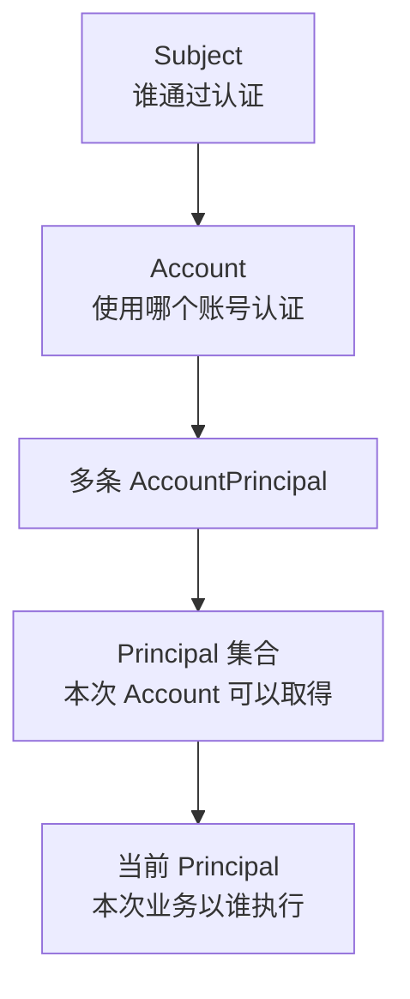
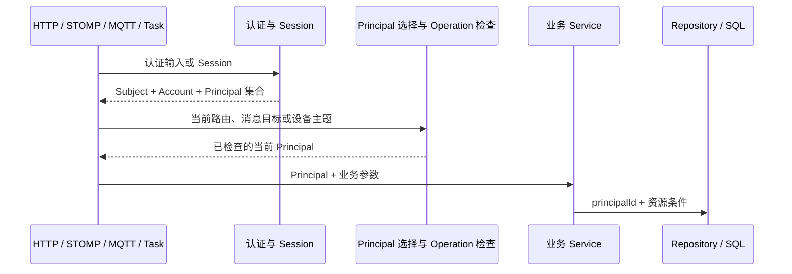

# Subject、Account 与 Principal 使用规则

本页适用于编写 Controller、消息接入、Service、Policy、Repository、Mapper、任务和审计代码的开发者。读完后，开发者能判断一个参数表示的是接入者、认证账号、业务执行者，还是被管理的目标记录。

## 适用范围

本规则用于决定 Controller、消息接入、Service、Policy、Repository、Mapper、任务和审计代码应该使用 Subject、Account 还是 Principal。

任何代码在使用这三个对象之前，都必须先明确当前参数表示接入者、认证账号、业务执行者，还是被管理的目标记录。

## 三个对象



### Subject

Subject 表示实际接入者，回答「谁完成了认证或建立了系统调用」。Subject、Account、Principal 分别回答「谁接入」「用哪个账号认证」「以谁的身份执行业务」，一次调用只选择一个 Principal，并由 Call 保存。

```text
HUMAN  -> 自然人
APPLICATION     -> 使用 AppKey、签名等方式接入的程序
DEVICE  -> 通过设备协议接入的设备
SYSTEM  -> 调度、Outbox 或维护任务
```

Subject 主要用于接入限制、认证安全、已验证 Contact、Session 失效和审计。普通业务代码不能根据 SubjectType 区分自然人、APPLICATION 或设备。

### Account

Account 表示一组可以完成认证的账号数据，回答「当前 Subject 使用哪个账号和认证材料建立 Session」。

Account 关联 RealmKey、AccountIdentifier、Credential、MFA 策略和 Session。密码、Passkey、TOTP、外部身份和 Account 自身状态都按 Account 处理。

Account 不表示管理员、访客或工作区成员，也不能作为业务资源的 owner、member 或 creator。

### Principal

Principal 表示业务执行身份，回答「当前业务操作以谁的身份执行」。

业务资料、Role、Operation、Owner、Member、Grant、消息发送者、文件使用者和数据创建者都使用 Principal。Principal 独立存在，不属于 Subject 或 Account。Account 通过多条 AccountPrincipal 记录取得 Principal 集合。

一个 Session 可以包含多个 Principal，但一次调用只能选择一个当前 Principal。

## 为什么普通业务只使用 Principal

脚手架在业务 Service 执行前完成以下处理：



HTTP、STOMP、MQTT 和任务接入负责以下工作：恢复 Subject 与 Account，选择 Account 已获准的 Principal，检查接入方式的操作限制，并建立 Call。

这些检查完成后，业务 Service 只需要知道当前 Principal。业务代码不重复判断调用者是 HUMAN、APPLICATION 还是 DEVICE，也不重新验证 Account 是否包含该 Principal。

如果同一个 Principal 被 HUMAN Subject 和 APPLICATION Subject 使用，两种入口可以使用不同的认证方式和操作白名单。进入业务 Service 前，最终 Operation 已经是 Principal RBAC 与入口白名单的交集。业务 Service 因此可以复用同一实现。

## 必须使用完整名称

文档正文、类型名、方法名和参数名必须使用 `Subject`、`Account`、`Principal` 完整名称，不能用单字母代替。

## 使用组合

| 组合 | 使用位置 | 示例 | 普通业务是否使用 |
| --- | --- | --- | --- |
| Subject | Subject 状态、已验证 Contact、Subject 下全部 Session | 停用 Subject、替换认证手机号 | 否 |
| Account | Credential、MFA、IdentityProvider 关联、Account Session | 修改密码、登记 Passkey、结束当前账号 Session | 否 |
| Principal | 业务资料、RBAC、资源访问、Owner、Member、Grant | 修改管理员资料、创建文档、发送消息、控制设备 | 是 |
| Subject + Account | 确认 Account 属于哪个 Subject，以及 Subject 管理自己的 Account | 查询本人账号安全信息、停用 Subject 下某个 Account | 否 |
| Account + Principal | AccountPrincipal 读写、Session 创建和 Principal 集合装载 | 给 Account 增加 Principal、检查关联、删除关联 | 否 |
| Subject + Principal | 接入来源检查和审计；不能作为普通业务 Service 的身份参数 | APPLICATION 使用某个人的 Principal、设备通过 MQTT 使用获准 Principal | 否 |
| Subject + Account + Principal | Call、Session 创建、接入日志和审计 | 记录谁通过哪个 Account、以哪个 Principal 执行 | 否 |

组合表不表示所有方法都要接收多个 ID。只有方法的实际判断需要某个对象时，才使用它。审计需要三者，不等于业务方法需要三个参数。

## IAM 与认证代码

IAM、Authentication、MFA 和 Session 管理根据实际操作使用完整名称：

```java
disableSubject(Long principalId, long version)
changePassword(Long accountId, PasswordChange command)
grantPrincipal(Long accountId, Long targetPrincipalId)
createSession(Long accountId)
```

`createSession` 可以从 Account 读取 Subject 和 Principal 集合，不要求调用方提交三个互相信任的 ID。能够从已验证对象读取的数据，不作为独立客户端参数接收。

AccountPrincipal 管理中的 `targetPrincipalId` 是被授予 Account 的 Principal，不一定是执行该管理操作的当前 Principal。方法和 SQL 必须使用 `actorPrincipalId`、`targetPrincipalId` 等名称，区分操作者与目标。

## 业务 Service 与 Policy

普通业务 Service 接收 Principal 或由 Principal 解析出的业务身份：

```java
PlatformOperatorProfile updateProfile(
        Principal principal,
        PlatformOperatorProfileUpdate command);

Document createDocument(
        Principal member,
        DocumentCreate command);
```

需要限制 PrincipalType 时，接入检查或业务入口 Policy 先把公共 Principal 转换成明确的业务身份，例如 PlatformOperatorActor、GuestActor 或 WorkspaceMemberActor。后续业务方法使用该类型，不再接收 Subject 或 Account。

业务 Policy 只根据 Principal、目标 Resource、Action 和业务表作出判断。以下写法不符合本规则：

```java
updateProfile(principalId, accountId, principalId, command);
createDocument(principalId, accountId, memberPrincipalId, command);
```

如果业务方法确实需要修改 Account、Credential 或 Subject Contact，它已经在处理 IAM 或认证资源，不属于「普通业务只使用 Principal」的情况。

## Repository 与 SQL

IAM 与认证 SQL 使用表本身的关联字段：

```sql
SELECT * FROM iam_account
WHERE id = :accountId
  AND subject_id = :principalId;

SELECT * FROM iam_account_principal
WHERE account_id = :accountId
  AND principal_id = :targetPrincipalId;
```

普通业务 SQL 使用 `principal_id` 识别执行者、Owner、Member、Creator 或 Grantee：

```sql
SELECT * FROM platform_operator
WHERE principal_id = :principalId;

SELECT device.*
FROM device_member
JOIN device ON device.id = device_member.device_id
WHERE device_member.principal_id = :principalId;
```

Tenant、Workspace、Device 等资源表仍然记录自己的 `tenant_id`、`workspace_id` 或 `device_id`。Principal 识别执行者，不代替资源 ID。

普通业务 SQL 禁止为了确认调用来源而关联 `iam_subject` 或 `iam_account`。HUMAN、APPLICATION、DEVICE 的入口限制必须在调用业务 Service 前完成。

## Call 与审计

Call 记录本次调用的 Subject、Account、当前 Principal、该 Principal 在 Session 中的 Resource 和权限判定。业务 Service 主要读取当前 Principal。认证安全和审计组件可以读取其他身份信息。

审计必须记录实际的 Subject、认证 Account 和执行 Principal。审计组件直接从 Call 取得这些数据，不能要求每个业务方法为了审计增加 Subject 和 Account 参数。

SYSTEM 请求使用 SYSTEM 类型的 Subject 和 `SystemPrincipal`，Account 为空。SYSTEM 仍然需要明确的 Operation 和 Resource Policy。

## 验收要求

- Principal 接口只提供 `principalId()`，不包含 `accountId`、`tenantId` 或业务 Profile 字段。
- 普通业务 Service 的身份参数只有 Principal 或明确的业务 Actor。
- 普通业务 Repository 不使用 Subject 或 Account 判断 Owner、Member、Role 或数据范围。
- AccountPrincipal 只在 IAM、Authentication、Session 和账号管理代码中读写。
- HTTP、STOMP、MQTT 和任务入口在调用业务 Service 前完成 Principal 选择与操作限制。
- 审计从 Call 记录 Subject、Account 和 Principal，不改变业务方法签名。
- 同一个业务 Service 可以被 HUMAN、APPLICATION、DEVICE 或 SYSTEM 入口复用，前提是入口已经完成对应检查。

## 示例

下面的 Service 创建工作区文档。
入口完成 Principal 选择后，Service 只接收明确的业务身份 `WorkspaceMemberActor`。
Repository 用 `principal_id` 记录创建者，用 `workspace_id` 记录所属工作区。

```java
public class WorkspaceMemberActor {

    private final long principalId;
    private final long workspaceId;

    public WorkspaceMemberActor(Principal principal, long workspaceId) {
        this.principalId = principal.principalId();
        this.workspaceId = workspaceId;
    }

    public long principalId() {
        return principalId;
    }

    public long workspaceId() {
        return workspaceId;
    }
}

@Service
public class DocumentService {

    private final DocumentRepository documents;

    public DocumentService(DocumentRepository documents) {
        this.documents = documents;
    }

    public Document createDocument(WorkspaceMemberActor member, DocumentCreate command) {
        return documents.insert(member.workspaceId(), member.principalId(), command);
    }
}
```

对应的 SQL 不关联 `iam_subject` 或 `iam_account`：

```sql
INSERT INTO document (workspace_id, created_by_principal_id, title)
VALUES (:workspaceId, :principalId, :title);
```

`DocumentCreate`、`DocumentRepository` 与 `document` 表由应用定义。
`WorkspaceMemberActor` 由应用在 `PrincipalSelection` 或 Controller 入口中，从已选择的 Principal 转换得到。

## 扩展方式

应用新增业务身份类型时，实现 `Principal`，并按 [IAM 模块](/capabilities/identity-access/iam)的要求提供 PrincipalCodec 和 PrincipalLoader。
应用用 `PrincipalSelection` 决定一次请求使用 Session 中的哪个 Principal，并在 `@CurrentPrincipal(selection = ...)` 中声明，规则见 [Principal 选择](/capabilities/identity-access/principal-selection)。
`WorkspaceMemberActor` 这类业务 Actor 只是应用自己的类型，框架不发现它。
