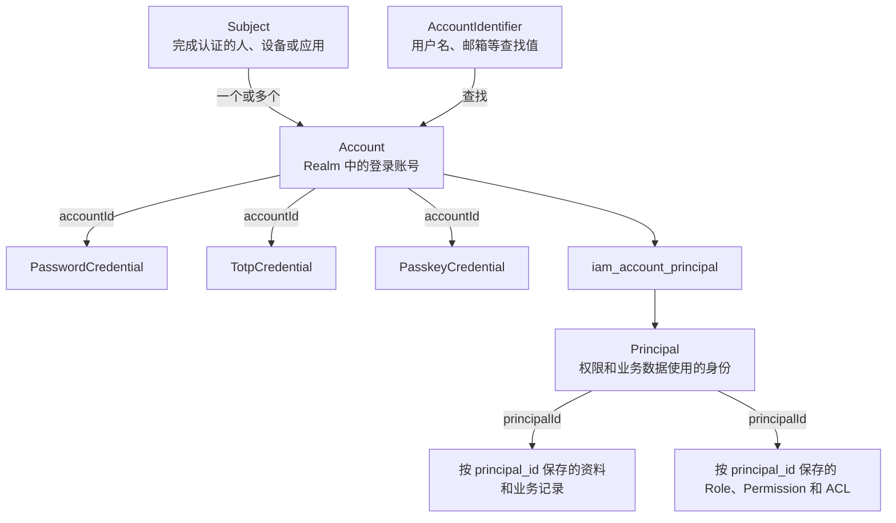
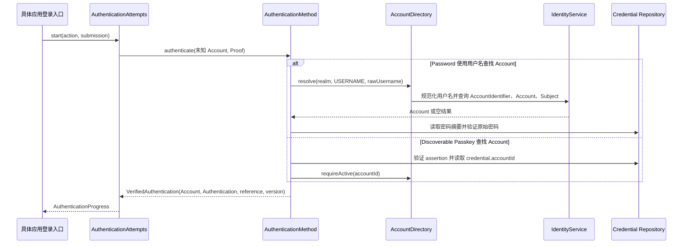
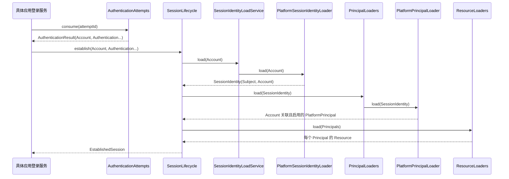
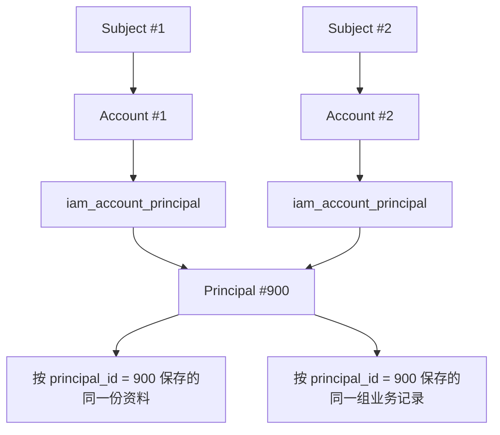

# IAM 中 Subject、Account 和 Principal 的关系

一个人、设备或应用可以有多个登录账号，也可以通过不同账号使用同一个 Principal。IAM 因此分别保存 Subject、Account 和 Principal。

- Subject 表示哪一个人、设备或应用完成认证。
- Account 表示使用哪个账号登录。
- Principal 表示登录后，权限检查和业务数据使用哪个身份。

不经过外部认证的系统任务使用固定的 Subject.SYSTEM。

本页说明这三个对象与 AccountIdentifier、Credential、Session 的关系。本页还说明一次登录如何找到 Account、如何验证 Credential、如何建立 Session，以及两个 Account 如何使用同一个 Principal。本页适用于维护 IAM、认证或业务模块身份关联的开发者。具体方法、参数和异常见相应的技术规格页。

## 每个对象保存什么

| 对象 | 表示什么 | 保存位置 |
|---|---|---|
| [Subject](/capabilities/identity-access/subject) | 完成认证的人、设备或应用；系统任务使用 Subject.SYSTEM | IAM 保存 ID、类型和状态，不保存姓名、头像等资料 |
| [Account](/capabilities/identity-access/account) | Subject 在一个 Realm 中使用的登录账号 | IAM 保存 Subject ID、Realm 和状态 |
| [AccountIdentifier](/javadoc/modules/iam/sca4dj-iam/com/sca4d/iam/identity/AccountIdentifier.html) | 用户名、邮箱等可以查到 Account 的值 | IAM 保存原值、规范化后的值、类型和状态 |
| [Credential](/capabilities/authentication-session/authentication-methods#方法凭据和证明) | 密码摘要、Passkey 或 TOTP secret 等用于验证 Account 的数据 | Password、Passkey、TOTP 等模块分别保存 |
| [Principal](/capabilities/identity-access/principal) | 权限检查、审计和业务表记录使用的身份 | IAM 保存 ID、类型和状态；具体应用或业务模块保存资料 |
| [Session](/javadoc/core/sca4dj-core-api/com/sca4d/core/api/authentication/Session.html) | 一次登录的 Subject、Account、可选 Principal、Resource 和认证记录 | Auth 保存 Session 内容和有效期 |

登录名、Credential 和认证设置属于 Account，所以相关表使用 `account_id`。创建者、成员、所有者、角色和权限属于 Principal，所以相关表使用 `principal_id`。只有一份数据描述的是同一个人、设备或应用，并且不应随 Account 或 Principal 改变时，才使用 `subject_id`。IAM 把「谁完成认证」「用哪个账号登录」「以哪个业务身份执行」拆成 Subject、Account 和 Principal，权限检查与业务数据只读取 Principal。

更多例子见 [Principal](/capabilities/identity-access/principal#业务表应该关联谁) 和 [Subject](/capabilities/identity-access/subject#什么时候业务数据才关联-subject)。

## 数据库怎样保存这些关系



IAM 保存 `iam_subject`、`iam_account`、`iam_account_identifier`、`iam_principal` 和 `iam_account_principal`。各认证方法保存自己的 Credential 表。具体应用或业务模块保存资料、Role、Permission 和 ACL，不能直接调用 IAM Mapper 查询这些表。

数据库关系有以下限制：

- 一个未删除的 Subject 在同一个 Realm 中最多有一个未删除的 Account，在不同 Realm 中可以各有一个 Account。
- AccountIdentifier 只用于查找 Account。同一 Realm、标识类型和规范值最多对应一个未删除的 Account。它不是密码，也不参与权限检查。
- Credential 属于 Account。给 Account 增加 Password、Passkey 或 TOTP 不会创建新的 Subject 或 Principal。
- `iam_account_principal` 保存 Account 与 Principal 的多对多关系。一个 Account 可以关联多个 Principal，多个 Account 也可以关联同一个 Principal。这张表不保存 Role 或 Permission。

[IdentityService](/javadoc/modules/iam/sca4dj-iam/com/sca4d/iam/identity/IdentityService.html) 读写这五张 IAM 表，但不创建具体的 Principal Java 对象。[PrincipalLoader](/javadoc/core/sca4dj-core-api/com/sca4d/core/api/authentication/principalsession/PrincipalLoader.html) 根据查询到的 Principal ID 创建相应类型的 Principal。Role、Permission 和 Resource 再由各自的 Loader 查询。

## 登录时怎样找到并验证 Account

具体应用把本次提交交给 [AuthenticationAttempts](/javadoc/core/sca4dj-core-api/com/sca4d/core/api/authentication/AuthenticationAttempts.html)。AuthenticationAttempts 通过认证方法目录选择 [AuthenticationMethod](/javadoc/core/sca4dj-core-api/com/sca4d/core/api/authentication/AuthenticationMethod.html)。

- Password 方法可以通过用户名查找 Account。
- Discoverable Passkey 可以通过验证后的 Passkey Credential 得到 `accountId`。
- TOTP、Shared Secret、HMAC 和 X.509 只能验证一个已经确定的 Account。



Password 方法从配置读取 Realm，然后调用 [AccountDirectory](/javadoc/core/sca4dj-core-api/com/sca4d/core/api/identity/AccountDirectory.html) 的 `resolve(...)`。IAM 先用 [AccountIdentifierNormalizer](/javadoc/modules/iam/sca4dj-iam/com/sca4d/iam/identity/AccountIdentifierNormalizer.html) 规范化用户名，再查询 AccountIdentifier、Account 和 Subject。三条记录都必须未删除且状态为 `ACTIVE`。

用户名不存在、任一记录已停用，或密码错误时，Password 方法都返回相同的认证失败结果。调用方无法据此判断用户名是否存在。

Discoverable Passkey 先验证 WebAuthn assertion。然后，从验证成功的 Passkey Credential 中读取 `accountId`。最后调用 `requireActive(accountId)`，检查 Account 和 Subject。

TOTP 提交中没有足以查找 Account 的信息。因此，它只能用于已经保存了 Account 的认证尝试。新增认证方法也必须明确选择一种方式：由 Proof 查到 Account，或者只验证认证尝试中已有的 Account。

第一个认证方法返回 Account 后，AuthenticationAttempts 会把这个 Account 保存到认证尝试。后续方法必须返回同一个 Account，否则认证立即失败。

Redis 只保存 Account、认证进度，以及 VerifiedAuthentication 中的非秘密引用和版本。它不保存原始密码、验证码、共享密钥、HMAC、证书字节、完整 WebAuthn 响应或外部 Token。认证方法和认证因素的详细规则，见[认证方法、凭据与认证因素](/capabilities/authentication-session/authentication-methods)。

## 认证成功后怎样建立 Session

认证成功只说明 Credential 与 Account 匹配，还没有确定本次 Session 可以使用哪些 Principal。

具体应用消费 [AuthenticationResult](/javadoc/core/sca4dj-core-api/com/sca4d/core/api/authentication/AuthenticationResult.html) 后，通过 [SessionLifecycle](/javadoc/core/sca4dj-core-api/com/sca4d/core/api/authentication/SessionLifecycle.html) 建立 Session。Auth 会重新查询 Subject、Account、可选 Principal 和 Resource，以发现认证期间发生的停用、删除或关系修改。



SessionIdentityLoadService 先从所有 [SessionIdentityLoader](/javadoc/core/sca4dj-core-api/com/sca4d/core/api/authentication/SessionIdentityLoader.html) 中，找到唯一一个 `supports(account)` 返回 `true` 的实现。

[PlatformSessionIdentityLoader](/javadoc/modules/iam/sca4dj-iam/com/sca4d/iam/base/PlatformSessionIdentityLoader.html) 只支持 Realm 为 `platform` 的 Account，并重新查询 Account 和 Subject。

PrincipalLoaders 随后找到唯一一个支持该 SessionIdentity 的 [PlatformPrincipalLoader](/javadoc/modules/iam/sca4dj-iam/com/sca4d/iam/base/PlatformPrincipalLoader.html)。然后，它查询这个 Account 关联且启用的全部 PlatformPrincipal。

其他 Realm 可以分别实现 SessionIdentityLoader 和 PrincipalLoader，返回自己使用的 Subject、Account 和 Principal 类型。Auth 只调用这两个接口，不依赖 IAM 中的 Platform 实现。

找不到身份 Loader、多个 Loader 同时返回 `true`、Account 或 Subject 已停用、Loader 返回了其他 Account、Principal ID 重复，或者 ResourceLoader 失败时，SessionService 不会创建 Session，也不会签发 Token。

Account 没有关联 Principal 时，仍可建立 Principal 和 Resource 均为空的 Session。建立成功后，每次请求再按 [Principal 选择](/capabilities/identity-access/principal-selection)，从 Session 已有的 Principal 中选择一个。不能选择 Session 中不存在的 Principal。

## 两个 Account 怎样使用同一个 Principal



Account #1 和 Account #2 分别认证。两个 Session 保存各自的 Subject 和 Account，但都可以包含 Principal #900。

业务 Service 读取到的 `principalId` 都是 `900`，所以权限检查、资料查询和业务表写入使用同一个 Principal。认证日志和审计仍然可以通过各自的 `subjectId`、`accountId` 和认证方法，区分两个登录来源。

共享 Principal 不会共享 Credential。Account #1 的密码、Passkey、TOTP、认证设置和 Session 仍然只属于 Account #1，Account #2 不能使用它们。只有 `iam_account_principal` 中存在 Account 与 Principal 的关系时，PrincipalLoader 才会把该 Principal 加入这个 Account 的 Session。

删除 Account #1 与 Principal #900 的关系，不会删除 Account #2 的关系。停用或删除 Principal #900，则会让两个 Account 都无法再把它加入新的 Session。

修改 Account-Principal 关系、Principal 状态、Role 或 Permission 的 Service，还必须使受影响 Account 的现有 Session 失效。不能只修改数据库后，继续使用旧 Session。

RbacService 以批量操作作为普通角色关系增删入口。`changeRoleAssignments(...)` 一次增加或移除一个 Role 的多个 Principal。Repository 批量锁定 Principal、批量写入关系，只为实际变化的 Principal 递增 `roles_version`。事务提交后，再批量清除权限缓存，并使关联 Session 重新装载。

含义相同的单个关系增删需要使用这一批量实现，不能另外维护一套单行查询和写入流程。

PlatformRbacService 只负责批量把 Platform Account 转换成 PlatformPrincipal，再委托通用 RBAC。具体应用不能为角色页面直接查询 IAM 表。

## 怎样组合身份和授权查询

业务模块已经取得一组 Principal ID 后，可以用 [PrincipalQuery](/javadoc/modules/iam/sca4dj-iam/com/sca4d/iam/identity/PrincipalQuery.html) 组合 IAM 负责的类型、状态和 Account 关系条件。IdentityService 返回输入 ID 的匹配子集。调用方不需要读取 `iam_principal`、`iam_account` 或 `iam_subject`，也不需要为每种条件组合增加一个 Service 方法。

```java
Set<Long> active = identities.findPrincipalIds(
        PrincipalQuery.forIds(profilePrincipalIds)
                .status(IdentityStatus.ACTIVE)
                .linkedAccount(LinkedAccountCondition.activeIn(new RealmKey("platform")))
                .build());
```

需要继续按角色授权筛选时，把 IAM 查询结果交给 [PrincipalGrantQuery](/javadoc/modules/iam/sca4dj-iam/com/sca4d/iam/rbac/PrincipalGrantQuery.html)。Operation 使用各模块声明的 `TreeCode` 常量，例如 `PlatformOperations.ROLES_READ`。`allOf(...)` 要求同时拥有全部 Operation，`anyOf(...)` 要求至少拥有其中一个，两者不能同时声明。`RbacService.findPrincipalIds(scope, query)` 在指定的 RbacScope 中查询，并拒绝不属于目标 RBAC 领域目录的编码。

```java
Set<Long> eligible = rbacService.findPrincipalIds(
        PlatformRbacRepository.PLATFORM,
        PrincipalGrantQuery.forIds(active)
                .allOf(PlatformOperations.ROLES_READ, PlatformOperations.ACCOUNTS_READ)
                .build());
```

这两个 Query 只接受模块公开的领域条件，不接受表名、列名、任意谓词或跨模块 JOIN。查询必须从明确的 Principal ID 集合开始。

需要搜索业务资料或分页读取完整列表时，由拥有该资料的业务模块查询自己的表，再把候选 ID 交给 IAM 和 RBAC 筛选。

## 停用和删除会发生什么

Subject、Account、Principal 和 AccountIdentifier 分别保存 `ACTIVE` 或 `DISABLED`。`deleted` 单独表示逻辑删除。

按用户名查找 Account 时，AccountIdentifier、Account 和 Subject 都必须未删除且为 `ACTIVE`。

建立 Session 时，只查询未删除且为 `ACTIVE` 的 Principal。没有 Principal 时保留空列表。

状态更新不检查统一的 Version。后提交的更新会覆盖先提交的更新。

IdentityService 可以按精确 Java 类型批量逻辑删除或恢复 Principal。删除会写入 `DISABLED + deleted = 1`，恢复会写入 `ACTIVE + deleted = 0`。两种操作都保留 `iam_account_principal`，让拥有业务资料的模块能够恢复同一个 Principal ID。

业务模块仍然负责在删除前清理该 Principal 的角色、数据范围和其他领域关系，并在事务提交后批量使关联 Account 的 Session 失效。

[PlatformAccountLifecycleService](/javadoc/modules/iam/sca4dj-iam/com/sca4d/iam/base/PlatformAccountLifecycleService.html) 删除 Platform Account 时，先终止该 Account 的 Session。然后，把 Account 和 AccountIdentifier 标记为已删除，并删除它与 Principal 的关系。

Subject 没有其他未删除 Account 时，才删除 Subject。Principal 没有其他未删除 Account 时，才删除 Principal、Role 和 ACL。其他 Account 仍然关联这个 Principal 时，Principal、资料、Role、ACL 和业务记录都必须保留。

IAM 不删除 Password、TOTP、Passkey Credential，也不删除具体应用保存的资料。PlatformAccountLifecycleService 返回删除结果后，具体应用必须在同一个业务事务中删除自己保存的数据。没有提供 Auth 时，IAM 仍会删除这些数据库记录，但不会终止任何 Session。

## 怎样增加标识、认证方法和 Principal

- 新的登录标识类型需要提供一个 [AccountIdentifierNormalizer](/javadoc/modules/iam/sca4dj-iam/com/sca4d/iam/identity/AccountIdentifierNormalizer.html)。找不到规范化器、同一类型存在多个规范化器，或规范化结果无效时，IdentityService 拒绝写入和查找该标识。
- Password、TOTP、Passkey 等认证方法分别保存自己的 Credential、检查 Proof，并处理各自协议的版本。IAM 不依赖这些认证模块。
- 新的 Principal 类型需要实现 Principal，提供对应的 PrincipalCodec 和 PrincipalLoader，再调用 IdentityService 创建 Principal 并关联 Account。PrincipalCodec 的 `type()` 和 `valueType()` 不能与其他实现重复。
- 只有一类身份需要独立创建、停用、删除，并保存自己的资料和业务记录时，才增加 Principal 类型。Role、Permission、门店、租户和公司不会因为权限或数据范围不同就自动成为 Principal。
- SessionIdentityLoadService 要求恰好一个 SessionIdentityLoader 的 `supports(account)` 返回 `true`。PrincipalLoaders 允许没有 PrincipalLoader 命中，并在有匹配实现时，要求最多一个实现支持返回的 SessionIdentity。身份装载失败或多个实现同时匹配时，SessionService 拒绝建立 Session。

## PlatformIdentityService 和 User

[PlatformIdentityService](/javadoc/modules/iam/sca4dj-iam/com/sca4d/iam/base/PlatformIdentityService.html) 固定使用 `platform` Realm。它在一个事务中创建 HUMAN Subject、Account、USERNAME AccountIdentifier、PlatformPrincipal 和 Account-Principal 关系。它只调用 IdentityService，不访问 Repository 或 Mapper，也不创建 Credential 或绑定 Role。

[User](/javadoc/modules/iam/sca4dj-iam/com/sca4d/iam/base/user/User.html) 把一个 Core Subject、一个 Core Account 和一个 Principal 放在同一个 Java 对象中。`User.of(...)` 接受这三个对象。`User.from(Session)` 只接受 `platform` Realm 的 Account，并且 Session 中必须恰好有一个 PlatformPrincipal。

Account 关联多个 Principal，或者多个 Account 共享一个 Principal 时，应直接使用 Session 和 Call 中已经选择的 Principal。不能用 User 表示这些关系。

## 示例

下例为「工作区成员」增加一种 Principal 类型。Principal 保存成员身份，Account 仍然只负责登录。同一个自然人在不同工作区中可以有不同的 WorkspaceMemberPrincipal。

```java
public class WorkspaceMemberPrincipal implements Principal {

    private final long id;

    public WorkspaceMemberPrincipal(long id) {
        this.id = id;
    }

    @Override
    public long principalId() {
        return id;
    }
}

public class WorkspaceMemberPrincipalCodec implements PrincipalCodec<WorkspaceMemberPrincipal> {

    @Override
    public TreeCode type() {
        return TreeCode.ofColon("WORKSPACE:MEMBER_PRINCIPAL");
    }

    @Override
    public Class<WorkspaceMemberPrincipal> valueType() {
        return WorkspaceMemberPrincipal.class;
    }

    @Override
    public byte[] encode(WorkspaceMemberPrincipal value) {
        return Long.toString(value.principalId()).getBytes(StandardCharsets.UTF_8);
    }

    @Override
    public WorkspaceMemberPrincipal decode(byte[] payload) {
        return new WorkspaceMemberPrincipal(Long.parseLong(new String(payload, StandardCharsets.UTF_8)));
    }
}

public class WorkspaceMemberPrincipalLoader implements PrincipalLoader {

    private static final RealmKey WORKSPACE_REALM = new RealmKey("workspace");

    private final WorkspaceMembershipService memberships;

    public WorkspaceMemberPrincipalLoader(WorkspaceMembershipService memberships) {
        this.memberships = memberships;
    }

    @Override
    public boolean supports(SessionIdentity identity) {
        return WORKSPACE_REALM.equals(identity.account().realmKey());
    }

    @Override
    public List<? extends Principal> load(SessionIdentity identity) {
        return memberships.activeMemberPrincipals(identity.account().accountId());
    }
}
```

`WorkspaceMembershipService` 是应用自己的 Service，负责读取成员资料。创建成员时，该 Service 调用 `IdentityService.createPrincipal(WorkspaceMemberPrincipal.class)` 得到 Principal ID，再关联 Account，并在应用自己的表中按 `principal_id` 保存成员资料。

下例为邮箱登录标识提供规范化器。同一类型只能有一个规范化器。

```java
@Component
public class EmailAccountIdentifierNormalizer implements AccountIdentifierNormalizer {

    private static final AccountIdentifierType EMAIL = new AccountIdentifierType("EMAIL");

    @Override
    public AccountIdentifierType type() {
        return EMAIL;
    }

    @Override
    public String normalize(String rawValue) {
        String normalized = rawValue.trim().toLowerCase(Locale.ROOT);
        if (normalized.isEmpty() || normalized.indexOf('@') < 1) {
            throw new BusinessException(IamErrorCode.IDENTIFIER_INVALID);
        }
        return normalized;
    }
}
```

## 扩展方式

IAM 的扩展点由 `IamAutoConfiguration` 以 `List<T>` 方式收集。应用把实现注册为 Spring Bean 即可，不需要修改 IAM。

| 扩展点 | 发现方式 | 启动或调用时的校验 |
|---|---|---|
| `AccountIdentifierNormalizer` | `IdentityService` 构造时收集 `List<AccountIdentifierNormalizer>` | 同一 `type()` 出现多个实现时抛出 `IllegalStateException` |
| `PrincipalCodec` | IAM 配置收集 `List<PrincipalCodec<?>>` | `type()` 与 `valueType()` 不能重复 |
| `SessionIdentityLoader`、`PrincipalLoader` | Auth 在建立 Session 时遍历全部实现 | 匹配数量不符合上文规则时，SessionService 拒绝建立 Session |
| `RbacOperationModule` | `PermissionSelectionRegistry` 收集 `List<RbacOperationModule>` | 与 `OperationCatalog` 不一致时启动失败 |
| `RbacPermissionCache` | `@ConditionalOnMissingBean(RbacPermissionCache.class)` 提供空实现 | 应用或 Redis 配置提供实现后，空实现不再生效 |

## 包结构

| 包 | 保存或实现什么 |
|---|---|
| `com.sca4d.iam.identity` | Subject、Account、AccountIdentifier、Principal 及 Account-Principal 关系的公开操作 |
| `com.sca4d.iam.identity.mapper` | 上述数据的 SQL 映射，只由 IAM Repository 使用 |
| `com.sca4d.iam.acl` | 按单个 Resource ID 检查权限的 ACL API |
| `com.sca4d.iam.rbac` | 按 RbacDomain 选择实现，并按 RbacScope 批量读写 Role、Permission 和 Principal 角色关系的 RBAC API |
| `com.sca4d.iam.base` | 内置的 PlatformPrincipal、Loader 和 Platform Account 删除服务 |
| `com.sca4d.iam.base.acl`、`com.sca4d.iam.base.rbac`、`com.sca4d.iam.base.user` | Platform ACL、Platform RBAC 和 User |
| `com.sca4d.iam.config` | 创建 IAM、Platform、ACL 和 RBAC 的 Spring Bean |

Session 如何读取 Role、Permission 和 Resource，见[权限模型设计](/capabilities/identity-access/permission-models)。Session 如何保存、刷新和终止，见[认证引擎与 Session](/capabilities/authentication-session/auth)。
