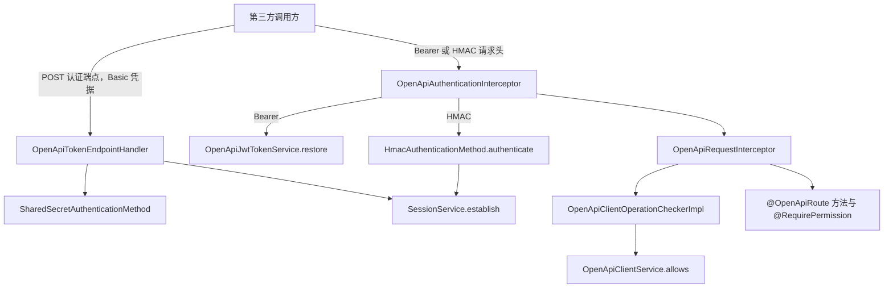

# OpenAPI 外部调用

本页涵盖 OpenAPI 模块的 Client 凭据、Token 端点、HMAC 签名、请求体缓存、APPLICATION 主体与失败结果。本页适用于需要向第三方开放接口的开发者。读完后，开发者能选择认证方式、声明开放路由，并判断调用失败的原因。接入步骤见 [开放 API 教程](/tutorials/external-api)。

## 概念

OpenAPI 外部调用让第三方程序使用自己的 Client 凭据访问具体应用声明的路由。每个 Client 对应一个 APPLICATION Subject 和一个 IAM Account，并由 `openapi_client_operation` 表保存显式开放给该 Client 的 Operation 子集。

Client 只能调用同时满足两个条件的路由：路由由 `@OpenApiRoute` 声明，且路由的 Operation 已开放给该 Client。OpenAPI 模块不引入第二套认证和权限机制，路由上的 `@RequirePermission` 与内部接口使用同一条 Operation 判断链。

调用方通过两种方式证明身份。

- Bearer Token：先调用 Token 端点，使用 Client Credentials 流程换取令牌。之后在 `Authorization` 请求头中携带 `Bearer` 令牌。
- HMAC 签名：每个请求携带 Client ID、时间戳、nonce 和签名四个请求头。

示例取自 `OpenApiRouteDefinitionTest` 的路由声明：

```java
@OpenApiRoute(method = RequestMethod.GET, path = "/openapi/devices/{deviceId}",
        toolGroup = "iot", toolName = "getDevice", operation = "iot:devices:read")
@RequirePermission(operation = "iot:devices:read")
```

该路由要求调用方同时通过 Client 的 Operation 检查和 Core 权限判断。`@RequirePermission` 的 `operation` 必须与 `@OpenApiRoute` 的 `operation` 相同。否则，`OpenApiRouteCatalog` 启动失败。



图中两条认证路径最终都通过 `call.authenticate` 写入认证结果。HMAC 路径先建立 Session。`OpenApiRequestInterceptor` 之后检查主体类型、Client 状态和 Operation 开放关系。Core 权限判断在 Controller 方法上执行。

## 核心对象

| 对象 | 负责 | 不负责 |
| --- | --- | --- |
| [OpenApiAuthenticationEndpoint](/javadoc/modules/openapi/sca4dj-openapi/com/sca4d/openapi/oauth/OpenApiAuthenticationEndpoint.html) | 保存应用选择的 Token 端点绝对路径 | 签发令牌 |
| [OpenApiTokenEndpointHandler](/javadoc/modules/openapi/sca4dj-openapi/com/sca4d/openapi/oauth/OpenApiTokenEndpointHandler.html) | 校验 `grant_type`、Basic 凭据、Client 状态、Account 状态和 Shared Secret，建立 Session，返回令牌响应 | 检查路由的 Operation |
| [OpenApiJwtTokenService](/javadoc/modules/openapi/sca4dj-openapi/com/sca4d/openapi/oauth/OpenApiJwtTokenService.html) | 启用时签发和恢复 HS256 OpenAPI JWT | 管理 Client 状态 |
| [OpenApiClientService](/javadoc/modules/openapi/sca4dj-openapi/com/sca4d/openapi/client/OpenApiClientService.html) | 创建 Client、替换 Operation 子集、修改 Client 状态，并提供 Client 查询 | 处理 HTTP 请求 |
| OpenApiClient 与 OpenApiClientStatus | 保存 Client ID、Account 标识、显示名称和 `ACTIVE`、`DISABLED` 状态 | 保存 Secret 或 MAC Key |
| [OpenApiAuthenticationInterceptor](/javadoc/modules/openapi/sca4dj-openapi/com/sca4d/openapi/web/OpenApiAuthenticationInterceptor.html) | 在 OpenAPI 路由上恢复 JWT，或验证 HMAC 并建立 Session | 检查 Operation 开放关系 |
| [OpenApiRequestInterceptor](/javadoc/modules/openapi/sca4dj-openapi/com/sca4d/openapi/web/OpenApiRequestInterceptor.html) | 要求 APPLICATION 主体，并调用 Operation 检查器 | 验证凭据 |
| [OpenApiClientOperationCheckerImpl](/javadoc/modules/openapi/sca4dj-openapi/com/sca4d/openapi/client/OpenApiClientOperationCheckerImpl.html) | 检查 Client 当前状态和目标 Operation 是否已开放 | 建立认证结果 |
| [OpenApiRequestBodyFilter](/javadoc/modules/openapi/sca4dj-openapi/com/sca4d/openapi/web/OpenApiRequestBodyFilter.html) | 为 OpenAPI 路径缓存请求体，使 HMAC 校验和 Controller 参数绑定都能读取请求体 | 校验签名 |

## Client 生命周期

`OpenApiClientService.create(...)` 按以下顺序创建 Client。

1. 校验每个请求的 Operation 已经由 `@OpenApiRoute` 声明，并且创建者 Session 的某个 Principal 已被授予该 Operation。
2. 校验认证方法为 `shared-secret` 或 `hmac`。
3. 创建 `SubjectType.APPLICATION` 类型的 Subject，并在 `openapi` 认证域中创建 Account。
4. 把创建者 Session 中的全部 Principal 关联到该 Account。
5. 保存 `ACTIVE` 状态的 Client 及其 Operation 子集。
6. 按认证方法签发 Secret 或 MAC Key，并随 `OpenApiClientCredentials` 一次性返回明文。

`replaceOperations(...)` 使用同样的 Operation 校验规则，替换 Client 的 Operation 子集。`changeStatus(...)` 修改 Client 的 `ACTIVE` 或 `DISABLED` 状态。

## Token 端点

具体应用通过 `OpenApiAuthenticationEndpoint.clientCredentials(path)` 声明端点。路径必须是非根绝对路径，不能以斜杠结尾，不能包含重复斜杠、`?` 或 `#`。该路径不要求位于 `sca4dj.openapi.path-prefix` 之下。

端点注册为 `POST`，接受 `application/x-www-form-urlencoded`，返回 `application/json`。

- 表单参数 `grant_type` 的值必须是 `client_credentials`。
- `Authorization` 请求头使用 HTTP Basic，用户名为 Client ID，密码为 Shared Secret。
- 响应字段为 `access_token`、`expires_in`（剩余秒数）、`scope` 和 `token_type`。`scope` 是 Client 开放的 Operation 编码，使用冒号格式并以空格分隔。`token_type` 固定为 `Bearer`。
- `sca4dj.openapi.jwt.enabled` 为 `false` 时，`access_token` 是 Session 的 access Token。为 `true` 时，`access_token` 是独立的 OpenAPI JWT。

签发前，端点依次检查 Client 是否存在、Client 是否为 `ACTIVE`、Client Account 是否可用，以及 Shared Secret 是否匹配。

## HMAC 签名

HMAC 请求使用四个请求头。头名称由下方配置决定，默认值如下。

| 请求头 | 内容 |
| --- | --- |
| `X-OpenApi-Client-Id` | Client ID |
| `X-OpenApi-Timestamp` | Unix 秒时间戳 |
| `X-OpenApi-Nonce` | 一次性随机数，长度 16 至 128，只能包含可打印 ASCII 字符 |
| `X-OpenApi-Signature` | HMAC-SHA256 签名的无填充 Base64URL 文本 |

签名输入由以下字段按顺序以换行分隔，并以 UTF-8 编码：固定前缀 `OPENAPI-HMAC-SHA256`、Client ID、大写的 HTTP 方法、路径、排序后的查询字符串、请求体 SHA-256 的十六进制文本、时间戳和 nonce。

查询字符串按 `&` 分隔后排序，再用 `&` 连接。

`HmacAuthenticationMethod` 为 Client 签发 32 字节 Base64URL 的 MAC Key。该 Key 只在创建 Client 的响应中返回一次。

验证顺序如下。

1. 时间戳与服务器时间的偏差超过 `sca4dj.auth.hmac.clock-skew` 时拒绝。
2. 同一 Account 的失败次数达到 `sca4dj.auth.hmac.failure-limit` 时拒绝。
3. nonce 被先行消费。即使随后签名校验失败，同一 nonce 也不能再次使用。
4. Credential 必须处于启用状态，且签名与 Key 计算结果一致。

请求体由 `OpenApiRequestBodyFilter` 处理。`Content-Length` 超过 8 MiB 时返回 HTTP 413，响应信息为「OpenAPI 请求体过大」。实际读取超过 8 MiB 时也返回 HTTP 413。

## 认证与路由检查顺序

`OpenApiAuthenticationInterceptor` 只处理带有 `@OpenApiRoute` 的方法。

- 请求带有 `Bearer` 请求头时，只尝试恢复 OpenAPI JWT，不尝试 HMAC。恢复失败时，该拦截器不设置认证结果，也不拒绝请求。
- 请求没有 `Bearer` 请求头，但带有任一 HMAC 请求头时，验证 HMAC 签名并建立 Session。
- `OpenApiRequestInterceptor` 要求调用已完成认证，且主体为 APPLICATION。不满足时返回错误码 `1001`。
- 主体检查通过后，`OpenApiClientOperationCheckerImpl` 查找当前 Account 对应的 Client。Client 不存在、Client 为 `DISABLED`，或目标 Operation 未开放给该 Client 时，返回错误码 `1002`。
- 之后，方法上的 `@RequirePermission` 在 Session 静态资源中判断同一 Operation。

JWT 恢复时不读取 Client 状态。因此，Client 被停用后，已签发的 Token 在下一次路由检查时返回 `1002`，直到令牌过期。

## 配置

以下配置类由 `OpenApiProperties` 绑定，HMAC 配置由 `HmacProperties` 绑定。`OpenApiConstants` 的名称在进程启动时固定。

| 配置键 | 默认值 | 作用 |
| --- | --- | --- |
| `sca4dj.openapi.path-prefix` | `/openapi` | `@OpenApiRoute` 路径和 HMAC 路径的必需前缀 |
| `sca4dj.openapi.hmac.headers.client-id` | `X-OpenApi-Client-Id` | Client ID 请求头名称 |
| `sca4dj.openapi.hmac.headers.timestamp` | `X-OpenApi-Timestamp` | 时间戳请求头名称 |
| `sca4dj.openapi.hmac.headers.nonce` | `X-OpenApi-Nonce` | nonce 请求头名称 |
| `sca4dj.openapi.hmac.headers.signature` | `X-OpenApi-Signature` | 签名请求头名称 |
| `sca4dj.openapi.jwt.enabled` | `false` | 是否签发和接受独立的 OpenAPI JWT |
| `sca4dj.openapi.jwt.active-key-id` | 无 | 当前签发密钥的标识，启用时必须存在于 `keys` 中 |
| `sca4dj.openapi.jwt.keys` | 空映射 | 密钥标识到 Base64 HS256 密钥的映射，解码后至少 32 字节 |
| `sca4dj.openapi.jwt.issuer` | 无 | JWT `iss`，启用时必须非空 |
| `sca4dj.openapi.jwt.audience` | 无 | JWT `aud`，启用时必须非空 |
| `sca4dj.openapi.jwt.access-ttl` | 5 分钟 | JWT 有效期，必须大于零 |
| `sca4dj.openapi.jwt.max-token-length` | `6144` | JWT 最大字符数，必须大于零 |
| `sca4dj.auth.hmac.clock-skew` | 5 分钟 | HMAC 时间戳允许的偏差 |
| `sca4dj.auth.hmac.nonce-ttl` | 10 分钟 | nonce 的保留时间 |
| `sca4dj.auth.hmac.failure-window` | 1 分钟 | HMAC 失败计数的统计窗口 |
| `sca4dj.auth.hmac.failure-limit` | `10` | 窗口内达到该失败次数后，拒绝该 Account 的 HMAC 请求 |

## 限制与失败结果

| 位置 | 条件 | 结果 |
| --- | --- | --- |
| Token 端点 | `grant_type` 不是 `client_credentials` | `AUTHENTICATION_FAILED`，错误码 `2100` |
| Token 端点 | Basic 请求头不以 `Basic ` 开头、无法解码或缺少分隔冒号 | `2100` |
| Token 端点 | Client ID 不存在、Client 为 `DISABLED`，或 Client Account 不可用 | `2100` |
| Token 端点 | Shared Secret 不匹配 | `SharedSecretErrorCode.REJECTED`，错误码 `2800`，`OpenApiTokenEndpointHandler` 不转换该异常 |
| Token 端点 | 缺少 `grant_type` 参数或 `Authorization` 请求头 | Spring MVC 参数绑定处理，本模块不转换 |
| Bearer 令牌 | 签名、时间、受众、issuer、Session 内容不合法，或 JWT 未启用 | 不设置 OpenAPI 认证结果；若后续认证也未建立认证结果，路由检查返回 `1001` |
| HMAC 请求头 | 缺少任一头，头为空白，或首尾带空白 | `2100` |
| HMAC 请求头 | 时间戳不是整数，或 nonce 格式不合法 | `2100` |
| HMAC 签名 | 时间偏差超限、失败次数超限、nonce 已使用、签名不匹配或 Credential 不可用 | `HmacErrorCode.REJECTED`，错误码 `1200`，由 OpenAPI 认证拦截器转换为 `2100` |
| 路由检查 | 调用主体不是 APPLICATION，或未完成认证 | `1001` |
| 路由检查 | Client 不存在、Client 为 `DISABLED`，或 Operation 未开放 | `1002` |
| 请求体 | `Content-Length` 或实际读取超过 8 MiB | HTTP 413，信息为「OpenAPI 请求体过大」 |
| 启动 | `@OpenApiRoute` 路径不在 `path-prefix` 之下、路由重复，或缺少相同 Operation 的 `@RequirePermission` | `IllegalArgumentException` 或 `IllegalStateException` |
| 启动 | JWT 启用但缺少 issuer、audience 或有效的 active key，密钥不是合法 Base64 或少于 32 字节 | `IllegalStateException` 或 `OpenapiException` |
| 启动 | 认证端点路径不是合法的非根绝对路径 | `IllegalArgumentException` |
| Client 管理 | 认证方法不是 `shared-secret` 或 `hmac`，或请求的 Operation 不是 OpenAPI 路由，或创建者没有该权限 | `IllegalArgumentException` |

调用方收到 `2100` 时，应检查 Client ID、Secret、MAC 签名和时间戳，不应重复使用同一 nonce。令牌过期后，调用方应重新执行 Token 交换。

收到 `1002` 时，应检查 Client 状态和 Operation 开放关系，不应重复提交同一请求。

## 示例

下例让第三方程序读取工作区中的文档。应用先提供 Token 端点，再声明受保护的路由，最后由管理接口创建 Client。

声明 Token 端点。应用提供 `OpenApiAuthenticationEndpoint` Bean 后，模块才注册 Token 端点和相关处理器。

```java
@Configuration
public class WorkspaceOpenApiConfiguration {

    @Bean
    OpenApiAuthenticationEndpoint openApiAuthenticationEndpoint() {
        return OpenApiAuthenticationEndpoint.clientCredentials("/oauth/token");
    }
}
```

声明开放路由。`@OpenApiRoute` 的 `operation` 与 `@RequirePermission` 的 `operation` 必须相同，路径必须位于 `sca4dj.openapi.path-prefix` 之下。

```java
@RestController
public class WorkspaceDocumentOpenApiController {

    private final DocumentService documents;

    public WorkspaceDocumentOpenApiController(DocumentService documents) {
        this.documents = documents;
    }

    @OpenApiRoute(method = RequestMethod.GET, path = "/openapi/documents/{documentId}",
            toolGroup = "workspace", toolName = "getDocument", operation = "WORKSPACE:DOCUMENTS:READ")
    @RequirePermission(operation = "WORKSPACE:DOCUMENTS:READ")
    public DocumentView getDocument(@PathVariable long documentId) {
        return documents.view(documentId);
    }
}
```

创建 Client。创建者 Session 必须已经拥有请求开放的 Operation。明文凭据只在返回值中出现一次。

```java
OpenApiClientCredentials credentials = clientService.create(
        session,
        "文档同步程序",
        List.of("WORKSPACE:DOCUMENTS:READ"),
        "shared-secret");
String clientId = credentials.client().clientId();
String secret = credentials.secret();
```

调用方使用 `clientId` 和 `secret` 作为 HTTP Basic 凭据，向 `/oauth/token` 提交 `grant_type=client_credentials`。随后在 `Authorization: Bearer <access_token>` 请求头中调用 `/openapi/documents/{documentId}`。

## 扩展方式

- 应用提供 `OpenApiAuthenticationEndpoint` Bean 后，`OpenApiAutoConfiguration` 才注册 Token 端点处理器和端点注册器，条件为 `@ConditionalOnBean(OpenApiAuthenticationEndpoint.class)`。应用不提供该 Bean 时，不开放 Token 交换，只能使用 HMAC。
- 新增开放路由时，在 Controller 方法上声明 `@OpenApiRoute` 和相同 Operation 的 `@RequirePermission`。`OpenApiRouteCatalog` 在启动时收集并校验这些方法。
- 新的 Operation 需要先进入 OperationCatalog。声明方式见 [Operation 与权限声明](/capabilities/identity-access/operation-declaration)。
- 创建 Client 只支持 `shared-secret` 和 `hmac` 两种认证方法。

## 相关页面

- [开放 API 教程](/tutorials/external-api)：声明端点、路由，创建 Client 并发起请求的步骤。
- [Operation 与权限声明](/capabilities/identity-access/operation-declaration)：Operation 编码、目录和 `@RequirePermission` 的规则。
- [认证方式](/capabilities/authentication-session/authentication-methods)：Shared Secret 与 HMAC 认证方法的概念。
- [身份与访问](/capabilities/identity-access/)：Subject、Account、Principal 和 APPLICATION 主体的关系。
