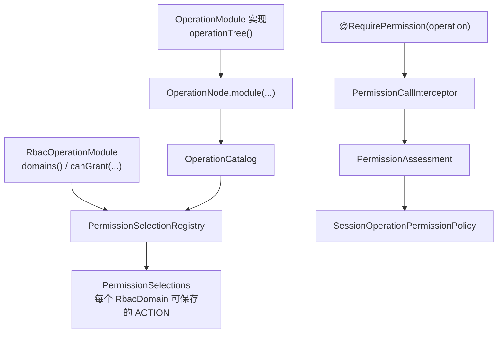

# Operation 与权限声明

本页涵盖 Operation 的编码规则、业务模块如何声明 Operation 目录、哪些 Operation 可以授予 RBAC 角色，以及 `@RequirePermission` 如何引用 Operation。本页适用于新增受保护接口、消息处理方法或 RBAC 业务模块的开发者。读完后，开发者能够为新模块声明 OperationModule 和 RbacOperationModule，并为受保护方法写出 `@RequirePermission`。

## 概念

Operation 是权限判断和审计使用的固定业务入口。[Operation](/javadoc/core/sca4dj-core-api/com/sca4d/core/api/permission/Operation.html) 实现 Resource，资源类型为 `CORE/OPERATIONS`。因此，固定入口的权限与业务对象权限都由 Permission 表示。Operation 编码由 `module:resource:action` 三段组成，例如 `PLATFORM:ROLES:READ`。Operation 实现 Resource，固定接口入口与业务对象使用同一种 Permission 结构；目录在启动时一次性校验，角色只保存目录中已经存在的 Action。

编码不直接手写，而是由模块锚点、资源段和动作段展开。[PlatformOperations](/javadoc/modules/iam/sca4dj-iam/com/sca4d/iam/base/rbac/PlatformOperations.html) 声明模块锚点 `PLATFORM`、资源段 `ROLES` 和动作段 `Action.READ`，展开得到 `PLATFORM:ROLES:READ`。同一字符串也保存在常量 `ROLES_READ_VALUE` 中，供注解引用。

Operation 与其他对象的协作顺序如下：

1. 模块实现 OperationModule，返回目录。
2. OperationCatalog 收集全部模块。
3. RbacOperationModule 声明可以授予的 RBAC 领域。
4. PermissionSelectionRegistry 按领域汇总可保存的 Operation。
5. 受保护方法使用 `@RequirePermission` 引用编码，由权限调用拦截器判断。

## 核心对象

| 对象 | 负责 | 不负责 |
| --- | --- | --- |
| [OperationModule](/javadoc/core/sca4dj-core-api/com/sca4d/core/api/permission/OperationModule.html) | 通过 `operationTree()` 返回以模块锚点为根的完整目录 | 判断 Principal 是否拥有某个 Operation |
| [OperationNode](/javadoc/core/sca4dj-core-api/com/sca4d/core/api/permission/OperationNode.html) | 表示 MODULE、RESOURCE 和 ACTION 三层节点；`OperationNode.module(...)` 展开局部段 | 保存运行时授权数据 |
| [OperationCatalog](/javadoc/core/sca4dj-core-api/com/sca4d/core/api/permission/OperationCatalog.html) | 汇总全部模块，校验完整编码唯一，提供 ACTION 查询和编码指纹 | 决定某个 Operation 可以授予哪个 RBAC 领域 |
| [RbacOperationModule](/javadoc/modules/iam/sca4dj-iam/com/sca4d/iam/rbac/RbacOperationModule.html) | 通过 `domains()` 声明参与的 RBAC 领域，通过 `canGrant(...)` 决定单个 Operation 的授予范围 | 保存角色、角色权限或 Principal 角色关系 |
| PermissionSelectionRegistry | 构造时校验 RBAC 模块与 OperationCatalog 一致，并按领域汇总可保存的 ACTION | 读取或保存角色数据 |
| [@RequirePermission](/javadoc/core/sca4dj-core-api/com/sca4d/core/api/annotation/RequirePermission.html) | 在方法或类型上声明一个固定操作、资源表达式或资源解析器 | 执行判断；判断由权限调用拦截器完成 |

## 声明顺序



图中前三步发生在应用启动时。`OperationCatalog` 和 `PermissionSelectionRegistry` 在构造时完成全部校验。任何声明错误都会阻止应用启动。

`@RequirePermission` 的判断发生在方法调用时。`SessionOperationPermissionPolicy` 使用调用绑定的 Session 静态资源，判断固定操作。

## 目录展开规则

- 模块锚点和 RESOURCE 局部段必须是单个节点，且不能是 `*`。违反时，`OperationNode.module(...)` 抛出 `IllegalArgumentException`。
- 同一模块内 RESOURCE 编码或 ACTION 编码重复时，`OperationNode.module(...)` 抛出 `IllegalArgumentException`。
- 不同模块的完整节点编码重复时，`OperationCatalog` 构造失败，抛出 `IllegalArgumentException`。
- `nameKey` 保存名称消息键。
- `sortOrder` 决定同级节点的顺序。排序值相同时，按编码排序。
- 只有 ACTION 是可以直接授予角色的具体 Operation。`OperationCatalog.actionByCode(...)` 对未知编码或非 ACTION 编码抛出 `IllegalArgumentException`。
- `OperationCatalog.fingerprint()` 只由具体 ACTION 编码计算。显示名称、排序值和模块登记顺序的变化，不改变指纹。

## RBAC 授予范围

- `domains()` 必须返回至少一个 RbacDomain。否则 PermissionSelectionRegistry 构造失败。
- `canGrant(domain, operation)` 默认对 `domains()` 中的全部领域返回 `true`。同一模块内不同 Operation 的授予范围不同时，覆盖该方法。
- 每个 ACTION 至少要被一个领域允许。否则 PermissionSelectionRegistry 构造失败，抛出 `IllegalStateException`。
- RBAC 模块集合必须与 OperationCatalog 的模块集合完全一致。缺少或多出任一模块时，构造失败，抛出 `IllegalStateException`。
- 管理接口只能保存目录中声明的具体 Operation。角色与领域、RbacScope 的关系见 [权限模型](/capabilities/identity-access/permission-models)。

## @RequirePermission 的作用

- `operation`、`resource` 和 `resolver` 三者必须且只能声明一个。
- 固定操作使用 `operation`。`action` 缺省时使用 `Action.INVOKE`。`SessionOperationPermissionPolicy` 只接受 `INVOKE`。
- 动态资源使用 `resource` 或 `resolver`。动态资源必须显式声明 `action`。
- 同一方法或类型上的多个声明（包括 `@RequirePermission` 重复声明）全部必须允许。任一 Permission 被拒绝时，调用失败。
- 同一 Permission 在一次调用中只判断一次，结果保存在当前 Call 中。
- `resolver` 必须返回非空的 `Collection<Resource>`。集合中的每个元素都会生成一个 Permission。
- `resource` 表达式返回集合时，每个元素生成一个 Permission。返回单个值时，生成一个 Permission。返回正整数或非空文本标识时，必须同时声明 `resourceType`。返回完整 Resource 时不需要。

## 主体限制

- SYSTEM：`Subject.SYSTEM` 由启动配置发布 ID。`IdentityService.createSubject(SubjectType.SYSTEM)` 和 `createAccount(...)` 对 SYSTEM 抛出 `IllegalArgumentException`。SYSTEM 不使用登录 Account。

  系统调用由 `Call.system(...)` 建立，不调用 `authenticate`，因此没有 Session。`Call.grants(...)` 在没有 Session 时返回 `false`，固定操作的权限判断拒绝该调用。源码中未定义系统调用通过其他途径获得固定操作权限的机制。
- APPLICATION：APPLICATION 主体由 OpenAPI Client 创建。`@OpenApiRoute` 路由只接受 APPLICATION 主体，并要求路由声明的 `operation` 已开放给该 Client。细节见 [OpenAPI 外部调用](/capabilities/identity-access/openapi-client)。

## 限制与失败结果

| 位置 | 条件 | 结果 |
| --- | --- | --- |
| `OperationNode.module(...)` | 锚点或 RESOURCE 段不是单个节点，或包含 `*` | `IllegalArgumentException` |
| `OperationNode.module(...)` | 同一模块内 RESOURCE 或 ACTION 编码重复 | `IllegalArgumentException` |
| `OperationCatalog` 构造 | 模块返回空目录 | `NullPointerException` |
| `OperationCatalog` 构造 | 不同模块的完整节点编码重复 | `IllegalArgumentException` |
| `OperationCatalog.actionByCode(...)` | 编码未知或不是 ACTION | `IllegalArgumentException` |
| PermissionSelectionRegistry 构造 | 模块锚点重复、领域为空、ACTION 没有任何可授予领域，或 RBAC 模块与 Catalog 模块不一致 | `IllegalStateException` |
| `@RequirePermission` 解析 | `operation`、`resource`、`resolver` 未恰好声明一个 | `IllegalStateException` |
| `@RequirePermission` 解析 | 动态资源未声明 `action` | `IllegalStateException` |
| `@RequirePermission` 解析 | 动态解析器返回空集合，或返回值不是 Collection | `IllegalStateException` |
| 固定操作判断 | `action` 不是 `INVOKE` | `IllegalStateException` |
| 权限判断 | 任一 Permission 被拒绝 | `BusinessException`，错误码 `1002`（`PERMISSION_DENIED`） |
| 权限判断 | 尚未完成 Principal 选择 | `IllegalStateException` |
| 认证前提 | 方法需要权限但调用未认证 | `BusinessException`，错误码 `1001`（`AUTHENTICATION_REQUIRED`） |
| 注解组合 | 同一方法同时声明匿名访问和权限 | `IllegalStateException` |

启动期抛出的异常表示声明错误，应修正模块目录或注解后重新启动。调用期的 `1002` 表示当前 Principal 没有目标 Operation 或资源权限。调用方应按错误码判断，不依赖异常消息文本。

## 配置

本主题没有独立的配置类或配置键。

## 示例

下例为「工作区文档」模块声明 Operation，并让 Controller 引用它们。模块锚点为 `WORKSPACE`，资源段为 `DOCUMENTS`，动作段为 `READ` 和 `MANAGE`，展开后得到 `WORKSPACE:DOCUMENTS:READ` 和 `WORKSPACE:DOCUMENTS:MANAGE`。

```java
public class WorkspaceOperations implements RbacOperationModule {

    public static final String DOCUMENTS_READ_VALUE = "WORKSPACE:DOCUMENTS:READ";

    public static final String DOCUMENTS_MANAGE_VALUE = "WORKSPACE:DOCUMENTS:MANAGE";

    public static final RbacDomain WORKSPACE_DOMAIN = new RbacDomain("WORKSPACE");

    @Override
    public OperationNode.Module operationTree() {
        return OperationNode.module(
                TreeCode.ofSegment("WORKSPACE"),
                "operation.workspace",
                100,
                OperationNode.resource(
                        TreeCode.ofSegment("DOCUMENTS"),
                        "operation.workspace.documents",
                        100,
                        OperationNode.action(Action.READ.code(), "operation.workspace.documents.read", 100),
                        OperationNode.action(Action.MANAGE.code(), "operation.workspace.documents.manage", 200)));
    }

    @Override
    public Set<RbacDomain> domains() {
        return Set.of(WORKSPACE_DOMAIN);
    }
}
```

`WORKSPACE_DOMAIN` 需要有对应的 RbacRepository，声明方式见[权限模型](/capabilities/identity-access/permission-models)。

把模块注册为 Spring Bean。

```java
@Configuration
public class WorkspaceOperationConfiguration {

    @Bean
    WorkspaceOperations workspaceOperations() {
        return new WorkspaceOperations();
    }
}
```

Controller 使用常量引用 Operation。

```java
@RestController
public class WorkspaceDocumentController {

    @GetMapping("/workspaces/{workspaceId}/documents")
    @RequirePermission(operation = WorkspaceOperations.DOCUMENTS_READ_VALUE)
    public List<DocumentView> list(@PathVariable long workspaceId) {
        return documentService.list(workspaceId);
    }

    @PutMapping("/workspaces/{workspaceId}/documents/{documentId}")
    @RequirePermission(operation = WorkspaceOperations.DOCUMENTS_MANAGE_VALUE)
    public void update(@PathVariable long workspaceId, @PathVariable long documentId,
            @RequestBody DocumentUpdateRequest request) {
        documentService.update(workspaceId, documentId, request);
    }
}
```

某个 Operation 只能授予部分领域时，覆盖 `canGrant(domain, operation)`。下例假设模块的 `domains()` 同时返回 `WORKSPACE_DOMAIN` 和 `AUDITOR_DOMAIN`，且 `DOCUMENTS_MANAGE` 不授予 `AUDITOR_DOMAIN`。

```java
private static final TreeCode DOCUMENTS_MANAGE = TreeCode.ofColon(DOCUMENTS_MANAGE_VALUE);

@Override
public boolean canGrant(RbacDomain domain, Operation operation) {
    if (!domains().contains(domain)) {
        return false;
    }
    return !(AUDITOR_DOMAIN.equals(domain) && DOCUMENTS_MANAGE.equals(operation.code()));
}
```

## 扩展方式

- 业务模块实现 OperationModule 或 RbacOperationModule，并注册为 Spring Bean。`CorePermissionConfiguration` 以 `List<OperationModule>` 收集全部模块，构造 OperationCatalog。
- `IamAutoConfiguration` 以 `List<RbacOperationModule>` 收集参与 RBAC 的模块，构造 PermissionSelectionRegistry。
- 校验在构造阶段完成。编码重复、领域为空、ACTION 无可授予领域，或两个集合的模块不一致时，应用启动失败。
- 不需要修改 IAM 或 Core。新增模块只需增加 Bean。

## 相关页面

- [权限开发规则](/capabilities/identity-access/permission-development)：Controller 与数据访问的开发规则。
- [权限模型](/capabilities/identity-access/permission-models)：RBAC 与 ACL、ABAC 的数据模型和缓存。
- [权限判断与授权数据](/capabilities/identity-access/authorization)：Session 静态资源与权限判断的运行时关系。
- [Principal 选择](/capabilities/identity-access/principal-selection)：权限判断前的业务主体选择。
- [OpenAPI 外部调用](/capabilities/identity-access/openapi-client)：APPLICATION 主体与开放路由。
- [接入身份与权限](/tutorials/identity-and-permission)：按步骤接入权限声明的教程。
