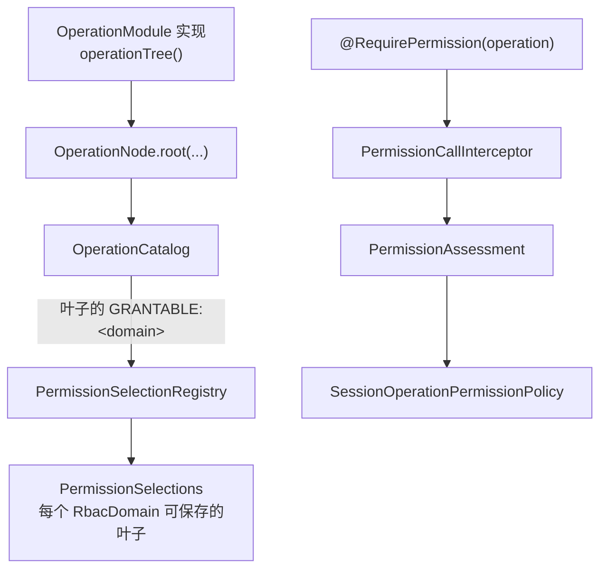

# Operation 与权限声明

本页涵盖 Operation 的编码规则、业务模块如何声明 Operation 目录、哪些 Operation 可以授予 RBAC 角色，以及 `@RequirePermission` 如何引用 Operation。本页适用于新增受保护接口、消息处理方法或 RBAC 业务模块的开发者。读完后，开发者能够为新模块声明 OperationModule 和叶子的 `GRANTABLE` 属性，并为受保护方法写出 `@RequirePermission`。

## 概念

Operation 是权限判断和审计使用的固定业务入口。[Operation](/javadoc/core/sca4dj-core-api/com/sca4d/core/api/permission/Operation.html) 实现 Resource，资源类型为 `CORE/OPERATIONS`。因此，固定入口的权限与业务对象权限都由 Permission 表示。Operation 目录是一棵深度不限的树：分组节点（Group）可以包含子分组和叶子（Leaf），可以授予角色的只有叶子。叶子编码由从根分组到叶子的全部节点用冒号连接，最后一段是动词（`Action`），例如 `PLATFORM:ROLES:READ` 的动词是 `READ`，`ORDERS:INVOICES:LINES:READ` 有四段。Operation 实现 Resource，固定接口入口与业务对象使用同一种 Permission 结构；目录在启动时一次性校验，角色只保存目录中已经存在的叶子。

编码不直接手写，而是由根分组锚点、各层分组段和动词展开。[PlatformOperations](/javadoc/modules/iam/sca4dj-iam/com/sca4d/iam/base/rbac/PlatformOperations.html) 声明根分组锚点 `PLATFORM`、分组段 `ROLES` 和动词 `Action.READ`，展开得到 `PLATFORM:ROLES:READ`。

Operation 的编码使用 [OperationCode](/javadoc/core/sca4dj-core-api/com/sca4d/core/api/permission/OperationCode.html) 类型，不使用裸 `TreeCode`。`OperationCode` 至少有两个节点，总长度不超过 128 字符，这个长度是目录深度的唯一上限。`verb()` 返回最后一个节点，`isWildcard()` 判断最后一个节点是否为 `*`。通配符节点 `*` 只能出现在最后一段，用于表示某个分组下的全部访问入口，通过 `OperationNode.wildcardLeaf(...)` 声明；其他位置出现 `*` 时抛出 `IllegalArgumentException`。`OperationCode` 与节点相同的 `TreeCode` 不相等，需要跨类型比较时使用 `sameCode(...)`。资源类型、Permission 动作和 Attribute 可以是任意编码，继续使用 `TreeCode`。

Operation 与其他对象的协作顺序如下：

1. 模块实现 OperationModule，返回目录。
2. OperationCatalog 收集全部模块。
3. 叶子用 `GRANTABLE:<domain>` 属性声明可以授予的 RBAC 领域。
4. PermissionSelectionRegistry 读取 OperationCatalog 叶子上的 `GRANTABLE` 属性，按领域汇总可保存的 Operation。
5. 受保护方法使用 `@RequirePermission` 引用编码，由权限调用拦截器判断。

## 编码的唯一来源

每个业务模块的 Operation 编码只手写一次：

- 注解参数必须是编译期常量，因此每个 Operation 保留一个 `String` 常量，命名为 `X_VALUE`，它是唯一手写的编码文本，例如 `ROLES_READ_VALUE = "PLATFORM:ROLES:READ"`。
- 代码中传递的 `OperationCode` 常量由它构造，命名为去掉 `_VALUE` 的 `X`，例如 `ROLES_READ = new OperationCode(ROLES_READ_VALUE)`。
- `operationTree()` 中的根分组锚点、分组段和自定义动词从这些 `OperationCode` 常量取得，或使用 `Action` 提供的通用动词，不再重复手写同一段文本。

`@RequirePermission(operation = ...)` 的文本是否存在于目录，在应用启动时检查，见下文「启动期校验」。

## 核心对象

| 对象 | 负责 | 不负责 |
| --- | --- | --- |
| [OperationModule](/javadoc/core/sca4dj-core-api/com/sca4d/core/api/permission/OperationModule.html) | 通过 `operationTree()` 返回以根分组锚点为根的完整目录 | 判断 Principal 是否拥有某个 Operation |
| [OperationNode](/javadoc/core/sca4dj-core-api/com/sca4d/core/api/permission/OperationNode.html) | 表示任意深度的分组（`Group`）和叶子（`Leaf`）；`OperationNode.root(...)`、`group(...)`、`leaf(...)` 和 `wildcardLeaf(...)` 声明局部段并展开完整编码 | 保存运行时授权数据 |
| [OperationCode](/javadoc/core/sca4dj-core-api/com/sca4d/core/api/permission/OperationCode.html) | 表示一个 Operation 的固定编码，校验节点数、长度和通配符位置 | 表示资源类型、Permission 动作或 Attribute |
| [OperationCatalog](/javadoc/core/sca4dj-core-api/com/sca4d/core/api/permission/OperationCatalog.html) | 汇总全部模块和属性轴，校验完整编码唯一和叶子属性，提供叶子查询、属性查询和编码指纹 | 决定某个 Operation 可以授予哪个 RBAC 领域 |
| [Attribute](/javadoc/core/sca4dj-core-api/com/sca4d/core/api/name/code/Attribute.html) | 表示叶子携带的一个固定属性值，例如 `INTENT:READ` | 参与指纹计算，或单独决定授权结果 |
| [OperationAxes](/javadoc/core/sca4dj-core-api/com/sca4d/core/api/permission/OperationAxes.html) | 定义标准轴 `INTENT`、`NATURE`、`RISK`、`VISIBILITY` 及其常用属性值 | 保存叶子；检查约束由 `OperationCatalog` 完成 |
| [AttributeAxis](/javadoc/core/sca4dj-core-api/com/sca4d/core/api/name/code/AttributeAxis.html) | 保存属性轴的轴根和取值约束 `AttributeConstraint`，判断属性是否位于轴根之下 | 检查叶子是否满足约束；检查由 `OperationCatalog` 构造时完成 |
| [RbacGrantable](/javadoc/modules/iam/sca4dj-iam/com/sca4d/iam/rbac/RbacGrantable.html) | 定义 `GRANTABLE` 轴；`of(domain)` 生成叶子声明使用的 `GRANTABLE:<domain>`，`domainsOf(leaf)` 读出叶子声明的领域 | 保存角色、角色权限或 Principal 角色关系 |
| PermissionSelectionRegistry | 构造时读取 OperationCatalog 叶子上的 `GRANTABLE` 属性，按领域汇总可保存的叶子 | 读取或保存角色数据 |
| [@RequirePermission](/javadoc/core/sca4dj-core-api/com/sca4d/core/api/annotation/RequirePermission.html) | 在方法或类型上声明一个固定操作、资源表达式或资源解析器 | 执行判断；判断由权限调用拦截器完成 |
| RequiredOperationDeclarationVerifier | 应用启动后检查 Controller 上 `@RequirePermission` 的固定 `operation` 文本都存在于 OperationCatalog | 检查 `resolver`、`resource` 动态声明，或 `@Audit` 等其他注解 |

## 声明顺序



图中前两步发生在应用启动时。`OperationCatalog` 和 `PermissionSelectionRegistry` 在构造时完成全部校验。任何声明错误都会阻止应用启动。

## 启动期校验

存在 Spring MVC 路由的应用，在全部 Controller 创建完成后，由 `RequiredOperationDeclarationVerifier` 检查权限注解：

- 扫描每个处理方法，以及它所在的 Controller 类上的 `@RequirePermission` 和 `@RequirePermissions`，包括重复声明的每一项。
- 对每个非空白的 `operation` 文本，检查它是合法的 `OperationCode`，并且 `OperationCatalog` 中存在对应的叶子。
- 任一文本不合法或不在目录中时，应用启动失败，抛出 `IllegalStateException`。消息按 `类#方法 -> 文本` 逐行列出全部缺失项；类级声明只列出类名。
- 只检查固定的 `operation`。`resolver`、`resource` 动态声明和 `@Audit` 不在检查范围内。
- 没有 Spring MVC 路由的应用不创建该检查器。

`@RequirePermission` 的判断发生在方法调用时。`SessionOperationPermissionPolicy` 使用调用绑定的 Session 静态资源，判断固定操作。

## 目录展开规则

- 根分组锚点和每层分组局部段必须是单个节点，且不能是 `*`。违反时，`OperationNode.root(...)` 或 `OperationNode.group(...)` 抛出 `IllegalArgumentException`。
- 一个分组的直接子节点可以是子分组、叶子或两者混合。同一父分组下两个子节点的完整编码相同时，`OperationNode.root(...)` 抛出 `IllegalArgumentException`，分组与叶子同名也算重复。
- 叶子的动词是任意 `Action`；`*` 只能通过 `OperationNode.wildcardLeaf(...)` 声明，且得到的叶子是该分组的最后一段。
- 完整编码超过 128 字符时，叶子展开失败，抛出 `IllegalArgumentException`。
- 不同模块的完整节点编码重复（包括两个模块使用相同的根分组锚点）时，`OperationCatalog` 构造失败，抛出 `IllegalArgumentException`。
- 每个分组和叶子都有一个 `Display`，保存名称消息键和说明消息键。声明时不写消息键，`Display` 按完整编码推导，见[显示键](#显示键)。
- `sortOrder` 决定同级节点的顺序，根分组之间也按它排序。排序值相同时，按编码排序。`OperationCatalog.tree()` 的每一层都遵循这个顺序。
- 只有叶子是可以直接授予角色的具体 Operation。`OperationCatalog.leafByCode(...)` 对未知编码或分组编码抛出 `IllegalArgumentException`。`leaves()` 按深度优先、同级排序后的顺序返回全部叶子。
- `OperationCatalog.tree(operations)` 返回只含指定 Operation 的目录投影，没有匹配叶子的分组在任意深度都被移除。
- `OperationCatalog.fingerprint()` 只由具体叶子编码计算。显示名称、排序值、属性、叶子依赖、分组层级和模块登记顺序的变化，不改变指纹。

## 显示键

分组和叶子通过 `display()` 返回 [Display](/javadoc/core/sca4dj-core-api/com/sca4d/core/api/name/Display.html)，它保存名称消息键 `nameKey()` 和说明消息键 `descriptionKey()`，文本由应用的 i18n 资源提供。

- **默认推导**：声明不写 `Display` 时，名称消息键为 `operation.` 加编码每个节点的小写形式，节点中的 `_` 换成 `-`，通配节点 `*` 写成 `all`，用 `.` 连接。例如 `ORDERS:INVOICE_LINES:READ` 的名称消息键是 `operation.orders.invoice-lines.read`，`ORDERS:ACCESS:*` 的是 `operation.orders.access.all`，根分组 `ORDERS` 的是 `operation.orders`。
- **说明消息键**：固定为名称消息键加 `.description`，没有单独指定的入口。
- **覆盖**：推导结果与已有的资源键不同时，在 `root`、`group`、`leaf`、`wildcardLeaf` 带 `Display` 的重载里传入 `Display.of(nameKey)`；说明消息键随之变为 `nameKey + ".description"`。例如 `OperationNode.leaf(Action.READ, Display.of("operation.orders.list"), 100, ...)`。
- **范围**：`Display` 只保存键，不检查资源中是否存在对应文本；`OperationCatalog` 也不检查。需要保证每个叶子都有文本的应用，在测试中用 `leaf.display().nameKey()` 和 `leaf.display().descriptionKey()` 查找资源。`Display` 不参与 `fingerprint()`。

## 叶子依赖

一个叶子需要同时持有其他叶子才能完整使用时，在声明处用 `requires(...)` 写出被依赖叶子的完整 `OperationCode`：

```java
OperationNode.leaf(Action.UPDATE, 20, INTENT_UPDATE, NATURE_FUNCTION)
        .requires(ORDERS_INVOICES_READ)
```

- `leaf(...)` 和 `wildcardLeaf(...)` 返回的声明都支持 `requires(...)`。`requires(...)` 返回带依赖的新声明，再次调用会替换之前的依赖，重复编码只保留首次出现的一份。
- `OperationNode.Leaf.requires()` 返回声明的依赖编码，保持声明顺序，没有声明时为空，返回值不可修改。
- 依赖只按叶子逐个声明。脚手架不根据动词、分组、属性或编码后缀推导依赖，也没有默认依赖；需要默认规则的应用在自己的代码中读取目录后生成声明。
- `OperationCatalog` 构造时检查依赖：目标编码必须是目录中的叶子，不能依赖自身，也不能成环。违反时抛出 `IllegalArgumentException`，消息包含叶子编码和被依赖的编码。
- 依赖不参与 `fingerprint()`。本页不规定依赖在授权时如何使用，也不检查被依赖叶子是否属于同一个 RBAC 领域。

## 属性与属性轴

叶子可以在声明时携带 Attribute，说明它的读写意图、风险等固定事实。调用方用这些事实判断，不再从编码文本的后缀推断。

- **声明**：`OperationNode.leaf(verb, sortOrder, attributes...)` 和 `OperationNode.wildcardLeaf(sortOrder, attributes...)` 的末尾列出叶子的 Attribute。标准轴要求的 `INTENT` 和 `NATURE` 必须列出，其余属性按需列出。同一叶子重复声明同一个 Attribute 时抛出 `IllegalArgumentException`，任一 Attribute 为 `null` 时抛出 `NullPointerException`。
- **属性轴**：`AttributeAxis` 由轴根 Attribute 和 `AttributeConstraint` 组成。轴根下的严格后代都是这条轴的属性值，轴根自身不是属性值。`AttributeConstraint.OPTIONAL` 允许叶子在这条轴上携带 0 个或多个值，`AttributeConstraint.REQUIRED_EXCLUSIVE` 要求恰好一个值。
- **标准轴**：[OperationAxes](/javadoc/core/sca4dj-core-api/com/sca4d/core/api/permission/OperationAxes.html) 定义四条标准轴，`CorePermissionConfiguration` 已经把它们注册为 `AttributeAxis` Bean，每个应用和 IAM 模块都会得到：
  - `INTENT`（`REQUIRED_EXCLUSIVE`）说明叶子做什么：`INTENT:READ` 只读取，`INTENT:ACCESS` 授予整个范围的访问入口，`INTENT:WRITE:` 之下的值表示会改变数据或触发外部效果，包括 `CREATE`、`UPDATE`、`DELETE`、`OPERATE`、`EXPORT`、`IMPORT`、`ASSIGN`、`SEND`、`RESET`、`CONFIRM`、`FORCE` 和 `REVEAL`。这是开放词汇，应用可以在 `INTENT:WRITE` 下增加自己的动词，叶子不直接使用 `INTENT:WRITE` 自身。
  - `NATURE`（`REQUIRED_EXCLUSIVE`）说明授权的是什么：`NATURE:FUNCTION` 表示功能入口，`NATURE:DATA_SCOPE` 表示一个范围内的全部数据。
  - `RISK`（`OPTIONAL`）标出需要额外留意的后果。Core 只提供通用值 `RISK:IRREVERSIBLE`、`RISK:PRIVILEGE:ESCALATION`、`RISK:SCOPE:WIDENING`、`RISK:CREDENTIAL:DISCLOSURE` 和 `RISK:CREDENTIAL:MANAGEMENT`。只和某个应用有关的风险值由该应用在 `RISK` 之下自行增加。
  - `VISIBILITY`（`OPTIONAL`）说明叶子在授权编辑器目录中的展示。`VISIBILITY:UNLISTED` 表示不列入授权编辑器目录：叶子仍在 `OperationCatalog` 中，也可以被授予和判断，但授权编辑器的目录展示应当跳过它，并移除因此没有可见叶子的分组。

  所以所有叶子都必须声明且只声明一个 `INTENT` 值和一个 `NATURE` 值，否则 `OperationCatalog` 构造失败。`OperationAxes.Intent`、`OperationAxes.Nature` 和 `OperationAxes.Risk` 提供对应的 `Attribute` 常量。
- **登记**：应用需要标准轴以外的轴时，把它注册为 `AttributeAxis` Bean。`CorePermissionConfiguration` 收集容器中的全部 `AttributeAxis`（标准轴和应用自己的轴）并传给 `OperationCatalog`。直接用 `new OperationCatalog(modules, axes)` 构造目录时，由调用方决定传入哪些轴，`OperationAxes.standard()` 返回四条标准轴。
- **目录查询**：`leavesWith(attribute)` 返回携带与该值完全相同属性的叶子，`leavesUnder(attribute)` 返回携带该属性或其任一后代的叶子。二者都保持目录顺序。`axes()` 返回登记的属性轴。
- **叶子判断**：`has(attribute)` 判断是否携带完全相同的值，`hasUnder(attribute)` 判断是否携带该属性或其后代，`get(axis)` 返回该轴上的全部值，`only(axis)` 返回该轴上唯一的值。该轴没有值时 `only(axis)` 返回空，多于一个值时抛出 `IllegalStateException`。属性是固定编码，可以直接用在 `if` 中。
- **指纹**：属性不参与 `fingerprint()`。只修改属性不会使在线 Session 失效。

属性值同时是 [Attribute](/javadoc/core/sca4dj-core-api/com/sca4d/core/api/name/code/Attribute.html) 类型，与节点相同的 `TreeCode` 不相等，见[名称与应用隔离](/capabilities/foundation/name-and-isolation)。

## RBAC 授予范围

- 叶子用 `RbacGrantable.of(domain)` 生成的 `GRANTABLE:<domain>` 属性声明可以授予的 RbacDomain，可以声明多个。叶子只能授予它声明了属性的领域；没有声明任何 `GRANTABLE` 值的叶子不能授予任何领域，PermissionSelectionRegistry 构造失败，抛出 `IllegalStateException`。
- 领域集合是开放的：属性值由领域编码生成，PermissionSelectionRegistry 不需要预先知道有哪些领域，目录中出现过的领域就是已安装规则的领域。`GRANTABLE` 的值必须是 `GRANTABLE:<domain>` 两段形式，更深的值使构造失败。
- `GRANTABLE` 轴是 `OPTIONAL` 轴，由 `IamAutoConfiguration` 注册为 `AttributeAxis` Bean。直接用 `new OperationCatalog(modules, axes)` 构造目录时，调用方需要把 `RbacGrantable.GRANTABLE` 放进 `axes`，否则带有该属性的叶子使目录构造失败。
- 属性不参与 `fingerprint()`，所以修改叶子的 `GRANTABLE` 声明不改变目录指纹；授权缓存的指纹按各领域可授予的 Operation 编码单独计算，授予范围变化时会使旧缓存失效。
- 管理接口只能保存目录中声明的具体 Operation。角色与领域、RbacScope 的关系见 [权限模型](/capabilities/identity-access/permission-models)。

## @RequirePermission 的作用

- `operation`、`resource` 和 `resolver` 三者必须且只能声明一个。
- 固定操作使用 `operation`。`action` 缺省时使用 `Action.INVOKE`。`SessionOperationPermissionPolicy` 只接受 `INVOKE`。
- 动态资源使用 `resource` 或 `resolver`。动态资源必须显式声明 `action`。
- 同一方法或类型上的多个声明（包括 `@RequirePermission` 重复声明）全部必须允许。任一 Permission 被拒绝时，调用失败。
- 同一 Permission 在一次调用中只判断一次，结果保存在当前 Call 中。
- `resolver` 必须返回非空的 `Collection<Resource>`。集合中的每个元素都会生成一个 Permission。
- `resource` 表达式返回集合时，每个元素生成一个 Permission。返回单个值时，生成一个 Permission。返回正整数或非空文本标识时，必须同时声明 `resourceType`。返回完整 Resource 时不需要。

## 主体限制

- SYSTEM：`Subject.SYSTEM` 由启动配置发布 ID。`IdentityService.createSubject(SubjectType.SYSTEM)` 和 `createAccount(...)` 对 SYSTEM 抛出 `IllegalArgumentException`。SYSTEM 不使用登录 Account。

  系统调用由 `Call.system(...)` 建立，不调用 `authenticate`，因此没有 Session。`Call.grants(...)` 在没有 Session 时返回 `false`，固定操作的权限判断拒绝该调用。源码中未定义系统调用通过其他途径获得固定操作权限的机制。
- APPLICATION：APPLICATION 主体由 Open Client 创建。`@OpenApiRoute` 路由只接受 APPLICATION 主体，并要求路由声明的 `operation` 已开放给该 Client。细节见 [OpenAPI 外部调用](/capabilities/identity-access/openapi-client)。

## 限制与失败结果

| 位置 | 条件 | 结果 |
| --- | --- | --- |
| `OperationNode.root(...)`、`OperationNode.group(...)` | 锚点或分组段不是单个节点，或包含 `*` | `IllegalArgumentException` |
| `OperationNode.root(...)` | 同一父分组下的分组或叶子完整编码重复，消息包含「节点编码重复」 | `IllegalArgumentException` |
| `OperationNode.root(...)` | 叶子完整编码超过 128 字符 | `IllegalArgumentException` |
| `OperationCatalog` 构造 | 模块返回空目录 | `NullPointerException` |
| `OperationCatalog` 构造 | 不同模块的完整节点编码重复 | `IllegalArgumentException` |
| `OperationNode.leaf(...)`、`OperationNode.wildcardLeaf(...)` | 同一叶子重复声明同一个属性 | `IllegalArgumentException` |
| `OperationCatalog` 构造 | 属性轴集合或其中的轴为 `null` | `NullPointerException` |
| `OperationCatalog` 构造 | 轴根重复，或一条轴的轴根位于另一条轴的轴根之下 | `IllegalArgumentException` |
| `OperationCatalog` 构造 | 叶子的属性不在任何已登记的轴下 | `IllegalArgumentException`，消息包含「属性未登记轴」 |
| `OperationCatalog` 构造 | 叶子直接使用轴根作为属性 | `IllegalArgumentException`，消息包含「属性不能直接使用轴根」 |
| `OperationCatalog` 构造 | `REQUIRED_EXCLUSIVE` 轴上的叶子没有值，或有多个值 | `IllegalArgumentException`，消息包含叶子编码和轴根 |
| `OperationCatalog` 构造 | 叶子依赖的编码不是目录中的叶子，消息包含「依赖的叶子不存在」、叶子编码和被依赖的编码 | `IllegalArgumentException` |
| `OperationCatalog` 构造 | 叶子依赖自身，消息包含「依赖自身」 | `IllegalArgumentException` |
| `OperationCatalog` 构造 | 叶子依赖成环，消息包含「成环」和整条环 | `IllegalArgumentException` |
| `OperationNode.LeafDeclaration.requires(...)` | 任一依赖编码为 `null` | `NullPointerException` |
| `OperationNode.Leaf.only(...)` | 该轴上有多个属性值 | `IllegalStateException` |
| `OperationCatalog.leafByCode(...)` | 编码未知或不是叶子 | `IllegalArgumentException` |
| PermissionSelectionRegistry 构造 | 叶子没有声明任何 `GRANTABLE` 值，或 `GRANTABLE` 值不是 `GRANTABLE:<domain>` 两段形式 | `IllegalStateException` |
| `OperationCode` 构造 | 少于两个节点、超过 128 字符，或 `*` 不在最后一段 | `IllegalArgumentException` |
| 启动期校验 | Controller 上 `@RequirePermission` 的 `operation` 文本不合法或不在目录中 | 应用启动失败，`IllegalStateException`，消息逐行列出 `类#方法 -> 文本` |
| `@RequirePermission` 解析 | `operation`、`resource`、`resolver` 未恰好声明一个 | `IllegalStateException` |
| `@RequirePermission` 解析 | 动态资源未声明 `action` | `IllegalStateException` |
| `@RequirePermission` 解析 | 动态解析器返回空集合，或返回值不是 Collection | `IllegalStateException` |
| 固定操作判断 | `action` 不是 `INVOKE` | `IllegalStateException` |
| 权限判断 | 任一 Permission 被拒绝 | `BusinessException`，错误码 `1002`（`PERMISSION_DENIED`） |
| 权限判断 | 尚未完成 Principal 选择 | `IllegalStateException` |
| 认证前提 | 方法需要权限但调用未认证 | `BusinessException`，错误码 `1001`（`AUTHENTICATION_REQUIRED`） |
| 注解组合 | 同一方法同时声明匿名访问和权限 | `IllegalStateException` |

启动期抛出的异常表示声明错误，应修正模块目录或注解后重新启动。调用期的 `1002` 表示当前 Principal 没有目标 Operation 或资源权限。调用方应按错误码判断，不依赖异常消息文本。

## 配置

本主题没有独立的配置类或配置键。

## 示例

下例为「工作区文档」模块声明 Operation，并让 Controller 引用它们。根分组锚点为 `WORKSPACE`，分组段为 `DOCUMENTS`，动词为 `READ` 和 `MANAGE`，展开后得到 `WORKSPACE:DOCUMENTS:READ` 和 `WORKSPACE:DOCUMENTS:MANAGE`。

```java
public class WorkspaceOperations implements OperationModule {

    public static final String DOCUMENTS_READ_VALUE = "WORKSPACE:DOCUMENTS:READ";

    public static final String DOCUMENTS_MANAGE_VALUE = "WORKSPACE:DOCUMENTS:MANAGE";

    public static final OperationCode DOCUMENTS_READ = new OperationCode(DOCUMENTS_READ_VALUE);

    public static final OperationCode DOCUMENTS_MANAGE = new OperationCode(DOCUMENTS_MANAGE_VALUE);

    public static final RbacDomain WORKSPACE_DOMAIN = new RbacDomain("WORKSPACE");

    @Override
    public OperationNode.Group operationTree() {
        return OperationNode.root(
                TreeCode.ofSegment(DOCUMENTS_READ.nodes().get(0)),
                100,
                OperationNode.group(
                        TreeCode.ofSegment(DOCUMENTS_READ.nodes().get(1)),
                        100,
                        OperationNode.leaf(
                                Action.READ, 100,
                                OperationAxes.Intent.READ, OperationAxes.Nature.FUNCTION,
                                RbacGrantable.of(WORKSPACE_DOMAIN)),
                        OperationNode.leaf(
                                Action.MANAGE, 200,
                                OperationAxes.Intent.UPDATE, OperationAxes.Nature.FUNCTION,
                                RbacGrantable.of(WORKSPACE_DOMAIN))));
    }
}
```

叶子在 `WORKSPACE_DOMAIN` 之外没有声明其他领域，所以两个叶子只能授予 `WORKSPACE_DOMAIN` 的角色。`WORKSPACE_DOMAIN` 需要有对应的 RbacRepository，声明方式见[权限模型](/capabilities/identity-access/permission-models)。

把模块注册为 Spring Bean。

```java
@Configuration
public class WorkspaceOperationConfiguration {

    @Bean
    WorkspaceOperations workspaceOperations() {
        return new WorkspaceOperations();
    }
}
```

Controller 使用常量引用 Operation。

```java
@RestController
public class WorkspaceDocumentController {

    @GetMapping("/workspaces/{workspaceId}/documents")
    @RequirePermission(operation = WorkspaceOperations.DOCUMENTS_READ_VALUE)
    public List<DocumentView> list(@PathVariable long workspaceId) {
        return documentService.list(workspaceId);
    }

    @PutMapping("/workspaces/{workspaceId}/documents/{documentId}")
    @RequirePermission(operation = WorkspaceOperations.DOCUMENTS_MANAGE_VALUE)
    public void update(@PathVariable long workspaceId, @PathVariable long documentId,
            @RequestBody DocumentUpdateRequest request) {
        documentService.update(workspaceId, documentId, request);
    }
}
```

下例为文档模块增加一个删除叶子，并增加一条标准轴以外的 `CHANNEL` 轴。`DOCUMENTS_REMOVE` 声明为 `INTENT:WRITE:DELETE`、`NATURE:FUNCTION` 和 `RISK:IRREVERSIBLE`，同时携带应用自己的 `CHANNEL:WEB`。`CHANNEL` 轴注册为 Bean；`INTENT`、`NATURE`、`RISK` 和 `VISIBILITY` 不需要注册。

```java
@Configuration
public class WorkspaceAttributeConfiguration {

    @Bean
    AttributeAxis channelAxis() {
        return new AttributeAxis(new Attribute("CHANNEL"), AttributeConstraint.OPTIONAL);
    }
}
```

```java
OperationNode.leaf(
        new Action("REMOVE"), 300,
        OperationAxes.Intent.DELETE, OperationAxes.Nature.FUNCTION,
        OperationAxes.Risk.IRREVERSIBLE, new Attribute("CHANNEL:WEB"))
```

启动后，`catalog.leavesWith(OperationAxes.Intent.DELETE)` 返回 `DOCUMENTS_REMOVE`，`catalog.leavesUnder(OperationAxes.Intent.WRITE)` 返回全部会改变数据的叶子，`catalog.leavesUnder(OperationAxes.RISK.root())` 返回携带任一风险的叶子。

分组可以继续嵌套，同一分组下可以同时有子分组和叶子。下例在 `ORDERS` 下声明分组 `INVOICES`，其下再有分组 `LINES`，并在 `ORDERS` 直接声明叶子 `EXPORT` 和通配叶子 `ORDERS:ACCESS:*`。展开后的叶子编码为 `ORDERS:EXPORT`、`ORDERS:INVOICES:READ`、`ORDERS:INVOICES:LINES:READ` 和 `ORDERS:ACCESS:*`。

```java
OperationNode.root(
        TreeCode.ofSegment("ORDERS"), 100,
        OperationNode.leaf(
                new Action("EXPORT"), 100,
                OperationAxes.Intent.EXPORT, OperationAxes.Nature.FUNCTION),
        OperationNode.group(
                TreeCode.ofSegment("INVOICES"), 200,
                OperationNode.leaf(
                        Action.READ, 100,
                        OperationAxes.Intent.READ, OperationAxes.Nature.FUNCTION),
                OperationNode.group(
                        TreeCode.ofSegment("LINES"), 200,
                        OperationNode.leaf(
                                Action.READ, 100,
                                OperationAxes.Intent.READ, OperationAxes.Nature.FUNCTION))),
        OperationNode.group(
                TreeCode.ofSegment("ACCESS"), 300,
                OperationNode.wildcardLeaf(
                        100,
                        OperationAxes.Intent.ACCESS, OperationAxes.Nature.DATA_SCOPE,
                        OperationAxes.Risk.SCOPE_WIDENING)));
```

某个 Operation 只能授予部分领域时，只在该叶子上列出可以授予的领域。下例假设模块同时服务 `WORKSPACE_DOMAIN` 和 `AUDITOR_DOMAIN`：`DOCUMENTS_READ` 两个领域都可以授予，`DOCUMENTS_MANAGE` 不授予 `AUDITOR_DOMAIN`。

```java
OperationNode.leaf(
        Action.READ, 100,
        OperationAxes.Intent.READ, OperationAxes.Nature.FUNCTION,
        RbacGrantable.of(WORKSPACE_DOMAIN), RbacGrantable.of(AUDITOR_DOMAIN)),
OperationNode.leaf(
        Action.MANAGE, 200,
        OperationAxes.Intent.UPDATE, OperationAxes.Nature.FUNCTION,
        RbacGrantable.of(WORKSPACE_DOMAIN))
```

## 扩展方式

- 业务模块实现 OperationModule 并注册为 Spring Bean，在叶子上声明 `GRANTABLE:<domain>`。`CorePermissionConfiguration` 以 `List<OperationModule>` 收集全部模块，构造 OperationCatalog。
- `IamAutoConfiguration` 用 OperationCatalog 构造 PermissionSelectionRegistry，不再单独收集模块。
- 校验在构造阶段完成。编码重复、叶子无可授予领域或 `GRANTABLE` 值形式不正确时，应用启动失败。
- 应用需要给叶子增加标准轴以外的属性时，先把对应的 `AttributeAxis` 注册为 Bean，再在 `OperationNode.leaf(...)` 中列出属性。Core 预置的只有 `OperationAxes` 的 `INTENT`、`NATURE`、`RISK` 和 `VISIBILITY`，IAM 另外预置 `GRANTABLE`；其他轴的词汇和含义由应用定义。
- 不需要修改 IAM 或 Core。新增模块只需增加 Bean。

## 相关页面

- [权限开发规则](/capabilities/identity-access/permission-development)：Controller 与数据访问的开发规则。
- [权限模型](/capabilities/identity-access/permission-models)：RBAC 与 ACL、ABAC 的数据模型和缓存。
- [权限判断与授权数据](/capabilities/identity-access/authorization)：Session 静态资源与权限判断的运行时关系。
- [Principal 选择](/capabilities/identity-access/principal-selection)：权限判断前的业务主体选择。
- [OpenAPI 外部调用](/capabilities/identity-access/openapi-client)：APPLICATION 主体与开放路由。
- [接入身份与权限](/tutorials/identity-and-permission)：按步骤接入权限声明的教程。
