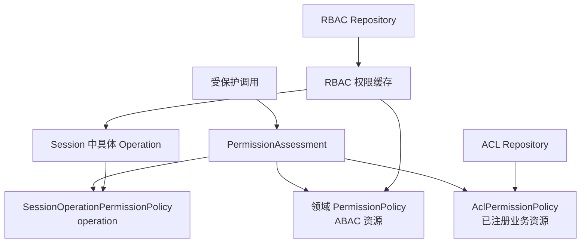

# 权限模型

本页说明 RBAC、ACL 和 ABAC 三种权限模型各自的适用范围，以及授权缓存与失效规则。本页适用于设计领域权限和角色授权的开发者。读完后，开发者能判断一项权限应使用哪种模型，以及授权变化后需要触发哪些失效动作。

Core 的 Permission 由 Resource 与 Action 组成。PermissionAssessment 要求一个资源恰好由一个 PermissionPolicy 认领。没有策略，或多个策略同时认领，都会失败。因此，每种权限模型必须声明明确且互不重叠的资源类型。三种模型的区别在于谁认领资源，以及授权数据放在 Session 中还是在请求中查询，判断入口仍是同一个 PermissionAssessment。



## RBAC

RBAC 管理稳定职责。一条 permission 表示角色可以执行哪个 Operation。展开后，它是资源为 Operation、动作为 INVOKE 的 Core Permission。Repository 保存 PermissionSelector。

管理 API 只能保存权限目录声明的具体 Operation。内置角色初始化可以保存内部选择符 `*`。读取授权时，再把它展开为该领域权限目录当前的全部 Operation。

授权判断不按 ROOT 等角色名称识别特殊身份。

各领域实现 [RbacRepository](/javadoc/modules/iam/sca4dj-iam/com/sca4d/iam/rbac/RbacRepository.html)，并用 [RbacDomain](/javadoc/modules/iam/sca4dj-iam/com/sca4d/iam/rbac/RbacDomain.html) 声明自己负责的 Repository 和权限目录。

业务 Operation 模块实现 RbacOperationModule。PermissionSelectionRegistry 自动汇总每个领域允许保存的具体 Operation。同一 Operation 可以进入多个领域。同一模块也可以按 Operation 返回不同结果。

一次角色、角色权限或 Principal 角色关系操作，还必须传入 [RbacScope](/javadoc/modules/iam/sca4dj-iam/com/sca4d/iam/rbac/RbacScope.html)。领域只有一套角色时，使用全局范围。同一领域按 Workspace 等业务对象分别保存角色时，使用领域加业务对象数字标识。

RbacDomain 负责选择 Repository 和权限目录。RbacScope 才定位一套具体的角色和授权关系。ACL 仍使用独立的 DomainScope，不与 RBAC 范围共用类型。

[RbacService](/javadoc/modules/iam/sca4dj-iam/com/sca4d/iam/rbac/RbacService.html) 可以一次读取多个 RbacScope 中多个 Principal 的 Operation。它先批量读取缓存，再把未命中项按 RbacDomain 分组。同一领域的全部未命中范围只调用一次 Repository，并缓存空授权结果。

提供脚手架 Redis 时，缓存使用一次批量读取、五分钟有效期和批量写入。同一应用的 IAM RBAC 缓存 key 使用共同的 Redis Cluster hash tag，使一次批量读取或 Lua 调用访问的 key 位于同一槽位。

每个 RbacDomain 的 key 还包含该领域可授予 Operation 编码集合的稳定指纹。编码集合变化后，新版本不会读取旧目录产生的授权结果。名称、翻译、排序和模块登记顺序变化，不会更换指纹。

旧 key 不主动扫描删除，按既有有效期过期。Redis 失败时，本次读取直接回到 Repository。

角色权限或 Principal 角色关系通过 RbacService 改变后，事务提交阶段只让受影响的 RbacScope 和 Principal 的缓存失效。该领域可选地标记关联 Session 失效。

每个缓存坐标保存独立修订号。失效操作原子增加修订号并删除选择符，因此失效前已经开始的 Repository 读取，不能把旧权限重新写回。

具体应用如果绕过 RbacService 直接修改权限数据，并且可授予 Operation 集合没有变化，必须查出受影响的 Principal，并调用 `RbacService.invalidatePermissions(scope, principalIds)`。目录指纹不能代替数据变化后的精确失效。

Platform 的全局授权在建立 Session 时装载为具体 Operation。具体应用也可以在已经选择 Workspace 等业务上下文后调用 RbacService，再由领域 PermissionPolicy 结合业务资源和数据范围完成判断。RBAC 负责角色到 Operation 的授权。业务数据范围仍由领域策略或查询条件负责。

[Role](/javadoc/modules/iam/sca4dj-iam/com/sca4d/iam/rbac/Role.html) 只保存所属 RbacScope、编码、状态和内置保护等授权事实，不包含展示文案。Platform 管理页面需要显示名称时，由 [PlatformRoleDetails](/javadoc/modules/iam/sca4dj-iam/com/sca4d/iam/base/rbac/PlatformRoleDetails.html) 在授权事实之外携带完整多语言字段。这些字段不会装入 Session，也不参与权限判定。

## ACL

ACL 管理随业务数据增长的资源实例。一条 AclEntry 直接表示某 Principal 对某资源可以执行某 Action，没有角色中间层。

各领域实现 [AclRepository](/javadoc/modules/iam/sca4dj-iam/com/sca4d/iam/acl/AclRepository.html)，声明 scope 与资源类型。跨领域重复、空类型以及 `operation` 冲突，都在启动时失败。

[AclService](/javadoc/modules/iam/sca4dj-iam/com/sca4d/iam/acl/AclService.html) 在判定时精确查询 Repository，不把 ACL 放进 Session。集合资源使用 `*` 标识。允许时返回 AclResourceScope，由业务查询按资源标识集合过滤。

Principal 停用或资源删除时，领域必须调用批量撤销方法。

## ABAC

ABAC 由领域直接实现 PermissionPolicy。策略从 Call 读取选定的 Principal。再从领域数据读取该 Principal 的成员关系、工作范围和目标资源。策略只认领自己的资源类型。

例如，文档策略先读取文档的 `workspace_id`。然后检查当前 `principalId` 是否存在对应的 `workspace_member`，以及是否具备所需权限。

Principal 本身不保存工作区标识，也不会因为切换工作区而改变。

当前不提供规则语言、规则表或表达式引擎。

## 示例

下例为「工作区」领域声明按工作区隔离的 RBAC 角色，并在成员加入角色后触发缓存失效。

声明领域，并按工作区标识定位角色空间。

```java
public final class WorkspaceRbac {

    public static final RbacDomain DOMAIN = new RbacDomain("WORKSPACE");

    private WorkspaceRbac() {
    }

    public static RbacScope scope(long workspaceId) {
        return RbacScope.of(DOMAIN, workspaceId);
    }
}
```

领域需要一个 RbacRepository 实现，`domain()` 返回 `WorkspaceRbac.DOMAIN`。其余方法读写应用自己的角色表。

```java
@Repository
public class WorkspaceRbacRepository implements RbacRepository {

    @Override
    public RbacDomain domain() {
        return WorkspaceRbac.DOMAIN;
    }

    // 其余方法按 RbacRepository 的接口约定读写应用自己的角色表。
}
```

把成员加入角色。该调用在同一事务中批量写入关系，提交后只让实际变化的 Principal 的缓存和 Session 失效。

```java
rbacService.changeRoleAssignments(
        WorkspaceRbac.scope(workspaceId),
        editorRoleId,
        List.of(memberPrincipalId),
        List.of());
```

应用绕过 RbacService 直接修改权限数据时，手动失效受影响的 Principal。

```java
rbacService.invalidatePermissions(WorkspaceRbac.scope(workspaceId), List.of(memberPrincipalId));
```

下例为文档资源提供 ACL。Repository 声明 scope 与资源类型，AclService 在判定时查询它。

```java
public interface WorkspaceDocumentAclRepository extends AclRepository {
    // 声明 scope()，并让 resourceTypes() 返回 WORKSPACE:DOCUMENT。
}
```

ABAC 的示例见[权限开发规则](/capabilities/identity-access/permission-development)中的 `WorkspaceDocumentPermissionPolicy`。

## 扩展方式

- 新的 RBAC 领域：实现 RbacRepository 并注册为 Spring Bean。`IamAutoConfiguration` 以 `List<RbacRepository>` 收集。同领域重复等问题在启动时失败。
- 可授予的 Operation：实现 RbacOperationModule，见 [Operation 与权限声明](/capabilities/identity-access/operation-declaration)。
- 新的 ACL 资源：实现 AclRepository 并注册为 Spring Bean。`IamAutoConfiguration` 以 `List<AclRepository>` 收集。跨领域重复、空类型以及 `operation` 冲突，在启动时失败。
- 缓存：没有提供 `RbacPermissionCache` Bean 时，`IamAutoConfiguration` 使用 `@ConditionalOnMissingBean(RbacPermissionCache.class)` 提供不保存授权结果的空实现。
- ABAC：实现 PermissionPolicy 并注册为 Spring Bean，由 `CorePermissionConfiguration` 以 `List<PermissionPolicy>` 收集。
