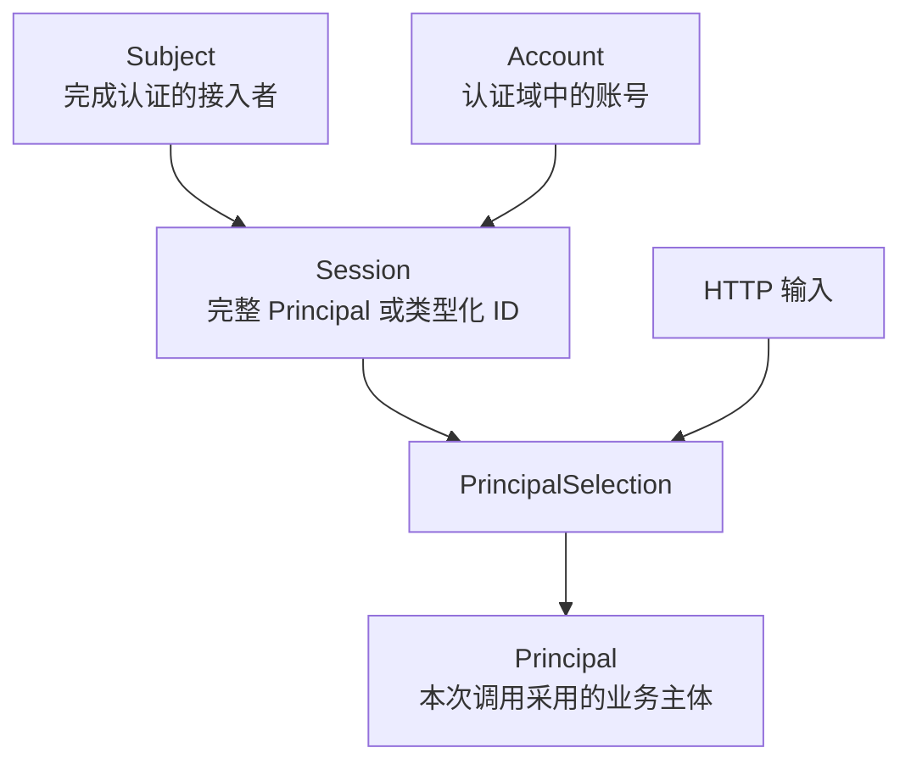
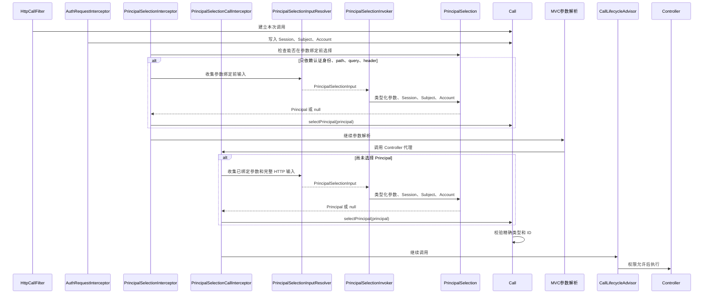

# Principal 选择

本页说明 Principal 选择的时机、输入来源、失败结果和 Platform 选择器的规则。本页适用于编写 `@CurrentPrincipal` 声明和业务 PrincipalSelection 的开发者。读完后，开发者能确定选择器应读取哪些输入，并知道选择失败会在哪一步发生。

一次认证只能确认登录主体和账号，不一定能确定业务操作最终归属于谁。一个账号可以关联平台操作员、工作区成员或其他业务身份。权限、数据归属和审计都必须使用本次调用实际采用的 [Principal](/capabilities/identity-access/principal)。

Workspace 本身不是 Principal。WorkspaceMemberPrincipal 则可以表示工作区中实际执行操作的成员身份。成员是管理员、审核员还是只读用户，只影响 Role、Permission 和数据范围，不改变这个 WorkspaceMemberPrincipal。

Principal 选择就是在认证完成后、权限判断前，从当前 Session 信任的 Principal 中确定本次调用使用哪一个。Session 可以保存完整 Principal 对象，也可以按精确 Java 类型保存紧凑 ID 集合。选择器不能扩大这份集合，也不能把 Session 中不存在的类型或标识当成当前 Principal。选择结果写入 Call，之后的权限判断、审计和业务数据归属都读取同一个 Call；选择器是应用提供的策略，框架只固定调用时机、输入范围和结果校验。



## 为什么不直接使用登录用户

很多框架把认证结果中的 principal 直接作为当前用户。Spring Security 的 [SecurityContextHolder](https://docs.spring.io/spring-security/reference/servlet/authentication/architecture.html#servlet-authentication-securitycontextholder) 也保存当前已认证对象和高层权限。这种模型适合「一个登录身份始终对应一个业务身份」的应用。

Sca4d-J 把 [Subject](/capabilities/identity-access/subject)、[Account](/capabilities/identity-access/account) 和 Principal 分开：

- Subject 表示谁完成认证。
- Account 表示该接入者在某个认证域使用的登录账号。
- Principal 表示这次业务调用以谁的名义执行。
- 这里的「谁」是业务视角下的身份，也说明本次调用进入哪个业务空间。

如果一个账号关联多个 Principal，直接把 Account 当成业务主体会丢失数据归属。如果每个请求都让 Controller 自己解析主体标识，不同接口会形成不同的选择规则，权限检查也可能在选择完成前执行。

因此，Spring MVC 拦截器和 AOP 按选择器需要的输入执行选择，结果写入当前 [Call](/javadoc/core/sca4dj-core-api/com/sca4d/core/api/call/Call.html)。

例如，同一个账号同时关联 ReaderPrincipal 和 PublisherPrincipal 时，使用 Account 记录「我的收藏」和「我发布的文档」，会把两个业务空间混在一起。

Sca4d-J 当前不使用 Spring Security SecurityContextHolder 保存这些对象。认证模块恢复 Session，HttpCallFilter 建立调用状态，后续组件只读取当前 Call。

## 一次 HTTP 调用怎样选择 Principal



[@CurrentPrincipal](/javadoc/core/sca4dj-core-spring/com/sca4d/core/spring/web/annotation/CurrentPrincipal.html) 可以声明在 Controller 类型、方法或参数上。[PrincipalSelectionInterceptor](/javadoc/core/sca4dj-core-spring/com/sca4d/core/spring/identity/PrincipalSelectionInterceptor.html) 和 [PrincipalSelectionCallInterceptor](/javadoc/core/sca4dj-core-spring/com/sca4d/core/spring/identity/PrincipalSelectionCallInterceptor.html) 都按方法、类型、参数的顺序查找声明。

PrincipalSelectionInterceptor 在 MVC 参数解析前，调用允许提前执行的选择器。其他选择器由 PrincipalSelectionCallInterceptor 在参数绑定完成后调用。当前调用已经选择 Principal 时，后续阶段不再执行选择器。

选择成功时，`Call.selectPrincipal(...)` 会再次确认目标 Principal 已经存在于 Session。

- 完整 Principal 返回 Session 中保存的对象，并可以使用预装的完整或数字 Resource。
- 只保存 ID 的 Principal 返回选择器解析的当前对象，不预装 Resource。

后续 `@RequirePermission` 继续由 Session 静态资源和业务 PermissionPolicy 判断。同一次调用不能切换为另一个类型或标识的 Principal。

## 选择器可以读取哪些输入

[PrincipalSelectionInputResolver](/javadoc/core/sca4dj-core-spring/com/sca4d/core/spring/identity/PrincipalSelectionInputResolver.html) 收集以下输入：

| 名称 | 内容 |
|---|---|
| Controller 方法参数名 | 对应的已绑定实参 |
| `path` | 路径变量 Map |
| `query` | 查询参数 Map；一个值保存标量，多个值保存 List |
| `header` | 小写请求头名称到标量或 List 的 Map |
| `body` | 标有 `@RequestBody` 的已绑定对象；没有时为 `null` |

[PrincipalSelection](/javadoc/core/sca4dj-core-spring/com/sca4d/core/spring/identity/PrincipalSelection.html) 用 `parameterType()` 声明需要的参数类型。返回 `Map.class` 时，直接获得上述 Map。返回普通 JavaBean 时，[PrincipalSelectionInvoker](/javadoc/core/sca4dj-core-spring/com/sca4d/core/spring/identity/PrincipalSelectionInvoker.html) 使用 Spring DataBinder 创建并绑定对象。

默认选择器在 Controller 参数绑定后执行，可以读取表中的全部输入。

`supportsSelectionBeforeArgumentBinding()` 返回 `true` 的选择器，只能读取当前认证身份、`path`、`query` 和 `header`。此时 Controller 参数和 `body` 均为空。只有这类选择器，能够在 [CurrentIdentityArgumentResolver](/javadoc/core/sca4dj-core-spring/com/sca4d/core/spring/web/CurrentIdentityArgumentResolver.html) 解析 `@CurrentPrincipal` 参数前写入选择结果。

类型化参数必须是具有无参构造方法和可写属性的具体类。接口、抽象类、实例化失败、未知属性和属性转换失败，都会转换成 `BusinessException(HttpErrorCode.BAD_REQUEST)`。该绑定不读取 HTTP ObjectMapper 配置。

选择器接收 Session、Subject 和 Account 的可空值。匿名 HTTP 请求会传入这些空值。

选择器即使返回 Principal，`Call.selectPrincipal(...)` 仍要求已经完成认证、存在 Session，并确认结果属于该 Session。匿名请求不能借此写入用户 Principal。

系统调用由 `Call.system(...)` 直接建立 SystemPrincipal，不会经过这个拦截器重新选择。

对于紧凑 Principal ID，选择器可以根据 Account 和 path、query 或 header 中的业务资源标识，查询业务 Repository，恢复当前一个具体 Principal。

返回值必须精确匹配 PrincipalIdLoader 建立 Session 时登记的 Java 类型和 ID。只匹配同一个 ID 的另一个 Principal 类型，仍会被拒绝。

成员停用或移除后，业务模块还必须使相关 Session 失效或刷新。不能只依赖选择器临时过滤旧集合。

## 当前 Platform 选择器

示例 App 的 PlatformAccountController、PlatformRoleController 和 FileController 使用 `PlatformPrincipalSelection`：

```java
@RestController
@RequestMapping("/platform")
@CurrentPrincipal(selection = PlatformPrincipalSelection.class)
public class PlatformRoleController {
    // Platform 角色接口
}
```

该选择器只接受 Account realm 为 `platform` 的 Session，并支持在多个 PlatformPrincipal 中按显式标识选择：

- 没有 Session，或当前 Account 不属于 `platform` realm：返回 `null`。
- 恰好一个 PlatformPrincipal：返回该 Principal。
- 没有 PlatformPrincipal：抛出 IllegalStateException。
- 存在多个 PlatformPrincipal：依次读取顶层、路径、查询参数中的 `principalId`，再读取请求头 `x-principal-id`；返回 Session 中标识匹配的 Principal。
- 多主体场景没有选择值、值不是正整数或 Session 中没有匹配主体：抛出 IllegalArgumentException。

PlatformPrincipalSelection 只支持按 `principalId` 显式选择，不解释工作区、组织等领域字段。需要按领域字段选择时，由对应业务模块提供自己的 PrincipalSelection。

业务模块怎样使用这些字段，取决于自己的 Principal 模型：

- 使用 EmployeePrincipal，工作区和团队只是工作范围时，选择器保持 EmployeePrincipal。成员关系、Role、Permission 或访问策略检查 `workspaceId` 和 `teamId`。
- 使用 WorkspaceMemberPrincipal 表示分别入驻和停用的工作区成员身份时，业务模块可以用 `workspaceId` 找到当前 Session 中的完整对象。也可以从紧凑 ID 集合恢复当前 WorkspaceMemberPrincipal，再把它选为本次调用身份。
- 无论采用哪一种设计，选择器都不能根据 `workspaceId` 构造 WorkspacePrincipal，也不能返回 Session 中没有登记精确类型和 ID 的 Principal。

## 示例

下面的示例按请求头 `x-workspace-id` 选择当前工作区成员身份。选择器不依赖 Controller 参数，因此声明为可在参数绑定前执行。

```java
@Component
public class WorkspaceMemberPrincipalSelection
        implements PrincipalSelection<Map<String, Object>> {

    @Override
    public boolean supportsSelectionBeforeArgumentBinding() {
        return true;
    }

    @Override
    public Class<Map<String, Object>> parameterType() {
        return PrincipalSelection.mapParameterType();
    }

    @Override
    public Principal select(Session session, Subject subject, Account account,
            Map<String, Object> parameters) {
        if (session == null) {
            return null;
        }
        Map<?, ?> header = (Map<?, ?>) parameters.get("header");
        Object workspaceId = header.get("x-workspace-id");
        if (!(workspaceId instanceof String text)) {
            throw new IllegalArgumentException("缺少 x-workspace-id");
        }
        long expected = Long.parseLong(text);
        return session.principals().stream()
                .filter(WorkspaceMemberPrincipal.class::isInstance)
                .map(WorkspaceMemberPrincipal.class::cast)
                .filter(member -> member.workspaceId() == expected)
                .findFirst()
                .orElseThrow(() -> new IllegalArgumentException("Session 中没有该工作区的成员身份"));
    }
}
```

```java
@RestController
@RequestMapping("/workspaces/documents")
@CurrentPrincipal(selection = WorkspaceMemberPrincipalSelection.class)
public class WorkspaceDocumentController {
    // 文档接口
}
```

示例使用 `Session.principals()` 读取完整 Principal 列表。Session 只保存紧凑 ID 集合时，选择器改为读取业务 Repository 恢复当前 Principal，规则见上文。

选择器返回的 Principal 必须是 Session 中已有的精确类型和 ID，否则 `Call.selectPrincipal(...)` 拒绝。示例中 `x-workspace-id` 缺失或无匹配成员时抛出 IllegalArgumentException，行为与 PlatformPrincipalSelection 的多主体分支一致。

## principalRequired 与 nullable

`@CurrentPrincipal` 中两个开关处理不同阶段：

- `principalRequired=true` 要求拦截器在 Controller 执行前得到 Principal。选择器返回 `null` 时直接失败。
- `nullable=true` 只允许参数解析器在当前调用没有 Principal 时，向该参数注入 `null`。

默认值是 `principalRequired=true`、`nullable=false`。只设置 `nullable=true`，不能绕过前面的必选要求。允许没有 Principal 的接口，必须同时把 `principalRequired` 设为 `false`。

参数只能声明为 Principal、其具体实现类型、`long` 或 Long。声明具体实现类型时，选择结果必须是该类型的实例。不匹配或声明其他类型时，CurrentIdentityArgumentResolver 抛出 IllegalStateException。注解参数不会出现在 OpenAPI 请求参数中。

## 失败发生在哪里

| 情况 | 结果 |
|---|---|
| 必须提前选择 Principal，但请求尚未认证 | `BusinessException(CoreErrorCode.AUTHENTICATION_REQUIRED)` |
| HTTP 请求之外触发选择拦截器 | 抛出 IllegalStateException |
| 默认选择器在 Spring 中不存在或不唯一 | Spring Bean 查找失败 |
| 参数类型不能实例化或绑定失败 | `BusinessException(HttpErrorCode.BAD_REQUEST)` |
| 选择器返回 `null` 且 `principalRequired=true` | 抛出 IllegalStateException |
| 选择器返回 Session 中不存在的类型或 ID | `Call.selectPrincipal(...)` 拒绝 |
| 同一次调用尝试选择不同 Principal | 抛出 IllegalStateException |
| `@CurrentPrincipal` 具体参数类型与选择结果不匹配 | 抛出 IllegalStateException |
| 参数要求非空 Principal，但当前没有选择结果 | `BusinessException(CoreErrorCode.AUTHENTICATION_REQUIRED)` |

选择器只负责从当前认证状态和请求输入确定 Principal。它不执行权限判断，不查询或刷新 Session，不修改 MDC 之外的运行环境，也不决定 Controller 最终能否执行。

权限判断见[权限判断与授权数据](/capabilities/identity-access/authorization)。完整调用顺序见[调用生命周期](/capabilities/identity-access/call-lifecycle)。

## 扩展方式

应用提供 PrincipalSelection 实现并注册为 Spring Bean。`@CurrentPrincipal(selection = ...)` 指定具体实现类型时，框架通过 `ApplicationContext.getBean(type)` 取得该 Bean。

未指定 `selection`（默认值为 `PrincipalSelection.class`）时，框架按 `PrincipalSelection` 接口类型取得 Bean。此时容器中必须恰好有一个 PrincipalSelection Bean，不存在或不唯一都会使 Spring Bean 查找失败。

PrincipalSelection 本身不通过 `List<T>` 汇总，也没有 `@ConditionalOnMissingBean` 默认实现。不同接口用不同选择器时，在 Controller 类型或方法上分别声明具体实现类型。
