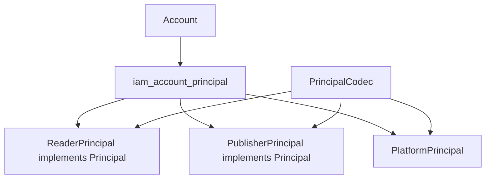
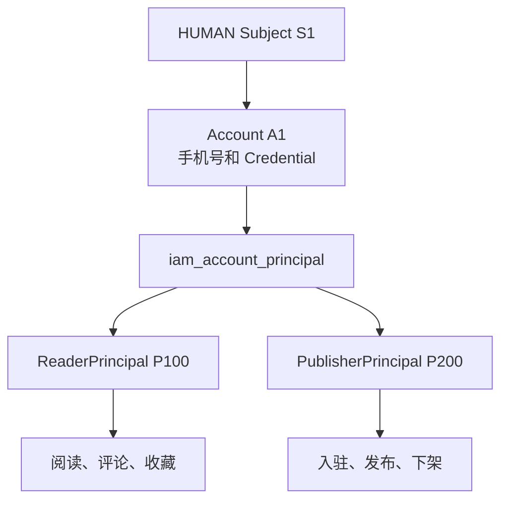
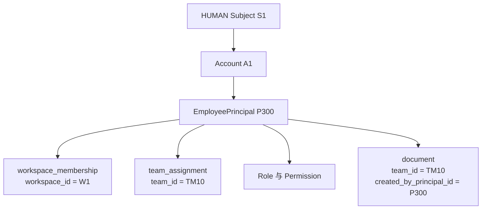
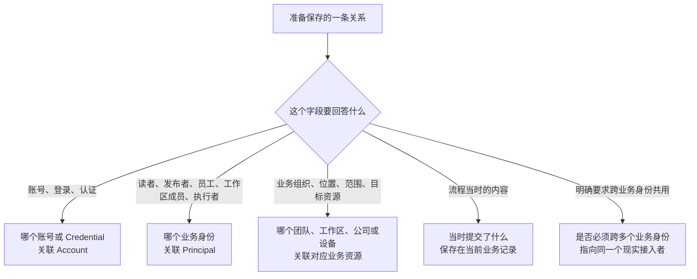
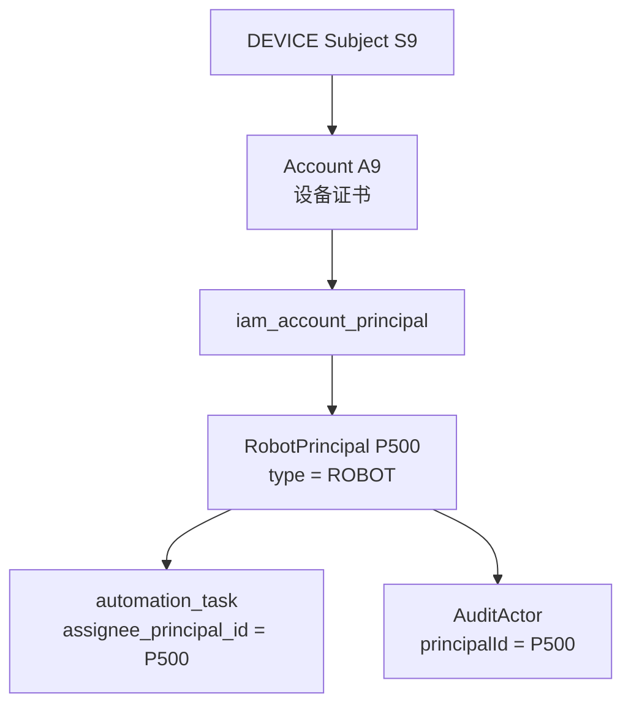
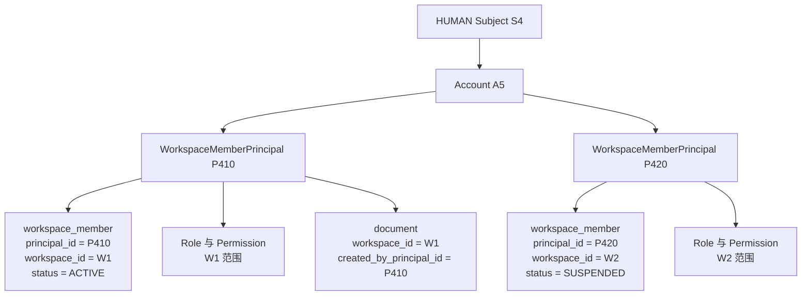

# Principal

源码：`core/sca4dj-core-api/src/main/java/com/sca4d/core/api/identity/Principal.java`

Principal 表示请求执行、权限判断和业务数据归属采用的业务主体。它是开放接口，只要求 `principalId()` 返回正数 `long` 标识。Core 只约定 `principalId()`，具体业务身份的字段、状态和生命周期由拥有它的业务模块保存。



Principal 保持接口，因为 ReaderPrincipal、PublisherPrincipal、PlatformPrincipal 等是不同业务类型。具体类型可以保存领域数据，并由 [PrincipalCodec](/javadoc/core/sca4dj-core-api/com/sca4d/core/api/authentication/principalsession/PrincipalCodec.html) 提供稳定的序列化类型标识。Core 不提供状态、版本、显示名称或数据库实现。

IAM 只登记 Principal 标识与具体 Java 类型对应的稳定判别值。创建、查找和可用性校验返回 `long` Principal 标识，不构造领域对象；应用用该标识结合自己的数据构造具体 Principal。内置 PlatformPrincipal 只保存 `principalId`。

一个 Account 可以关联多个 Principal，不同 Account 也可关联同一 Principal。Session 可以保存完整 Principal，也可以按具体 Java 类型保存紧凑 ID 集合；请求执行前由 [Principal 选择](/capabilities/identity-access/principal-selection)确定当前一个。Subject 表示谁接入，Account 表示通过哪个认证域登录，Principal 表示代表谁执行业务；三个标识不可互换。

系统内部调用使用 [SystemPrincipal](/javadoc/core/sca4dj-core-api/com/sca4d/core/api/identity/SystemPrincipal.html)。相关持久化操作见 [IdentityService](/javadoc/modules/iam/sca4dj-iam/com/sca4d/iam/identity/IdentityService.html)。

这里的「业务主体」也可以理解为一次业务调用采用的业务身份。它不是职位、权限等级，也不是团队、工作区或公司这些组织和资源本身，而是一个对象进入某个独立业务空间后使用的身份。这个业务空间有自己的业务流程、数据和生命周期。

读者阅读文档与发布者发布文档就是两个不同的业务空间。即使同一个自然人同时做这两件事，也需要 ReaderPrincipal 和 PublisherPrincipal。同一个工作区成员从普通成员变成管理员时，继续使用原来的 WorkspaceMemberPrincipal，只修改 Role 和 Permission，不应再创建 WorkspaceAdminPrincipal。

WorkspacePrincipal 与 WorkspaceMemberPrincipal 表达的对象不同。WorkspacePrincipal 把工作区组织本身当成执行者，是错误建模；WorkspaceMemberPrincipal 表示工作区里的一个成员以成员身份执行操作。当成员关系有独立的加入、资料、启停、退出和业务记录时，它就是一种完整的业务身份，可以实现 Principal。

ReaderPrincipal、PublisherPrincipal、EmployeePrincipal、WorkspaceMemberPrincipal、RobotPrincipal 等名称只是业务建模示例，不是 Sca4d-J 已经内置的 Java 类型。脚手架内置实现见 [SystemPrincipal](/javadoc/core/sca4dj-core-api/com/sca4d/core/api/identity/SystemPrincipal.html) 与 [PlatformPrincipal](/javadoc/modules/iam/sca4dj-iam/com/sca4d/iam/base/PlatformPrincipal.html)；具体应用只实现自己确实需要的业务身份。

**核心规则：操作登录账号、登录标识、Credential 和认证设置时关联 [Account](/capabilities/identity-access/account)；业务数据需要记录「谁」时默认关联 Principal；无法明确证明数据必须跨多个业务身份共用时，也先关联 Principal；只有业务本身必须跨多个业务身份管理同一个现实接入者时，才关联 [Subject](/capabilities/identity-access/subject)。**

## Principal 解决什么问题

认证成功只能说明哪个 Subject 使用哪个 Account 登录，不能说明这次调用正在以哪一种业务身份工作。

例如，同一个自然人既是读者又是发布者：

- 读者注册、维护阅读偏好、评论和收藏属于 ReaderPrincipal 的流程；
- 发布者入驻、提交资格、发布、下架和停用属于 PublisherPrincipal 的流程；
- 「是否允许发布」只是 PublisherPrincipal 的权限或状态，不会把读者变成发布者，也不会创建新的 Principal；
- 登录手机号和 Credential 仍然属于 Account，不属于 ReaderPrincipal 或 PublisherPrincipal。



Account 通过 `iam_account_principal` 关联它可以使用的 Principal。[Session](/javadoc/core/sca4dj-core-api/com/sca4d/core/api/authentication/Session.html) 保存一个或多个完整 Principal 或类型化 ID 集合，请求在权限判断前从中选择一个，也允许两种集合都为空。具体装载方式见[把成员身份装入 Session](/tutorials/authentication-and-session#4-把成员身份装入-session)，选择过程见 [Principal 选择](/capabilities/identity-access/principal-selection)。

## 什么时候才需要新的 Principal

这里先区分类型与实例：ReaderPrincipal 和 PublisherPrincipal 是两种 Principal 类型；同一个自然人在 W1 和 W2 分别拥有成员身份时，P410 和 P420 可以是 WorkspaceMemberPrincipal 的两个实例。定义新类型是因为出现了另一类业务身份，创建新实例是因为产生了一个可以独立启停和退出的具体身份。

判断是否需要独立的 Principal 类型或实例，依次检查下面四件事：

1. 切换身份后，「我是谁」是否变成了另一个业务对象，例如从读者变成发布者，或者从 W1 的成员身份切换为独立建立的 W2 成员身份？
2. 两个身份是否进入不同的核心流程，例如阅读与评论、发布与下架？
3. 两个身份是否各自拥有独立资料、状态和生命周期，例如读者资料与发布者资格分别创建、停用和删除？
4. 业务代码是否需要明确切换当前身份，避免把两个业务空间的数据、权限和审计混在一起？

只有这些差异确实构成另一套业务身份时，才新增 Principal。下面这些差异本身都不构成新的 Principal：

- Role 或 Permission 不同；
- 能执行的操作不同；
- 管理员、审核员、编辑等岗位不同；
- 只给同一个业务身份增加或更换团队、工作区、公司等成员关系；
- 可以查看的数据范围不同；
- 某个资源归谁所有。

| 场景 | 是否使用独立 Principal | 原因 |
|---|---|---|
| 同一自然人既是读者又是发布者 | 是 | 使用 ReaderPrincipal 与 PublisherPrincipal 两种类型和两个实例 |
| 同一自然人既是读者又是内部员工 | 通常是 | 面向读者的阅读流程与内部工作流程相互独立 |
| 发布者可以发布或被暂停发布 | 否 | 这是 PublisherPrincipal 的权限或业务状态变化 |
| 同一个工作区成员变成管理员、审核员或只读成员 | 否 | 保留原 WorkspaceMemberPrincipal 实例，只修改 Role、Permission 和数据范围 |
| 员工被分配到不同团队 | 否 | 团队是工作范围，使用 `team_id` 和任职关系表示 |
| 同一 EmployeePrincipal 可以管理两个工作区 | 否 | 两个工作区只是该员工业务身份的工作范围 |
| 同一自然人在两个工作区分别入驻、启停和退出 | 是 | 创建两个 WorkspaceMemberPrincipal 实例；它们类型相同，状态和生命周期相互独立 |
| 公司、组织或合同参与方 | 否 | 它们是业务组织或资源，使用各自业务 ID 表示 |
| 普通传感器 | 否 | 它是被管理和读取的设备资源 |
| 独立领取任务并调用业务接口的机器人 | 是 | 它进入自动化任务流程，有独立状态和生命周期 |

权限不能反过来定义 Principal。给 ReaderPrincipal 增加「导出文档」权限，它仍然是 ReaderPrincipal；撤销 PublisherPrincipal 的「发布」权限，它仍然是 PublisherPrincipal。Role 和 Permission 回答「这个身份现在能做什么」，Principal 回答「当前进入的是哪一个业务空间」。

## 为什么 WorkspacePrincipal 不对，而 WorkspaceMemberPrincipal 可以

Team 是团队资源，Workspace 是业务范围，Company 和 Organization 是业务组织。它们回答「数据属于哪里」「操作发生在哪里」或「合同关联哪个组织」，不回答当前调用进入了哪一种独立业务流程。

因此，TeamPrincipal、WorkspacePrincipal、OrganizationPrincipal 和 CompanyPrincipal 都是错误建模。给资源、范围或组织名称加上 Principal 后缀，既没有产生新的业务空间，也无法说明调用者是哪一种业务身份。

WorkspaceMemberPrincipal 不代表 Workspace。它代表一个人或应用在某个 Workspace 中建立的成员身份。下面两种模型都可能正确，区别不在权限多少，而在成员关系是不是独立业务身份：

- 一个 EmployeePrincipal 可以在多个工作区工作，加入工作区只增加工作范围时，使用 `workspace_membership` 关系，不增加 Principal；
- 每个工作区分别邀请、审核、启用、停用和移除成员，并分别保存成员资料和业务记录时，每个成员关系可以建立一个 WorkspaceMemberPrincipal。

采用 WorkspaceMemberPrincipal 时，三个标识仍然各自回答一个问题：

| 数据 | 回答的问题 |
|---|---|
| `workspace_id` | 操作发生在哪个工作区，业务数据属于哪个工作区？ |
| `principal_id` | 这个工作区里的哪个成员身份执行了操作？ |
| Role、Permission 和数据范围 | 这个成员身份当前允许做什么、查看哪些数据？ |

因此，W1 的成员 P410 创建文档时，文档可以同时保存 `workspace_id=W1` 与 `created_by_principal_id=P410`。前者不能代替后者，后者也不会把 Workspace 组织变成 Principal。P410 从普通成员变成管理员时，只修改 Role 和 Permission。对于同一个自然人，如果它又在 W2 建立了一段可独立停用和退出的成员身份，则为 W2 创建另一个 WorkspaceMemberPrincipal 实例。

这个区别也适用于其他组织。OrganizationPrincipal 和 CompanyPrincipal 把组织当成执行者，因此不成立；OrganizationMemberPrincipal 或 CompanyMemberPrincipal 表达的是组织中的成员身份，在成员确实拥有独立业务流程和生命周期时可以成立。如果它们只是同一个 EmployeePrincipal 的任职范围，仍然只保存成员关系，不新增 Principal。

以员工管理团队文档为例：



这张图中每个标识回答不同问题：

- EmployeePrincipal P300 表示当前调用使用内部员工这一业务身份；
- `workspace_id=W1` 表示员工属于哪个工作区；
- `team_id=TM10` 表示员工被分配到哪个团队，以及文档属于哪个团队；
- Role 和 Permission 表示员工在 W1、TM10 或其他范围内能做什么；
- `created_by_principal_id=P300` 表示哪个业务身份创建了文档。

这个例子选择 EmployeePrincipal，是因为工作区和团队只表示员工的工作范围。员工从编辑变成管理员时，修改 Role、Permission 或任职关系，不创建 AdminPrincipal。员工从 TM10 调到另一个团队时，修改 `team_assignment`，不创建另一个 Principal。如果具体业务把每个工作区成员关系作为独立创建和停用的业务身份，则应改用 WorkspaceMemberPrincipal，而不是套用这个例子。

公司参与合同时也一样：合同使用 `company_id`、`party_role` 表示哪家公司是采购方或供应商，使用 `created_by_principal_id` 记录哪个员工业务身份创建了合同。不创建 CompanyPrincipal 或 ContractPartyPrincipal。

## Principal 类型应该怎样命名

Principal 类型名应该直接表达独立的业务身份，而不是资源名称、组织名称、岗位或权限：

| 含义 | 建模 |
|---|---|
| 读者业务身份 | ReaderPrincipal |
| 发布者业务身份 | PublisherPrincipal |
| 内部员工业务身份 | EmployeePrincipal |
| 独立创建、启停和退出的工作区成员身份 | WorkspaceMemberPrincipal |
| 拥有独立流程和生命周期的组织成员身份 | OrganizationMemberPrincipal |
| 自动化任务中的机器人身份 | RobotPrincipal |
| 独立执行集成任务的外部应用身份 | IntegrationPrincipal |
| 团队、工作区、组织、公司 | 普通业务资源，不定义对应 Principal |
| 管理员、审核员、编辑、只读成员 | Role、Permission 或业务状态，不定义对应 Principal |

同一个 Principal 类型内部仍然可以有丰富的权限和状态。不要为「能否发布」「是否管理员」「可管理哪些团队」分别创建 Principal 类型。

## 为什么接口里只有一个 ID

Principal 是 Core 与各种业务身份之间最小且稳定的约定。Core 只需要使用 `principalId` 完成以下工作：

- 在 Session 中找到可选择的业务身份；
- 把本次调用绑定到一个业务身份；
- 检查这个身份的权限和静态资源；
- 在审计和业务数据中记录这个身份。

读者偏好、发布者资格、员工部门、工作区成员资料、机器人型号等字段没有共同结构，也不由 Core 修改。如果把这些字段加入 Principal 接口，每增加一种业务身份都要修改 Core，未使用该身份的应用也会被迫依赖无关数据。因此：

- Principal 接口只定义 `principalId()`；
- ReaderPrincipal、PublisherPrincipal、EmployeePrincipal、WorkspaceMemberPrincipal、RobotPrincipal 等具体类型说明它是哪一种业务身份；
- 读者资料、发布者资格、员工档案、工作区成员资料和机器人状态由对应业务模块保存；
- IAM 的 `iam_principal` 只登记 ID、类型、状态和必要的管理字段；
- [PrincipalCodec](/javadoc/core/sca4dj-core-api/com/sca4d/core/api/authentication/principalsession/PrincipalCodec.html) 为具体 Java 类型登记固定 type，Session 才能恢复正确类型。

因此，「纯 ID」不是缺少业务含义。这个 ID 是业务身份在 Session、权限、审计和业务表之间共同使用的稳定引用；具体类型和业务表负责说明它是读者、发布者、员工、工作区成员还是机器人。

## Subject、Account 和 Principal 分别回答什么

| 对象 | 回答的问题 | 典型数据 |
|---|---|---|
| [Subject](/capabilities/identity-access/subject) | 实际是哪个人、设备或应用接入系统？ | Subject 类型，以及它拥有的 Account |
| [Account](/capabilities/identity-access/account) | 它使用哪个账号和哪些 Credential 完成认证？ | 用户名、登录手机号、Password、Passkey、TOTP、账号状态 |
| Principal | 这次调用进入哪个业务空间，以哪种业务身份执行？ | 读者、发布者、员工、工作区成员、机器人、集成应用等业务身份 |

三种 ID 不能互换。修改密码的目标是 Account；查询「我的收藏」使用 ReaderPrincipal；查询「我发布的文档」使用 PublisherPrincipal；只有明确跨读者和发布者管理同一个自然人的资料时才考虑 Subject。

## 业务表应该关联谁

一张业务表可以同时保存多种关系。每个字段分别问它要回答什么：



| 数据 | 选择 | 原因 |
|---|---|---|
| 用户名、登录手机号、登录邮箱 | Account | 它们用于找到账号 |
| Password、Passkey、TOTP、认证设置 | Account | 它们决定账号怎样完成认证 |
| 读者资料、发布者资格、员工档案、工作区成员资料 | Principal | 它们属于各自独立的业务身份 |
| 文档读者、任务领取人、文件创建人 | Principal | 它们记录业务中的「谁」 |
| Role、Permission、数据范围 | Principal 或 Principal 与范围的关系 | 它们说明当前业务身份能做什么 |
| 团队、工作区、公司、组织 | 对应的 `team_id`、`workspace_id`、`company_id`、`organization_id` | 它们是组织、位置或业务范围 |
| 文档发布时的署名信息、合同参与方和证件快照 | 当前文档或合同 | 历史记录不能随资料修改 |
| 明确跨读者、发布者、员工共用的自然人主档 | Subject | 业务规则要求跨多个 Principal 保持同一份资料 |

默认选择 Principal 的原因很直接：业务方法执行前已经选定当前 Principal，权限和审计也使用它。业务表按 Principal 保存读者、负责人、创建人等关系后，更换 Account 不需要迁移业务数据，不同业务空间的数据也不会混在一起。

这里的默认规则只处理「谁」这类关系，不会把团队、工作区和公司改成 Principal。同一份文档可以同时保存 `team_id`、`owner_principal_id` 和 `created_by_principal_id`，三个字段分别表示所属团队、负责人和创建者。

以后发现某项资料确实需要按 Subject 汇总时，应用服务可以通过 [IdentityService](/javadoc/modules/iam/sca4dj-iam/com/sca4d/iam/identity/IdentityService.html) 查询 Account、Principal 与 Subject 的关系，再完成查询或迁移。业务模块不能直接读取 IAM 的表、Mapper、Row 或 Repository。

## 字段名要写清关系

不要给每张表都增加一个含义不明的 `principal_id`。字段名应该说明 Principal 在这条记录中是什么：

- 负责人：`owner_principal_id`；
- 创建人：`created_by_principal_id`；
- 处理人：`assignee_principal_id`；
- 操作人：`operated_by_principal_id`；
- 业务身份资料表：表名已经说明唯一关系时使用 `principal_id`，例如 `publisher_profile.principal_id` 或 `workspace_member.principal_id`。

团队、工作区、公司和组织继续使用 `team_id`、`workspace_id`、`company_id` 和 `organization_id`。合同可以同时保存采购方公司、供应商公司和创建人 Principal，不能把三个含义合并成一个通用 `principal_id`。

## 示例

### 定义并注册 WorkspaceMemberPrincipal

下面的示例定义一种工作区成员身份。Principal 类型保存成员身份自己的数据，PrincipalCodec 为它登记固定 type。

```java
public class WorkspaceMemberPrincipal implements Principal {

    private final long principalId;
    private final long workspaceId;

    public WorkspaceMemberPrincipal(long principalId, long workspaceId) {
        if (principalId <= 0 || workspaceId <= 0) {
            throw new IllegalArgumentException("标识必须为正数");
        }
        this.principalId = principalId;
        this.workspaceId = workspaceId;
    }

    @Override
    public long principalId() {
        return principalId;
    }

    public long workspaceId() {
        return workspaceId;
    }
}
```

```java
@Component
public class WorkspaceMemberPrincipalCodec implements PrincipalCodec<WorkspaceMemberPrincipal> {

    public static final TreeCode TYPE = TreeCode.ofColon("DOCS:WORKSPACE_MEMBER");

    @Override
    public TreeCode type() {
        return TYPE;
    }

    @Override
    public Class<WorkspaceMemberPrincipal> valueType() {
        return WorkspaceMemberPrincipal.class;
    }

    @Override
    public byte[] encode(WorkspaceMemberPrincipal value) {
        return ByteBuffer.allocate(16)
                .putLong(value.principalId())
                .putLong(value.workspaceId())
                .array();
    }

    @Override
    public WorkspaceMemberPrincipal decode(byte[] payload) {
        ByteBuffer buffer = ByteBuffer.wrap(payload);
        return new WorkspaceMemberPrincipal(buffer.getLong(), buffer.getLong());
    }
}
```

`version()` 使用接口默认值 `1`。type 不能与其他 PrincipalCodec 重复，`valueType()` 也不能与其他实现重复，否则启动时失败。

### 由 Account 装载成员身份

Session 建立时，PrincipalLoader 根据 Subject 和 Account 返回完整 Principal。下面的示例读取当前 Account 关联的全部工作区成员身份。

```java
@Component
public class WorkspaceMemberPrincipalLoader implements PrincipalLoader {

    private final WorkspaceMemberRepository members;

    public WorkspaceMemberPrincipalLoader(WorkspaceMemberRepository members) {
        this.members = members;
    }

    @Override
    public boolean supports(SessionIdentity identity) {
        return "workspace".equals(identity.account().realmKey().value());
    }

    @Override
    public List<WorkspaceMemberPrincipal> load(SessionIdentity identity) {
        return members.listActiveByAccountId(identity.account().accountId());
    }
}
```

WorkspaceMemberRepository 是应用自己的持久化类型，不属于框架。`realmKey().value()` 只是示例中的判断方式，实际认证域名称由应用定义。

### 创建文档时保存的字段

W1 的成员 P410 创建文档时，文档表同时保存范围和执行者：

| 数据 | 保存位置 |
|---|---|
| 文档所属工作区 | `document.workspace_id` |
| 创建文档的成员身份 | `document.created_by_principal_id` |
| 成员昵称和联系电话 | `workspace_member.principal_id` 对应的资料 |
| 登录手机号 | AccountIdentifier，关联 `account_id` |
| Password 或 Passkey | Credential，关联 `account_id` |

读者更换登录手机号只修改 AccountIdentifier；修改联系电话只修改成员资料；已经发布的文档署名快照保持不变。

## 建模场景

### 读者登录并评论

| 数据 | 保存位置 |
|---|---|
| 登录手机号 | AccountIdentifier，关联 `account_id` |
| Password 或 Passkey | Credential，关联 `account_id` |
| 读者昵称和联系电话 | `reader_profile.principal_id` |
| 评论作者 | `document_comment.reader_principal_id` |
| 评论所属文档 | `document_comment.document_id` |
| 评论时的署名 | 评论自己的 `author_name_snapshot` |

读者更换登录手机号只修改 AccountIdentifier；修改联系电话只修改读者资料；已经创建的评论署名快照保持不变。

### 管理员修改账号

管理员停用账号、重置 Password 或撤销 Passkey 时，同一操作同时涉及 Account 和 Principal：

- `target_account_id` 表示哪个登录账号被修改；
- 当前 Principal 表示哪个业务身份有权执行并实际执行了修改；
- Password、Passkey 和认证设置继续关联目标 Account；
- [AuditActor](/javadoc/core/sca4dj-core-api/com/sca4d/core/api/audit/AuditActor.html) 保存操作者当时的 Subject、Account 和 Principal。

Account 是操作目标，不是管理员的权限身份。管理员只是当前 Principal 拥有的 Role 或 Permission，不需要 AdminPrincipal。

### 普通设备、认证设备和机器人

设备是否需要 Principal，取决于它是否进入独立业务流程，而不是取决于它是否联网或是否拥有 Credential。

**普通业务资源：** 办公室里有一个温度传感器。系统读取温度、修改采样频率，传感器不领取任务。设备表保存 `device_id`；所在团队使用 `team_id`，登记人使用 `created_by_principal_id`。这个传感器不需要自己的 Principal。

**只负责认证的设备：** 传感器使用设备证书连接系统时，IAM 可以为它建立 DEVICE Subject 和 Account，证书关联 Account。通用 Session 允许 Principal 为空。具体应用如果只让设备上报自己的数据，可以直接使用同一个 Session，并继续用 `device_id` 表示设备；需要 Principal 的调用生命周期会拒绝该调用，不能为了通过权限检查而虚构一个 Principal。

**进入自动化业务流程的机器人：** 归档机器人会登录系统、领取归档任务、进入执行中状态、报告完成或失败，并调用相应业务接口。机器人有独立的任务流程、运行状态和停用生命周期，因此建立 RobotPrincipal，并为 PrincipalCodec 登记 `ROBOT` type：



`ROBOT` 是 Principal 类型，不是 SubjectType。Subject 仍然使用 `DEVICE`，Account 保存机器人怎样认证，RobotPrincipal 表示机器人进入自动化任务业务空间后的身份。

同一台机器人还可以同时是被维护的设备资源。维护记录使用 `target_device_id` 表示维护哪台设备；自动化任务使用 `assignee_principal_id` 表示哪个机器人身份执行任务。一个对象既可以被别人维护，也可以自己执行业务任务，这两个关系不能合并。

### 同一自然人既是读者又是发布者

```text
Subject S1
├── Account A1（手机号登录）
│   ├── ReaderPrincipal P100
│   └── PublisherPrincipal P200
└── Account A2（企业 SSO，可选）
    ├── ReaderPrincipal P100
    └── PublisherPrincipal P200
```

评论和收藏关联 P100，发布记录和发布者资格关联 P200。停用 PublisherPrincipal 不影响读者阅读；更换 Account 也不需要迁移评论和发布记录。给 P200 撤销发布权限只会限制发布者操作，不会把 P200 变成另一种 Principal。

### 员工管理工作区和团队，成员关系只是范围

```text
Subject S2 -> Account A3 -> EmployeePrincipal P300
                               ├── workspace_membership(W1, role=ADMIN)
                               ├── team_assignment(TM10)
                               └── team_assignment(TM11)
```

P300 表示内部员工业务身份。这个业务中的工作区成员关系没有自己的资料、状态和生命周期，因此 W1、TM10 和 TM11 只是成员关系和工作范围。员工在 TM10 创建文档时，文档保存 `team_id=TM10` 和 `created_by_principal_id=P300`。员工改为只读角色、调到 TM11 或离开 W1 时，修改 Role、Permission、成员关系或分配关系，不创建 TeamOperatorPrincipal 或 TeamPrincipal。

### 工作区成员本身是业务身份



P410 和 P420 是同一种 WorkspaceMemberPrincipal 类型的两个实例，分别表示这个自然人在 W1 与 W2 中建立的成员身份。P410 进入 W1 的文档、审批和配置流程，P420 进入 W2 的对应业务空间；W1 停用 P410 不影响 P420。W1 把 P410 从普通成员改为管理员时，只修改 P410 的 Role 和 Permission，不创建新的 Principal。`workspace_id` 仍然标识工作区资源，`principal_id` 标识在该工作区中执行操作的成员身份，因此 WorkspaceMemberPrincipal 正确，WorkspacePrincipal 仍然错误。

### 组织员工处理文档

```text
Subject S3 -> Account A4 -> EmployeePrincipal P400
                               ├── organization_membership(organization_id=O10)
                               ├── Role(DOCUMENT_EDITOR)
                               └── created document D20

document D20
├── organization_id -> O10
└── created_by_principal_id -> P400
```

Organization O10 表示文档属于哪个组织，EmployeePrincipal P400 表示哪个员工业务身份执行了操作。员工能否创建文档、查看统计或维护模板由 Role、Permission 和数据范围决定。给 P400 增加统计权限，或者让 P400 同时加入另一个组织，只修改授权或成员关系，不创建 OrganizationPrincipal。

如果同一个自然人还会以读者身份阅读，则 ReaderPrincipal 与 EmployeePrincipal 分开，因为阅读、评论与组织内文档处理是两套业务流程。这个拆分来自业务空间不同，不是因为 EmployeePrincipal 关联了 O10。

### 公司参加合同

```text
purchase_contract
├── contract_party
│   ├── company_id  -> C10 / C20
│   └── party_role  -> BUYER / SUPPLIER
└── created_by_principal_id -> EmployeePrincipal P300
```

公司是业务组织，合同参与方是公司在一份合同中的关系。`company_id` 与 `party_role` 表示采购方和供应商，EmployeePrincipal 表示哪个员工业务身份创建了合同。不创建 CompanyPrincipal、OrganizationPrincipal 或 ContractPartyPrincipal。

### 外部应用

外部系统只有在进入独立的同步、回调或自动处理流程，并拥有自己的配置、状态和生命周期时，才建立 IntegrationPrincipal。API Key、签名公钥和轮换状态关联 Account；同步游标、Webhook 配置和任务记录关联 IntegrationPrincipal。

如果 API Key 只让已有业务身份调用接口，不产生独立的集成流程和数据，就只把它作为 Account 的 Credential，不额外创建 IntegrationPrincipal。

### 手机号、邮箱和身份证件

同一个值保存在哪里，取决于它在当前业务中做什么：

| 用途 | 保存位置 |
|---|---|
| 手机号或邮箱用于登录 | AccountIdentifier |
| 手机号或邮箱用于联系读者 | ReaderPrincipal 资料 |
| 评论时留下联系电话 | 评论快照 |
| 发布者入驻时完成实名认证 | PublisherPrincipal 的入驻或资格记录 |
| 读者开户时完成实名认证 | ReaderPrincipal 的开户或核验记录 |
| 证件管理模块跨读者和发布者维护同一自然人证件 | Subject 关联的证件记录 |

身份证号本身不等于 Subject 数据。只有证件管理模块明确要求跨多个 Principal 管理同一个自然人的证件时，才使用 `subject_id`。证件原文和影像由负责证件的模块加密保存，不能进入 Session、普通日志或 IAM 身份表。

## 扩展方式

应用通过注册 Spring Bean 提供 Principal 的实现。框架不扫描 Principal 类型本身，只收集下面几类 Bean。

| 应用提供 | 框架如何发现 | 重复或缺失时的结果 |
|---|---|---|
| `PrincipalCodec<P>` | AuthAutoConfiguration 以 `List<PrincipalCodec<?>>` 注入 | 重复 type 或重复 Java 类型在启动时失败 |
| `PrincipalLoader` | PrincipalLoaders 以 `List<PrincipalLoader>` 注入 | 多个 Loader 的 `supports(identity)` 同时成立时抛出 IllegalStateException |
| `PrincipalIdLoader<P>` | PrincipalIdLoaders 以 `List<PrincipalIdLoader<?>>` 注入 | 多个 Loader 认领同一 Principal 类型时抛出 IllegalStateException |
| `PrincipalSelection<P>` | `@CurrentPrincipal(selection = ...)` 指定类型，由 Spring 按类型查找 Bean | Bean 不存在或不唯一时 Spring 查找失败 |

新的 Principal 类型需要实现 Principal，提供 PrincipalCodec，并提供 PrincipalLoader 或 PrincipalIdLoader 之一。新建 Principal 并关联 Account 时，调用 IdentityService，细节见[身份与访问管理模块](/capabilities/identity-access/iam)。

## 使用限制

- `principalId` 必须为正数，同一个业务身份在业务数据存在期间不能更换 ID。
- 具体 Principal 类型必须登记唯一的 PrincipalCodec type；重复 type 或重复 Java 类型会在启动时失败。
- 当前 Principal 必须来自当前 Session；调用代码不能自行构造一个陌生 ID 绕过选择。
- Role、Permission、组织关系和数据范围不能代替 Principal，也不能作为创建新 Principal 的唯一理由。
- 权限、审计和需要记录「谁」的业务数据使用本次调用选中的 Principal。
- 系统内部调用使用 [SystemPrincipal](/javadoc/core/sca4dj-core-api/com/sca4d/core/api/identity/SystemPrincipal.html)。
- IAM 持久化操作见 [IdentityService](/javadoc/modules/iam/sca4dj-iam/com/sca4d/iam/identity/IdentityService.html)。
