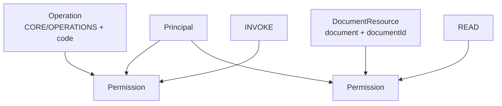
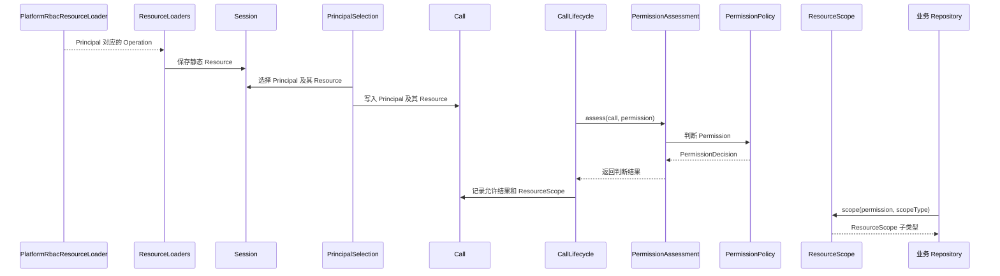

# Resource

源码：`core/sca4dj-core-api/src/main/java/com/sca4d/core/api/resource/Resource.java`

本页说明 Resource 的含义、标识设计，以及它与 Session、ResourceScope 的关系。本页适用于定义业务资源类型或声明权限对象的开发者。读完后，开发者能判断一个对象是否应实现 Resource，并确定它的 type 与 id 如何设计。

## 权限保护的对象

Resource 表示权限判断保护的对象。它回答「Principal 想对什么执行 Action」，由非空白的资源类型和资源标识共同确定。

```text
Resource = type + id
Permission = Resource + Action
```

只使用数值 ID 不足以确定资源。文档 `42`、文件 `42` 和工作区 `42` 是不同对象。只使用 Java 类名、数据库表名或 URL 也不可靠，因为同一业务对象可能有多个持久化表示和多个访问入口。

因此，Resource 使用由业务模块维护的稳定 type，并在该类型内使用稳定 id。

[Cedar 授权请求](https://docs.cedarpolicy.com/policies/syntax-policy.html#scope) 同样使用 principal、action 和 resource。Resource 表示 Action 要访问或修改的应用对象。Sca4d-J 沿用这组基础关系，但 Resource 是自己的 Java 接口。当前权限执行也没有接入 Cedar。

## Operation 也是 Resource

固定 Controller 方法、任务入口或其他可命名操作，使用 [Operation](/javadoc/core/sca4dj-core-api/com/sca4d/core/api/permission/Operation.html) 表示。Operation 实现 Resource，固定返回 type `CORE/OPERATIONS`（常量 `Operation.RESOURCE_TYPE`），id 是 Operation code，例如：

```java
Operation operation = new Operation("PLATFORM:ROLES:READ");
Permission permission = new Permission(operation, Action.INVOKE);
```

Operation 不是另一套权限对象。它与文档、文件等业务 Resource 的区别只在读取时间。角色提供的 Operation 数量有限、读取频繁，适合在 Session 建立或刷新时预先装入。业务对象通常数量很大，需要在请求中根据实际 ID 读取和判断。



图中的两项 Permission 使用完全相同的结构。第一项判断固定接口操作，第二项判断具体文档。Resource 本身不决定结果。PermissionPolicy 读取当前 Call、Resource 和 Action 后，返回允许或拒绝。

## 静态 Resource 与请求中的 ResourceScope

Session 可以保存每个 Principal 的静态 Resource。当前生产实现中，PlatformRbacResourceLoader 根据角色读取 Operation。ResourceLoaders 将其合并为 `principalId -> Resource 列表`。



Session 静态 Resource 适合签发时就能完整列出的授权对象。`Session.grants(principalId, resource)` 按 `type()` 和 `id()` 比较，不要求 Resource Java 实现提供 `equals()`。

[ResourceScope](/javadoc/core/sca4dj-core-api/com/sca4d/core/api/permission/ResourceScope.html) 不是 Resource 集合。它保存一次调用中某项完整 Permission 已经批准的数据访问条件。Repository 再把 ResourceScope 中的条件转换成 SQL 条件。

静态 Resource 回答「Session 是否已经持有这项授权」。ResourceScope 回答「这次查询具体可以访问哪些记录」。静态 Resource 与 ResourceScope 分别保存在 Session 与 Call 中，与其他模块的做法一致：认证结果保存在 Session 中，请求数据保存在 Call 中。

当前仓库已经实现 Operation 的 Session 加载和判断。但没有生产 PermissionPolicy 写入业务 ResourceScope，也没有业务 Repository 消费 ResourceScope。设计文档中的文档等示例说明使用方式，不表示现有应用已经开放这些业务 API。

## 谁负责创建和读取 Resource

| 工作 | 负责对象 | 不应负责 |
|---|---|---|
| 定义 Resource type、id 的含义和具体实现 | 拥有该业务对象的模块 | Core 猜测业务类型 |
| 声明固定 Operation | OperationModule | Controller 临时拼接同义 code |
| 建立 Session 时加载静态 Resource | ResourceLoader | 选择当前 Principal |
| 合并多个 Loader 的结果 | ResourceLoaders | 查询模块内部 Mapper |
| 编码具体 Session Resource | ResourceCodec | 改变 Resource 含义 |
| 选择当前 Principal 的 Resource | PrincipalSelection | 加载 Session 之外的新授权对象 |
| 判断 Permission | PermissionPolicy、PermissionAssessment | 在 Controller 中复制授权规则 |
| 把 ResourceScope 转成查询条件 | 业务 Repository | 信任客户端提交的数据范围 |

模块增加需要进入 Session 的 Resource 类型时，必须同时实现唯一的 ResourceCodec。Codec type 用来选择 Java 类型，Resource 自己的 `type()` 用于权限比较。两者处理不同问题，不能混用。

## 领域模型何时直接实现 Resource

领域模型已经包含稳定业务标识，而且该对象本身就是权限或审计要表达的目标时，领域模型直接实现 Resource。Account、StoredFile、Role 和示例 App 的 PlatformUserProfile 都采用这种方式。调用方取得完整对象后，直接传给 Permission 或审计记录，不再创建只转发相同类型和标识的 XxxResource。

调用方只有持久化的 `type + id`、消息中的通用引用或方法参数中的标识，没有也不需要读取完整领域对象时，使用 [Resource.Ref](/javadoc/core/sca4dj-core-api/com/sca4d/core/api/resource/Resource.html)。这种引用不会虚构领域字段，也不会为了构造权限目标额外查询数据库。

直接实现 Resource 需要同时满足以下条件：

- 资源类型由所属模块长期维护；
- 资源标识在该类型内稳定唯一；
- 模型构造时能够拒绝非法标识；
- `type()`、`id()` 不依赖可变展示字段。

只描述数据库行布局、临时查询结果或多个不同业务对象的类型，不能直接实现 Resource。

## 资源标识怎样设计

Resource type 应是模块长期维护的稳定业务名称，例如 `document`、`file` 或 `workspace`。不要使用 Java 全限定类名、数据库表名或页面路由。重构类、换表或调整 URL 不应改变已经保存的权限含义。

Resource id 在同一 type 内必须稳定且唯一。数值主键可以转成十进制字符串，业务编码也可以直接使用。复合标识应由模块定义无歧义的编码和解析规则，不能简单用容易冲突的字符串拼接。

Resource 接口不强制所有对象写入一张公共资源表。资源字段、生命周期和层级仍由拥有该业务数据的模块保存。Core 只要求权限判断时可以得到明确的 type 和 id。

## 不能直接当作 Resource 的对象

**只有持久化布局含义的数据库对象**：这类对象随 Mapper 和表结构变化，没有稳定业务身份。Repository 应把它转换成领域模型或 Resource.Ref。权限规则不能依赖数据库字段布局。

**HTTP URL**：多个 URL 可能操作同一对象，同一路由也可能通过路径参数指向不同对象。固定入口使用 Operation，具体对象使用业务 Resource。

**Principal**：Principal 是执行者，Resource 是被操作对象。即使「用户修改自己的资料」中二者数值相同，也必须分别表达。否则无法说明谁在操作谁。

**角色或权限字符串**：角色负责把授权集合关联到 Principal，Permission 才表示 Resource 与 Action。把角色名写进 Resource id，会把授权的组织方式写成资源身份的一部分。

## 两个完整例子

### 固定角色管理接口

示例 App 的 PlatformRoleController 读取操作要求 `PLATFORM:ROLES:READ + INVOKE`。OperationCatalog 提供该 Operation，Platform 角色把它授予 Principal，Session 建立时加载它。请求选出 Principal 后，SessionOperationPermissionPolicy 检查静态 Resource。没有该 Operation 时返回拒绝，Controller 不执行。

### 读取一份文档

文档模块可以定义 type `document`、id 为文档 ID 的 Resource，并要求 `READ`。PermissionPolicy 根据当前 Principal 和文档归属，得到允许的 ResourceScope，并通过 `PermissionDecision.allow(scope)` 返回。

Repository 必须通过 CurrentResourceScope 取得该 Permission 的条件，并把条件加入 SQL。不能先无条件查出文档，再在 Controller 中隐藏结果。

第二个例子描述预期接入方式。当前仓库没有文档 Resource、对应 PermissionPolicy 或 Repository 实现。

## 示例

### 让领域模型直接实现 Resource

下面的示例让 Document 直接作为权限目标。type 在类中固定，id 在构造时校验。

```java
public class Document implements Resource {

    public static final TreeCode TYPE = TreeCode.ofColon("DOCS:DOCUMENT");

    private final long documentId;
    private final long workspaceId;
    private String title;

    public Document(long documentId, long workspaceId, String title) {
        if (documentId <= 0 || workspaceId <= 0) {
            throw new IllegalArgumentException("文档标识必须为正数");
        }
        this.documentId = documentId;
        this.workspaceId = workspaceId;
        this.title = title;
    }

    @Override
    public TreeCode type() {
        return TYPE;
    }

    @Override
    public String id() {
        return Long.toString(documentId);
    }

    public long workspaceId() {
        return workspaceId;
    }
}
```

`type()` 和 `id()` 不依赖可变的 `title`。调用方只有文档标识、没有读取完整对象时，使用 `new Resource.Ref(Document.TYPE, "42")`。

### 声明权限

固定入口与具体对象使用同一个 Permission 结构：

```java
Permission invoke = new Permission(new Operation("docs:documents:read"), Action.INVOKE);
Permission read = new Permission(new Resource.Ref(Document.TYPE, "42"), Action.READ);
```

`Operation` 的字符串构造方法按冒号分段解析。Action 常量包括 `INVOKE`、`CREATE`、`READ`、`WRITE`、`UPDATE`、`DELETE`、`MANAGE` 和 `OPERATE`。

### 为 Session 提供静态 Resource

建立 Session 时，ResourceLoader 按 Principal 返回静态 Resource。下面的示例把成员可访问的文档授予对应 Principal。

```java
@Component
public class WorkspaceDocumentResourceLoader implements ResourceLoader {

    private final DocumentGrantRepository grants;

    public WorkspaceDocumentResourceLoader(DocumentGrantRepository grants) {
        this.grants = grants;
    }

    @Override
    public Map<Long, List<Resource>> load(Collection<? extends Principal> principals) {
        Map<Long, List<Resource>> result = new LinkedHashMap<>();
        for (Principal principal : principals) {
            result.put(principal.principalId(), grants.listGrantedDocuments(principal.principalId()));
        }
        return result;
    }
}
```

DocumentGrantRepository 是应用自己的持久化类型。返回的 Resource 如果不是 Core 已有类型，需要同时提供对应的 ResourceCodec，见「扩展方式」。

## 扩展方式

应用通过注册 Spring Bean 提供 Resource 相关实现，框架以 `List<T>` 注入汇总。

| 应用提供 | 框架如何发现 | 重复或错误时的结果 |
|---|---|---|
| `ResourceLoader` | AuthAutoConfiguration 以 `List<ResourceLoader>` 注入 ResourceLoaders | ResourceLoader 返回输入外的 Principal，或同一 Principal 下 Resource 的 type 与 id 重复，抛出 IllegalStateException |
| `ResourceCodec<R>` | AuthAutoConfiguration 以 `List<ResourceCodec<?>>` 注入 | 具体类型缺少 Codec 或 Codec type 重复时，Session 编解码失败 |
| PermissionPolicy | 由 PermissionAssessment 汇总 | Permission 没有恰好一个 PermissionPolicy 认领时拒绝判断 |

新增需要进入 Session 的 Resource 类型时，同时实现唯一的 ResourceCodec。Codec 的 `type()` 用于选择 Java 类型，Resource 自己的 `type()` 用于权限比较。

## 构造和失败要求

Resource 是接口。Core 不能在实现创建时主动校验返回值。Resource 用于创建 Permission 或进入 Session 时，会检查 `type()` 和 `id()`：

- 创建 Permission 时，任一值为 `null`、空字符串或空白字符串，Permission 构造失败；
- Resource 进入 Session 时，任一值为 `null`、空字符串或空白字符串，Session 构造失败；
- 同一个 Principal 下出现相同 `type + id` 时，Session 构造失败；
- 资源映射包含 Session 中不存在的 `principalId` 时，Session 构造失败；
- 具体类型缺少 ResourceCodec，或者多个 Codec 使用相同 type 时，Session 编解码失败；
- Permission 没有恰好一个 PermissionPolicy 认领时，PermissionAssessment 拒绝判断；
- Repository 请求尚未获准的 ResourceScope 时，CurrentResourceScope 抛出异常。

实现 Resource 时，应在构造阶段就拒绝非法 type 和 id，不要等到 Session 或权限判断时才发现。Session 只保存不可修改的快照，不会查询 Resource 当前是否仍存在。

## 相关权限类型

- [Permission](/javadoc/core/sca4dj-core-api/com/sca4d/core/api/permission/Permission.html)：Resource 与 Action 组成的完整权限。
- [Operation](/javadoc/core/sca4dj-core-api/com/sca4d/core/api/permission/Operation.html)：固定操作入口使用的 Resource。
- [Session](/javadoc/core/sca4dj-core-api/com/sca4d/core/api/authentication/Session.html)：按 Principal 保存静态 Resource。
- [ResourceLoader](/javadoc/core/sca4dj-core-api/com/sca4d/core/api/authentication/principalsession/ResourceLoader.html)：建立 Session 时贡献静态 Resource。
- [ResourceCodec](/javadoc/core/sca4dj-core-api/com/sca4d/core/api/authentication/principalsession/ResourceCodec.html)：具体 Resource 在 Session 中的序列化与反序列化。
- [ResourceScope](/javadoc/core/sca4dj-core-api/com/sca4d/core/api/permission/ResourceScope.html)：一次调用已经批准的数据访问条件。
- [权限判断与授权数据](/capabilities/identity-access/authorization)：固定 Operation 和业务 Resource 的完整执行过程。
