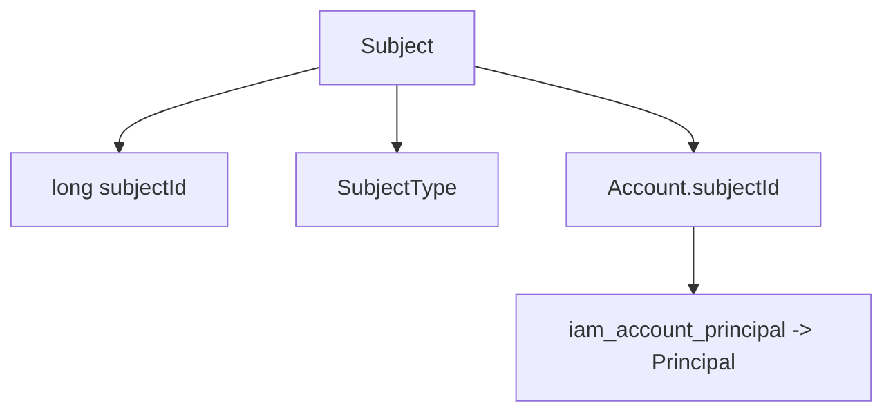
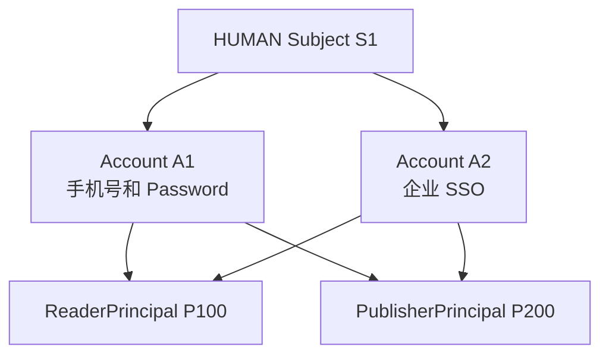

# Subject

源码：`core/sca4dj-core-api/src/main/java/com/sca4d/core/api/identity/Subject.java`

本页说明 Subject 的含义、保存内容和范围。本页适用于设计身份关联和业务数据归属的开发者。读完后，开发者能判断一项数据应关联 Subject、Principal 还是 Account。

Subject 表示实际接入系统或建立受控调用的对象。它是不可继承的 Core 类型，只保存正数 `long` 标识与 SubjectType。用户名、凭据、业务资料、权限、持久化状态和版本都不属于 Subject。



Subject 不保存用户名、Credential、姓名、手机号、头像、权限或业务资料。它的意义不是描述一个人或一台设备。它的作用是告诉身份系统：哪些 Account 属于同一个人、设备或应用。Subject 只保存不变的 ID 和类型，用来判断哪些 Account 属于同一个接入对象。

## Subject 为什么存在

同一个人可以同时使用手机号登录和企业 SSO 登录，也可以同时是读者和发布者。如果只保存 Account，系统会把两个登录账号看成两个无关对象。如果用手机号或邮箱判断是不是同一个人，换号后关系就会丢失。

Subject 给这些会变化的对象一个共同且不变的 ID：



在这个例子中：

- A1 和 A2 都通过 `subjectId=S1` 说明它们属于同一个人；
- P100 和 P200 分别说明这个人在读者和发布者业务中以谁的名义操作；
- 更换手机号、停用 A1 或增加新的 Principal，都不需要更换 S1。

这就是「Subject 是身份系统自洽的核心锚点」的具体含义。Account 可以增加或停用。Account 与 Principal 的关系可以建立或删除。身份系统仍然有一个固定 ID，用于判断哪些账号属于同一个接入对象。

这个 ID 只表达 IAM 已经建立的归属关系。它不自动证明两个账号在现实中确实属于同一个人。创建 Subject 和关联 Account 的业务流程，必须自己完成身份核验。

## 为什么只有 ID 和类型

SubjectType 只区分 `HUMAN`、`DEVICE`、`APPLICATION` 和 `SYSTEM`。这些类型只告诉系统接入对象的大类，不描述它的业务资料。

如果 Subject 保存姓名、手机号、设备型号或应用名称，身份模块就必须决定每种资料怎样校验、修改和删除。结果会出现几个问题：

- 换手机号会被误解为更换 Subject；
- 读者资料和员工资料会被迫放在同一个对象中；
- 设备、应用和人员需要完全不同的字段；
- 没有引入相关业务模块的应用也要保留无关字段。

因此，Subject 只保存身份系统真正需要共同使用的 ID 和类型。姓名、联系方式、公司资料、设备型号等内容，由负责它们的业务模块保存，并按需要关联 Principal 或业务资源。

「只有 ID」不等于没有作用。`subjectId` 用于：

- 说明一个 Account 属于哪个实际接入对象；
- 检查 Session 中的 Account 与 Subject 是否一致；
- 查询同一个 Subject 拥有的多个 Account；
- 在多个 Account 或 Principal 之间判断是否属于同一个接入对象；
- 审计共享 Principal 背后实际完成认证的人、设备或应用。

## 构造与读取

`new Subject(subjectId, type)` 要求 `subjectId` 为正数，`type` 不能为 `null`。`subjectId()` 返回稳定标识，`type()` 返回接入对象类别。SubjectType 区分 `HUMAN`、`DEVICE`、`APPLICATION` 与 `SYSTEM`，不表达权限等级。

Subject 是 final 类。应用不定义 PublisherSubject、ReaderSubject 或其他实现。领域差异由 [Principal](/capabilities/identity-access/principal) 表达，领域资料默认使用 Principal 标识关联自己的数据。

只有业务明确要求跨多个 Principal 管理同一个现实接入者时，相关资料才关联 Subject。

WorkspaceMemberPrincipal 表示成员身份，不会把 Workspace 资源变成 Principal。

## 什么时候业务数据才关联 Subject

一项业务数据只有同时满足下面三个条件，才应优先关联 `subject_id`：

1. 它描述的是实际的人、设备或应用本身，不是读者、员工、发布者等业务身份；
2. 同一个 Subject 更换 Account 或切换 Principal 后，这项数据仍然必须是同一份；
3. 业务规则必须跨多个 Principal 查询、限制或更新这项数据。

典型例子是明确的自然人证件管理：同一个人既是读者又是发布者，但证件管理模块要求两个身份共用同一份身份证件记录。此时证件记录可以关联 Subject。

普通实名认证只服务某次开户、签约或读者业务时，结果仍然优先关联对应 Principal 或业务记录。不因为出现身份证号，就改为关联 Subject。

另外一些可能关联 Subject 的场景包括：自然人主档需要合并多个登录账号；风控规则要跨读者和发布者身份限制同一个人；隐私请求必须一次查出同一个人的多个账号和业务身份。这些模块的业务对象本来就是「跨账号、跨业务身份的同一个人」，才满足关联 Subject 的条件。

下面这些内容通常不关联 Subject：

| 内容 | 应该保存在哪里 |
|---|---|
| 用于登录的手机号或邮箱 | AccountIdentifier |
| Password、Passkey、TOTP | Account 的 Credential |
| 用于联系读者的手机号或邮箱 | ReaderPrincipal 资料 |
| 发布者资格和发布评分 | PublisherPrincipal 资料 |
| 评论时填写的署名信息 | 评论快照 |
| 普通设备的型号、位置和状态 | 设备业务表 |
| 机器人的任务和权限 | RobotPrincipal |

手机号、邮箱和身份证号只是字段内容，不能单独决定关联 Subject。先判断它在当前业务中做什么。用于登录的，属于 Account。用于联系某个读者的，属于 ReaderPrincipal。记录一次交易的，属于该交易。只有跨多个 Principal 管理同一个实际对象时，才属于 Subject。

当前 SubjectType 没有法人类型。公司、组织和合同参与方使用 `company_id`、`organization_id` 等业务标识。它们不定义对应 Principal，也不能把公司标成 `HUMAN` Subject。

员工代表公司执行操作时，业务记录同时保存公司标识和员工 Principal。确实需要让法人本身直接完成认证时，必须先确定新的 SubjectType 和认证方式。

## 示例

### 构造 Subject 与 Account

认证流程建立 Session 前，需要一对一致的 Subject 与 Account。下面的示例为一名工作区成员建立这对对象。

```java
Subject subject = new Subject(1001L, SubjectType.HUMAN);
Account account = new Account(2001L, subject.subjectId(), new RealmKey("workspace"));
SessionIdentity identity = new SessionIdentity(subject, account);
```

`SessionIdentity` 在构造时检查 `account.subjectId()` 与 `subject.subjectId()` 一致，不一致抛出 IllegalArgumentException。`new RealmKey("workspace")` 中的认证域名称由应用定义。

### 判断数据应关联谁

工作区文档的创建者记录「谁」，使用 Principal。跨工作区成员身份汇总同一个自然人的实名档案，才使用 Subject。

```java
// 文档记录创建者：使用当前 Principal。
long createdBy = call.principal().orElseThrow().principalId();

// 实名档案跨多个 Principal 共用：使用 Subject。
long subjectId = call.subject().orElseThrow().subjectId();
```

`Call.principal()` 与 `Call.subject()` 返回 Optional。匿名调用或尚未选择 Principal 的调用没有对应值，应用按自己的失败规则处理。

## 系统 Subject

`Subject.SYSTEM` 是系统任务和内部调用使用的固定对象：`subjectId` 为 1，类型为 `SYSTEM`。`Subject.configureSystemId(long)` 可在启动时把默认值 1 一次性替换为 IAM 确认的正数 ID。它不对应 IAM 数据行，也不会绕过权限检查。[Call](/javadoc/core/sca4dj-core-api/com/sca4d/core/api/call/Call.html) 的系统工厂将它与 SystemPrincipal 一起使用。

## 持久化状态

Core 不规定 Subject 的数据库状态或版本。IAM 的 [IdentityService](/javadoc/modules/iam/sca4dj-iam/com/sca4d/iam/identity/IdentityService.html) 单独读取 IdentityStatus，并在状态更新时递增数据库内部版本。这些数据不会写入 Subject 或 Session 的序列化内容。

## 限制

- `subjectId` 必须为正数，并在对象生命周期内稳定。
- SubjectType 创建后不可修改。
- [Account](/capabilities/identity-access/account) 必须通过 `subjectId()` 指向所属 Subject。
- 权限和业务数据归属使用 Principal，不使用 `subjectId` 代替 `principalId`。
- Subject 不保存自然人的姓名、头像、联系方式或外部身份提供方资料。

相关关系见[身份类型](/javadoc/core/sca4dj-core-api/com/sca4d/core/api/identity/package-summary.html)与[身份与访问管理模块](/capabilities/identity-access/iam)。

具体关联判断和示例见 [Principal 的建模场景](/capabilities/identity-access/principal#建模场景)。
